# CSS Learning Modules

[](https://www.w3.org/Style/CSS/) [](#learning-roadmap) [](#learning-modules--subtopics) [](#learning-modules--subtopics) [](#tech-stack--tools) [](./LICENSE)


## Project Description

**CSS Learning Modules** is an exhaustive, production-grade educational curriculum designed to guide learners from fundamental styling syntax through advanced layout engines, responsive web architectures, modern CSS features, and complete production web applications.

Structured across **18 pedagogical modules** containing **300 fully standalone CSS stylesheets and HTML previews**, this repository bridges declarative theory and live browser execution. Each lesson pairs an isolated `.css` stylesheet with an interactive `.html` preview document and a verified browser rendering capture (`output/`) recorded directly from modern rendering engines. Built entirely with pure, vanilla CSS without third-party frameworks or preprocessors, this curriculum serves as an authoritative, code-first reference for mastering the web's design foundation.

## Learning Objectives

Learners engaging with this curriculum will develop concrete, industry-standard frontend styling and design skills across every core domain of modern web development:

- **Core Syntax & Ruleset Anatomy**: Master selector syntax, declaration blocks, properties, values, units, and integration methods (inline, internal, external).
- **Selectors & Combinators**: Leverage universal, type, class, ID, attribute selectors (exact, substring, prefix, suffix), and structural combinators (child, descendant, adjacent/general sibling).
- **Cascade, Specificity, & Inheritance**: Understand browser cascade algorithms, specificity weighting calculation (inline > ID > class > type), inheritance behavior, value keywords (`inherit`, `initial`, `unset`, `revert`), and cascade layers (`@layer`).
- **Box Model & Sizing Mechanics**: Dissect content, padding, border, and margin layers, `box-sizing` (`content-box` vs. `border-box`), margin collapse, intrinsic sizing (`min-content`, `max-content`, `fit-content`), and modern aspect-ratio controls.
- **Typography & Text Formatting**: Architect responsive typography using system font stacks, `@font-face` web fonts, optical sizing, fluid sizing via `clamp()`, and text manipulation properties.
- **Colors, Gradients, & Backgrounds**: Implement modern color models (HEX, RGB, HSL), opacity channels, multi-layer backgrounds, linear/radial/conic gradients, and blend modes (`background-blend-mode`).
- **Borders, Shadows, & Visual Effects**: Construct modern elevation shadows (`box-shadow`), accessible outline rings (`outline-offset`), glassmorphic frosted glass (`backdrop-filter`), graphic filters, and geometric `clip-path` shapes.
- **Display & Positioning Systems**: Control normal flow and out-of-flow elements using `block`, `inline`, `inline-block`, `position` (`relative`, `absolute`, `fixed`, `sticky`), and stacking contexts (`z-index`).
- **Flexbox 1-Dimensional Layouts**: Master flexible layouts, main/cross axes, alignment (`justify-content`, `align-items`), flexible sizing (`flex-grow`, `flex-shrink`, `flex-basis`), gap spacing, and fluid UI patterns.
- **CSS Grid 2-Dimensional Layouts**: Architect two-dimensional grid systems using `grid-template-columns`/`rows`, named template areas, flexible fractional units (`fr`), `minmax()`, `repeat()`, and auto-placement (`auto-fill`/`auto-fit`).
- **Responsive Web Design & Adaptability**: Engineer mobile-first and desktop-first layouts using `@media` range syntax, orientation queries, hover/pointer capabilities, dark/light color schemes (`prefers-color-scheme`), reduced motion, and container queries (`@container`).
- **Pseudo-classes & Pseudo-elements**: Enhance user interaction with dynamic pseudo-classes (`:hover`, `:focus-visible`, `:has()`, `:is()`, `:where()`, `:not()`, `:nth-child()`) and generated pseudo-elements (`::before`, `::after`, `::marker`).
- **Transforms, Transitions, & Animations**: Create GPU-accelerated 2D/3D transformations, smooth state transitions, and keyframe-driven timeline animations (`@keyframes`) with easing curves.
- **Custom Properties & Calculations**: Design scalable design systems using CSS Variables (`--custom-property`), scoped tokens, mathematical expressions (`calc()`, `min()`, `max()`, `clamp()`), modern color functions (`color-mix()`, `light-dark()`), and CSS counters.
- **Modern Living Standard Features**: Utilize emerging CSS specifications including native CSS Nesting, `@scope` style encapsulation, `@property` typed Houdini variables, and native scroll snap behaviors.
- **Accessible Form & Component Styling**: Craft custom accessible form controls, input focus rings, validation indicators (`:valid`, `:invalid`), responsive data tables, custom scrollbars, and native disclosure widgets (`details`/`summary`).
- **Architecture, Clean Code, & Best Practices**: Adopt scalable styling methodologies including CSS Reset, CSS Normalize, BEM naming conventions, utility classes, and modular file organization.
- **Full-Scale Capstone Projects**: Synthesize frontend competencies into 5 complete real-world projects: User Profile Card, Responsive Portfolio, Grid Dashboard, E-Commerce Storefront, and Full Modern Landing Page.

## Learning Roadmap

The curriculum follows a structured pedagogical trajectory progressing from foundational syntax to advanced web engineering architectures:

| Module | Title | Level | Topics | Primary Focus |
| :--- | :--- | :--- | :---: | :--- |
| [01. Introduction to CSS and Basic Syntax](#module-01-introduction-to-css-and-basic-syntax) | Introduction to CSS and Basic Syntax | `Fundamental` | 15 (1–15) | Covers foundational CSS syntax, rulesets, declarations, inline/internal/external integration, comments, whitespace, units, color values, and user-agent stylesheets. |
| [02. CSS Selectors](#module-02-css-selectors) | CSS Selectors | `Fundamental` | 20 (16–35) | Explores universal, type, class, and ID selectors, combinators (child, descendant, adjacent/general sibling), attribute matching, selector combinations, and selector lists. |
| [03. Cascade, Specificity, and Inheritance](#module-03-cascade-specificity-and-inheritance) | Cascade, Specificity, and Inheritance | `Fundamental to Intermediate` | 15 (36–50) | Examines cascade algorithms, specificity weighting calculation, source order, inheritance behavior, value keywords (`inherit`, `initial`, `unset`, `revert`), `!important`, and cascade layers (`@layer`). |
| [04. CSS Box Model](#module-04-css-box-model) | CSS Box Model | `Fundamental to Intermediate` | 20 (51–70) | Dissects concentric box layers (content, padding, border, margin), `box-sizing` (`content-box` vs `border-box`), min/max constraints, margin collapsing, centering with `margin: auto`, logical properties, intrinsic sizing, and aspect ratios. |
| [05. Typography and Text Formatting](#module-05-typography-and-text-formatting) | Typography and Text Formatting | `Fundamental to Intermediate` | 20 (71–90) | Covers font families, fallback stacks, font sizes, weights, styles, line heights, text alignments, decorations, transforms, spacing, shadows, overflow ellipsis truncation, and web fonts with `@font-face`. |
| [06. Colors and Backgrounds](#module-06-colors-and-backgrounds) | Colors and Backgrounds | `Fundamental to Intermediate` | 20 (91–110) | Examines named colors, hexadecimal, `rgb()`, `hsl()`, alpha channels, background images, repeat, positioning, sizing (`cover`/`contain`), multi-backgrounds, linear/radial/conic gradients, blend modes, clipping, and origins. |
| [07. Borders, Outlines, Shadows, and Visual Effects](#module-07-borders-outlines-shadows-and-visual-effects) | Borders, Outlines, Shadows, and Visual Effects | `Intermediate` | 15 (111–125) | Explores border properties, widths, styles, rounded corners (`border-radius`), outlines, outline offsets, elevation drop shadows (`box-shadow`), opacity, graphical filters, backdrop filters (glassmorphism), and clip paths. |
| [08. Display, Positioning, and Overflow](#module-08-display-positioning-and-overflow) | Display, Positioning, and Overflow | `Intermediate` | 20 (126–145) | Covers display modes (`block`, `inline`, `inline-block`, `none`), visibility, positioning schemes (`static`, `relative`, `absolute`, `fixed`, `sticky`), physical and logical insets, `z-index` stacking contexts, overflow modes, and `object-fit`. |
| [09. Flexbox Layout](#module-09-flexbox-layout) | Flexbox Layout | `Intermediate` | 20 (146–165) | Explores one-dimensional flex containers, flex direction, wrapping, flow, main-axis distribution (`justify-content`), cross-axis alignment (`align-items`), flexible sizing (`grow`, `shrink`, `basis`), ordering, gap, and responsive patterns. |
| [10. CSS Grid Layout](#module-10-css-grid-layout) | CSS Grid Layout | `Intermediate to Advanced` | 20 (166–185) | Dissects two-dimensional grid containers, column/row track definition, named grid areas, line placement, gap, implicit flow, auto-fit/auto-fill, `minmax()`, `repeat()`, fractional units (`fr`), alignments, and dashboard layouts. |
| [11. Responsive Web Design](#module-11-responsive-web-design) | Responsive Web Design | `Intermediate to Advanced` | 20 (186–205) | Examines `@media` queries, mobile-first and desktop-first strategies, fluid layouts, fluid typography with `clamp()`, responsive images/navigation, orientation, hover/pointer capabilities, dark mode, reduced motion, and container queries (`@container`). |
| [12. Pseudo-classes and Pseudo-elements](#module-12-pseudo-classes-and-pseudo-elements) | Pseudo-classes and Pseudo-elements | `Intermediate to Advanced` | 20 (206–225) | Covers interaction states (`:hover`, `:active`, `:focus`, `:focus-visible`, `:focus-within`), tree-structural selectors (`:nth-child`, `:nth-of-type`), logical selectors (`:not`, `:is`, `:where`, `:has`), form states, and generated content (`::before`, `::after`, `::marker`). |
| [13. Transforms, Transitions, and Animations](#module-13-transforms-transitions-and-animations) | Transforms, Transitions, and Animations | `Intermediate to Advanced` | 20 (226–245) | Explores 2D geometric transforms (`translate`, `rotate`, `scale`, `skew`), 3D transforms, perspective, `preserve-3d`, backface visibility, smooth state transitions (timing, delays, easing curves), and `@keyframes` timeline animations. |
| [14. CSS Variables, Functions, and Calculations](#module-14-css-variables-functions-and-calculations) | CSS Variables, Functions, and Calculations | `Advanced` | 20 (246–265) | Covers CSS custom properties, global/local scoping, `var()`, arithmetic with `calc()`, `min()`, `max()`, `clamp()`, `color-mix()`, relative color syntax, `light-dark()`, CSS counters, design tokens, and modular theming systems. |
| [15. At-Rules and Modern CSS Features](#module-15-at-rules-and-modern-css-features) | At-Rules and Modern CSS Features | `Advanced` | 15 (266–280) | Examines `@media`, `@supports` feature queries, `@import`, `@font-face`, `@keyframes`, `@layer` cascades, `@container` queries, `@scope` style boundaries, Houdini `@property`, native CSS Nesting, and scroll snap mechanics. |
| [16. Forms, Tables, and Component Styling](#module-16-forms-tables-and-component-styling) | Forms, Tables, and Component Styling | `Advanced` | 10 (281–290) | Covers form input styling, accessible focus states, visual validation (`:valid`/`:invalid`), custom checkboxes/radios, button component variants, data table styling, zebra striping, responsive tables, custom scrollbars, and native accordions. |
| [17. CSS Architecture, Debugging, and Best Practices](#module-17-css-architecture-debugging-and-best-practices) | CSS Architecture, Debugging, and Best Practices | `Advanced` | 5 (291–295) | Explores universal CSS reset strategies, cross-browser normalization, BEM naming methodology, utility-first atomic classes, and modular directory architectures (ITCSS and 7-1 pattern). |
| [18. Practical Capstone CSS Projects](#module-18-practical-capstone-css-projects) | Practical Capstone CSS Projects | `Capstone / Practical` | 5 (296–300) | Synthesizes curriculum concepts into 5 complete real-world projects: User Profile Card, Responsive Developer Portfolio, Interactive Dashboard, E-Commerce Storefront, and Full Corporate Landing Page. |

## Prerequisites

Before starting with the curriculum, ensure your local development environment meets the following baseline requirements:

- **Prior Knowledge**: Basic familiarity with HTML document structure and web browser navigation is recommended. The curriculum starts with fundamental styling syntax and progressively advances to professional architectures.
- **Modern Web Browser**: Any modern web browser with full support for CSS3 and contemporary Web Standards:
  - **Google Chrome** (v90 or higher)
  - **Mozilla Firefox** (v88 or higher)
  - **Microsoft Edge** (v90 or higher)
  - **Apple Safari** (v15 or higher)
- **Text Editor or IDE**: Any code editor supporting CSS syntax highlighting, linting, and formatting (e.g., [Visual Studio Code](https://code.visualstudio.com/), [Sublime Text](https://www.sublimetext.com/), or [WebStorm](https://www.jetbrains.com/webstorm/)).
- **Local HTTP Server (Recommended)**: While HTML and CSS files can be previewed directly via the filesystem (`file://`), serving them over HTTP is strongly recommended for testing web fonts (`@font-face`), modular imports (`@import`), and modern features. Options include the VS Code Live Server extension, Node.js (`npx serve`), or Python (`python -m http.server`).

## Tech Stack & Tools

- **Core Styling Technology**: CSS3 / W3C & WHATWG CSS Living Standard
- **Core Markup Language**: HTML5 (W3C Recommendation)
- **Layout Specifications**: CSS Box Model Module Level 4, CSS Flexible Box Layout Module Level 1, CSS Grid Layout Module Level 2
- **Responsive & Adaptive Standards**: Media Queries Level 5, CSS Container Queries Level 1
- **Visual Effects & Motion**: CSS Transforms Module Level 2, CSS Transitions Module Level 2, CSS Animations Level 1, Filter Effects Module Level 1
- **Programmable & Modern CSS**: CSS Custom Properties for Cascading Variables Module Level 1, CSS Values and Units Module Level 4 (`calc()`, `min()`, `max()`, `clamp()`), CSS Houdini Properties & Values API Level 1 (`@property`), CSS Cascading and Inheritance Level 5 (`@layer`)
- **Inspection & Development Tools**: Browser Developer Tools (Elements inspector, Computed styles panel, Box Model visualizer, Flexbox/Grid layout overlays, Animation timelines)
- **Local Development Servers**: Python `http.server`, Node.js `serve`, VS Code Live Server

## Getting Started

Follow these steps to clone the repository and explore the learning modules locally:

### 1. Clone the Repository

```bash
git clone https://github.com/weztcy/CSS-Learning-Modules.git
cd CSS-Learning-Modules
```

### 2. Previewing Lessons in Your Browser

You can inspect and execute any lesson using one of the following methods:

#### Method A: Direct File Execution

Open any lesson preview HTML file directly from your terminal or file manager:

```bash
# Windows
start "" "module-01-pengenalan-css-dan-sintaks-dasar/01_css_basic_syntax.html"

# macOS
open module-01-pengenalan-css-dan-sintaks-dasar/01_css_basic_syntax.html

# Linux
xdg-open module-01-pengenalan-css-dan-sintaks-dasar/01_css_basic_syntax.html
```

#### Method B: VS Code Live Server Extension (Recommended)

1. Open the cloned `CSS Learning Modules` folder in Visual Studio Code.
2. Install the **Live Server** extension (`ritwickdey.liveserver`).
3. Right-click on any `.html` preview file and select **Open with Live Server** to view the live rendering with instant reload upon modifying the paired `.css` stylesheet.

#### Method C: Python Built-In HTTP Server

If you have Python installed, launch a local web server from the repository root:

```bash
python -m http.server 8080
```

Then navigate to `http://localhost:8080` in your web browser.

#### Method D: Node.js Serve

If Node.js is installed, spin up a lightweight local server via npx:

```bash
npx serve .
```

## How to Use This Repository

To maximize your learning effectiveness, follow this structured study workflow:

1. **Select a Module**: Review the [Learning Roadmap](#learning-roadmap) and choose a topic aligned with your current learning objectives.
2. **Study the Architecture**: Read the module overview and subtopic descriptions to grasp the underlying browser layout engine mechanics, cascade rules, and rendering behaviors.
3. **Inspect the Stylesheet Source**: Open the linked `.css` file in your code editor to examine selector specificity, property declarations, and architectural commenting. Inspect the paired `.html` file to see how markup is structured.
4. **Render in Browser**: Launch the `.html` file in your browser to observe the visual styling in action.
5. **Compare with Output Captures**: Compare your browser's rendered display against the verified output screenshot located in that subtopic's `output/` directory.
6. **Experiment and Modify**: Experiment by altering properties, modifying values, testing layout edge cases in Developer Tools, and completing the capstone projects in Module 18.

## Learning Modules & Subtopics

This section contains the comprehensive curriculum breakdown across all 18 modules and 300 subtopics. Each subtopic includes a verified link to its source stylesheet, paired preview document, key concepts, technical implementation details, and rendered browser execution capture.


### Module 01: Introduction to CSS and Basic Syntax

**Curriculum Path**: [`module-01-pengenalan-css-dan-sintaks-dasar`](./module-01-pengenalan-css-dan-sintaks-dasar) | **Level**: `Fundamental` | **Scope**: 15 Lessons

#### Overview & Concepts Covered

Covers foundational Cascading Style Sheets (CSS) principles, including basic syntax structure, ruleset anatomy, declaration blocks, properties and values, the three CSS implementation methods (inline, internal, and external stylesheets), educational code commenting, whitespace handling, case sensitivity rules, value units (px, rem, em, %), color notation systems, and the default user-agent styles applied by web browsers.

#### Subtopics & Visual Captures

##### 1. Basic CSS Syntax

- **Source Code**: [`01_css_basic_syntax.css`](./module-01-pengenalan-css-dan-sintaks-dasar/01_css_basic_syntax.css) | **Preview**: [`01_css_basic_syntax.html`](./module-01-pengenalan-css-dan-sintaks-dasar/01_css_basic_syntax.html)
- **Key Concept**: CSS syntax follows the universal pattern of `selector { property: value; }`. The selector specifies the target HTML element, the property identifies the stylistic feature to modify, and the value assigns the desired configuration.
- **Implementation**: Defines baseline rules for `h1` headings and `p` paragraphs within curly braces `{}` using property-value pairs separated by colons `:` and terminated with semicolons `;`.
- **Execution Output**:

  

##### 2. CSS Ruleset Anatomy

- **Source Code**: [`02_css_ruleset.css`](./module-01-pengenalan-css-dan-sintaks-dasar/02_css_ruleset.css) | **Preview**: [`02_css_ruleset.html`](./module-01-pengenalan-css-dan-sintaks-dasar/02_css_ruleset.html)
- **Key Concept**: A cohesive block of styling instructions is called a ruleset. A ruleset starts with a selector list and is followed by a declaration block enclosed in curly brackets containing one or more property declarations.
- **Implementation**: Constructs `.banner` and `.banner-btn` rulesets grouping multiple visual declarations to assemble a cohesive banner card component with gradient backgrounds and styled action buttons.
- **Execution Output**:

  

##### 3. Introduction to Selectors

- **Source Code**: [`03_css_selectors_intro.css`](./module-01-pengenalan-css-dan-sintaks-dasar/03_css_selectors_intro.css) | **Preview**: [`03_css_selectors_intro.html`](./module-01-pengenalan-css-dan-sintaks-dasar/03_css_selectors_intro.html)
- **Key Concept**: Selectors act as query patterns that the browser engine evaluates against the DOM tree to match and style specific elements.
- **Implementation**: Targets element types (`h2`), class names (`.highlight`), and unique IDs (`#unique-status`) to apply distinct visual treatments across the preview document.
- **Execution Output**:

  

##### 4. CSS Declarations

- **Source Code**: [`04_css_declarations.css`](./module-01-pengenalan-css-dan-sintaks-dasar/04_css_declarations.css) | **Preview**: [`04_css_declarations.html`](./module-01-pengenalan-css-dan-sintaks-dasar/04_css_declarations.html)
- **Key Concept**: Each style instruction is called a declaration, comprised of a `property: value;` pair. A colon separates the property name from its value, and a semicolon marks the end of each declaration.
- **Implementation**: Styles a `.quote-box` callout component using discrete declarations configuring background color, left border accent, margins, and padding.
- **Execution Output**:

  

##### 5. Properties and Values

- **Source Code**: [`05_css_properties_values.css`](./module-01-pengenalan-css-dan-sintaks-dasar/05_css_properties_values.css) | **Preview**: [`05_css_properties_values.html`](./module-01-pengenalan-css-dan-sintaks-dasar/05_css_properties_values.html)
- **Key Concept**: Properties are standardized stylistic identifiers defined by W3C specifications, while values represent the specific settings, measurements, keywords, or functional notations accepted by those properties.
- **Implementation**: Styles a commercial product card using dimensions, corner curvatures, and typography properties configured with numeric values, keywords, and color functions.
- **Execution Output**:

  

##### 6. Inline CSS Styling

- **Source Code**: [`06_inline_css.css`](./module-01-pengenalan-css-dan-sintaks-dasar/06_inline_css.css) | **Preview**: [`06_inline_css.html`](./module-01-pengenalan-css-dan-sintaks-dasar/06_inline_css.html)
- **Key Concept**: Inline styles are written directly into an HTML element's opening tag using the `style` attribute. They carry the highest specificity weight among standard author styles but compromise separation of concerns.
- **Implementation**: Applies inline styling attributes to headings, paragraphs, and buttons within the preview document to demonstrate their visual overrides and localized scope.
- **Execution Output**:

  

##### 7. Internal CSS Stylesheets

- **Source Code**: [`07_internal_css.css`](./module-01-pengenalan-css-dan-sintaks-dasar/07_internal_css.css) | **Preview**: [`07_internal_css.html`](./module-01-pengenalan-css-dan-sintaks-dasar/07_internal_css.html)
- **Key Concept**: Internal styles reside within a `<style>` element placed inside the `<head>` section of an HTML document, scoped exclusively to that single document.
- **Implementation**: Defines a complete internal stylesheet within the preview page's `<head>` to style an informational notification card with custom typography and borders.
- **Execution Output**:

  

##### 8. External CSS Stylesheets

- **Source Code**: [`08_external_css.css`](./module-01-pengenalan-css-dan-sintaks-dasar/08_external_css.css) | **Preview**: [`08_external_css.html`](./module-01-pengenalan-css-dan-sintaks-dasar/08_external_css.html)
- **Key Concept**: External stylesheets are saved as independent `.css` files and linked into HTML documents using the `<link rel="stylesheet">` tag, establishing true separation of presentation from content.
- **Implementation**: Links an external stylesheet to format a clean article card component, demonstrating modular, multi-page styling best practices.
- **Execution Output**:

  

##### 9. CSS Comments

- **Source Code**: [`09_css_comments.css`](./module-01-pengenalan-css-dan-sintaks-dasar/09_css_comments.css) | **Preview**: [`09_css_comments.html`](./module-01-pengenalan-css-dan-sintaks-dasar/09_css_comments.html)
- **Key Concept**: Comments in CSS are written within `/* ... */` blocks. They are completely ignored by browser rendering engines and serve to document architecture, section dividers, and design rationale.
- **Implementation**: Implements structural section headers, property explanations, and commented-out fallback rules across the stylesheet.
- **Execution Output**:

  

##### 10. Multiple Declarations

- **Source Code**: [`10_css_multiple_declarations.css`](./module-01-pengenalan-css-dan-sintaks-dasar/10_css_multiple_declarations.css) | **Preview**: [`10_css_multiple_declarations.html`](./module-01-pengenalan-css-dan-sintaks-dasar/10_css_multiple_declarations.html)
- **Key Concept**: A single ruleset declaration block can contain unlimited declarations, each terminated with a semicolon to instruct the browser to apply all properties concurrently.
- **Implementation**: Combines multiple simultaneous styling declarations onto a `.card` element to configure backgrounds, shadows, text styles, padding, and alignments.
- **Execution Output**:

  

##### 11. Whitespace in CSS

- **Source Code**: [`11_css_whitespace.css`](./module-01-pengenalan-css-dan-sintaks-dasar/11_css_whitespace.css) | **Preview**: [`11_css_whitespace.html`](./module-01-pengenalan-css-dan-sintaks-dasar/11_css_whitespace.html)
- **Key Concept**: CSS parsers collapse extraneous whitespace, tabs, and newlines, enabling readable expanded authoring while allowing automated minification for production delivery.
- **Implementation**: Compares formatted multi-line rulesets with compact single-line rulesets, demonstrating identical visual rendering results across both approaches.
- **Execution Output**:

  

##### 12. CSS Case Sensitivity

- **Source Code**: [`12_css_case_sensitivity.css`](./module-01-pengenalan-css-dan-sintaks-dasar/12_css_case_sensitivity.css) | **Preview**: [`12_css_case_sensitivity.html`](./module-01-pengenalan-css-dan-sintaks-dasar/12_css_case_sensitivity.html)
- **Key Concept**: CSS property names, keywords, and standard element selectors are case-insensitive, whereas custom class names, ID attributes, and URL paths are strictly case-sensitive.
- **Implementation**: Demonstrates matching behavior across lowercase, uppercase, and mixed-case selector variations to reinforce defensive class naming conventions.
- **Execution Output**:

  

##### 13. CSS Units and Values

- **Source Code**: [`13_css_property_units.css`](./module-01-pengenalan-css-dan-sintaks-dasar/13_css_property_units.css) | **Preview**: [`13_css_property_units.html`](./module-01-pengenalan-css-dan-sintaks-dasar/13_css_property_units.html)
- **Key Concept**: CSS units are categorized into absolute units (`px`, `pt`, `cm`) and relative units (`rem`, `em`, `%`, `vw`, `vh`), each governing scalable typography and responsive container geometry.
- **Implementation**: Configures multi-tier dimensional boxes using pixels, root ems (`rem`), and percentages to demonstrate adaptive behavior across screen dimensions.
- **Execution Output**:

  

##### 14. Color Value Formats

- **Source Code**: [`14_css_color_values.css`](./module-01-pengenalan-css-dan-sintaks-dasar/14_css_color_values.css) | **Preview**: [`14_css_color_values.html`](./module-01-pengenalan-css-dan-sintaks-dasar/14_css_color_values.html)
- **Key Concept**: Colors can be represented using named color keywords, hexadecimal triplets/sextets, `rgb()` channels, or `hsl()` cylindrical models with optional alpha transparency.
- **Implementation**: Builds a swatch matrix demonstrating identical hues rendered via keyword, hex, RGB, and HSL notations side-by-side with varying opacity levels.
- **Execution Output**:

  

##### 15. Browser Default User-Agent Styles

- **Source Code**: [`15_css_browser_defaults.css`](./module-01-pengenalan-css-dan-sintaks-dasar/15_css_browser_defaults.css) | **Preview**: [`15_css_browser_defaults.html`](./module-01-pengenalan-css-dan-sintaks-dasar/15_css_browser_defaults.html)
- **Key Concept**: Browsers enforce built-in user-agent stylesheets establishing initial element display modes, default margins on headings and lists, and standard typography prior to author styling.
- **Implementation**: Contrasts unstyled browser default elements with explicitly overridden author styles to visualize the impact of user-agent stylesheet assumptions.
- **Execution Output**:

  

### Module 02: CSS Selectors

**Curriculum Path**: [`module-02-css-selectors`](./module-02-css-selectors) | **Level**: `Fundamental` | **Scope**: 20 Lessons

#### Overview & Concepts Covered

Provides a comprehensive examination of CSS selectors and combinators: the universal selector (`*`), type/element selectors, class selectors, ID selectors, grouping selectors, combinators (descendant, child `>`, adjacent sibling `+`, general sibling `~`), the attribute selector family (presence `[attr]`, exact match `=`, substring `*=`, prefix `^=`, suffix `$=`, space-separated word `~=`, hyphenated `|=`), selector combinations, complex compound selectors, and selector list patterns.

#### Subtopics & Visual Captures

##### 16. Universal Selector

- **Source Code**: [`16_universal_selector.css`](./module-02-css-selectors/16_universal_selector.css) | **Preview**: [`16_universal_selector.html`](./module-02-css-selectors/16_universal_selector.html)
- **Key Concept**: The universal selector `*` matches every element of any type within the document or within a specific container, commonly used for global box-sizing and margin resets.
- **Implementation**: Applies the `*` selector to reset default margins, paddings, and standardize `box-sizing` across all child elements inside an informational card.
- **Execution Output**:

  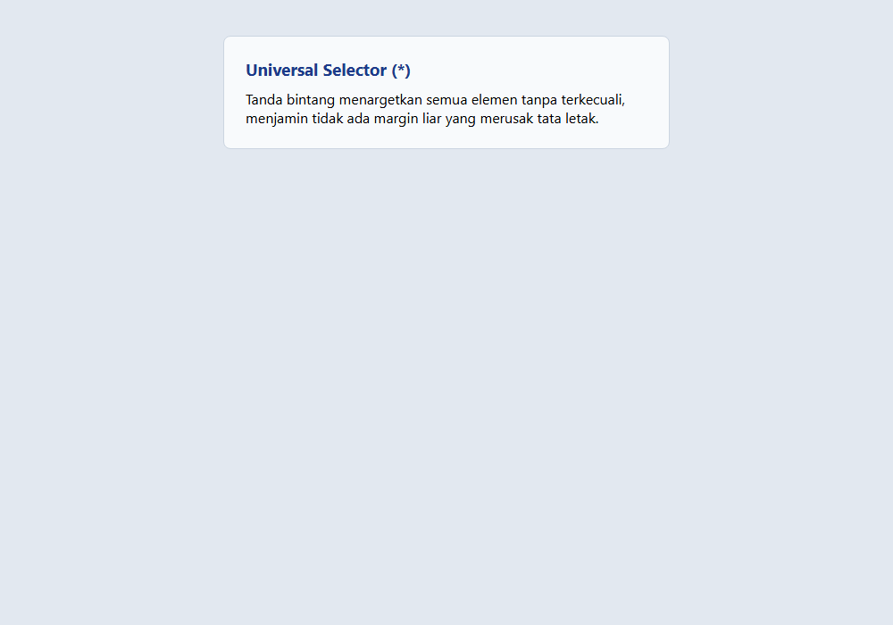

##### 17. Element / Type Selector

- **Source Code**: [`17_element_selector.css`](./module-02-css-selectors/17_element_selector.css) | **Preview**: [`17_element_selector.html`](./module-02-css-selectors/17_element_selector.html)
- **Key Concept**: Element (or type) selectors match all elements sharing the identical HTML tag name, establishing consistent document-wide typography and element baselines.
- **Implementation**: Directly styles `h2`, `p`, and `blockquote` elements to construct a clean, hierarchical editorial article layout.
- **Execution Output**:

  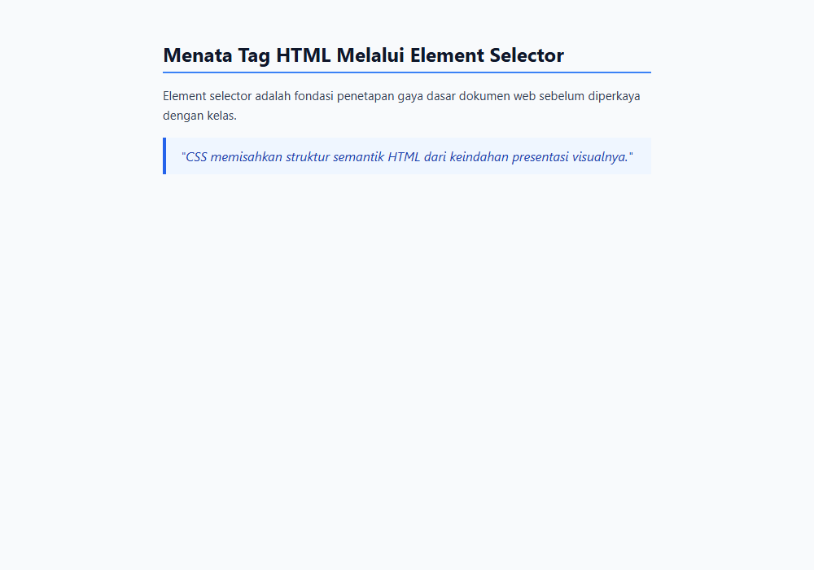

##### 18. Class Selector

- **Source Code**: [`18_class_selector.css`](./module-02-css-selectors/18_class_selector.css) | **Preview**: [`18_class_selector.html`](./module-02-css-selectors/18_class_selector.html)
- **Key Concept**: Class selectors target elements prefixed with a dot (`.className`). Classes are reusable across multiple disparate elements, serving as the cornerstone of modular CSS architecture.
- **Implementation**: Creates reusable component classes `.btn`, `.btn-primary`, and `.btn-secondary` that apply consistently to both `<button>` and `<a>` elements.
- **Execution Output**:

  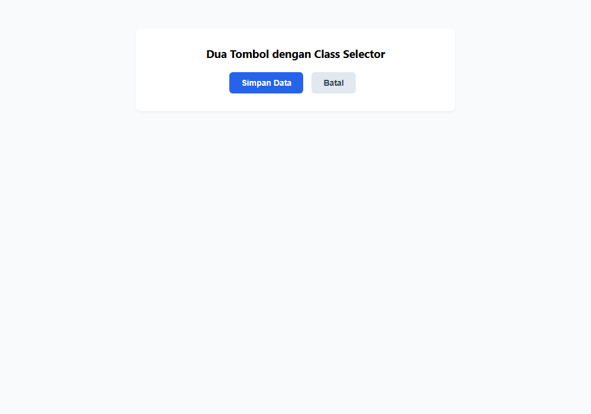

##### 19. ID Selector

- **Source Code**: [`19_id_selector.css`](./module-02-css-selectors/19_id_selector.css) | **Preview**: [`19_id_selector.html`](./module-02-css-selectors/19_id_selector.html)
- **Key Concept**: ID selectors target elements prefixed with a hash (`#idName`). An ID must be unique within a document and carries heavy specificity weighting over class selectors.
- **Implementation**: Styles a singleton `#main-navbar` header component with high specificity, dark background accents, and fixed page positioning.
- **Execution Output**:

  

##### 20. Grouping Selector

- **Source Code**: [`20_grouping_selector.css`](./module-02-css-selectors/20_grouping_selector.css) | **Preview**: [`20_grouping_selector.html`](./module-02-css-selectors/20_grouping_selector.html)
- **Key Concept**: When multiple distinct selectors share identical declarations, they can be grouped in a comma-separated list to minimize duplication following DRY principles.
- **Implementation**: Groups `h1, h2, h3` to share unified font families and baseline margins, followed by tiered individual font sizes.
- **Execution Output**:

  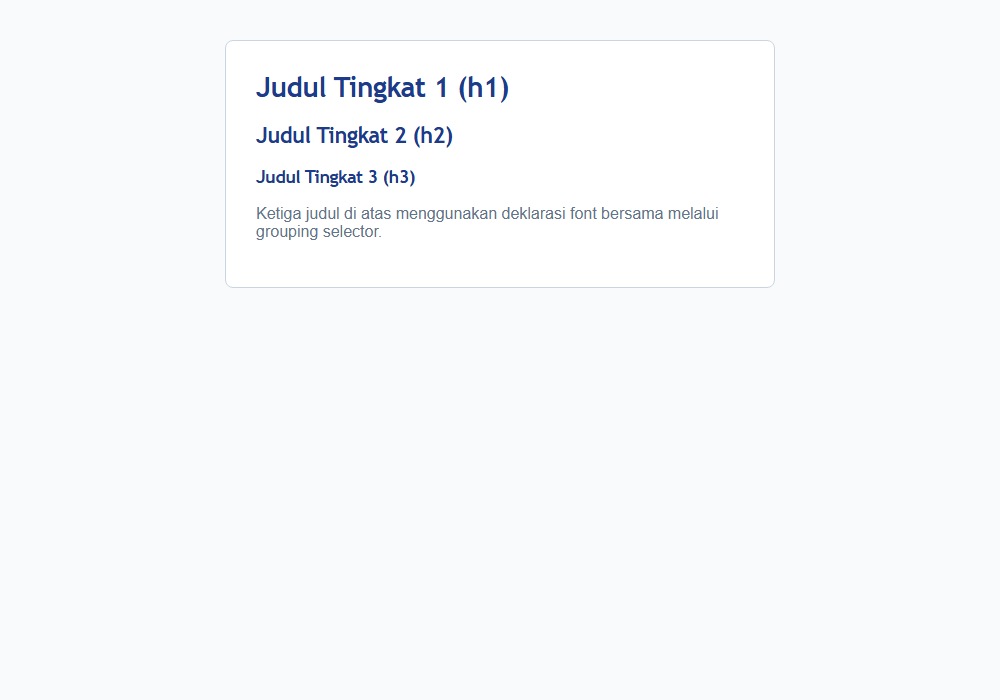

##### 21. Descendant Combinator

- **Source Code**: [`21_descendant_selector.css`](./module-02-css-selectors/21_descendant_selector.css) | **Preview**: [`21_descendant_selector.html`](./module-02-css-selectors/21_descendant_selector.html)
- **Key Concept**: The descendant combinator (expressed as a space) matches all elements that are descendants of a specified ancestor, regardless of nesting depth.
- **Implementation**: Targets `.card p` to style paragraphs located anywhere inside card containers without affecting standalone document paragraphs.
- **Execution Output**:

  

##### 22. Child Combinator

- **Source Code**: [`22_child_selector.css`](./module-02-css-selectors/22_child_selector.css) | **Preview**: [`22_child_selector.html`](./module-02-css-selectors/22_child_selector.html)
- **Key Concept**: The child combinator (`>`) matches only elements that are immediate, direct children of a parent, preventing styles from leaking into deeper nested structures.
- **Implementation**: Uses `.menu > li` to style top-level navigation list items without altering sub-menu list items inside nested lists.
- **Execution Output**:

  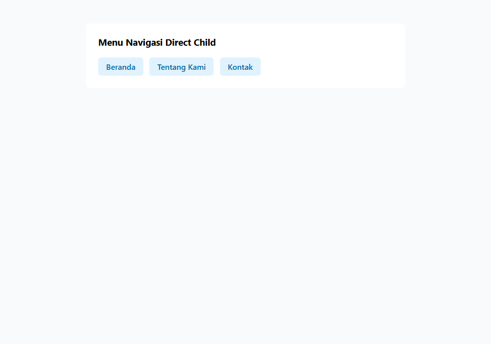

##### 23. Adjacent Sibling Combinator

- **Source Code**: [`23_adjacent_sibling_selector.css`](./module-02-css-selectors/23_adjacent_sibling_selector.css) | **Preview**: [`23_adjacent_sibling_selector.html`](./module-02-css-selectors/23_adjacent_sibling_selector.html)
- **Key Concept**: The adjacent sibling combinator (`+`) matches an element that immediately succeeds a specified element at the same DOM hierarchical level.
- **Implementation**: Styles `h2 + p` to apply a distinctive lead paragraph treatment (larger font size, bold weight) only to paragraphs immediately following a heading.
- **Execution Output**:

  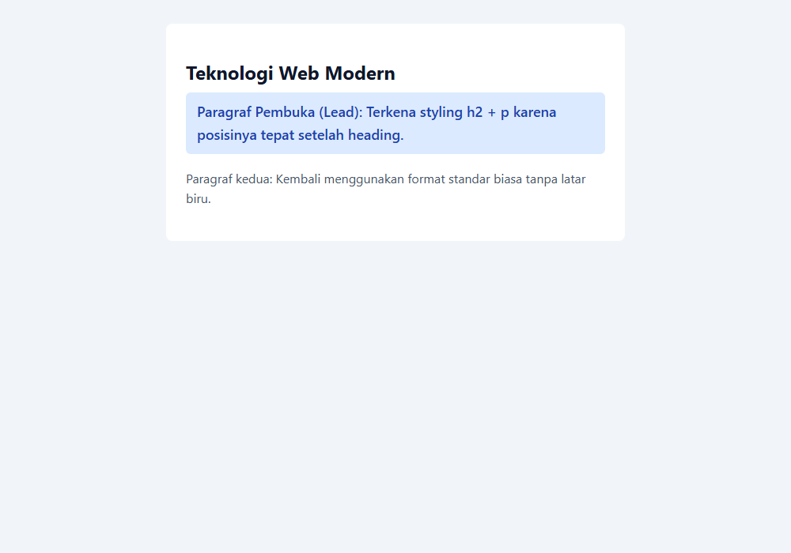

##### 24. General Sibling Combinator

- **Source Code**: [`24_general_sibling_selector.css`](./module-02-css-selectors/24_general_sibling_selector.css) | **Preview**: [`24_general_sibling_selector.html`](./module-02-css-selectors/24_general_sibling_selector.html)
- **Key Concept**: The general sibling combinator (`~`) matches all sibling elements that appear anywhere after a specified element under the same parent.
- **Implementation**: Targets `h3 ~ p` to format all body paragraphs following an introductory sub-heading with subtle left indentation.
- **Execution Output**:

  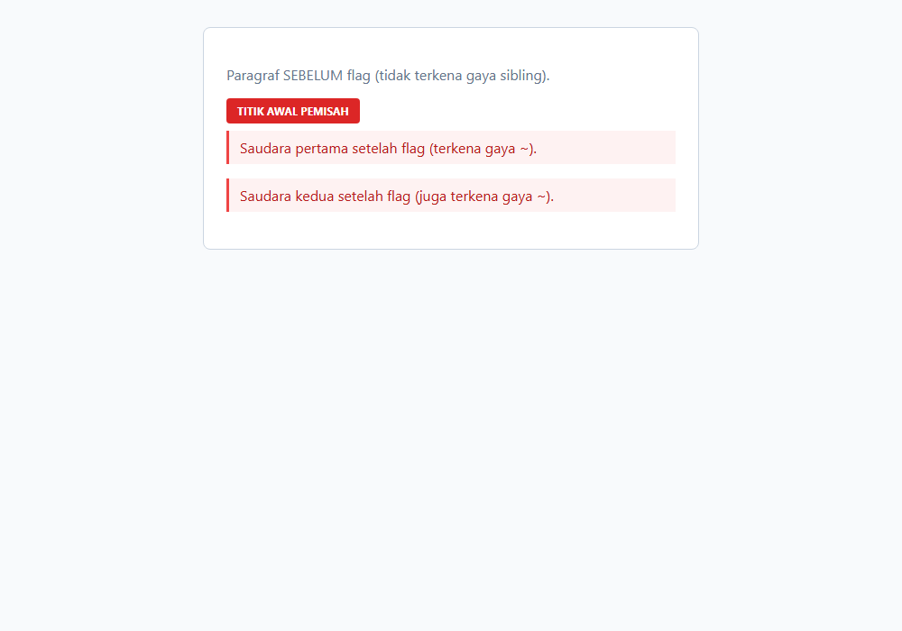

##### 25. Attribute Presence Selector

- **Source Code**: [`25_attribute_selector.css`](./module-02-css-selectors/25_attribute_selector.css) | **Preview**: [`25_attribute_selector.html`](./module-02-css-selectors/25_attribute_selector.html)
- **Key Concept**: The attribute presence selector `[attribute]` matches any element that contains the specified attribute, regardless of its assigned value.
- **Implementation**: Targets `input[required]` to highlight mandatory form inputs with distinct accent border styling.
- **Execution Output**:

  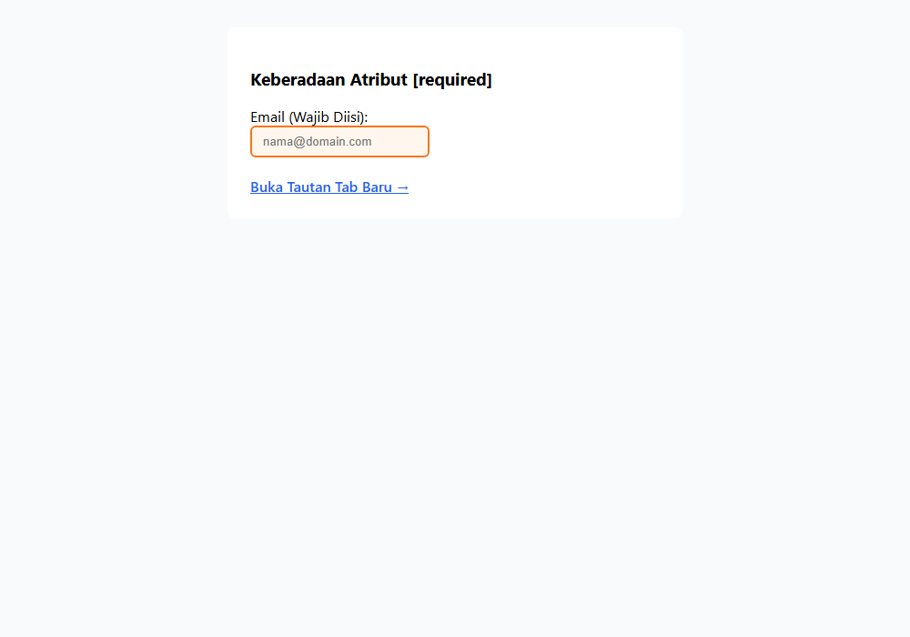

##### 26. Exact Attribute Matching

- **Source Code**: [`26_attribute_exact_match.css`](./module-02-css-selectors/26_attribute_exact_match.css) | **Preview**: [`26_attribute_exact_match.html`](./module-02-css-selectors/26_attribute_exact_match.html)
- **Key Concept**: The exact attribute selector `[attribute="value"]` matches elements where the attribute matches the specified string exactly.
- **Implementation**: Styles form inputs by exact type, configuring distinct appearances for `input[type="text"]`, `input[type="email"]`, and `input[type="submit"]`.
- **Execution Output**:

  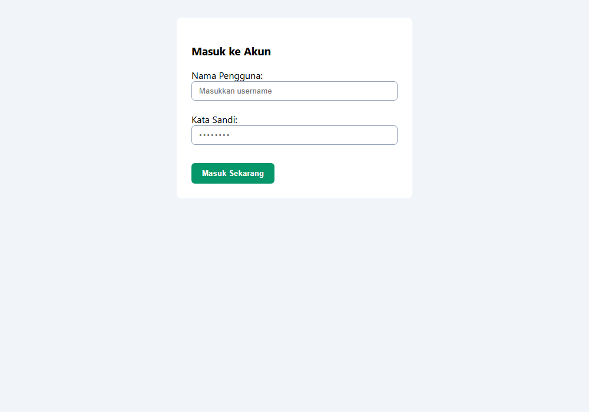

##### 27. Attribute Substring Matching

- **Source Code**: [`27_attribute_contains.css`](./module-02-css-selectors/27_attribute_contains.css) | **Preview**: [`27_attribute_contains.html`](./module-02-css-selectors/27_attribute_contains.html)
- **Key Concept**: The substring attribute selector `[attribute*="value"]` matches elements whose attribute contains the given substring anywhere within its value.
- **Implementation**: Matches hyperlinks containing `[href*="google"]` and `[href*="github"]` to render branded icons alongside external links.
- **Execution Output**:

  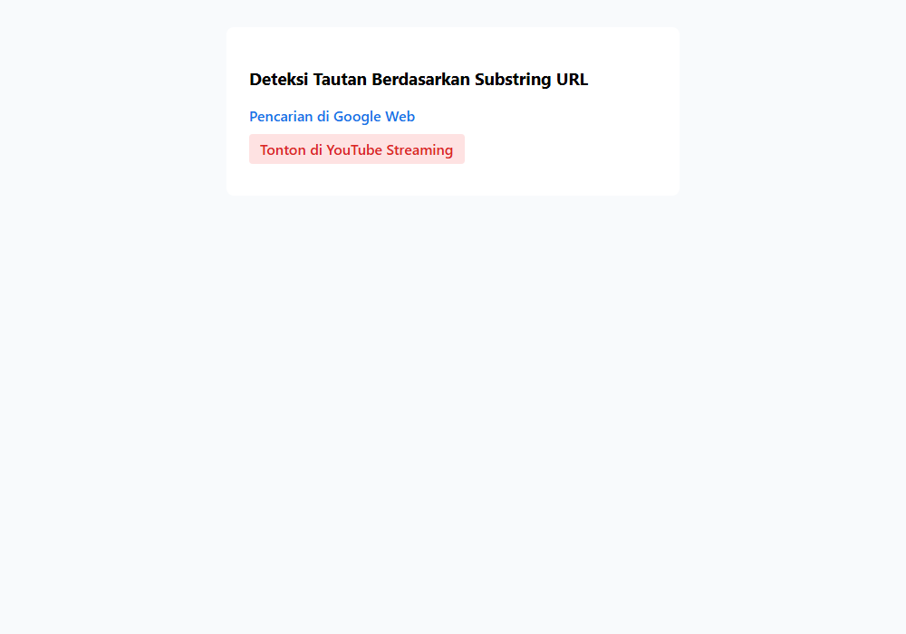

##### 28. Attribute Prefix Matching

- **Source Code**: [`28_attribute_prefix.css`](./module-02-css-selectors/28_attribute_prefix.css) | **Preview**: [`28_attribute_prefix.html`](./module-02-css-selectors/28_attribute_prefix.html)
- **Key Concept**: The prefix attribute selector `[attribute^="value"]` matches elements whose attribute value starts exactly with the specified string.
- **Implementation**: Matches secure external URLs using `a[href^="https://"]` to automatically append a security indicator badge.
- **Execution Output**:

  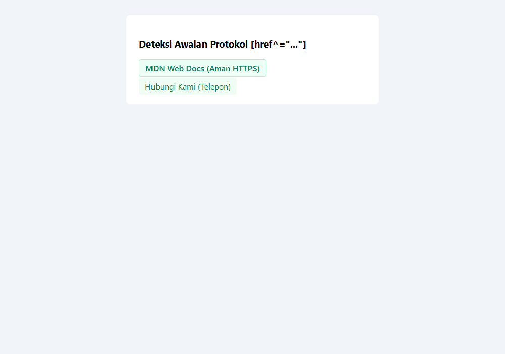

##### 29. Attribute Suffix Matching

- **Source Code**: [`29_attribute_suffix.css`](./module-02-css-selectors/29_attribute_suffix.css) | **Preview**: [`29_attribute_suffix.html`](./module-02-css-selectors/29_attribute_suffix.html)
- **Key Concept**: The suffix attribute selector `[attribute$="value"]` matches elements whose attribute value ends with the specified substring.
- **Implementation**: Detects downloadable file links by extension using `a[href$=".pdf"]` and `a[href$=".zip"]` to display document type badges.
- **Execution Output**:

  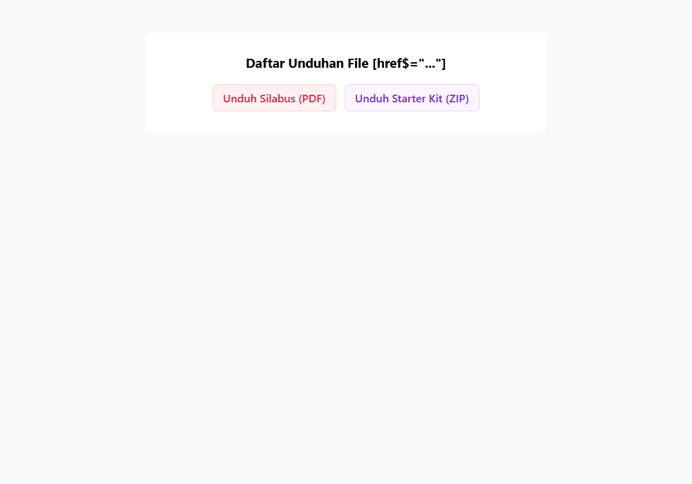

##### 30. Attribute Word Matching

- **Source Code**: [`30_attribute_word_match.css`](./module-02-css-selectors/30_attribute_word_match.css) | **Preview**: [`30_attribute_word_match.html`](./module-02-css-selectors/30_attribute_word_match.html)
- **Key Concept**: The space-separated word selector `[attribute~="value"]` matches elements whose attribute contains the specified whole word in a whitespace-delimited list.
- **Implementation**: Selects items using custom data attributes like `[data-tags~="featured"]` to apply highlighted product styling.
- **Execution Output**:

  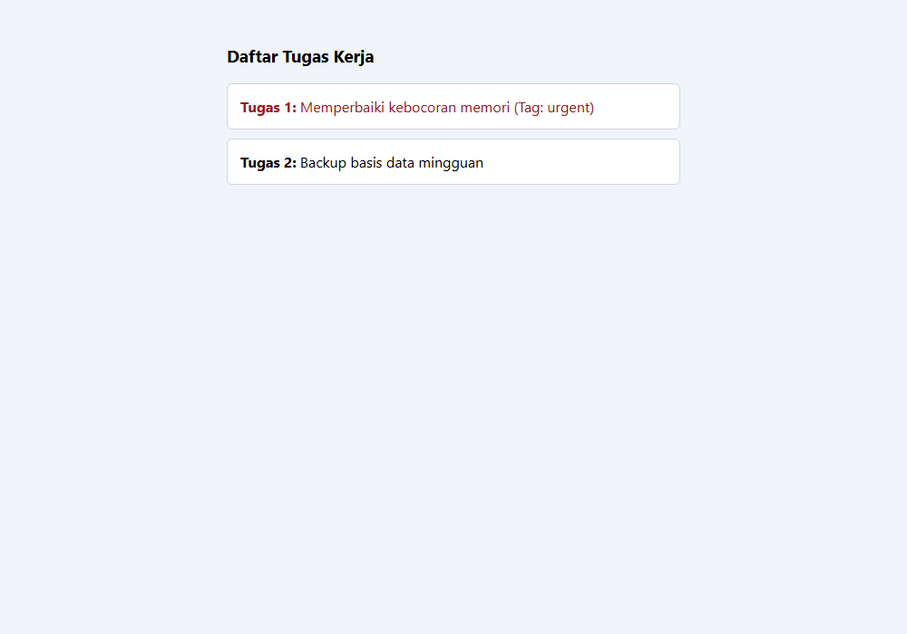

##### 31. Attribute Hyphen Matching

- **Source Code**: [`31_attribute_hyphen_match.css`](./module-02-css-selectors/31_attribute_hyphen_match.css) | **Preview**: [`31_attribute_hyphen_match.html`](./module-02-css-selectors/31_attribute_hyphen_match.html)
- **Key Concept**: The hyphenated attribute selector `[attribute|="value"]` matches elements whose attribute value is either exactly the value or begins with the value immediately followed by a hyphen (`-`).
- **Implementation**: Targets language attributes via `[lang|="en"]` to format English and sub-regional English (`en-US`, `en-GB`) content with specific typography.
- **Execution Output**:

  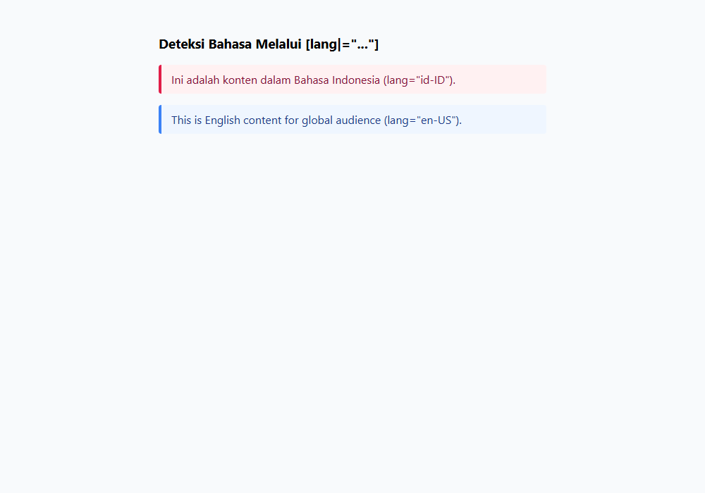

##### 32. Selector Combinations

- **Source Code**: [`32_selector_combinations.css`](./module-02-css-selectors/32_selector_combinations.css) | **Preview**: [`32_selector_combinations.html`](./module-02-css-selectors/32_selector_combinations.html)
- **Key Concept**: Multiple selectors and combinators can be chained into compound rules to target elements meeting several conditions simultaneously.
- **Implementation**: Combines type, class, and attribute filters into `button.btn-primary[type="submit"]` to style primary form submission buttons.
- **Execution Output**:

  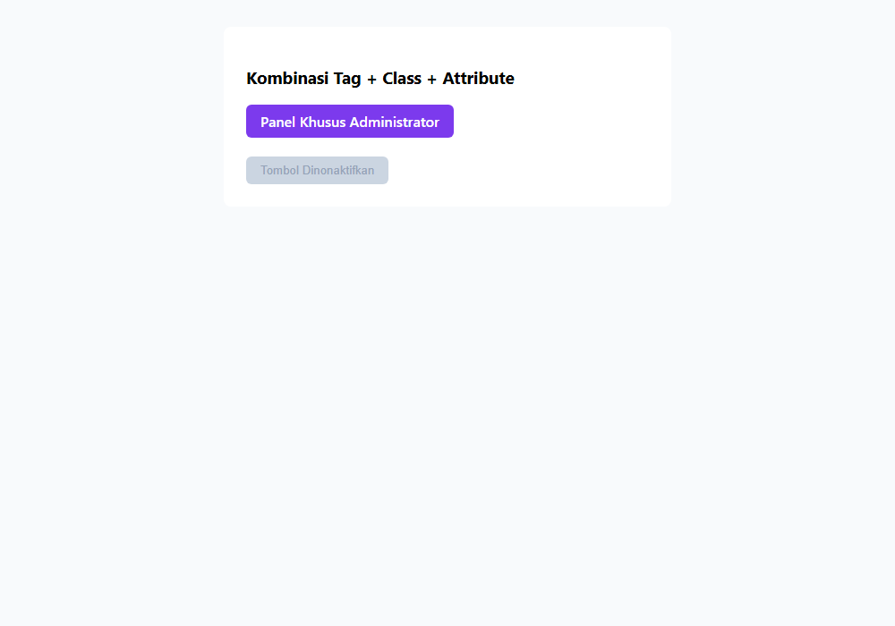

##### 33. Multiple Class Selectors

- **Source Code**: [`33_multiple_class_selectors.css`](./module-02-css-selectors/33_multiple_class_selectors.css) | **Preview**: [`33_multiple_class_selectors.html`](./module-02-css-selectors/33_multiple_class_selectors.html)
- **Key Concept**: Chaining class selectors without whitespace (e.g., `.card.highlight.active`) matches only elements that simultaneously possess every listed class.
- **Implementation**: Styles an alert card only when it bears both `.notification` and `.is-unread` classes, applying alert borders and badge indicators.
- **Execution Output**:

  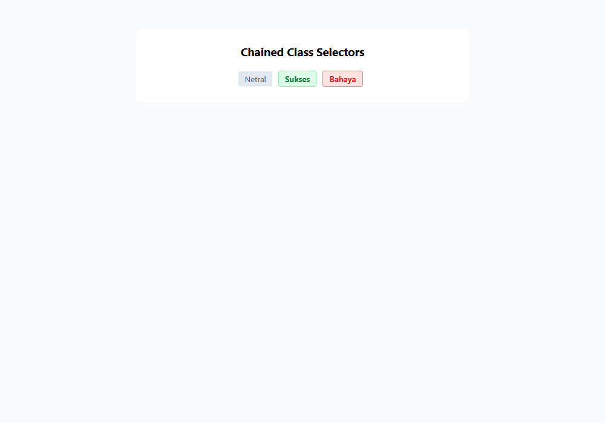

##### 34. Complex Selectors

- **Source Code**: [`34_complex_selectors.css`](./module-02-css-selectors/34_complex_selectors.css) | **Preview**: [`34_complex_selectors.html`](./module-02-css-selectors/34_complex_selectors.html)
- **Key Concept**: Complex selectors integrate combinators, pseudo-classes, and structural hierarchies to pinpoint deeply nested UI elements without adding arbitrary HTML classes.
- **Implementation**: Pinpoints specific table cells within data grids using `table.data-grid > tbody > tr:nth-child(even) > td:first-child`.
- **Execution Output**:

  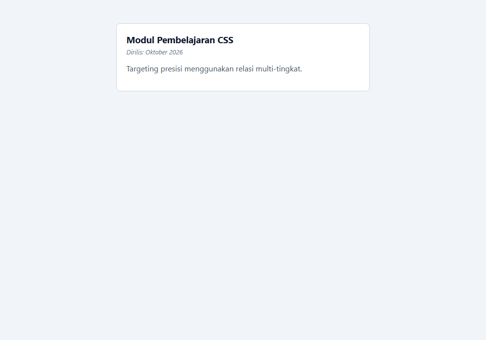

##### 35. Selector List Patterns

- **Source Code**: [`35_selector_list_patterns.css`](./module-02-css-selectors/35_selector_list_patterns.css) | **Preview**: [`35_selector_list_patterns.html`](./module-02-css-selectors/35_selector_list_patterns.html)
- **Key Concept**: Organizing selector lists with clear indentation and logical categorization ensures maintainability, preventing single invalid selectors from invalidating shared declaration blocks.
- **Implementation**: Formats multi-selector heading and component base definitions with clean layout rules and graceful fallback structures.
- **Execution Output**:

  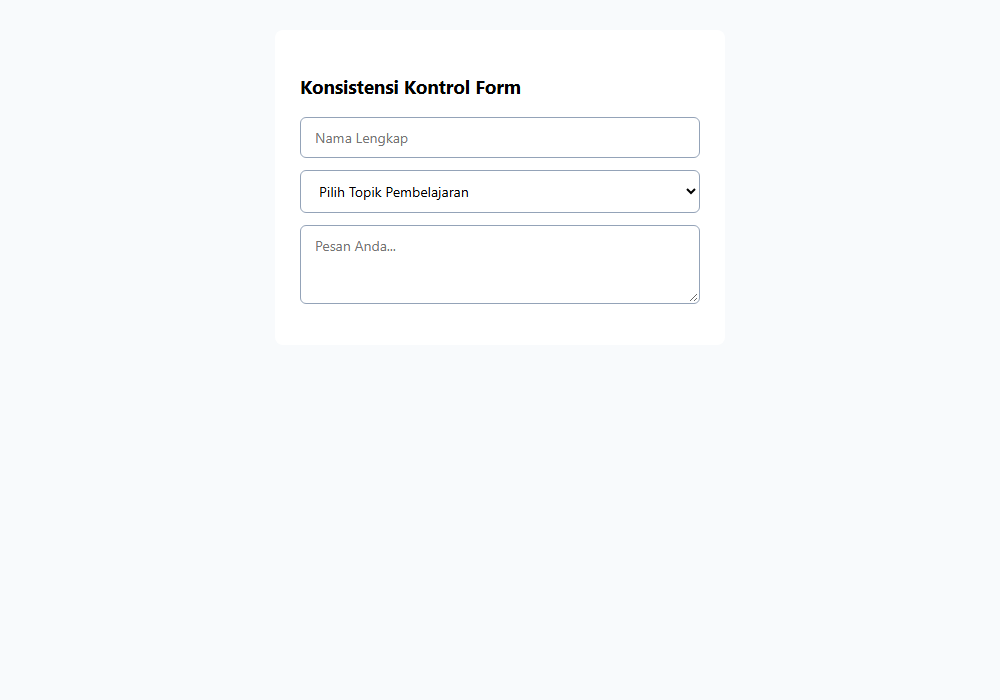


### Module 03: Cascade, Specificity, and Inheritance

**Curriculum Path**: [`module-03-cascade-specificity-dan-inheritance`](./module-03-cascade-specificity-dan-inheritance) | **Level**: `Fundamental to Intermediate` | **Scope**: 15 Lessons

#### Overview & Concepts Covered

Explores the core rendering engine algorithms governing CSS: the Cascade (rule precedence and conflict resolution), Specificity calculations (inline styles > IDs > classes/attributes/pseudo-classes > type selectors), source order determination, CSS Inheritance (property propagation from parent to child), inherited versus non-inherited properties, universal value keywords (`initial`, `inherit`, `unset`, `revert`, `revert-layer`), safe usage and architectural risks of `!important`, and modern Cascade Layers (`@layer`).

#### Subtopics & Visual Captures

##### 36. The CSS Cascade Algorithm

- **Source Code**: [`36_css_cascade.css`](./module-03-cascade-specificity-dan-inheritance/36_css_cascade.css) | **Preview**: [`36_css_cascade.html`](./module-03-cascade-specificity-dan-inheritance/36_css_cascade.html)
- **Key Concept**: The cascade algorithm synthesizes rules from multiple stylesheet origins (user-agent, user, and author), ranking them by importance, specificity, and declaration order to resolve property values.
- **Implementation**: Demonstrates competing rules targeting a text element, highlighting how author stylesheets resolve conflicts against browser defaults.
- **Execution Output**:

  

##### 37. Selector Specificity

- **Source Code**: [`37_selector_specificity.css`](./module-03-cascade-specificity-dan-inheritance/37_selector_specificity.css) | **Preview**: [`37_selector_specificity.html`](./module-03-cascade-specificity-dan-inheritance/37_selector_specificity.html)
- **Key Concept**: Specificity is a four-tier tuple `(a, b, c, d)` determining precedence: inline declarations `(1,0,0,0)`, ID selectors `(0,1,0,0)`, class/attribute/pseudo-class selectors `(0,0,1,0)`, and element/pseudo-element selectors `(0,0,0,1)`.
- **Implementation**: Applies type, class, and ID rules to the same target container, verifying how higher specificity categories decisively override lower categories.
- **Execution Output**:

  

##### 38. Specificity Comparison and Weighting

- **Source Code**: [`38_specificity_comparison.css`](./module-03-cascade-specificity-dan-inheritance/38_specificity_comparison.css) | **Preview**: [`38_specificity_comparison.html`](./module-03-cascade-specificity-dan-inheritance/38_specificity_comparison.html)
- **Key Concept**: Specificity weights are compared column-by-column from left to right; a single class selector `(0,0,1,0)` permanently outweighs any number of concatenated type selectors `(0,0,0,10)`.
- **Implementation**: Constructs an interactive specificity ladder contrasting chained element selectors against concise class rules to illustrate resolution mechanics.
- **Execution Output**:

  

##### 39. Source Order and Rule Precedence

- **Source Code**: [`39_source_order.css`](./module-03-cascade-specificity-dan-inheritance/39_source_order.css) | **Preview**: [`39_source_order.html`](./module-03-cascade-specificity-dan-inheritance/39_source_order.html)
- **Key Concept**: When competing CSS declarations share identical specificity and origin, the declaration positioned latest in stylesheet reading order takes ultimate precedence.
- **Implementation**: Defines duplicate `.status-badge` rules with identical specificity, proving that the trailing definition reliably overrides prior rules.
- **Execution Output**:

  

##### 40. CSS Inheritance

- **Source Code**: [`40_css_inheritance.css`](./module-03-cascade-specificity-dan-inheritance/40_css_inheritance.css) | **Preview**: [`40_css_inheritance.html`](./module-03-cascade-specificity-dan-inheritance/40_css_inheritance.html)
- **Key Concept**: Inheritance propagates computed property values from parent elements down through the DOM hierarchy to child nodes without explicit re-declaration.
- **Implementation**: Sets typographic and color properties on a `.parent-card` wrapper, illustrating how text children inherit styles while box-model borders remain uninherited.
- **Execution Output**:

  

##### 41. Inherited Properties

- **Source Code**: [`41_inherited_properties.css`](./module-03-cascade-specificity-dan-inheritance/41_inherited_properties.css) | **Preview**: [`41_inherited_properties.html`](./module-03-cascade-specificity-dan-inheritance/41_inherited_properties.html)
- **Key Concept**: Properties governing typography, text formatting, and color (such as `color`, `font-family`, `font-size`, `line-height`, `letter-spacing`) naturally inherit down the DOM tree.
- **Implementation**: Configures a global article container demonstrating how nested headings, lists, and spans automatically inherit typographic metrics.
- **Execution Output**:

  

##### 42. Non-Inherited Properties

- **Source Code**: [`42_non_inherited_properties.css`](./module-03-cascade-specificity-dan-inheritance/42_non_inherited_properties.css) | **Preview**: [`42_non_inherited_properties.html`](./module-03-cascade-specificity-dan-inheritance/42_non_inherited_properties.html)
- **Key Concept**: Properties controlling the box model, positioning, sizing, borders, backgrounds, and display modes do not inherit by default to maintain layout containment.
- **Implementation**: Applies borders, backgrounds, and margins to a parent container, proving that nested child paragraphs remain unaffected by parent box geometry.
- **Execution Output**:

  

##### 43. The `initial` Keyword

- **Source Code**: [`43_initial_value.css`](./module-03-cascade-specificity-dan-inheritance/43_initial_value.css) | **Preview**: [`43_initial_value.html`](./module-03-cascade-specificity-dan-inheritance/43_initial_value.html)
- **Key Concept**: The `initial` keyword resets a property to its official W3C specification initial default value, completely bypassing browser defaults and inherited values.
- **Implementation**: Resets text color on a nested element to `color: initial` (black), disconnecting it from the parent container's custom blue theme.
- **Execution Output**:

  

##### 44. The `inherit` Keyword

- **Source Code**: [`44_inherit_keyword.css`](./module-03-cascade-specificity-dan-inheritance/44_inherit_keyword.css) | **Preview**: [`44_inherit_keyword.html`](./module-03-cascade-specificity-dan-inheritance/44_inherit_keyword.html)
- **Key Concept**: The `inherit` keyword forces an element to adopt the computed value of that property from its direct parent element, even on normally non-inherited properties.
- **Implementation**: Uses `border: inherit` on a nested callout badge to synchronize its boundary treatment directly with the parent card's border styling.
- **Execution Output**:

  

##### 45. The `unset` Keyword

- **Source Code**: [`45_unset_keyword.css`](./module-03-cascade-specificity-dan-inheritance/45_unset_keyword.css) | **Preview**: [`45_unset_keyword.html`](./module-03-cascade-specificity-dan-inheritance/45_unset_keyword.html)
- **Key Concept**: The `unset` keyword functions dynamically: acting like `inherit` if the property naturally inherits, or like `initial` if the property does not inherit.
- **Implementation**: Applies `all: unset` to raw button elements, stripping browser button bevels and margins while retaining parent typographic colors.
- **Execution Output**:

  

##### 46. The `revert` Keyword

- **Source Code**: [`46_revert_keyword.css`](./module-03-cascade-specificity-dan-inheritance/46_revert_keyword.css) | **Preview**: [`46_revert_keyword.html`](./module-03-cascade-specificity-dan-inheritance/46_revert_keyword.html)
- **Key Concept**: The `revert` keyword rolls back property values to the browser's default user-agent stylesheet, discarding all author stylesheet declarations.
- **Implementation**: Reverts an overridden list component back to standard browser bullet formatting and default indentation using `revert`.
- **Execution Output**:

  

##### 47. The `revert-layer` Keyword

- **Source Code**: [`47_revert_layer.css`](./module-03-cascade-specificity-dan-inheritance/47_revert_layer.css) | **Preview**: [`47_revert_layer.html`](./module-03-cascade-specificity-dan-inheritance/47_revert_layer.html)
- **Key Concept**: The `revert-layer` keyword steps backward one cascade layer (`@layer`), rolling back property values to the matching declaration in the previous layer.
- **Implementation**: Demonstrates layered cascade overrides where a component-layer rule reverts to a theme-layer definition without falling back to user-agent styles.
- **Execution Output**:

  

##### 48. The `!important` Declaration

- **Source Code**: [`48_important_declaration.css`](./module-03-cascade-specificity-dan-inheritance/48_important_declaration.css) | **Preview**: [`48_important_declaration.html`](./module-03-cascade-specificity-dan-inheritance/48_important_declaration.html)
- **Key Concept**: Appending `!important` to a declaration elevates it into an independent high-priority origin bucket, overriding all standard specificity and inline styles.
- **Implementation**: Illustrates utility class overrides using `!important` to force accessibility contrasts while detailing the architectural hazards of overuse.
- **Execution Output**:

  

##### 49. Introduction to Cascade Layers (`@layer`)

- **Source Code**: [`49_cascade_layers_intro.css`](./module-03-cascade-specificity-dan-inheritance/49_cascade_layers_intro.css) | **Preview**: [`49_cascade_layers_intro.html`](./module-03-cascade-specificity-dan-inheritance/49_cascade_layers_intro.html)
- **Key Concept**: The `@layer` at-rule establishes explicit cascade tiers (e.g., `reset`, `framework`, `components`, `utilities`), giving later layers precedence over earlier layers regardless of internal specificity.
- **Implementation**: Structures a two-tier layout where an un-layered high-specificity selector is successfully governed by a layered component rule.
- **Execution Output**:

  

##### 50. CSS Cascade Conflict Resolution

- **Source Code**: [`50_cascade_conflict_resolution.css`](./module-03-cascade-specificity-dan-inheritance/50_cascade_conflict_resolution.css) | **Preview**: [`50_cascade_conflict_resolution.html`](./module-03-cascade-specificity-dan-inheritance/50_cascade_conflict_resolution.html)
- **Key Concept**: Resolving styling conflicts requires evaluating origin, layer order, specificity, and source order in an exact, deterministic pipeline.
- **Implementation**: Synthesizes a comprehensive multi-selector dispute scenario, stepping through how each tier of the cascade algorithm resolves the final rendered visual.
- **Execution Output**:

  

### Module 04: CSS Box Model

**Curriculum Path**: [`module-04-css-box-model`](./module-04-css-box-model) | **Level**: `Fundamental to Intermediate` | **Scope**: 20 Lessons

#### Overview & Concepts Covered

Dissects the core structural layout model of CSS: the Box Model. Topics include the four concentric box layers (content, padding, border, and margin), fundamental differences between `content-box` and `border-box`, explicit dimensions and bounding constraints (`min-width`, `max-width`, `min-height`, `max-height`), margin collapsing mechanics, horizontal centering via `margin: auto`, modern logical properties (`margin-inline`, `padding-block`), global box-sizing resets, intrinsic sizing keywords (`min-content`, `max-content`, `fit-content()`), and the `aspect-ratio` property.

#### Subtopics & Visual Captures

##### 51. CSS Box Model Fundamentals

- **Source Code**: [`51_box_model_basic.css`](./module-04-css-box-model/51_box_model_basic.css) | **Preview**: [`51_box_model_basic.html`](./module-04-css-box-model/51_box_model_basic.html)
- **Key Concept**: Every rendered web element is modeled as a rectangular box comprised of four concentric layers: the innermost content area, surrounding padding, bounding border, and outer margin.
- **Implementation**: Displays a color-coded diagram box visually exposing all four layers with contrasting backgrounds and labels to clarify layout geometry.
- **Execution Output**:

  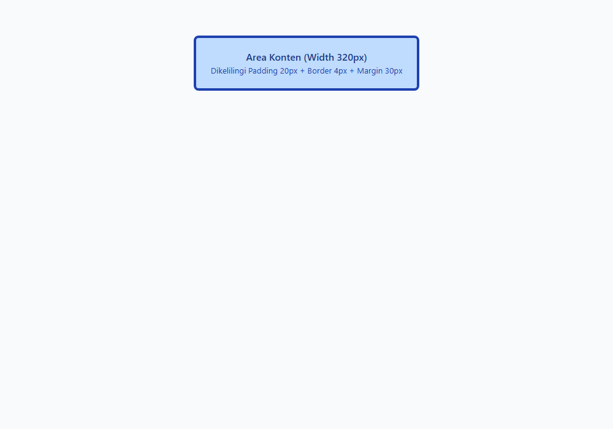

##### 52. `box-sizing: content-box`

- **Source Code**: [`52_content_box.css`](./module-04-css-box-model/52_content_box.css) | **Preview**: [`52_content_box.html`](./module-04-css-box-model/52_content_box.html)
- **Key Concept**: Under `box-sizing: content-box` (the browser default), declared `width` and `height` apply strictly to the content area, causing padding and borders to inflate total rendered physical width.
- **Implementation**: Demonstrates two boxes declared with 300px width; adding padding and border forces the `content-box` element to exceed 360px physical width.
- **Execution Output**:

  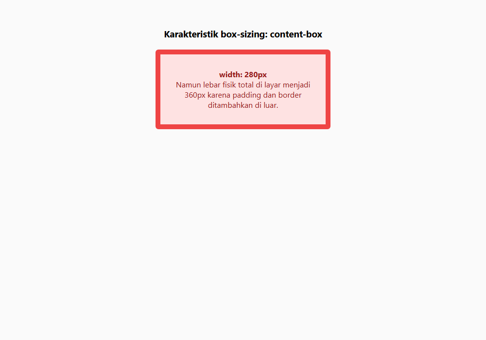

##### 53. `box-sizing: border-box`

- **Source Code**: [`53_border_box.css`](./module-04-css-box-model/53_border_box.css) | **Preview**: [`53_border_box.html`](./module-04-css-box-model/53_border_box.html)
- **Key Concept**: Under `box-sizing: border-box`, declared `width` and `height` encapsulate content, padding, and border, absorbing internal padding without increasing outer physical dimensions.
- **Implementation**: Contrasts identical 300px containers side-by-side to show how `border-box` locks outer dimensions securely for predictable grid and column sizing.
- **Execution Output**:

  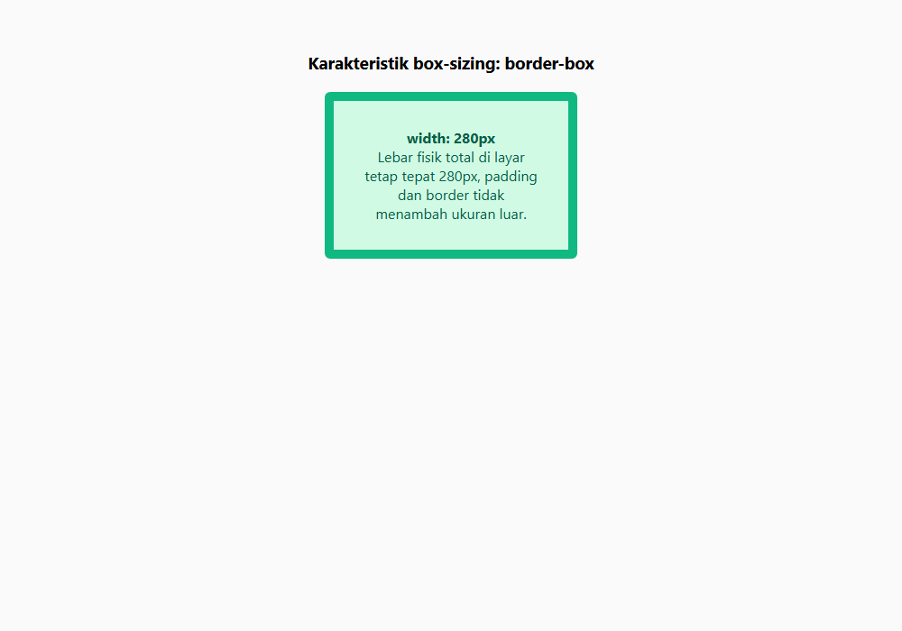

##### 54. The `width` Property

- **Source Code**: [`54_width_property.css`](./module-04-css-box-model/54_width_property.css) | **Preview**: [`54_width_property.html`](./module-04-css-box-model/54_width_property.html)
- **Key Concept**: The `width` property sets the horizontal measurement of an element using absolute lengths (`px`), relative lengths (`rem`), or percentages relative to the containing block.
- **Implementation**: Configures fixed, fluid, and proportional width containers to demonstrate responsive horizontal space consumption across viewport shifts.
- **Execution Output**:

  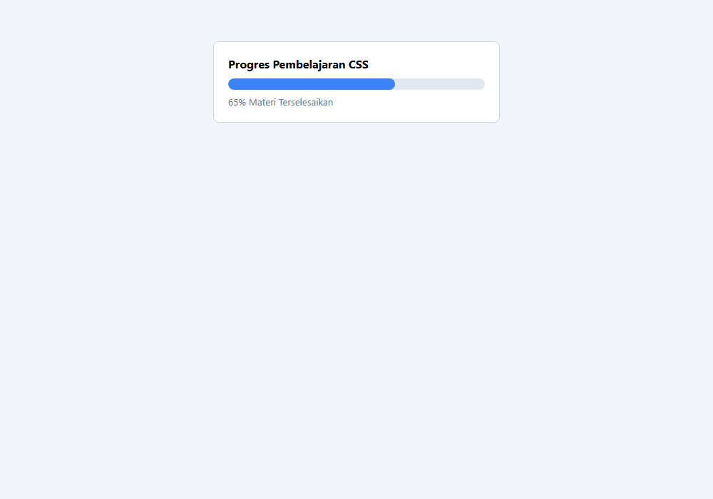

##### 55. The `height` Property

- **Source Code**: [`55_height_property.css`](./module-04-css-box-model/55_height_property.css) | **Preview**: [`55_height_property.html`](./module-04-css-box-model/55_height_property.html)
- **Key Concept**: The `height` property specifies the vertical dimension of an element, typically defaulting to `auto` so that containers expand dynamically to accommodate content.
- **Implementation**: Demonstrates explicit pixel heights, percentage heights within defined parent containers, and the consequences of vertical content overflow.
- **Execution Output**:

  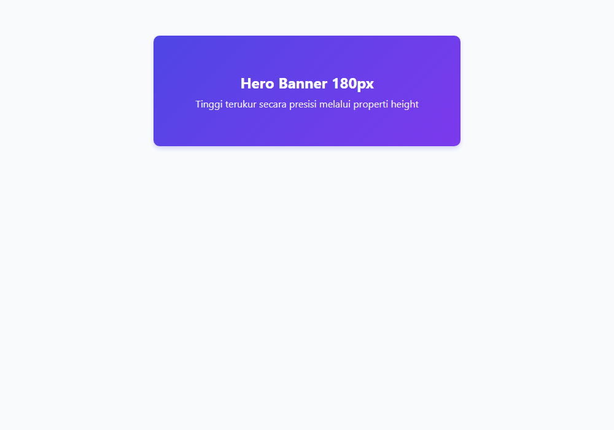

##### 56. The `min-width` Property

- **Source Code**: [`56_min_width.css`](./module-04-css-box-model/56_min_width.css) | **Preview**: [`56_min_width.html`](./module-04-css-box-model/56_min_width.html)
- **Key Concept**: The `min-width` property establishes an unbreakable lower bound for an element's width, preventing fluid layouts from collapsing narrower than acceptable minimums.
- **Implementation**: Configures an adaptive card with fluid percentage width constrained by `min-width: 280px` to maintain component readability on mobile devices.
- **Execution Output**:

  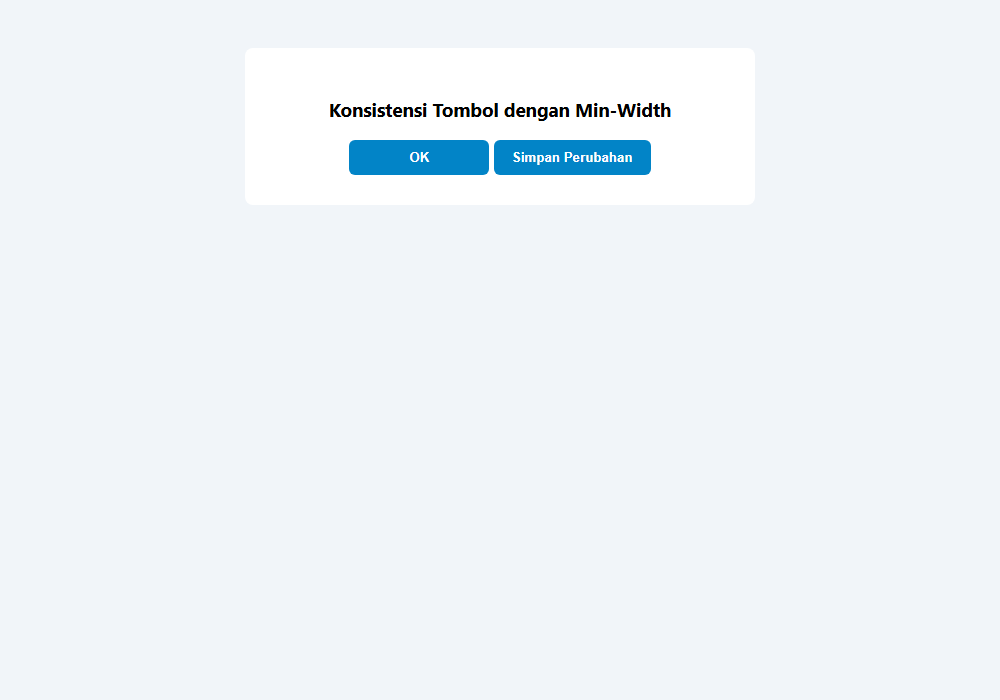

##### 57. The `max-width` Property

- **Source Code**: [`57_max_width.css`](./module-04-css-box-model/57_max_width.css) | **Preview**: [`57_max_width.html`](./module-04-css-box-model/57_max_width.html)
- **Key Concept**: The `max-width` property prevents an element from stretching wider than a defined limit, serving as the industry cornerstone for centered, responsive reading containers.
- **Implementation**: Sets `max-width: 800px` on a centered reading article container, ensuring line lengths remain optimal for readability on wide desktop monitors.
- **Execution Output**:

  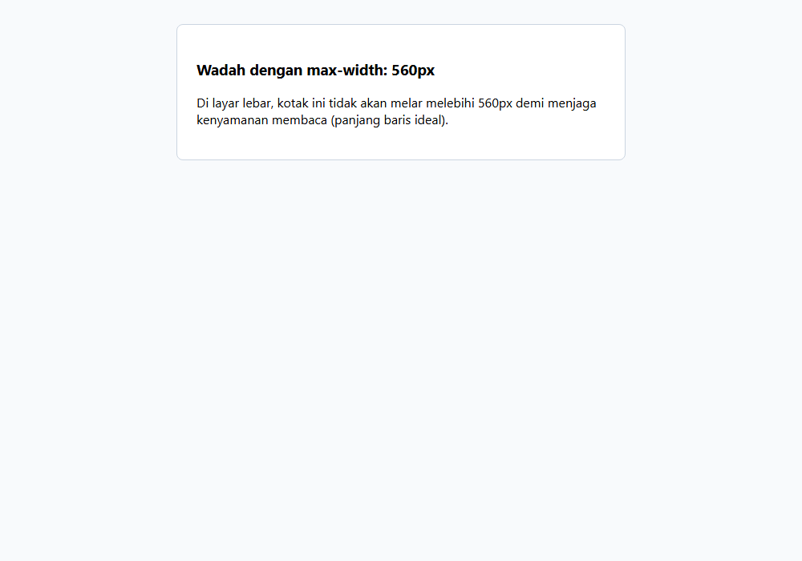

##### 58. The `min-height` Property

- **Source Code**: [`58_min_height.css`](./module-04-css-box-model/58_min_height.css) | **Preview**: [`58_min_height.html`](./module-04-css-box-model/58_min_height.html)
- **Key Concept**: The `min-height` property ensures an element never renders shorter than a baseline threshold, while still permitting it to expand vertically when content overflows.
- **Implementation**: Styles hero banners and feature cards with `min-height: 200px`, guaranteeing structural presence even with sparse initial content.
- **Execution Output**:

  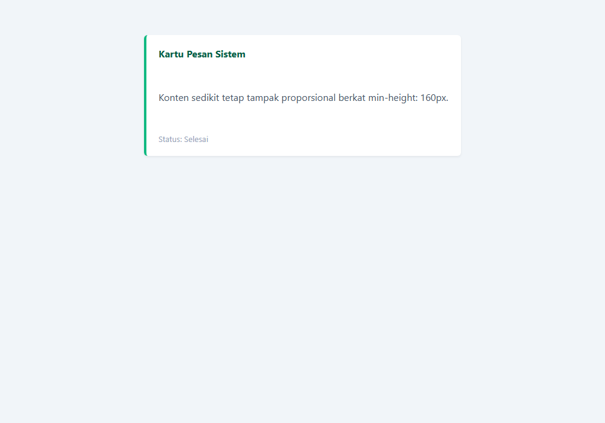

##### 59. The `max-height` Property

- **Source Code**: [`59_max_height.css`](./module-04-css-box-model/59_max_height.css) | **Preview**: [`59_max_height.html`](./module-04-css-box-model/59_max_height.html)
- **Key Concept**: The `max-height` property caps the vertical expansion of an element, frequently paired with `overflow: auto` to establish scrolling panels.
- **Implementation**: Constrains a terms-and-conditions agreement box with `max-height: 160px` and internal scrolling to maintain clean page proportions.
- **Execution Output**:

  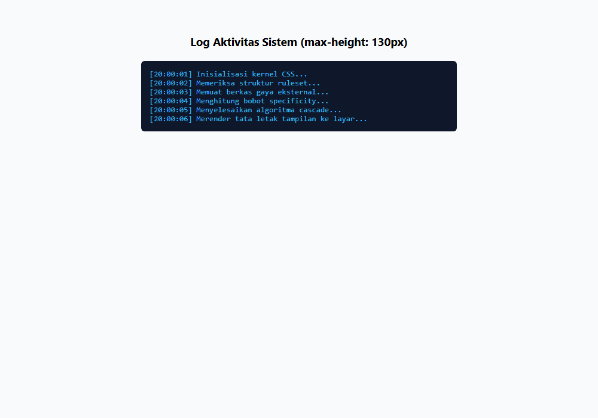

##### 60. The `margin` Property

- **Source Code**: [`60_margin_property.css`](./module-04-css-box-model/60_margin_property.css) | **Preview**: [`60_margin_property.html`](./module-04-css-box-model/60_margin_property.html)
- **Key Concept**: The `margin` property controls transparent clearance outside an element's border, supporting 1, 2, 3, or 4-value shorthands or directional properties.
- **Implementation**: Formats stacked card components using clockwise multi-value margin shorthand (`top right bottom left`) to establish rhythmic vertical rhythm.
- **Execution Output**:

  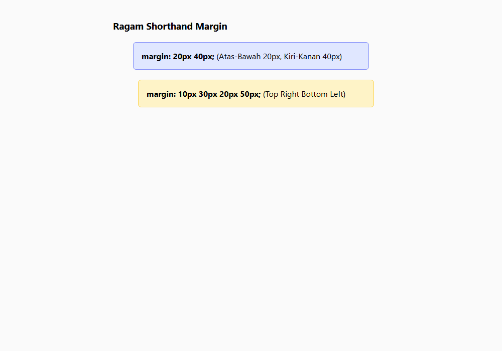

##### 61. Margin Collapsing Mechanics

- **Source Code**: [`61_margin_collapse.css`](./module-04-css-box-model/61_margin_collapse.css) | **Preview**: [`61_margin_collapse.html`](./module-04-css-box-model/61_margin_collapse.html)
- **Key Concept**: In normal flow, adjacent vertical margins between block elements collapse into a single margin whose size equals the maximum of the intersecting margins.
- **Implementation**: Places two blocks with 30px and 20px vertical margins, proving the resulting separation measures exactly 30px rather than their mathematical sum of 50px.
- **Execution Output**:

  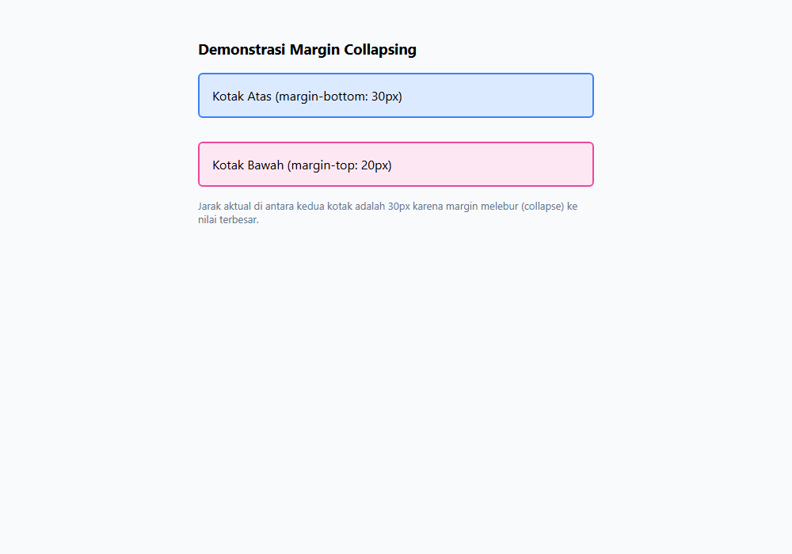

##### 62. The `padding` Property

- **Source Code**: [`62_padding_property.css`](./module-04-css-box-model/62_padding_property.css) | **Preview**: [`62_padding_property.html`](./module-04-css-box-model/62_padding_property.html)
- **Key Concept**: The `padding` property creates internal breathing room between an element's content and its border boundary, adopting the element's background color.
- **Implementation**: Creates button and card components configured with asymmetric directional paddings, balancing vertical and horizontal whitespace for visual poise.
- **Execution Output**:

  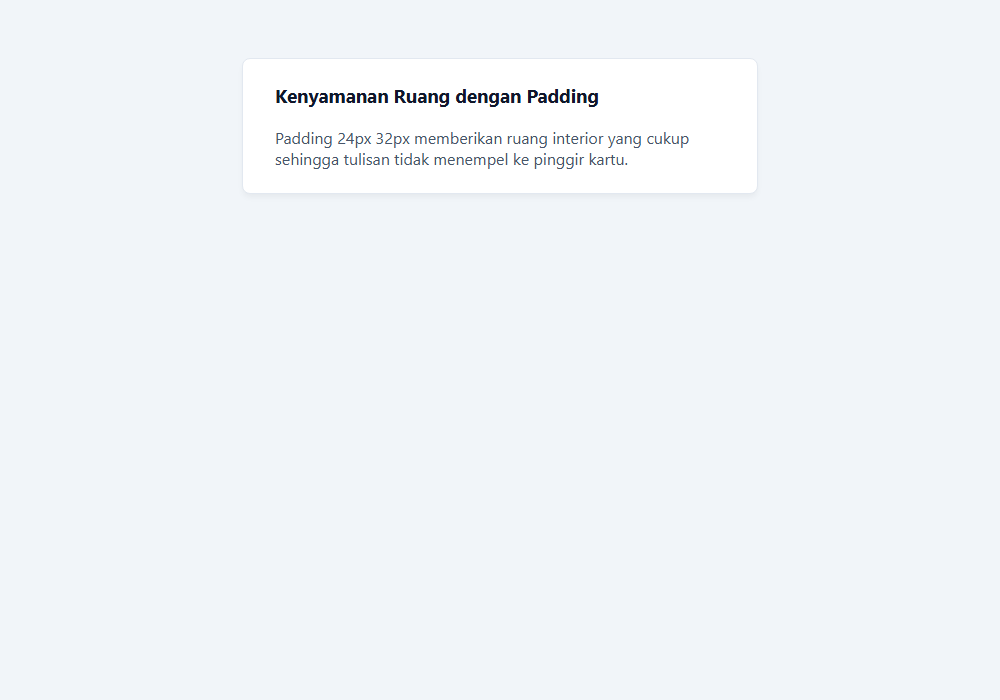

##### 63. Centering Elements with `margin: auto`

- **Source Code**: [`63_margin_auto.css`](./module-04-css-box-model/63_margin_auto.css) | **Preview**: [`63_margin_auto.html`](./module-04-css-box-model/63_margin_auto.html)
- **Key Concept**: Setting `margin-left: auto` and `margin-right: auto` on a block-level element with an explicit width evenly divides remaining container space, achieving horizontal centering.
- **Implementation**: Centers a 500px card container within a full-width parent block using `margin: 0 auto`.
- **Execution Output**:

  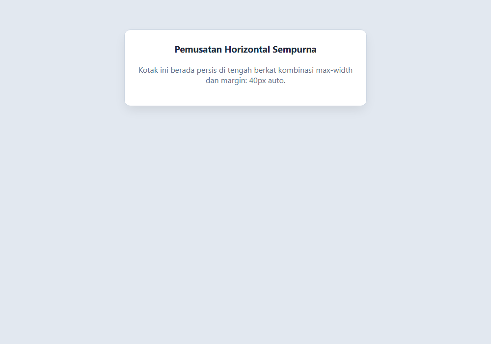

##### 64. Logical Margin Properties

- **Source Code**: [`64_logical_margin.css`](./module-04-css-box-model/64_logical_margin.css) | **Preview**: [`64_logical_margin.html`](./module-04-css-box-model/64_logical_margin.html)
- **Key Concept**: Modern CSS logical properties (`margin-block-start`, `margin-block-end`, `margin-inline-start`, `margin-inline-end`) adapt automatically to writing modes and text direction (LTR vs RTL).
- **Implementation**: Sets `margin-inline: auto` and `margin-block: 2rem` on cards, demonstrating seamless bidirectional layout adaptability.
- **Execution Output**:

  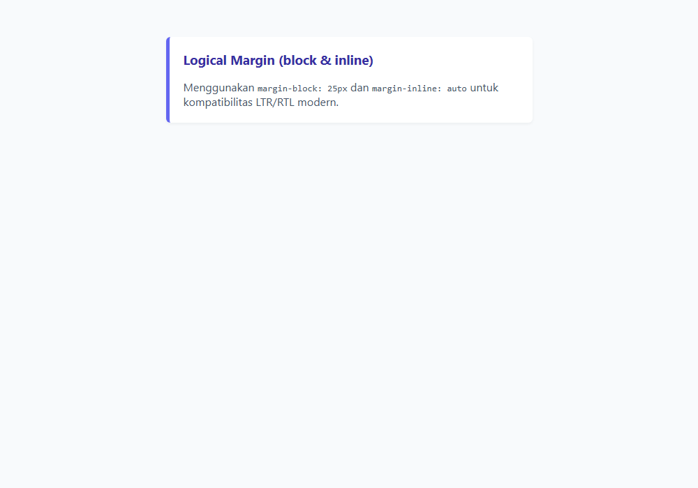

##### 65. Logical Padding Properties

- **Source Code**: [`65_logical_padding.css`](./module-04-css-box-model/65_logical_padding.css) | **Preview**: [`65_logical_padding.html`](./module-04-css-box-model/65_logical_padding.html)
- **Key Concept**: Logical padding properties (`padding-block` and `padding-inline`) control internal spacing relative to text flow axes rather than hardcoded physical top/left directions.
- **Implementation**: Configures button components using `padding-block: 0.75rem` and `padding-inline: 1.5rem` for robust internationalization support.
- **Execution Output**:

  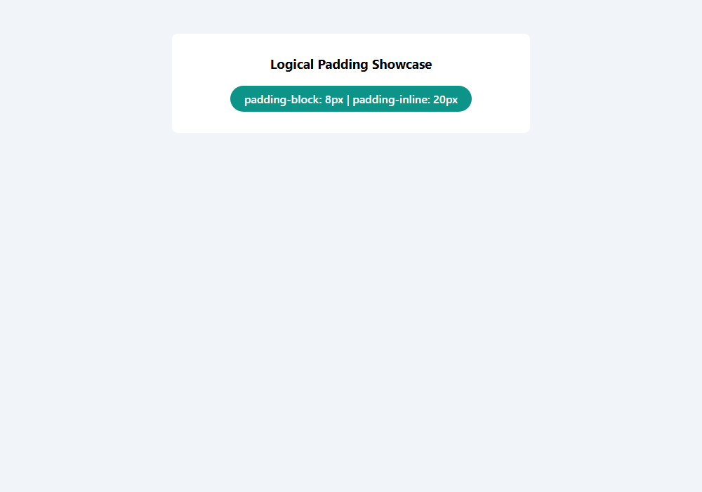

##### 66. Global Box-Sizing Reset

- **Source Code**: [`66_box_sizing_global.css`](./module-04-css-box-model/66_box_sizing_global.css) | **Preview**: [`66_box_sizing_global.html`](./module-04-css-box-model/66_box_sizing_global.html)
- **Key Concept**: The industry-standard global box-sizing reset applies `box-sizing: border-box` across `html`, `*`, `*::before`, and `*::after` to ensure universal sizing predictability.
- **Implementation**: Implements an enterprise universal reset ruleset and demonstrates how multi-column form layouts align precisely without border calculation drift.
- **Execution Output**:

  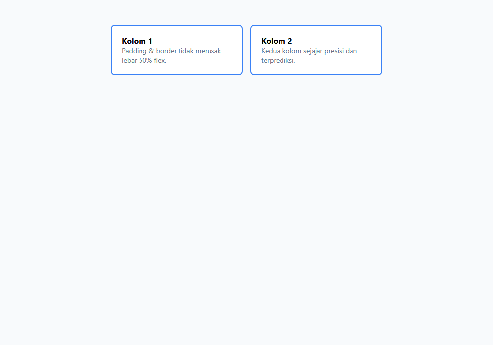

##### 67. Intrinsic Sizing Keywords

- **Source Code**: [`67_intrinsic_sizing.css`](./module-04-css-box-model/67_intrinsic_sizing.css) | **Preview**: [`67_intrinsic_sizing.html`](./module-04-css-box-model/67_intrinsic_sizing.html)
- **Key Concept**: Intrinsic sizing allows elements to derive dimensions organically from their internal content rather than relying exclusively on explicit extrinsic pixel values.
- **Implementation**: Demonstrates intrinsic sizing behavior on chips, tag badges, and button labels as their text payloads dynamically vary.
- **Execution Output**:

  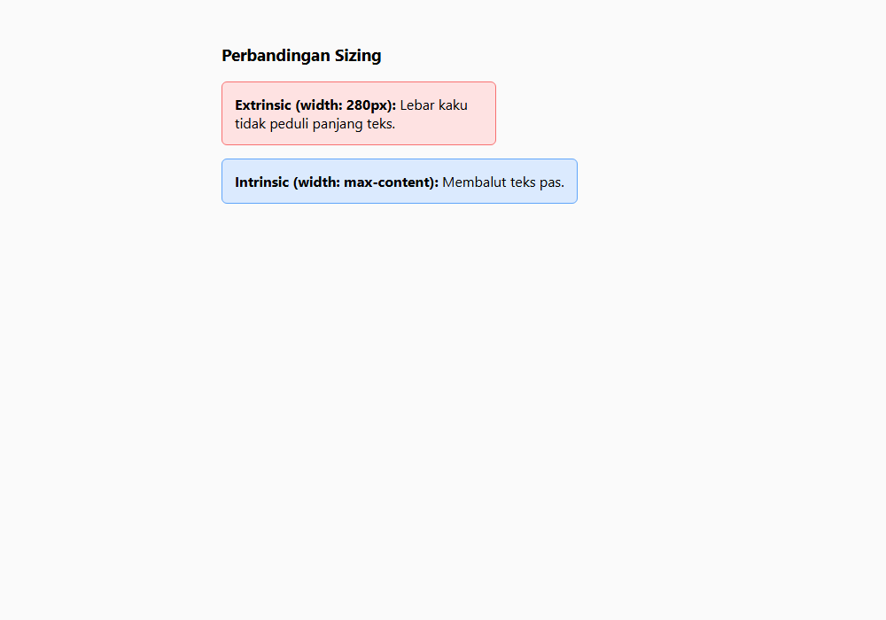

##### 68. `min-content` and `max-content`

- **Source Code**: [`68_min_content_max_content.css`](./module-04-css-box-model/68_min_content_max_content.css) | **Preview**: [`68_min_content_max_content.html`](./module-04-css-box-model/68_min_content_max_content.html)
- **Key Concept**: `min-content` sizes an element to the narrowest width possible without overflowing (wrapping at every opportunity), while `max-content` expands to fit content without wrapping.
- **Implementation**: Contrasts two text boxes sized with `width: min-content` and `width: max-content` to highlight automated layout boundary calculations.
- **Execution Output**:

  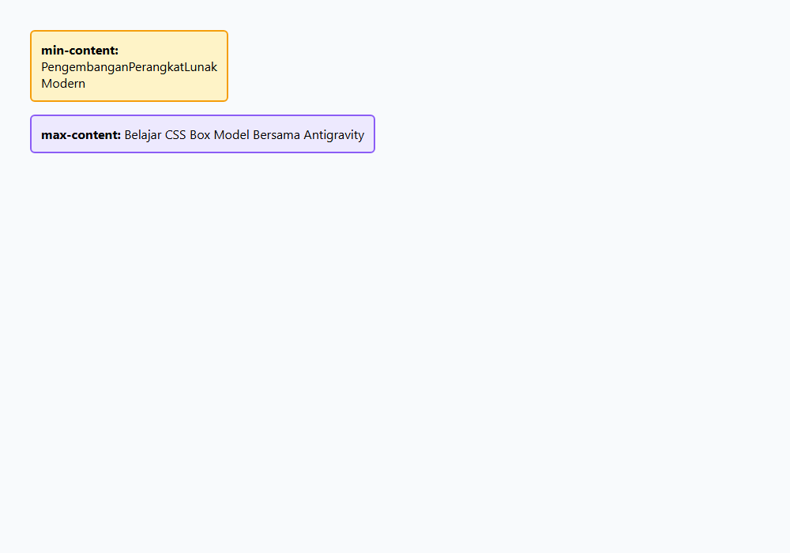

##### 69. The `fit-content()` Function

- **Source Code**: [`69_fit_content.css`](./module-04-css-box-model/69_fit_content.css) | **Preview**: [`69_fit_content.html`](./module-04-css-box-model/69_fit_content.html)
- **Key Concept**: The `fit-content()` function allows an element to grow with its content up to an explicit cap argument, after which it clamps and wraps lines cleanly.
- **Implementation**: Sizes a dynamic banner using `width: fit-content(400px)`, allowing it to shrink wrap short slogans while preventing wider headlines from blowing out.
- **Execution Output**:

  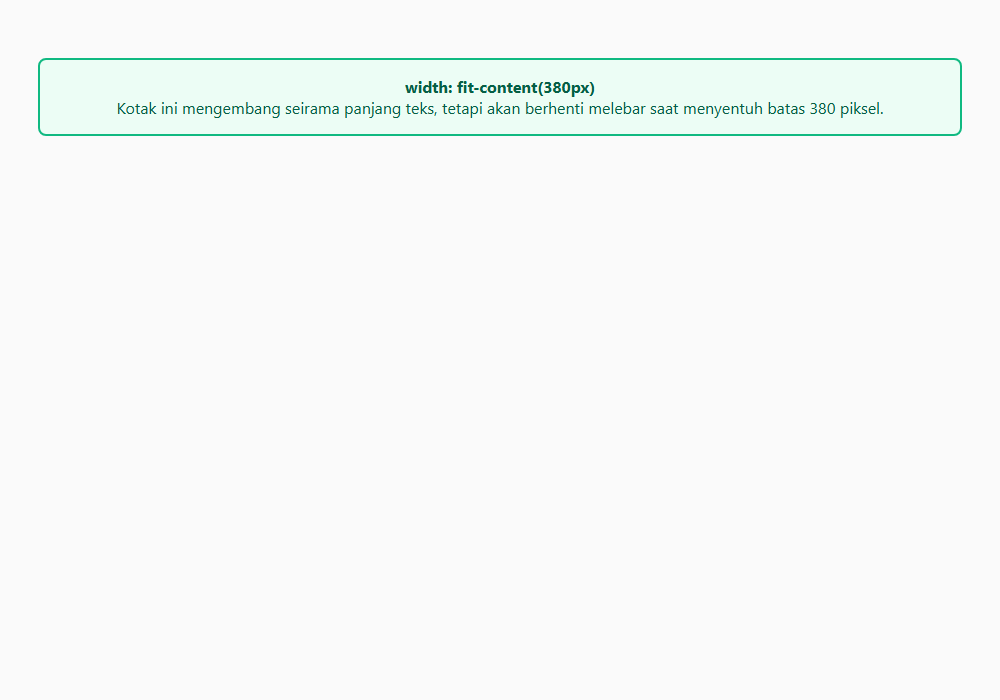

##### 70. The `aspect-ratio` Property

- **Source Code**: [`70_aspect_ratio.css`](./module-04-css-box-model/70_aspect_ratio.css) | **Preview**: [`70_aspect_ratio.html`](./module-04-css-box-model/70_aspect_ratio.html)
- **Key Concept**: The modern `aspect-ratio` property locks a preferred width-to-height ratio (e.g., `16 / 9`, `1 / 1`, `4 / 3`), eliminating legacy padding hacks for responsive media wrappers.
- **Implementation**: Builds video player wrappers and avatar containers maintaining flawless 16:9 and 1:1 aspect ratios across fluid viewport resizing.
- **Execution Output**:

  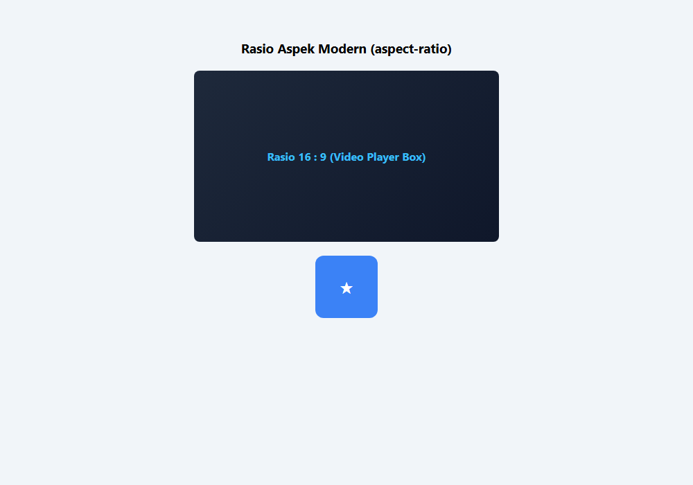


### Module 05: Typography and Text Formatting

**Curriculum Path**: [`module-05-typography-dan-pemformatan-teks`](./module-05-typography-dan-pemformatan-teks) | **Level**: `Fundamental to Intermediate` | **Scope**: 20 Lessons

#### Overview & Concepts Covered

Delves into modern web typography principles and text styling: font family definitions with resilient fallback stacks, scalable font size scaling (`rem`, `em`, `%`), numeric and keyword font weights, font styles, small-caps font variants, font stretch, the `font` shorthand, comfortable line height ratios (`line-height`), alignment controls (`text-align`), modern text decoration suites (underline offset, thickness, styling), case transformations (`text-transform`), paragraph indentation, letter and word spacing kerning, graphical text shadows, ellipsis truncation (`text-overflow`), whitespace management, and custom self-hosted web fonts via `@font-face`.

#### Subtopics & Visual Captures

##### 71. The `font-family` Property and Fallbacks

- **Source Code**: [`71_font_family.css`](./module-05-typography-dan-pemformatan-teks/71_font_family.css) | **Preview**: [`71_font_family.html`](./module-05-typography-dan-pemformatan-teks/71_font_family.html)
- **Key Concept**: The `font-family` property specifies a comma-separated prioritized list of font faces, terminating with a generic family keyword (`sans-serif`, `serif`, `monospace`) to ensure dependable cross-platform rendering.
- **Implementation**: Defines modern system UI font stacks for headings and monospaced code fonts for technical excerpts within an article layout.
- **Execution Output**:

  

##### 72. The `font-size` Property and Scalable Units

- **Source Code**: [`72_font_size.css`](./module-05-typography-dan-pemformatan-teks/72_font_size.css) | **Preview**: [`72_font_size.html`](./module-05-typography-dan-pemformatan-teks/72_font_size.html)
- **Key Concept**: The `font-size` property controls glyph dimensions; using root-relative units (`rem`) respects user browser accessibility font size preferences, unlike rigid pixel (`px`) measurements.
- **Implementation**: Builds a modular typographic scale progressing harmoniously from `0.875rem` up to `2.5rem` across headings, body text, and captions.
- **Execution Output**:

  

##### 73. The `font-weight` Property

- **Source Code**: [`73_font_weight.css`](./module-05-typography-dan-pemformatan-teks/73_font_weight.css) | **Preview**: [`73_font_weight.html`](./module-05-typography-dan-pemformatan-teks/73_font_weight.html)
- **Key Concept**: The `font-weight` property sets stroke thickness using numeric intervals from `100` (Thin) to `900` (Black) or keywords (`normal`, `bold`, `lighter`, `bolder`).
- **Implementation**: Visualizes a full weight ladder demonstrating visual hierarchy distinctions between delicate subheadings and high-impact headlines.
- **Execution Output**:

  

##### 74. The `font-style` Property

- **Source Code**: [`74_font_style.css`](./module-05-typography-dan-pemformatan-teks/74_font_style.css) | **Preview**: [`74_font_style.html`](./module-05-typography-dan-pemformatan-teks/74_font_style.html)
- **Key Concept**: The `font-style` property toggles between `normal`, `italic` (designed cursive glyphs), and `oblique` (mechanically slanted roman glyphs) styling.
- **Implementation**: Styles editorial blockquotes and scientific citations with genuine italic letterforms to convey semantic emphasis.
- **Execution Output**:

  

##### 75. The `font-variant` Property

- **Source Code**: [`75_font_variant.css`](./module-05-typography-dan-pemformatan-teks/75_font_variant.css) | **Preview**: [`75_font_variant.html`](./module-05-typography-dan-pemformatan-teks/75_font_variant.html)
- **Key Concept**: The `font-variant` property enables advanced OpenType typographic features, including `small-caps` to render lowercase text in scaled capital letterforms.
- **Implementation**: Applies `font-variant: small-caps` to publication headers and table label metrics for enhanced editorial polish.
- **Execution Output**:

  

##### 76. The `font-stretch` Property

- **Source Code**: [`76_font_stretch.css`](./module-05-typography-dan-pemformatan-teks/76_font_stretch.css) | **Preview**: [`76_font_stretch.html`](./module-05-typography-dan-pemformatan-teks/76_font_stretch.html)
- **Key Concept**: The `font-stretch` property selects condensed or expanded glyph variants from font families containing variable widths or width-specific font files.
- **Implementation**: Compares `condensed`, `normal`, and `expanded` font stretches on headline text to optimize horizontal character density.
- **Execution Output**:

  

##### 77. The `font` Shorthand Property

- **Source Code**: [`77_font_shorthand.css`](./module-05-typography-dan-pemformatan-teks/77_font_shorthand.css) | **Preview**: [`77_font_shorthand.html`](./module-05-typography-dan-pemformatan-teks/77_font_shorthand.html)
- **Key Concept**: The `font` shorthand condenses `style`, `weight`, `size`, `line-height`, and `family` into a single declaration; `font-size` and `font-family` are mandatory.
- **Implementation**: Configures a complete editorial card's typography using `font: italic bold 1.125rem/1.6 system-ui, sans-serif`.
- **Execution Output**:

  

##### 78. The `line-height` Property

- **Source Code**: [`78_line_height.css`](./module-05-typography-dan-pemformatan-teks/78_line_height.css) | **Preview**: [`78_line_height.html`](./module-05-typography-dan-pemformatan-teks/78_line_height.html)
- **Key Concept**: The `line-height` property specifies the vertical distance between baselines; unitless values (e.g., `1.5` or `1.6`) multiply font size proportionally and inherit predictably.
- **Implementation**: Contrasts tight, normal, and generous line-height ratios across dense technical paragraphs to illustrate reading comfort optimization.
- **Execution Output**:

  

##### 79. The `text-align` Property

- **Source Code**: [`79_text_align.css`](./module-05-typography-dan-pemformatan-teks/79_text_align.css) | **Preview**: [`79_text_align.html`](./module-05-typography-dan-pemformatan-teks/79_text_align.html)
- **Key Concept**: The `text-align` property aligns inline content within its containing block (`left`, `center`, `right`, `justify`), or using logical equivalents (`start`, `end`).
- **Implementation**: Displays side-by-side text columns formatted with left, center, right, and justified alignments within card boundaries.
- **Execution Output**:

  

##### 80. The `text-decoration` Property Suite

- **Source Code**: [`80_text_decoration.css`](./module-05-typography-dan-pemformatan-teks/80_text_decoration.css) | **Preview**: [`80_text_decoration.html`](./module-05-typography-dan-pemformatan-teks/80_text_decoration.html)
- **Key Concept**: Modern CSS provides fine-grained text decoration control: line placement (`underline`, `line-through`), custom line styles (`wavy`, `dashed`), custom color, and `text-underline-offset`.
- **Implementation**: Styles interactive links and deleted prices with stylish wavy underlines, custom color accents, and comfortable underline offsets.
- **Execution Output**:

  

##### 81. The `text-transform` Property

- **Source Code**: [`81_text_transform.css`](./module-05-typography-dan-pemformatan-teks/81_text_transform.css) | **Preview**: [`81_text_transform.html`](./module-05-typography-dan-pemformatan-teks/81_text_transform.html)
- **Key Concept**: The `text-transform` property modifies character casing presentationally (`uppercase`, `lowercase`, `capitalize`) without mutating the underlying HTML text string.
- **Implementation**: Formats table column headers with `uppercase` and article titles with `capitalize` while preserving clean semantic HTML source text.
- **Execution Output**:

  

##### 82. The `text-indent` Property

- **Source Code**: [`82_text_indent.css`](./module-05-typography-dan-pemformatan-teks/82_text_indent.css) | **Preview**: [`82_text_indent.html`](./module-05-typography-dan-pemformatan-teks/82_text_indent.html)
- **Key Concept**: The `text-indent` property creates horizontal indentations on the first line of a block container, emulating traditional print publishing conventions.
- **Implementation**: Applies `text-indent: 2rem` to editorial book excerpts, creating an authentic literary publishing reading experience.
- **Execution Output**:

  

##### 83. The `letter-spacing` Property

- **Source Code**: [`83_letter_spacing.css`](./module-05-typography-dan-pemformatan-teks/83_letter_spacing.css) | **Preview**: [`83_letter_spacing.html`](./module-05-typography-dan-pemformatan-teks/83_letter_spacing.html)
- **Key Concept**: The `letter-spacing` property adjusts the tracking distance between individual characters, essential for ensuring legibility in all-caps headings and micro-badges.
- **Implementation**: Expands letter tracking on uppercase button labels and status badges using `letter-spacing: 0.125em`.
- **Execution Output**:

  

##### 84. The `word-spacing` Property

- **Source Code**: [`84_word_spacing.css`](./module-05-typography-dan-pemformatan-teks/84_word_spacing.css) | **Preview**: [`84_word_spacing.html`](./module-05-typography-dan-pemformatan-teks/84_word_spacing.html)
- **Key Concept**: The `word-spacing` property alters the whitespace clearance between adjacent words, providing refined layout control for headline banners.
- **Implementation**: Adjusts word separation across hero headlines to achieve balanced, aesthetic typographic distribution across wide containers.
- **Execution Output**:

  

##### 85. The `text-shadow` Property

- **Source Code**: [`85_text_shadow.css`](./module-05-typography-dan-pemformatan-teks/85_text_shadow.css) | **Preview**: [`85_text_shadow.html`](./module-05-typography-dan-pemformatan-teks/85_text_shadow.html)
- **Key Concept**: The `text-shadow` property renders graphic drop shadows beneath text using horizontal offset, vertical offset, blur radius, and color parameters.
- **Implementation**: Creates layered neon glow effects and subtle legible drop shadows on hero typography positioned over photographic backgrounds.
- **Execution Output**:

  

##### 86. The `text-overflow` Property and Ellipsis Truncation

- **Source Code**: [`86_text_overflow.css`](./module-05-typography-dan-pemformatan-teks/86_text_overflow.css) | **Preview**: [`86_text_overflow.html`](./module-05-typography-dan-pemformatan-teks/86_text_overflow.html)
- **Key Concept**: Truncating text with an ellipsis requires combining three essential properties: `white-space: nowrap`, `overflow: hidden`, and `text-overflow: ellipsis`.
- **Implementation**: Implements single-line card title truncation, cleanly replacing overflowing strings with an elegant `...` indicator.
- **Execution Output**:

  

##### 87. The `white-space` Property

- **Source Code**: [`87_white_space.css`](./module-05-typography-dan-pemformatan-teks/87_white_space.css) | **Preview**: [`87_white_space.html`](./module-05-typography-dan-pemformatan-teks/87_white_space.html)
- **Key Concept**: The `white-space` property dictates how whitespace sequences and line breaks are handled (`normal`, `nowrap`, `pre`, `pre-wrap`, `pre-line`).
- **Implementation**: Demonstrates verbatim preformatted code blocks using `white-space: pre` alongside unwrapped horizontal notification tags using `nowrap`.
- **Execution Output**:

  

##### 88. The `word-break` Property

- **Source Code**: [`88_word_break.css`](./module-05-typography-dan-pemformatan-teks/88_word_break.css) | **Preview**: [`88_word_break.html`](./module-05-typography-dan-pemformatan-teks/88_word_break.html)
- **Key Concept**: The `word-break` property dictates whether line breaks may occur within words (`normal`, `break-all`, `keep-all`), preventing unbreakable strings from blowing out containers.
- **Implementation**: Formats dense URL paths inside narrow chat message bubbles using `word-break: break-all` to prevent layout overflow.
- **Execution Output**:

  

##### 89. The `overflow-wrap` Property

- **Source Code**: [`89_overflow_wrap.css`](./module-05-typography-dan-pemformatan-teks/89_overflow_wrap.css) | **Preview**: [`89_overflow_wrap.html`](./module-05-typography-dan-pemformatan-teks/89_overflow_wrap.html)
- **Key Concept**: `overflow-wrap: break-word` (historically `word-wrap`) allows otherwise unbreakable words to wrap mid-word only when the word cannot fit on its own line.
- **Implementation**: Protects responsive card containers against long words or URLs without fragmenting standard English words unnecessarily.
- **Execution Output**:

  

##### 90. Custom Web Fonts with `@font-face`

- **Source Code**: [`90_web_fonts.css`](./module-05-typography-dan-pemformatan-teks/90_web_fonts.css) | **Preview**: [`90_web_fonts.html`](./module-05-typography-dan-pemformatan-teks/90_web_fonts.html)
- **Key Concept**: The `@font-face` at-rule allows developers to declare and load custom self-hosted web font files (`woff2`, `woff`), specifying font families, weights, and `font-display` strategies.
- **Implementation**: Declares a self-hosted modern typeface with `font-display: swap` to deliver polished branded typography with zero layout shift.
- **Execution Output**:

  

### Module 06: Colors and Backgrounds

**Curriculum Path**: [`module-06-warna-dan-background`](./module-06-warna-dan-background) | **Level**: `Fundamental to Intermediate` | **Scope**: 20 Lessons

#### Overview & Concepts Covered

Presents an in-depth guide to color theory, notations, and background rendering in CSS: official named color keywords, 3/6/8-digit hexadecimal notations, modern comma-free `rgb()` and `hsl()` functional syntax, alpha transparency management, foreground text and background colors, background image handling (`image`, `repeat`, `position`, `size: cover/contain`, `attachment: fixed/scroll`), shorthand definitions, multi-layer composite backgrounds, CSS gradients (linear, radial, and conic gradients with color stops), layer blending modes (`background-blend-mode`), and background clipping (`background-clip`) and positioning origin (`background-origin`).

#### Subtopics & Visual Captures

##### 91. CSS Named Colors

- **Source Code**: [`91_named_colors.css`](./module-06-warna-dan-background/91_named_colors.css) | **Preview**: [`91_named_colors.html`](./module-06-warna-dan-background/91_named_colors.html)
- **Key Concept**: CSS natively supports 140+ standardized named color keywords (e.g., `crimson`, `royalblue`, `forestgreen`, `gold`) recognized universally across web browsers.
- **Implementation**: Renders a curated palette showcase card displaying popular named colors with accessible white and black contrasting text.
- **Execution Output**:

  

##### 92. Hexadecimal Color Notation

- **Source Code**: [`92_hex_colors.css`](./module-06-warna-dan-background/92_hex_colors.css) | **Preview**: [`92_hex_colors.html`](./module-06-warna-dan-background/92_hex_colors.html)
- **Key Concept**: Hexadecimal colors use base-16 notation (`#RRGGBB` or `#RGB`), expanding in modern CSS to support an optional 8-digit alpha transparency channel (`#RRGGBBAA`).
- **Implementation**: Demonstrates 6-digit hex color palettes alongside modern 8-digit semi-transparent overlays on alert components.
- **Execution Output**:

  

##### 93. The `rgb()` Functional Notation

- **Source Code**: [`93_rgb_colors.css`](./module-06-warna-dan-background/93_rgb_colors.css) | **Preview**: [`93_rgb_colors.html`](./module-06-warna-dan-background/93_rgb_colors.html)
- **Key Concept**: Modern CSS Color Level 4 allows `rgb()` to use space-separated red, green, and blue values (`0–255` or percentages) with an optional slash-separated alpha channel (`rgb(R G B / A)`).
- **Implementation**: Formats interactive cards using modern comma-free `rgb()` notation, comparing opaque cards with translucent frosted panels.
- **Execution Output**:

  

##### 94. The `hsl()` Functional Notation

- **Source Code**: [`94_hsl_colors.css`](./module-06-warna-dan-background/94_hsl_colors.css) | **Preview**: [`94_hsl_colors.html`](./module-06-warna-dan-background/94_hsl_colors.html)
- **Key Concept**: The `hsl()` model represents colors through human-intuitive parameters: Hue (`0–360°`), Saturation (`0–100%`), and Lightness (`0–100%`), streamlining palette generation.
- **Implementation**: Builds a cohesive brand palette by systematically varying lightness and saturation percentages while locking a constant hue degree.
- **Execution Output**:

  

##### 95. Color Alpha Channels and Transparency

- **Source Code**: [`95_alpha_colors.css`](./module-06-warna-dan-background/95_alpha_colors.css) | **Preview**: [`95_alpha_colors.html`](./module-06-warna-dan-background/95_alpha_colors.html)
- **Key Concept**: Alpha channels modulate color opacity from `0.0` (fully transparent) to `1.0` (fully opaque) without altering the opacity of child text or elements.
- **Implementation**: Overlays translucent colored modal panels above background patterns, proving that text remains crisp and opaque.
- **Execution Output**:

  

##### 96. The `color` Property

- **Source Code**: [`96_color_property.css`](./module-06-warna-dan-background/96_color_property.css) | **Preview**: [`96_color_property.html`](./module-06-warna-dan-background/96_color_property.html)
- **Key Concept**: The `color` property dictates the foreground color for text and text decorations, automatically serving as the computed value for the `currentColor` keyword.
- **Implementation**: Demonstrates semantic text coloring across headings, body copy, and icons that dynamically inherit color via `currentColor`.
- **Execution Output**:

  

##### 97. The `background-color` Property

- **Source Code**: [`97_background_color.css`](./module-06-warna-dan-background/97_background_color.css) | **Preview**: [`97_background_color.html`](./module-06-warna-dan-background/97_background_color.html)
- **Key Concept**: The `background-color` property fills an element's padding and content boxes with a solid or translucent hue, rendering beneath any background images.
- **Implementation**: Configures tiered background tints for header banners, warning panels, and sidebar navigation modules.
- **Execution Output**:

  

##### 98. The `background-image` Property

- **Source Code**: [`98_background_image.css`](./module-06-warna-dan-background/98_background_image.css) | **Preview**: [`98_background_image.html`](./module-06-warna-dan-background/98_background_image.html)
- **Key Concept**: The `background-image` property renders one or more graphic assets via `url('path')` or gradient functions beneath the element's content.
- **Implementation**: Sets a high-resolution hero background image with fallback background colors to ensure accessibility during asset loading.
- **Execution Output**:

  

##### 99. The `background-repeat` Property

- **Source Code**: [`99_background_repeat.css`](./module-06-warna-dan-background/99_background_repeat.css) | **Preview**: [`99_background_repeat.html`](./module-06-warna-dan-background/99_background_repeat.html)
- **Key Concept**: The `background-repeat` property dictates tiling behavior: `repeat`, `no-repeat`, `repeat-x`, `repeat-y`, or modern spaced tiling modes (`space`, `round`).
- **Implementation**: Displays subtle geometric pattern tiling using `repeat` contrasted against singular hero backgrounds using `no-repeat`.
- **Execution Output**:

  

##### 100. The `background-position` Property

- **Source Code**: [`100_background_position.css`](./module-06-warna-dan-background/100_background_position.css) | **Preview**: [`100_background_position.html`](./module-06-warna-dan-background/100_background_position.html)
- **Key Concept**: The `background-position` property positions the initial anchor coordinates of a background image using keywords (`center`, `top right`), percentages, or precise offsets.
- **Implementation**: Aligns background decorative graphics precisely to the center and right margins of promotional banner cards.
- **Execution Output**:

  

##### 101. The `background-size` Property (`cover` & `contain`)

- **Source Code**: [`101_background_size.css`](./module-06-warna-dan-background/101_background_size.css) | **Preview**: [`101_background_size.html`](./module-06-warna-dan-background/101_background_size.html)
- **Key Concept**: `background-size: cover` scales an image to completely fill the container (cropping excess), while `contain` scales the image to fit entirely without clipping.
- **Implementation**: Contrasts `cover` on immersive hero banners with `contain` on corporate logo containers across various viewport aspect ratios.
- **Execution Output**:

  

##### 102. The `background-attachment` Property

- **Source Code**: [`102_background_attachment.css`](./module-06-warna-dan-background/102_background_attachment.css) | **Preview**: [`102_background_attachment.html`](./module-06-warna-dan-background/102_background_attachment.html)
- **Key Concept**: The `background-attachment` property dictates whether an image scrolls with the page (`scroll`), scrolls with element contents (`local`), or remains fixed relative to the viewport (`fixed`).
- **Implementation**: Creates a classic parallax scrolling visual effect on an article divider section using `background-attachment: fixed`.
- **Execution Output**:

  

##### 103. The `background` Shorthand Property

- **Source Code**: [`103_background_shorthand.css`](./module-06-warna-dan-background/103_background_shorthand.css) | **Preview**: [`103_background_shorthand.html`](./module-06-warna-dan-background/103_background_shorthand.html)
- **Key Concept**: The `background` shorthand consolidates color, image, position, size, repeat, and attachment into one rule; sizing must be separated from position via a slash (`position / size`).
- **Implementation**: Defines a complete hero background layer in a single concise line: `#1e293b url('img.jpg') no-repeat center / cover fixed`.
- **Execution Output**:

  

##### 104. Multiple Background Layers

- **Source Code**: [`104_multiple_backgrounds.css`](./module-06-warna-dan-background/104_multiple_backgrounds.css) | **Preview**: [`104_multiple_backgrounds.html`](./module-06-warna-dan-background/104_multiple_backgrounds.html)
- **Key Concept**: CSS supports stacking multiple comma-separated background layers on a single element; layers are rendered from top to bottom in declaration order.
- **Implementation**: Stacks a semi-transparent dark gradient overlay above a photographic background image to guarantee high text contrast.
- **Execution Output**:

  

##### 105. Linear Gradients (`linear-gradient`)

- **Source Code**: [`105_background_gradients.css`](./module-06-warna-dan-background/105_background_gradients.css) | **Preview**: [`105_background_gradients.html`](./module-06-warna-dan-background/105_background_gradients.html)
- **Key Concept**: The `linear-gradient()` function transitions smoothly between colors along an angle line (`to right`, `135deg`) without downloading raster image files.
- **Implementation**: Styles vibrant call-to-action buttons and modern cards with sleek 135-degree diagonal dual-color gradients.
- **Execution Output**:

  

##### 106. Radial Gradients (`radial-gradient`)

- **Source Code**: [`106_radial_gradient.css`](./module-06-warna-dan-background/106_radial_gradient.css) | **Preview**: [`106_radial_gradient.html`](./module-06-warna-dan-background/106_radial_gradient.html)
- **Key Concept**: The `radial-gradient()` function radiates color transitions outwardly from a central focal point (`circle`, `ellipse`) to create spotlight or vignette effects.
- **Implementation**: Formats dark-mode dashboard hero containers with subtle circular center-glow spotlights using radial gradients.
- **Execution Output**:

  

##### 107. Conic Gradients (`conic-gradient`)

- **Source Code**: [`107_conic_gradient.css`](./module-06-warna-dan-background/107_conic_gradient.css) | **Preview**: [`107_conic_gradient.html`](./module-06-warna-dan-background/107_conic_gradient.html)
- **Key Concept**: The `conic-gradient()` function sweeps color transitions around a central rotational origin, ideal for pie charts, color wheels, and animated luminous borders.
- **Implementation**: Builds an interactive circular progress chart and color spectrum dial purely through CSS conic gradient color stops.
- **Execution Output**:

  

##### 108. Gradient Color Stops and Positioning

- **Source Code**: [`108_gradient_color_stops.css`](./module-06-warna-dan-background/108_gradient_color_stops.css) | **Preview**: [`108_gradient_color_stops.html`](./module-06-warna-dan-background/108_gradient_color_stops.html)
- **Key Concept**: Color stops dictate precise start, transition, and end points along the gradient line; placing two color stops at identical positions creates razor-sharp stripes.
- **Implementation**: Creates crisp multi-color diagonal warning stripes and smooth custom multi-stage spectral transitions.
- **Execution Output**:

  

##### 109. The `background-blend-mode` Property

- **Source Code**: [`109_background_blend_mode.css`](./module-06-warna-dan-background/109_background_blend_mode.css) | **Preview**: [`109_background_blend_mode.html`](./module-06-warna-dan-background/109_background_blend_mode.html)
- **Key Concept**: The `background-blend-mode` property blends multiple background images or an image with a solid background color using Photoshop-grade formulas (`multiply`, `screen`, `overlay`).
- **Implementation**: Applies `multiply` and `luminosity` blend modes to duotone photography cards for consistent art direction.
- **Execution Output**:

  

##### 110. `background-clip` and `background-origin`

- **Source Code**: [`110_background_clip_origin.css`](./module-06-warna-dan-background/110_background_clip_origin.css) | **Preview**: [`110_background_clip_origin.html`](./module-06-warna-dan-background/110_background_clip_origin.html)
- **Key Concept**: `background-origin` dictates the box area where positioning starts (`border-box`, `padding-box`, `content-box`), while `background-clip` truncates rendering (including clipping to text with `text`).
- **Implementation**: Demonstrates gradient-filled knockout typography using `background-clip: text` alongside padding-constrained pattern boxes.
- **Execution Output**:

  


### Module 07: Borders, Outlines, Shadows, and Visual Effects

**Curriculum Path**: [`module-07-border-outline-shadow-dan-efek-visual`](./module-07-border-outline-shadow-dan-efek-visual) | **Level**: `Intermediate` | **Scope**: 15 Lessons

#### Overview & Concepts Covered

Explores element boundary styling, elevation depth, and visual graphic effects: the `border` shorthand and individual side configurations (width, styles, color, and curved corners with `border-radius`), vital distinctions between borders and accessible focus outlines (`outline` and `outline-offset`), layered realistic drop shadows (`box-shadow`), element opacity levels, CSS graphical filters (`blur`, `grayscale`, `brightness`, `drop-shadow`), glassmorphic frosted glass aesthetics using `backdrop-filter`, layer blending with `mix-blend-mode`, and geometric masking shapes via `clip-path`.

#### Subtopics & Visual Captures

##### 111. The `border` Shorthand Property

- **Source Code**: [`111_border_property.css`](./module-07-border-outline-shadow-dan-efek-visual/111_border_property.css) | **Preview**: [`111_border_property.html`](./module-07-border-outline-shadow-dan-efek-visual/111_border_property.html)
- **Key Concept**: The `border` shorthand specifies an element's boundary by combining `border-width`, `border-style`, and `border-color` into a single declaration.
- **Implementation**: Styles an informational alert box with a solid 2px corporate blue border, framing the component within the page flow.
- **Execution Output**:

  

##### 112. The `border-width` Property

- **Source Code**: [`112_border_width.css`](./module-07-border-outline-shadow-dan-efek-visual/112_border_width.css) | **Preview**: [`112_border_width.html`](./module-07-border-outline-shadow-dan-efek-visual/112_border_width.html)
- **Key Concept**: The `border-width` property controls stroke thickness using keywords (`thin`, `medium`, `thick`) or explicit measurements (`px`, `rem`).
- **Implementation**: Renders a progression of container cards with border thicknesses ranging from hairline 1px strokes up to bold 8px structural borders.
- **Execution Output**:

  

##### 113. The `border-style` Property

- **Source Code**: [`113_border_style.css`](./module-07-border-outline-shadow-dan-efek-visual/113_border_style.css) | **Preview**: [`113_border_style.html`](./module-07-border-outline-shadow-dan-efek-visual/113_border_style.html)
- **Key Concept**: The `border-style` property dictates line rendering patterns: `solid`, `dashed`, `dotted`, `double`, `groove`, `ridge`, `inset`, or `outset`.
- **Implementation**: Displays an interactive gallery comparing dashed drag-and-drop dropzones, dotted coupon borders, and double rule dividers.
- **Execution Output**:

  

##### 114. The `border-color` Property

- **Source Code**: [`114_border_color.css`](./module-07-border-outline-shadow-dan-efek-visual/114_border_color.css) | **Preview**: [`114_border_color.html`](./module-07-border-outline-shadow-dan-efek-visual/114_border_color.html)
- **Key Concept**: The `border-color` property sets boundary hues; omitting it causes the border to automatically adopt the element's current text `color`.
- **Implementation**: Configures status badge borders communicating success, warning, and danger states via coordinated border color tokens.
- **Execution Output**:

  

##### 115. The `border-radius` Property and Rounded Corners

- **Source Code**: [`115_border_radius.css`](./module-07-border-outline-shadow-dan-efek-visual/115_border_radius.css) | **Preview**: [`115_border_radius.html`](./module-07-border-outline-shadow-dan-efek-visual/115_border_radius.html)
- **Key Concept**: The `border-radius` property curves element corners using circular radii or elliptical dual-axis values separated by slashes (`horizontal / vertical`).
- **Implementation**: Demonstrates subtle card rounded corners (`8px`), pill-shaped button capsules (`9999px`), and perfect circular avatar frames (`50%`).
- **Execution Output**:

  

##### 116. Individual Side Border Properties

- **Source Code**: [`116_individual_borders.css`](./module-07-border-outline-shadow-dan-efek-visual/116_individual_borders.css) | **Preview**: [`116_individual_borders.html`](./module-07-border-outline-shadow-dan-efek-visual/116_individual_borders.html)
- **Key Concept**: CSS enables directional border declarations (`border-top`, `border-right`, `border-bottom`, `border-left`) to create asymmetric accents.
- **Implementation**: Constructs an editorial callout box featuring a prominent 4px left accent border while leaving top, right, and bottom sides open.
- **Execution Output**:

  

##### 117. The `outline` Property

- **Source Code**: [`117_outline_property.css`](./module-07-border-outline-shadow-dan-efek-visual/117_outline_property.css) | **Preview**: [`117_outline_property.html`](./module-07-border-outline-shadow-dan-efek-visual/117_outline_property.html)
- **Key Concept**: Unlike `border`, `outline` is rendered outside the element's box model bounds without consuming layout space or triggering reflows, critical for accessibility focus rings.
- **Implementation**: Styles high-contrast focus rings around interactive buttons and form inputs that preserve parent layout geometry upon keyboard activation.
- **Execution Output**:

  

##### 118. The `outline-offset` Property

- **Source Code**: [`118_outline_offset.css`](./module-07-border-outline-shadow-dan-efek-visual/118_outline_offset.css) | **Preview**: [`118_outline_offset.html`](./module-07-border-outline-shadow-dan-efek-visual/118_outline_offset.html)
- **Key Concept**: The `outline-offset` property creates transparent breathing space between an element's border edge and its outline stroke.
- **Implementation**: Adds `outline-offset: 4px` to focused interactive buttons, producing an elegant, accessible floating focus ring indicator.
- **Execution Output**:

  

##### 119. The `box-shadow` Property and Elevation

- **Source Code**: [`119_box_shadow.css`](./module-07-border-outline-shadow-dan-efek-visual/119_box_shadow.css) | **Preview**: [`119_box_shadow.html`](./module-07-border-outline-shadow-dan-efek-visual/119_box_shadow.html)
- **Key Concept**: The `box-shadow` property casts drop shadows defined by horizontal offset, vertical offset, blur radius, optional spread radius, and shadow color.
- **Implementation**: Styles an elevated product card with soft atmospheric shadows, giving the component tactile visual depth above the canvas.
- **Execution Output**:

  

##### 120. Multiple Layered Box Shadows

- **Source Code**: [`120_multiple_box_shadows.css`](./module-07-border-outline-shadow-dan-efek-visual/120_multiple_box_shadows.css) | **Preview**: [`120_multiple_box_shadows.html`](./module-07-border-outline-shadow-dan-efek-visual/120_multiple_box_shadows.html)
- **Key Concept**: Stacking multiple comma-separated shadows simulates realistic optical light dispersion and ambient occlusion far better than a single harsh shadow.
- **Implementation**: Applies a modern design-system multi-layer elevation token combining a tight contact shadow with a soft diffused ambient drop shadow.
- **Execution Output**:

  

##### 121. The `opacity` Property

- **Source Code**: [`121_opacity_property.css`](./module-07-border-outline-shadow-dan-efek-visual/121_opacity_property.css) | **Preview**: [`121_opacity_property.html`](./module-07-border-outline-shadow-dan-efek-visual/121_opacity_property.html)
- **Key Concept**: The `opacity` property modulates total transparency (`0.0` to `1.0`), affecting the element and all of its descendants uniformly.
- **Implementation**: Demonstrates disabled card states using `opacity: 0.5` alongside full-opacity interactive controls to clarify user availability.
- **Execution Output**:

  

##### 122. The `filter` Property and Graphical Effects

- **Source Code**: [`122_filter_property.css`](./module-07-border-outline-shadow-dan-efek-visual/122_filter_property.css) | **Preview**: [`122_filter_property.html`](./module-07-border-outline-shadow-dan-efek-visual/122_filter_property.html)
- **Key Concept**: The `filter` property applies post-processing graphical effects directly in browser hardware: `blur()`, `grayscale()`, `brightness()`, `contrast()`, `drop-shadow()`.
- **Implementation**: Implements an interactive image gallery demonstrating grayscale transitions, dynamic brightness boosts, and alpha-aware drop shadows on PNG icons.
- **Execution Output**:

  

##### 123. The `backdrop-filter` Property (Glassmorphism)

- **Source Code**: [`123_backdrop_filter.css`](./module-07-border-outline-shadow-dan-efek-visual/123_backdrop_filter.css) | **Preview**: [`123_backdrop_filter.html`](./module-07-border-outline-shadow-dan-efek-visual/123_backdrop_filter.html)
- **Key Concept**: The `backdrop-filter` property applies graphical filters (such as `blur()`) to the area immediately behind an element rather than to the element itself.
- **Implementation**: Constructs an authentic modern glassmorphism card combining `backdrop-filter: blur(12px)`, translucent background fills, and subtle border highlights.
- **Execution Output**:

  

##### 124. The `mix-blend-mode` Property

- **Source Code**: [`124_mix_blend_mode.css`](./module-07-border-outline-shadow-dan-efek-visual/124_mix_blend_mode.css) | **Preview**: [`124_mix_blend_mode.html`](./module-07-border-outline-shadow-dan-efek-visual/124_mix_blend_mode.html)
- **Key Concept**: The `mix-blend-mode` property dictates how an element's content blends with the contents of the element's parent container and background behind it.
- **Implementation**: Blends high-contrast typography across vibrant graphic gradients using `difference` and `multiply` blend modes.
- **Execution Output**:

  

##### 125. The `clip-path` Property and Geometric Masking

- **Source Code**: [`125_clip_path.css`](./module-07-border-outline-shadow-dan-efek-visual/125_clip_path.css) | **Preview**: [`125_clip_path.html`](./module-07-border-outline-shadow-dan-efek-visual/125_clip_path.html)
- **Key Concept**: The `clip-path` property clips elements into non-rectangular geometric shapes using basic shapes: `circle()`, `ellipse()`, `inset()`, and `polygon()`.
- **Implementation**: Masks photographic containers into dynamic diagonal angled hero banners, hexagons, and chevron badges using `polygon()`.
- **Execution Output**:

  

### Module 08: Display, Positioning, and Overflow

**Curriculum Path**: [`module-08-display-positioning-dan-overflow`](./module-08-display-positioning-dan-overflow) | **Level**: `Intermediate` | **Scope**: 20 Lessons

#### Overview & Concepts Covered

Covers document normal flow control, element rendering types, and coordinates: standard display modes (`block`, `inline`, `inline-block`, `none`), element visibility states (`visibility: hidden` vs `display: none`), the CSS positioning scheme (`static`, `relative`, `absolute`, `fixed`, `sticky`), physical versus modern logical inset properties, the 3D stacking axis (`z-index`) and stacking context creation, container overflow management (`overflow: hidden`, `auto`, `scroll`, and directional `overflow-x`/`y`), and image scaling behavior via `object-fit` and `object-position`.

#### Subtopics & Visual Captures

##### 126. `display: block`

- **Source Code**: [`126_display_block.css`](./module-08-display-positioning-dan-overflow/126_display_block.css) | **Preview**: [`126_display_block.html`](./module-08-display-positioning-dan-overflow/126_display_block.html)
- **Key Concept**: Elements with `display: block` always start on a new line and stretch horizontally to fill the full width of their containing block, respecting width, height, and all margins.
- **Implementation**: Displays vertically stacked content containers, demonstrating natural block-level document flow and full-width container expansion.
- **Execution Output**:

  

##### 127. `display: inline`

- **Source Code**: [`127_display_inline.css`](./module-08-display-positioning-dan-overflow/127_display_inline.css) | **Preview**: [`127_display_inline.html`](./module-08-display-positioning-dan-overflow/127_display_inline.html)
- **Key Concept**: Elements with `display: inline` flow horizontally within text content without breaking lines; explicit `width`, `height`, and vertical margins are completely ignored.
- **Implementation**: Formats inline text badges and highlighted phrases within a paragraph, illustrating how inline flow wraps naturally across line boundaries.
- **Execution Output**:

  

##### 128. `display: inline-block`

- **Source Code**: [`128_display_inline_block.css`](./module-08-display-positioning-dan-overflow/128_display_inline_block.css) | **Preview**: [`128_display_inline_block.html`](./module-08-display-positioning-dan-overflow/128_display_inline_block.html)
- **Key Concept**: Elements with `display: inline-block` flow side-by-side horizontally like inline elements while fully honoring declared `width`, `height`, padding, and margins.
- **Implementation**: Builds a horizontal navigation pill menu where each item maintains explicit padding and height without forcing line breaks.
- **Execution Output**:

  

##### 129. `display: none`

- **Source Code**: [`129_display_none.css`](./module-08-display-positioning-dan-overflow/129_display_none.css) | **Preview**: [`129_display_none.html`](./module-08-display-positioning-dan-overflow/129_display_none.html)
- **Key Concept**: `display: none` completely removes an element from the visual rendering tree; the element occupies zero space on the page and surrounding siblings collapse into the void.
- **Implementation**: Toggles visibility across informational banner states, demonstrating the total collapse of element footprint in normal flow.
- **Execution Output**:

  

##### 130. The `visibility` Property (`visible` vs `hidden`)

- **Source Code**: [`130_visibility_property.css`](./module-08-display-positioning-dan-overflow/130_visibility_property.css) | **Preview**: [`130_visibility_property.html`](./module-08-display-positioning-dan-overflow/130_visibility_property.html)
- **Key Concept**: `visibility: hidden` makes an element invisible while strictly preserving its exact geometry, width, and height in the document layout.
- **Implementation**: Contrasts `display: none` against `visibility: hidden` side-by-side to highlight how `visibility: hidden` maintains layout stability without shifting siblings.
- **Execution Output**:

  

##### 131. `position: static` (Normal Flow)

- **Source Code**: [`131_position_static.css`](./module-08-display-positioning-dan-overflow/131_position_static.css) | **Preview**: [`131_position_static.html`](./module-08-display-positioning-dan-overflow/131_position_static.html)
- **Key Concept**: `position: static` is the browser default where elements render strictly according to normal document flow; inset properties (`top`, `left`) and `z-index` have zero effect.
- **Implementation**: Demonstrates standard sequential document flow across cards, proving that directional offset declarations are ignored on static elements.
- **Execution Output**:

  

##### 132. `position: relative`

- **Source Code**: [`132_position_relative.css`](./module-08-display-positioning-dan-overflow/132_position_relative.css) | **Preview**: [`132_position_relative.html`](./module-08-display-positioning-dan-overflow/132_position_relative.html)
- **Key Concept**: `position: relative` offsets an element visually relative to its own normal flow position without altering the layout space reserved for it, establishing a positioning context for children.
- **Implementation**: Offsets a card badge 20px horizontally and vertically while preserving its initial layout footprint in normal document flow.
- **Execution Output**:

  

##### 133. `position: absolute`

- **Source Code**: [`133_position_absolute.css`](./module-08-display-positioning-dan-overflow/133_position_absolute.css) | **Preview**: [`133_position_absolute.html`](./module-08-display-positioning-dan-overflow/133_position_absolute.html)
- **Key Concept**: `position: absolute` removes an element completely from normal flow, positioning it relative to its closest non-static ancestor containing block.
- **Implementation**: Pins a status notification badge to the top-right corner of a relative card container (`top: -8px; right: -8px`).
- **Execution Output**:

  

##### 134. `position: fixed`

- **Source Code**: [`134_position_fixed.css`](./module-08-display-positioning-dan-overflow/134_position_fixed.css) | **Preview**: [`134_position_fixed.html`](./module-08-display-positioning-dan-overflow/134_position_fixed.html)
- **Key Concept**: `position: fixed` removes an element from flow and anchors it relative to the viewport window, remaining persistent in place during page scrolling.
- **Implementation**: Constructs a persistent floating support button anchored to `bottom: 24px; right: 24px` of the viewport during document scrolling.
- **Execution Output**:

  

##### 135. `position: sticky`

- **Source Code**: [`135_position_sticky.css`](./module-08-display-positioning-dan-overflow/135_position_sticky.css) | **Preview**: [`135_position_sticky.html`](./module-08-display-positioning-dan-overflow/135_position_sticky.html)
- **Key Concept**: `position: sticky` behaves as `relative` until the viewport scroll reaches a specified threshold (e.g., `top: 0`), then locks in place like `fixed` within its parent container.
- **Implementation**: Implements sticky category section headers inside a long scrollable article that seamlessly pin to the top as content scrolls through.
- **Execution Output**:

  

##### 136. Physical Inset Properties (`top`, `right`, `bottom`, `left`)

- **Source Code**: [`136_top_right_bottom_left.css`](./module-08-display-positioning-dan-overflow/136_top_right_bottom_left.css) | **Preview**: [`136_top_right_bottom_left.html`](./module-08-display-positioning-dan-overflow/136_top_right_bottom_left.html)
- **Key Concept**: Directional inset properties position elements along physical screen axes; defining opposing insets (e.g., `left: 0; right: 0`) stretches elements horizontally.
- **Implementation**: Positions four status badges at each physical corner of a showcase preview card using directional inset coordinates.
- **Execution Output**:

  

##### 137. Logical Inset Properties (`inset`, `inset-block`, `inset-inline`)

- **Source Code**: [`137_inset_logical_properties.css`](./module-08-display-positioning-dan-overflow/137_inset_logical_properties.css) | **Preview**: [`137_inset_logical_properties.html`](./module-08-display-positioning-dan-overflow/137_inset_logical_properties.html)
- **Key Concept**: The modern `inset` shorthand replaces `top`, `right`, `bottom`, and `left` in a single declaration (`inset: 0` stretches an absolute overlay across its entire parent).
- **Implementation**: Styles a full-bleed semi-transparent modal overlay across a card using `position: absolute; inset: 0`.
- **Execution Output**:

  

##### 138. The `z-index` Property

- **Source Code**: [`138_z_index.css`](./module-08-display-positioning-dan-overflow/138_z_index.css) | **Preview**: [`138_z_index.html`](./module-08-display-positioning-dan-overflow/138_z_index.html)
- **Key Concept**: The `z-index` property controls the 3D stacking order along the perpendicular z-axis for positioned elements (`relative`, `absolute`, `fixed`, `sticky`).
- **Implementation**: Overlaps three colored cards, using sequential `z-index: 10`, `z-index: 20`, and `z-index: 30` to explicitly control layer elevation.
- **Execution Output**:

  

##### 139. CSS Stacking Context Creation and Layering

- **Source Code**: [`139_stacking_context.css`](./module-08-display-positioning-dan-overflow/139_stacking_context.css) | **Preview**: [`139_stacking_context.html`](./module-08-display-positioning-dan-overflow/139_stacking_context.html)
- **Key Concept**: Stacking contexts isolate child layers; an element with `z-index: 9999` nested inside a lower stacking context can never escape above an outer sibling with a higher parent context.
- **Implementation**: Demonstrates stacking context creation via `opacity: 0.99` and `transform`, illustrating why nested high `z-index` elements remain bound to parent tiers.
- **Execution Output**:

  

##### 140. `overflow: hidden` and Clipping

- **Source Code**: [`140_overflow_hidden.css`](./module-08-display-positioning-dan-overflow/140_overflow_hidden.css) | **Preview**: [`140_overflow_hidden.html`](./module-08-display-positioning-dan-overflow/140_overflow_hidden.html)
- **Key Concept**: `overflow: hidden` clips any content exceeding the padding box boundary, hiding extra content without rendering scrollbars.
- **Implementation**: Prevents oversized images and long strings from spilling outside card containers with rounded corners using `overflow: hidden`.
- **Execution Output**:

  

##### 141. `overflow: auto` and Scrollbars

- **Source Code**: [`141_overflow_auto.css`](./module-08-display-positioning-dan-overflow/141_overflow_auto.css) | **Preview**: [`141_overflow_auto.html`](./module-08-display-positioning-dan-overflow/141_overflow_auto.html)
- **Key Concept**: `overflow: auto` dynamically renders scrollbars only when content exceeds container boundaries, leaving the interface scrollbar-free when content fits.
- **Implementation**: Formats a responsive code snippet box that automatically surfaces horizontal scrollbars when lines exceed container width.
- **Execution Output**:

  

##### 142. `overflow: scroll`

- **Source Code**: [`142_overflow_scroll.css`](./module-08-display-positioning-dan-overflow/142_overflow_scroll.css) | **Preview**: [`142_overflow_scroll.html`](./module-08-display-positioning-dan-overflow/142_overflow_scroll.html)
- **Key Concept**: `overflow: scroll` permanently reserves and displays scrollbar tracks regardless of whether content overflows, preventing layout jitter when content shifts.
- **Implementation**: Styles a fixed chat feed container with permanent vertical scrollbar tracks to maintain rock-solid layout alignment.
- **Execution Output**:

  

##### 143. Independent Overflow (`overflow-x` and `overflow-y`)

- **Source Code**: [`143_overflow_x_y.css`](./module-08-display-positioning-dan-overflow/143_overflow_x_y.css) | **Preview**: [`143_overflow_x_y.html`](./module-08-display-positioning-dan-overflow/143_overflow_x_y.html)
- **Key Concept**: CSS allows independent configuration of horizontal (`overflow-x`) and vertical (`overflow-y`) overflow axes.
- **Implementation**: Configures a horizontal thumbnail carousel scrolling with `overflow-x: auto` while clipping vertical content with `overflow-y: hidden`.
- **Execution Output**:

  

##### 144. The `object-fit` Property for Replaced Elements

- **Source Code**: [`144_object_fit.css`](./module-08-display-positioning-dan-overflow/144_object_fit.css) | **Preview**: [`144_object_fit.html`](./module-08-display-positioning-dan-overflow/144_object_fit.html)
- **Key Concept**: The `object-fit` property dictates how replaced content (like `` or `<video>`) fits into a container: `fill`, `contain`, `cover`, `none`, or `scale-down`.
- **Implementation**: Solves image squishing on responsive user avatar cards using `object-fit: cover` to maintain aspect ratios without distortion.
- **Execution Output**:

  

##### 145. The `object-position` Property

- **Source Code**: [`145_object_position.css`](./module-08-display-positioning-dan-overflow/145_object_position.css) | **Preview**: [`145_object_position.html`](./module-08-display-positioning-dan-overflow/145_object_position.html)
- **Key Concept**: The `object-position` property shifts the focal alignment point of replaced content within its container box, defaulting to `50% 50%` (center).
- **Implementation**: Re-aligns portrait photography within wide thumbnail cards to focus specifically on `top center`, preventing subject heads from being cropped.
- **Execution Output**:

  


### Module 09: Flexbox Layout

**Curriculum Path**: [`module-09-flexbox-layout`](./module-09-flexbox-layout) | **Level**: `Intermediate` | **Scope**: 20 Lessons

#### Overview & Concepts Covered

Examines the one-dimensional Flexible Box Layout module: converting elements into flex containers (`display: flex`), main axis direction (`flex-direction`), multi-line wrapping (`flex-wrap`), the `flex-flow` shorthand, main-axis distribution (`justify-content`), cross-axis alignment (`align-items`, `align-content`, `align-self`), flexible growth, shrinkage, and base sizing (`flex-grow`, `flex-shrink`, `flex-basis`), structural reordering (`order`), gap spacing (`gap`), and practical UI patterns including responsive navigation bars, equal-height card grids, absolute centering, and adaptive sidebars.

#### Subtopics & Visual Captures

##### 146. Introduction to Flexbox Architecture

- **Source Code**: [`146_flexbox_basic.css`](./module-09-flexbox-layout/146_flexbox_basic.css) | **Preview**: [`146_flexbox_basic.html`](./module-09-flexbox-layout/146_flexbox_basic.html)
- **Key Concept**: Flexbox is a one-dimensional layout model engineered to distribute space and align items along a primary axis and a perpendicular cross axis dynamically.
- **Implementation**: Converts a standard block container into a flex container, demonstrating how block children automatically become inline flex items aligned horizontally.
- **Execution Output**:

  

##### 147. `display: flex` and Flex Container Initialization

- **Source Code**: [`147_display_flex.css`](./module-09-flexbox-layout/147_display_flex.css) | **Preview**: [`147_display_flex.html`](./module-09-flexbox-layout/147_display_flex.html)
- **Key Concept**: Declaring `display: flex` establishes a block-level flex container, while `display: inline-flex` initializes an inline-level flex container.
- **Implementation**: Demonstrates side-by-side comparisons of full-width `flex` containers against compact, content-wrapping `inline-flex` badge bars.
- **Execution Output**:

  

##### 148. The `flex-direction` Property (Main Axis)

- **Source Code**: [`148_flex_direction.css`](./module-09-flexbox-layout/148_flex_direction.css) | **Preview**: [`148_flex_direction.html`](./module-09-flexbox-layout/148_flex_direction.html)
- **Key Concept**: The `flex-direction` property defines the main axis orientation: `row` (horizontal, default), `row-reverse`, `column` (vertical), or `column-reverse`.
- **Implementation**: Renders sequential step trackers comparing standard horizontal `row` flow with reversed and vertical `column` layouts.
- **Execution Output**:

  

##### 149. The `flex-wrap` Property and Multi-Line Flex

- **Source Code**: [`149_flex_wrap.css`](./module-09-flexbox-layout/149_flex_wrap.css) | **Preview**: [`149_flex_wrap.html`](./module-09-flexbox-layout/149_flex_wrap.html)
- **Key Concept**: By default, flex items resist line breaks (`flex-wrap: nowrap`); enabling `flex-wrap: wrap` permits items to break gracefully into multiple lines as space diminishes.
- **Implementation**: Builds a responsive chip tag list that automatically breaks and wraps neatly across multiple lines without overflowing the card container.
- **Execution Output**:

  

##### 150. The `flex-flow` Shorthand Property

- **Source Code**: [`150_flex_flow.css`](./module-09-flexbox-layout/150_flex_flow.css) | **Preview**: [`150_flex_flow.html`](./module-09-flexbox-layout/150_flex_flow.html)
- **Key Concept**: The `flex-flow` shorthand combines `flex-direction` and `flex-wrap` into one concise rule (e.g., `flex-flow: row wrap`).
- **Implementation**: Formats an adaptive media gallery using `flex-flow: row wrap`, ensuring smooth multi-row wrapping across responsive resizing.
- **Execution Output**:

  

##### 151. The `justify-content` Property (Main Axis Alignment)

- **Source Code**: [`151_justify_content.css`](./module-09-flexbox-layout/151_justify_content.css) | **Preview**: [`151_justify_content.html`](./module-09-flexbox-layout/151_justify_content.html)
- **Key Concept**: `justify-content` distributes extra space along the main axis: `flex-start`, `center`, `flex-end`, `space-between`, `space-around`, or `space-evenly`.
- **Implementation**: Visualizes all space distribution algorithms in an interactive alignment showcase across identical container widths.
- **Execution Output**:

  

##### 152. The `align-items` Property (Cross Axis Alignment)

- **Source Code**: [`152_align_items.css`](./module-09-flexbox-layout/152_align_items.css) | **Preview**: [`152_align_items.html`](./module-09-flexbox-layout/152_align_items.html)
- **Key Concept**: `align-items` aligns items along the cross axis: `stretch` (default), `flex-start`, `center`, `flex-end`, or `baseline` (aligning text baselines).
- **Implementation**: Aligns buttons, icons, and text of differing font sizes along their baseline and vertical center within a unified toolbar.
- **Execution Output**:

  

##### 153. The `align-content` Property (Multi-Line Alignment)

- **Source Code**: [`153_align_content.css`](./module-09-flexbox-layout/153_align_content.css) | **Preview**: [`153_align_content.html`](./module-09-flexbox-layout/153_align_content.html)
- **Key Concept**: When multi-line flex items wrap, `align-content` distributes extra vertical space between the wrapped lines (analogous to `justify-content` on the cross axis).
- **Implementation**: Formats a multi-line badge board inside a fixed-height container, demonstrating `space-between` and `center` line distribution.
- **Execution Output**:

  

##### 154. The `align-self` Property (Individual Item Alignment)

- **Source Code**: [`154_align_self.css`](./module-09-flexbox-layout/154_align_self.css) | **Preview**: [`154_align_self.html`](./module-09-flexbox-layout/154_align_self.html)
- **Key Concept**: The `align-self` property allows a specific child flex item to override the container's parent `align-items` setting on the cross axis.
- **Implementation**: Positions a singular action button to `align-self: flex-end` inside a header where all other items are vertically centered.
- **Execution Output**:

  

##### 155. The `flex-grow` Property (Space Distribution)

- **Source Code**: [`155_flex_grow.css`](./module-09-flexbox-layout/155_flex_grow.css) | **Preview**: [`155_flex_grow.html`](./module-09-flexbox-layout/155_flex_grow.html)
- **Key Concept**: The `flex-grow` unitless factor dictates what portion of leftover available space a flex item should absorb relative to other siblings.
- **Implementation**: Builds a search toolbar where the text input (`flex-grow: 1`) dynamically expands to consume all available width while icon buttons remain static.
- **Execution Output**:

  

##### 156. The `flex-shrink` Property (Item Contraction)

- **Source Code**: [`156_flex_shrink.css`](./module-09-flexbox-layout/156_flex_shrink.css) | **Preview**: [`156_flex_shrink.html`](./module-09-flexbox-layout/156_flex_shrink.html)
- **Key Concept**: The `flex-shrink` factor dictates how items contract when space is insufficient; `flex-shrink: 0` guarantees an element will never compress below its base size.
- **Implementation**: Locks an avatar icon at `flex-shrink: 0` inside a narrow notification banner, preventing the image from squishing as text wraps.
- **Execution Output**:

  

##### 157. The `flex-basis` Property (Initial Item Size)

- **Source Code**: [`157_flex_basis.css`](./module-09-flexbox-layout/157_flex_basis.css) | **Preview**: [`157_flex_basis.html`](./module-09-flexbox-layout/157_flex_basis.html)
- **Key Concept**: The `flex-basis` property defines the initial starting size of a flex item along the main axis before space distribution factors (`grow`, `shrink`) are calculated.
- **Implementation**: Assigns discrete `flex-basis: 250px` baselines to product cards, observing how remaining space distributes evenly across rows.
- **Execution Output**:

  

##### 158. The `flex` Shorthand Property

- **Source Code**: [`158_flex_shorthand.css`](./module-09-flexbox-layout/158_flex_shorthand.css) | **Preview**: [`158_flex_shorthand.html`](./module-09-flexbox-layout/158_flex_shorthand.html)
- **Key Concept**: The recommended `flex` shorthand combines `flex-grow`, `flex-shrink`, and `flex-basis` (e.g., `flex: 1 1 0%` or `flex: 0 0 200px`) to prevent common calculation quirks.
- **Implementation**: Formats a multi-column pricing card matrix using standardized `flex: 1` declarations for uniform, equal-width columns.
- **Execution Output**:

  

##### 159. The `order` Property and Visual Reordering

- **Source Code**: [`159_order_property.css`](./module-09-flexbox-layout/159_order_property.css) | **Preview**: [`159_order_property.html`](./module-09-flexbox-layout/159_order_property.html)
- **Key Concept**: The `order` property modifies the visual display sequence of flex items independently of their source code order in the HTML document.
- **Implementation**: Promotes a featured promotion card to the front of a three-card lineup using `order: -1` while leaving markup order intact.
- **Execution Output**:

  

##### 160. The `gap` Property in Flexbox

- **Source Code**: [`160_gap_flexbox.css`](./module-09-flexbox-layout/160_gap_flexbox.css) | **Preview**: [`160_gap_flexbox.html`](./module-09-flexbox-layout/160_gap_flexbox.html)
- **Key Concept**: Modern CSS Flexbox supports `gap`, `row-gap`, and `column-gap`, placing gutters cleanly between items without requiring negative margin hacks on containers.
- **Implementation**: Spacing a grid of interactive buttons and cards with `gap: 1.5rem`, ensuring clean perimeter boundaries without rogue margins.
- **Execution Output**:

  

##### 161. Flexbox Navigation Bar Architecture

- **Source Code**: [`161_flexbox_navigation.css`](./module-09-flexbox-layout/161_flexbox_navigation.css) | **Preview**: [`161_flexbox_navigation.html`](./module-09-flexbox-layout/161_flexbox_navigation.html)
- **Key Concept**: Flexbox naturally excels at website navigation bars: anchoring brand logos to the left, centering links, and pushing user profile actions to the far right.
- **Implementation**: Constructs a responsive header using `justify-content: space-between` with auto-margin techniques to group navigation items effortlessly.
- **Execution Output**:

  

##### 162. Equal-Height Card Grid with Flexbox

- **Source Code**: [`162_flexbox_cards.css`](./module-09-flexbox-layout/162_flexbox_cards.css) | **Preview**: [`162_flexbox_cards.html`](./module-09-flexbox-layout/162_flexbox_cards.html)
- **Key Concept**: Flex items automatically stretch vertically to match the height of their tallest sibling (`align-items: stretch`), eliminating uneven card heights.
- **Implementation**: Builds a multi-card pricing grid where all cards stretch to identical heights and action buttons lock cleanly to card footers using `margin-top: auto`.
- **Execution Output**:

  

##### 163. Centering Elements with Flexbox

- **Source Code**: [`163_flexbox_centering.css`](./module-09-flexbox-layout/163_flexbox_centering.css) | **Preview**: [`163_flexbox_centering.html`](./module-09-flexbox-layout/163_flexbox_centering.html)
- **Key Concept**: Perfect two-dimensional centering is achieved in just two declarations: `justify-content: center` (main axis) and `align-items: center` (cross axis).
- **Implementation**: Centers a login modal dialog both horizontally and vertically inside a full-height container using pure flexbox centering.
- **Execution Output**:

  

##### 164. Sidebar with Flexbox

- **Source Code**: [`164_flexbox_sidebar.css`](./module-09-flexbox-layout/164_flexbox_sidebar.css) | **Preview**: [`164_flexbox_sidebar.html`](./module-09-flexbox-layout/164_flexbox_sidebar.html)
- **Key Concept**: Application shells often combine a fixed-width navigation sidebar with a dynamic, expanding main content area.
- **Implementation**: Creates an application layout with a fixed `260px` sidebar paired with a fluid `flex: 1` main dashboard workspace.
- **Execution Output**:

  

##### 165. Adaptive Multi-Column Layouts with Flexbox

- **Source Code**: [`165_flexbox_responsive_layout.css`](./module-09-flexbox-layout/165_flexbox_responsive_layout.css) | **Preview**: [`165_flexbox_responsive_layout.html`](./module-09-flexbox-layout/165_flexbox_responsive_layout.html)
- **Key Concept**: Combining `flex-wrap: wrap` with percentage-based or calc-driven `flex-basis` values creates seamless multi-column responsive grids.
- **Implementation**: Builds a responsive 3-column product catalog that gracefully folds down to 2 columns on tablets and 1 column on mobile phones.
- **Execution Output**:

  

### Module 10: CSS Grid Layout

**Curriculum Path**: [`module-10-css-grid-layout`](./module-10-css-grid-layout) | **Level**: `Intermediate to Advanced` | **Scope**: 20 Lessons

#### Overview & Concepts Covered

Master the two-dimensional CSS Grid Layout engine: initializing grid containers (`display: grid`), explicit column and row definitions (`grid-template-columns`, `grid-template-rows`), visual layout mapping with named template areas (`grid-template-areas`), item placement coordinates (`grid-column`, `grid-row`, `grid-area`), grid gap spacing, implicit grid flow and auto track sizing (`grid-auto-flow`, `grid-auto-columns`/`rows`), responsive auto-placement keywords (`auto-fill`, `auto-fit`), flexible fractional units (`fr`), responsive track formulas (`minmax()`, `repeat()`), grid alignment properties (`justify-items`, `align-items`), and full multi-column card and dashboard architectures.

#### Subtopics & Visual Captures

##### 166. Introduction to 2D CSS Grid Layout

- **Source Code**: [`166_grid_basic.css`](./module-10-css-grid-layout/166_grid_basic.css) | **Preview**: [`166_grid_basic.html`](./module-10-css-grid-layout/166_grid_basic.html)
- **Key Concept**: CSS Grid Layout is a true two-dimensional layout engine capable of orchestrating rows and columns simultaneously within a single container.
- **Implementation**: Initializes a basic 3-column by 2-row layout grid, positioning six structured content cells with uniform track dimensions.
- **Execution Output**:

  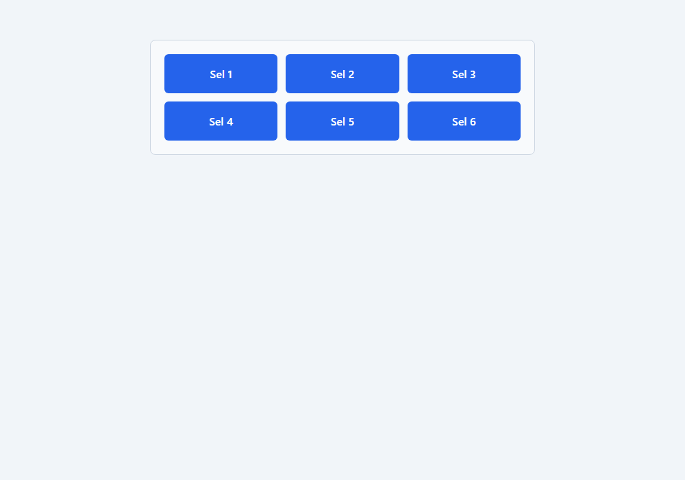

##### 167. `display: grid` and Grid Container Initialization

- **Source Code**: [`167_display_grid.css`](./module-10-css-grid-layout/167_display_grid.css) | **Preview**: [`167_display_grid.html`](./module-10-css-grid-layout/167_display_grid.html)
- **Key Concept**: `display: grid` establishes a block-level grid formatting context, transforming all direct children into grid items placed along coordinate grid lines.
- **Implementation**: Contrasts standard block flow with an initialized grid container, illustrating how child boxes immediately align to grid tracks.
- **Execution Output**:

  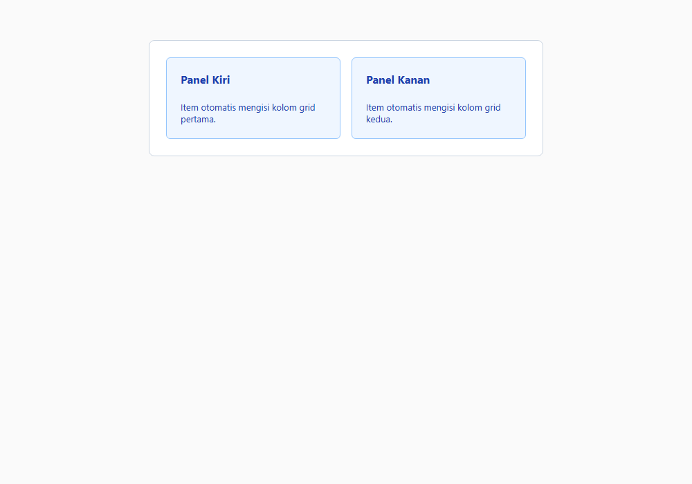

##### 168. The `grid-template-columns` Property

- **Source Code**: [`168_grid_template_columns.css`](./module-10-css-grid-layout/168_grid_template_columns.css) | **Preview**: [`168_grid_template_columns.html`](./module-10-css-grid-layout/168_grid_template_columns.html)
- **Key Concept**: The `grid-template-columns` property defines explicit vertical tracks using lengths, percentages, or flexible fractional units (`fr`).
- **Implementation**: Defines asymmetrical columns (`200px 1fr 2fr`), allocating a fixed sidebar alongside two proportionally distributed content columns.
- **Execution Output**:

  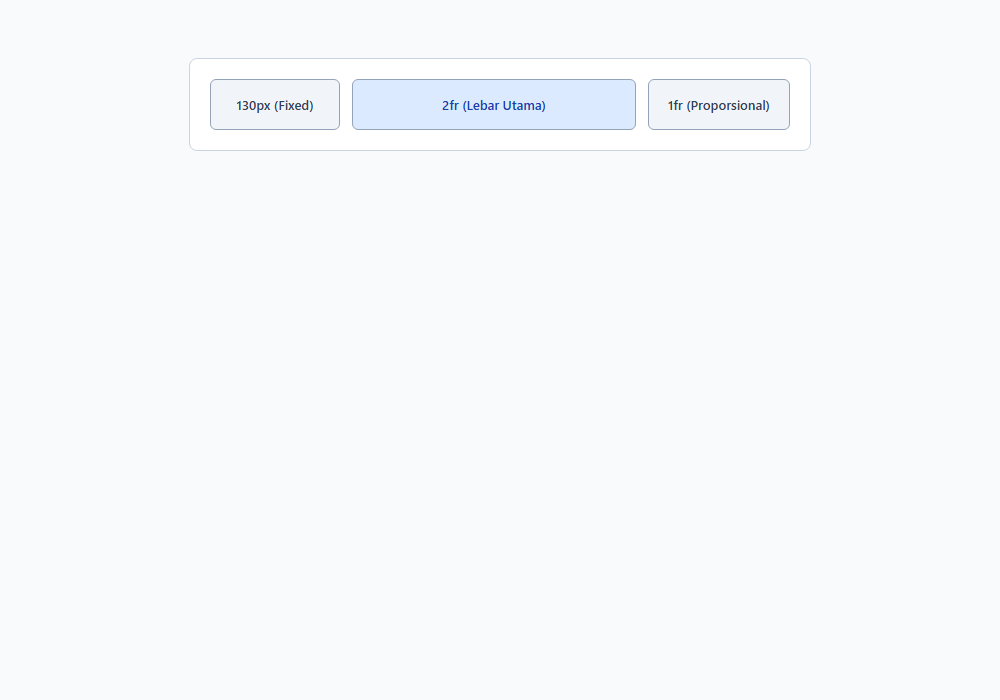

##### 169. The `grid-template-rows` Property

- **Source Code**: [`169_grid_template_rows.css`](./module-10-css-grid-layout/169_grid_template_rows.css) | **Preview**: [`169_grid_template_rows.html`](./module-10-css-grid-layout/169_grid_template_rows.html)
- **Key Concept**: The `grid-template-rows` property specifies explicit horizontal track heights across grid rows.
- **Implementation**: Sets fixed 80px header tracks, auto-expanding body content rows, and 60px footer tracks for application layouts.
- **Execution Output**:

  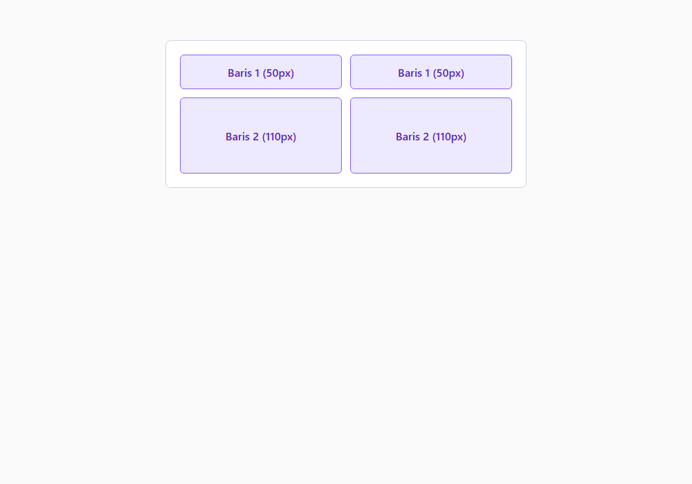

##### 170. Named Grid Areas (`grid-template-areas`)

- **Source Code**: [`170_grid_template_areas.css`](./module-10-css-grid-layout/170_grid_template_areas.css) | **Preview**: [`170_grid_template_areas.html`](./module-10-css-grid-layout/170_grid_template_areas.html)
- **Key Concept**: `grid-template-areas` enables visual ASCII-style semantic layout definitions, mapping named components directly to cell coordinates.
- **Implementation**: Maps a complete website layout: `"header header" "sidebar main" "footer footer"`, providing intuitive layout readability.
- **Execution Output**:

  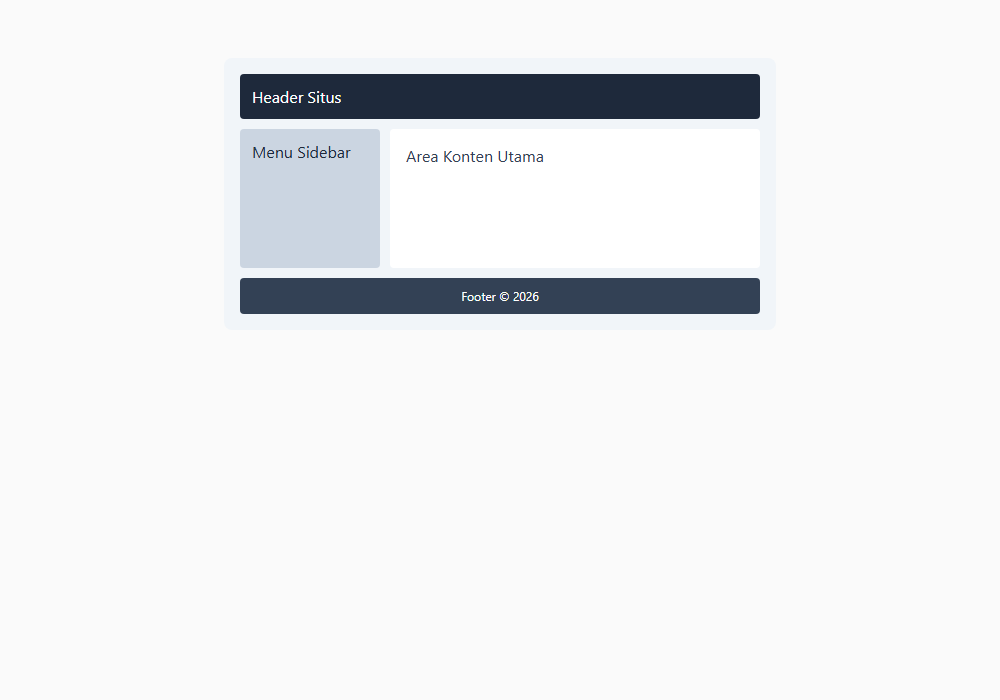

##### 171. Column Placement with `grid-column`

- **Source Code**: [`171_grid_column.css`](./module-10-css-grid-layout/171_grid_column.css) | **Preview**: [`171_grid_column.html`](./module-10-css-grid-layout/171_grid_column.html)
- **Key Concept**: The `grid-column` shorthand (`grid-column-start / grid-column-end` or `span N`) positions an item across specific vertical grid lines.
- **Implementation**: Stretches a featured hero card across all three columns (`grid-column: 1 / -1`) while subsequent cards occupy single tracks.
- **Execution Output**:

  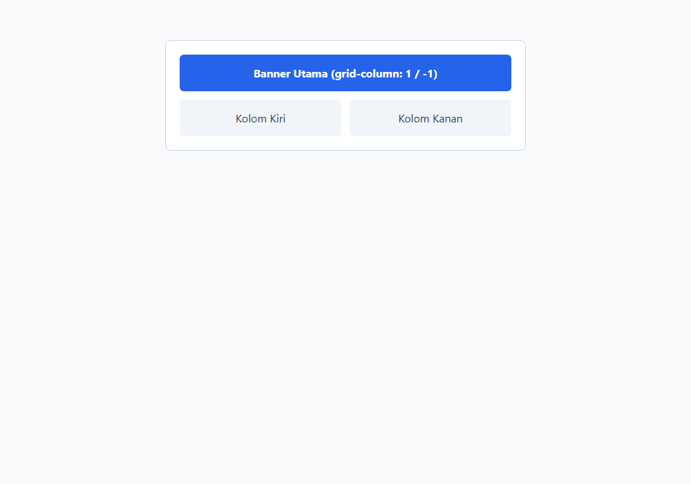

##### 172. Row Placement with `grid-row`

- **Source Code**: [`172_grid_row.css`](./module-10-css-grid-layout/172_grid_row.css) | **Preview**: [`172_grid_row.html`](./module-10-css-grid-layout/172_grid_row.html)
- **Key Concept**: The `grid-row` shorthand controls vertical placement, allowing elements to span down across multiple intersecting horizontal rows.
- **Implementation**: Spans a primary navigation sidebar across two stacked rows (`grid-row: 1 / span 2`) adjacent to stacked dashboard widgets.
- **Execution Output**:

  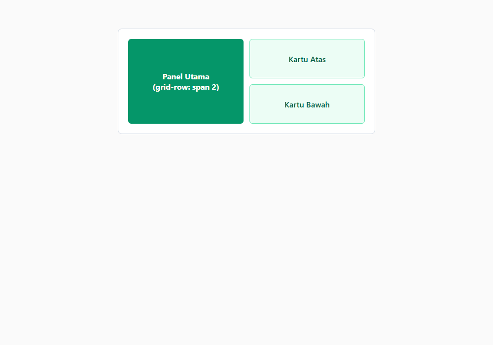

##### 173. The `grid-area` Placement Property

- **Source Code**: [`173_grid_area.css`](./module-10-css-grid-layout/173_grid_area.css) | **Preview**: [`173_grid_area.html`](./module-10-css-grid-layout/173_grid_area.html)
- **Key Concept**: `grid-area` assigns an element to a named area declared in `grid-template-areas`, or serves as a four-coordinate shorthand (`row-start / col-start / row-end / col-end`).
- **Implementation**: Assigns semantic landmarks to defined template areas via `grid-area: header`, `grid-area: sidebar`, and `grid-area: main`.
- **Execution Output**:

  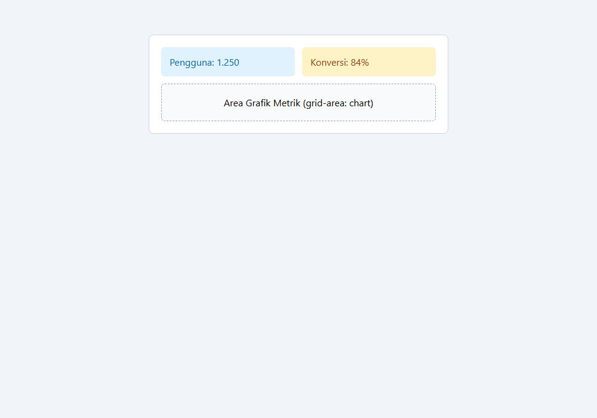

##### 174. Grid Gap Spacing (`row-gap`, `column-gap`, `gap`)

- **Source Code**: [`174_grid_gap.css`](./module-10-css-grid-layout/174_grid_gap.css) | **Preview**: [`174_grid_gap.html`](./module-10-css-grid-layout/174_grid_gap.html)
- **Key Concept**: The `gap` property establishes gutters between adjacent rows and columns without adding perimeter margin to external container borders.
- **Implementation**: Configures an image showcase matrix using `gap: 20px 30px` to maintain distinct vertical and horizontal gutter spacing.
- **Execution Output**:

  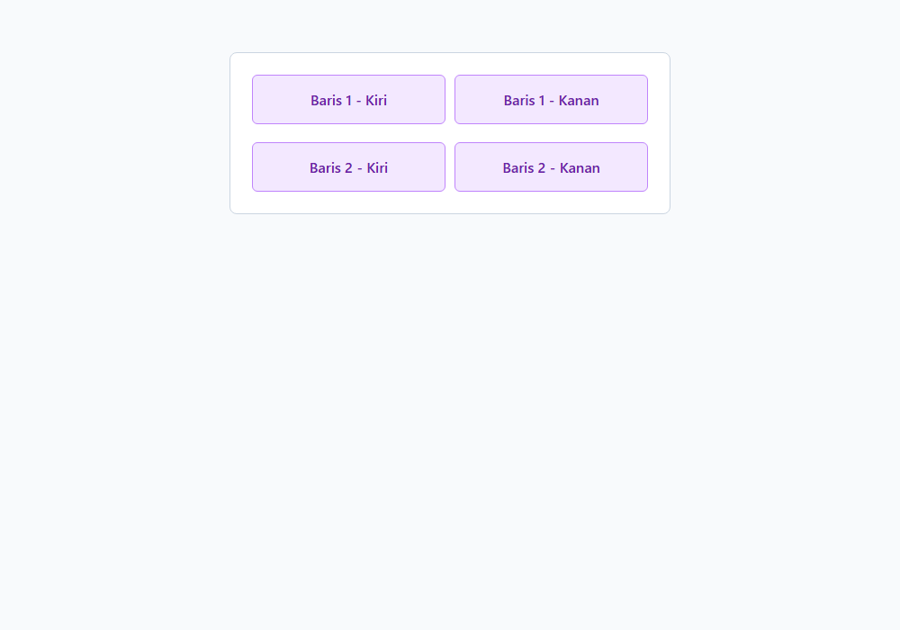

##### 175. Implicit Grid Flow (`grid-auto-flow`)

- **Source Code**: [`175_grid_auto_flow.css`](./module-10-css-grid-layout/175_grid_auto_flow.css) | **Preview**: [`175_grid_auto_flow.html`](./module-10-css-grid-layout/175_grid_auto_flow.html)
- **Key Concept**: `grid-auto-flow` dictates how auto-placed items flow: `row` (default), `column`, or `dense` (packing small items backward to fill holes left by spanning elements).
- **Implementation**: Demonstrates masonry-like packing using `grid-auto-flow: dense` across asymmetric photo gallery cards.
- **Execution Output**:

  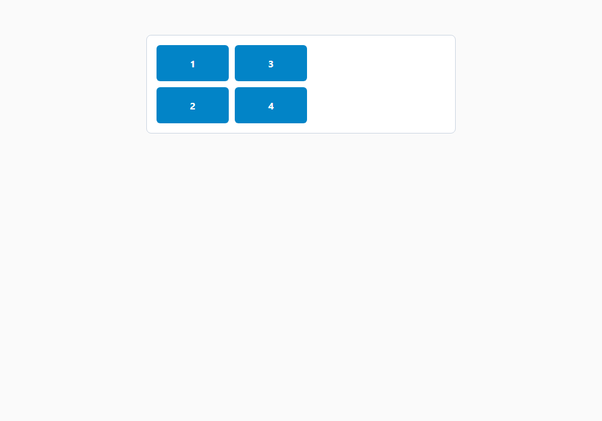

##### 176. Implicit Track Sizing (`grid-auto-columns` / `grid-auto-rows`)

- **Source Code**: [`176_grid_auto_columns_rows.css`](./module-10-css-grid-layout/176_grid_auto_columns_rows.css) | **Preview**: [`176_grid_auto_columns_rows.html`](./module-10-css-grid-layout/176_grid_auto_columns_rows.html)
- **Key Concept**: `grid-auto-rows` and `grid-auto-columns` dictate track sizes automatically generated when extra items exceed explicitly defined template tracks.
- **Implementation**: Sets `grid-auto-rows: 150px`, guaranteeing that all dynamically appended items receive uniform heights.
- **Execution Output**:

  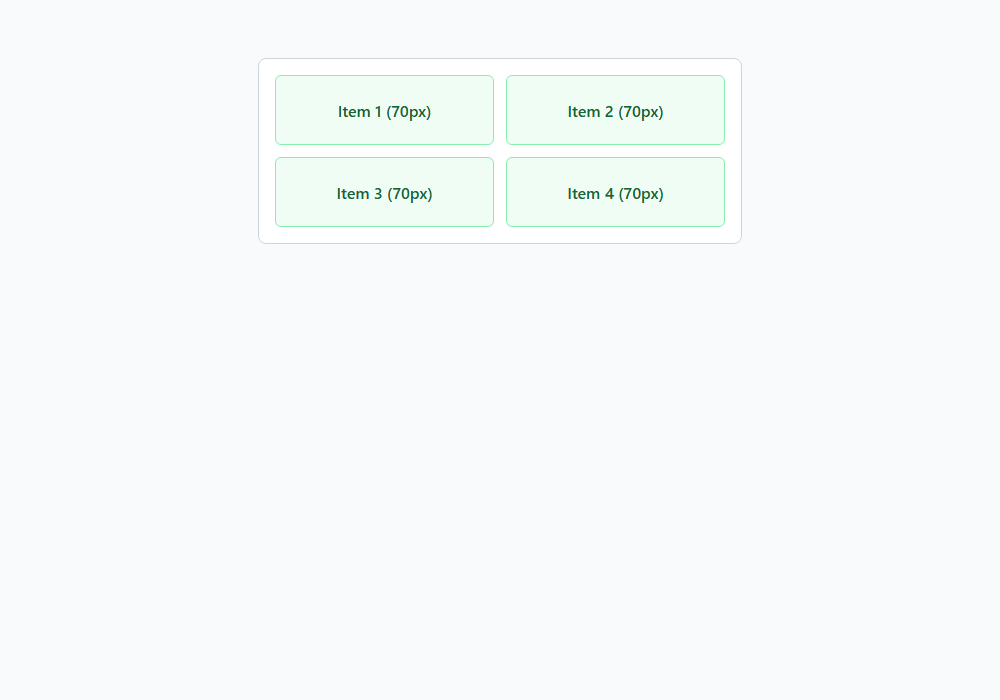

##### 177. Responsive Column Wrapping with `auto-fit`

- **Source Code**: [`177_grid_auto_fit.css`](./module-10-css-grid-layout/177_grid_auto_fit.css) | **Preview**: [`177_grid_auto_fit.html`](./module-10-css-grid-layout/177_grid_auto_fit.html)
- **Key Concept**: `auto-fit` collapses empty tracks to zero width, allowing existing items to stretch and fill all remaining container space seamlessly.
- **Implementation**: Authors the canonical responsive card pattern: `repeat(auto-fit, minmax(240px, 1fr))`, achieving fluid responsiveness with zero media queries.
- **Execution Output**:

  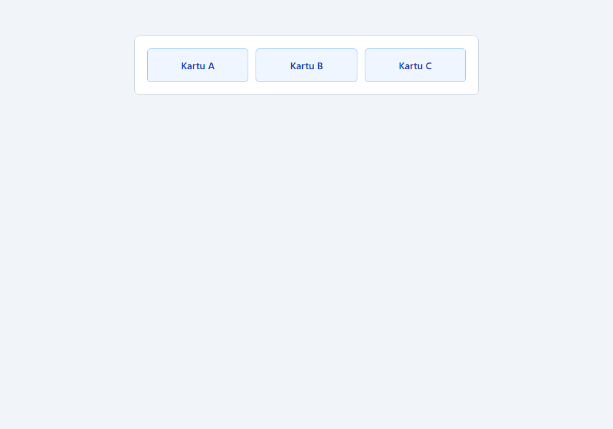

##### 178. Empty Slot Reservation with `auto-fill`

- **Source Code**: [`178_grid_auto_fill.css`](./module-10-css-grid-layout/178_grid_auto_fill.css) | **Preview**: [`178_grid_auto_fill.html`](./module-10-css-grid-layout/178_grid_auto_fill.html)
- **Key Concept**: `auto-fill` maintains empty virtual track slots if space permits, preserving item widths without forcibly expanding them across empty rows.
- **Implementation**: Contrasts `auto-fill` and `auto-fit` side-by-side to illustrate slot preservation behavior when item counts are sparse.
- **Execution Output**:

  

##### 179. The `minmax()` Track Sizing Function

- **Source Code**: [`179_minmax_function.css`](./module-10-css-grid-layout/179_minmax_function.css) | **Preview**: [`179_minmax_function.html`](./module-10-css-grid-layout/179_minmax_function.html)
- **Key Concept**: The `minmax(min, max)` function establishes lower and upper sizing boundaries for grid tracks, enabling fluid contraction with bounded expansion.
- **Implementation**: Configures sidebar columns sized with `minmax(180px, 280px)` alongside expanding `1fr` content viewports.
- **Execution Output**:

  

##### 180. The `repeat()` Pattern Function

- **Source Code**: [`180_repeat_function.css`](./module-10-css-grid-layout/180_repeat_function.css) | **Preview**: [`180_repeat_function.html`](./module-10-css-grid-layout/180_repeat_function.html)
- **Key Concept**: The `repeat(count, track-definition)` function concisely duplicates recurring column and row tracks without verbose manual declarations.
- **Implementation**: Sets a uniform 12-column grid layout via `repeat(12, 1fr)` for fine-grained multi-column desktop application layouts.
- **Execution Output**:

  

##### 181. Fractional Unit (`fr`) Distribution

- **Source Code**: [`181_fractional_units.css`](./module-10-css-grid-layout/181_fractional_units.css) | **Preview**: [`181_fractional_units.html`](./module-10-css-grid-layout/181_fractional_units.html)
- **Key Concept**: The fractional unit `fr` represents a fraction of leftover free space in the grid container after all fixed lengths and gutters are deducted.
- **Implementation**: Demonstrates proportional distribution across three columns configured as `1fr 2fr 1fr`, giving the center column double width.
- **Execution Output**:

  

##### 182. Inline Alignment with `justify-items` and `justify-self`

- **Source Code**: [`182_justify_items_grid.css`](./module-10-css-grid-layout/182_justify_items_grid.css) | **Preview**: [`182_justify_items_grid.html`](./module-10-css-grid-layout/182_justify_items_grid.html)
- **Key Concept**: `justify-items` dictates horizontal alignment of all items within their individual grid cells; `justify-self` allows single items to override cell alignment.
- **Implementation**: Compares `start`, `center`, `end`, and `stretch` horizontal cell alignments within a structured grid preview.
- **Execution Output**:

  

##### 183. Block Alignment with `align-items` and `align-self`

- **Source Code**: [`183_align_items_grid.css`](./module-10-css-grid-layout/183_align_items_grid.css) | **Preview**: [`183_align_items_grid.html`](./module-10-css-grid-layout/183_align_items_grid.html)
- **Key Concept**: `align-items` dictates vertical block alignment of items within grid cells; `align-self` overrides vertical alignment for individual items.
- **Implementation**: Vertically centers cards within generous row tracks, allowing specific priority cards to stretch fully.
- **Execution Output**:

  

##### 184. Responsive Card Layout with CSS Grid

- **Source Code**: [`184_grid_card_layout.css`](./module-10-css-grid-layout/184_grid_card_layout.css) | **Preview**: [`184_grid_card_layout.html`](./module-10-css-grid-layout/184_grid_card_layout.html)
- **Key Concept**: CSS Grid provides the premier architecture for card grids: handling equal column widths, uniform row heights, and consistent gutter spacing natively.
- **Implementation**: Constructs an e-commerce product matrix with responsive auto-wrapping, image containment, and price tags.
- **Execution Output**:

  

##### 185. Complex Dashboard Architecture with CSS Grid

- **Source Code**: [`185_grid_dashboard_layout.css`](./module-10-css-grid-layout/185_grid_dashboard_layout.css) | **Preview**: [`185_grid_dashboard_layout.html`](./module-10-css-grid-layout/185_grid_dashboard_layout.html)
- **Key Concept**: Full web applications synthesize multi-track column/row declarations and named areas to construct complex analytics dashboards.
- **Implementation**: Architectures an enterprise analytics portal featuring navigation bars, metric stat cards, data chart panels, and side activity feeds.
- **Execution Output**:

  


### Module 11: Responsive Web Design

**Curriculum Path**: [`module-11-responsive-web-design`](./module-11-responsive-web-design) | **Level**: `Intermediate to Advanced` | **Scope**: 20 Lessons

#### Overview & Concepts Covered

Focuses on responsive design paradigms, adaptive layouts, and media query specifications: core `@media` syntax, breakpoint architectures with `min-width` (mobile-first) and `max-width` (desktop-first), fluid layouts and percentage dimensions, responsive typography with mathematical bounds via `clamp()`, flexible images, adaptive navigation bars, responsive Flexbox and Grid patterns, orientation queries (`portrait`/`landscape`), user input hardware detection (`hover`, `pointer`), user preference media queries (`prefers-color-scheme`, `prefers-reduced-motion`), print media stylesheets, and next-generation Container Queries (`@container`).

#### Subtopics & Visual Captures

##### 186. Media Queries Syntax and Mechanics

- **Source Code**: [`186_media_queries_basic.css`](./module-11-responsive-web-design/186_media_queries_basic.css) | **Preview**: [`186_media_queries_basic.html`](./module-11-responsive-web-design/186_media_queries_basic.html)
- **Key Concept**: The `@media` at-rule conditionally applies CSS rules based on device viewport metrics, screen resolution, and media types (`screen`, `print`).
- **Implementation**: Styles an adaptive card that dynamically transitions background colors and typography sizes across viewport thresholds.
- **Execution Output**:

  

##### 187. Mobile-First Breakpoints with `min-width`

- **Source Code**: [`187_media_min_width.css`](./module-11-responsive-web-design/187_media_min_width.css) | **Preview**: [`187_media_min_width.html`](./module-11-responsive-web-design/187_media_min_width.html)
- **Key Concept**: The industry-standard mobile-first strategy writes base styles for small screens, using `@media (min-width: ...)` to progressively enhance layouts for tablets and desktops.
- **Implementation**: Progressively enhances a single-column mobile list into a 2-column tablet grid at `min-width: 640px` and a 4-column desktop grid at `min-width: 1024px`.
- **Execution Output**:

  

##### 188. Desktop-First Breakpoints with `max-width`

- **Source Code**: [`188_media_max_width.css`](./module-11-responsive-web-design/188_media_max_width.css) | **Preview**: [`188_media_max_width.html`](./module-11-responsive-web-design/188_media_max_width.html)
- **Key Concept**: Desktop-first authoring defines wide desktop layouts as the baseline, using `@media (max-width: ...)` to degrade gracefully as viewports narrow.
- **Implementation**: Contrasts desktop-first breakpoint ladders with mobile-first structures, demonstrating source order management to prevent rule collisions.
- **Execution Output**:

  

##### 189. Mobile-First Progressive Enhancement Strategy

- **Source Code**: [`189_mobile_first.css`](./module-11-responsive-web-design/189_mobile_first.css) | **Preview**: [`189_mobile_first.html`](./module-11-responsive-web-design/189_mobile_first.html)
- **Key Concept**: Progressive enhancement ensures mobile devices load lightweight, essential styles first, downloading complex multi-column layouts only on devices with capable screens.
- **Implementation**: Builds a robust product showcase starting with touch-friendly vertical stacks, unlocking rich horizontal split cards on larger screens.
- **Execution Output**:

  

##### 190. Desktop-First Graceful Degradation Strategy

- **Source Code**: [`190_desktop_first.css`](./module-11-responsive-web-design/190_desktop_first.css) | **Preview**: [`190_desktop_first.html`](./module-11-responsive-web-design/190_desktop_first.html)
- **Key Concept**: Graceful degradation targets legacy enterprise desktops first, systematically overriding desktop positioning and multi-column floats as viewports constrict.
- **Implementation**: Refactors a desktop multi-panel dashboard into simplified stacked blocks using descending `max-width` query ladders.
- **Execution Output**:

  

##### 191. Responsive Typography and Fluid Font Scaling

- **Source Code**: [`191_responsive_typography.css`](./module-11-responsive-web-design/191_responsive_typography.css) | **Preview**: [`191_responsive_typography.html`](./module-11-responsive-web-design/191_responsive_typography.html)
- **Key Concept**: Stepped media query breakpoints scale `font-size` at discrete intervals (e.g., mobile `1.25rem`, tablet `1.75rem`, desktop `2.5rem`) to maintain headline balance.
- **Implementation**: Scales an editorial heading hierarchy across four standard device breakpoints without text wrapping anomalies.
- **Execution Output**:

  

##### 192. Fluid Percentage-Based Layouts

- **Source Code**: [`192_fluid_layout.css`](./module-11-responsive-web-design/192_fluid_layout.css) | **Preview**: [`192_fluid_layout.html`](./module-11-responsive-web-design/192_fluid_layout.html)
- **Key Concept**: Fluid layouts replace rigid pixel widths with proportional percentages (`%`) and viewport units (`vw`), flowing continuously without rigid jumps.
- **Implementation**: Implements an elastic 3-column layout where column widths expand and contract proportionally with the browser window.
- **Execution Output**:

  

##### 193. Modern Fluid Typography with `clamp()`

- **Source Code**: [`193_fluid_typography_clamp.css`](./module-11-responsive-web-design/193_fluid_typography_clamp.css) | **Preview**: [`193_fluid_typography_clamp.html`](./module-11-responsive-web-design/193_fluid_typography_clamp.html)
- **Key Concept**: The modern formula `font-size: clamp(min, preferred_vw, max)` provides completely fluid font scaling without requiring a single media query.
- **Implementation**: Sets hero headlines to `font-size: clamp(2rem, 5vw + 1rem, 4.5rem)`, scaling smoothly from mobile phones to ultra-wide displays.
- **Execution Output**:

  

##### 194. Responsive Images and Aspect-Ratio Preservation

- **Source Code**: [`194_responsive_images.css`](./module-11-responsive-web-design/194_responsive_images.css) | **Preview**: [`194_responsive_images.html`](./module-11-responsive-web-design/194_responsive_images.html)
- **Key Concept**: Ensuring images never overflow their parent requires `max-width: 100%; height: auto; display: block`, preserving intrinsic aspect ratios automatically.
- **Implementation**: Embeds high-resolution visual photography inside fluid containers, demonstrating responsive scaling without aspect-ratio distortion.
- **Execution Output**:

  

##### 195. Responsive Navigation and Mobile Toggle Menus

- **Source Code**: [`195_responsive_navigation.css`](./module-11-responsive-web-design/195_responsive_navigation.css) | **Preview**: [`195_responsive_navigation.html`](./module-11-responsive-web-design/195_responsive_navigation.html)
- **Key Concept**: Responsive navigation displays a horizontal link bar on desktops while folding into a vertical drawer or hamburger menu layout on mobile viewports.
- **Implementation**: Constructs a responsive header that morphs from an expanded desktop navbar into a collapsible mobile drawer.
- **Execution Output**:

  

##### 196. Adaptive Flexbox Breakpoints

- **Source Code**: [`196_responsive_flexbox.css`](./module-11-responsive-web-design/196_responsive_flexbox.css) | **Preview**: [`196_responsive_flexbox.html`](./module-11-responsive-web-design/196_responsive_flexbox.html)
- **Key Concept**: Shifting `flex-direction: column` on mobile to `flex-direction: row` at desktop breakpoints provides an intuitive responsive transformation pattern.
- **Implementation**: Reconfigures feature cards from vertical stacks into horizontal split media-and-text components across screen breakpoints.
- **Execution Output**:

  

##### 197. Adaptive CSS Grid Breakpoints

- **Source Code**: [`197_responsive_grid.css`](./module-11-responsive-web-design/197_responsive_grid.css) | **Preview**: [`197_responsive_grid.html`](./module-11-responsive-web-design/197_responsive_grid.html)
- **Key Concept**: Redefining `grid-template-columns` inside media queries transitions grid tracks from 1 column (mobile) to 2 columns (tablet) and 4 columns (desktop).
- **Implementation**: Formats an adaptive portfolio showcase, orchestrating track expansions smoothly as viewport width increases.
- **Execution Output**:

  

##### 198. Device Orientation Media Queries (`portrait` vs `landscape`)

- **Source Code**: [`198_orientation_queries.css`](./module-11-responsive-web-design/198_orientation_queries.css) | **Preview**: [`198_orientation_queries.html`](./module-11-responsive-web-design/198_orientation_queries.html)
- **Key Concept**: The `orientation` media feature (`portrait` vs `landscape`) adapts layouts to device rotation independently of raw screen pixel dimensions.
- **Implementation**: Reorganizes mobile video player controls from vertical side stacks in portrait to compact bottom overlays in landscape.
- **Execution Output**:

  

##### 199. Hover Capability Media Queries (`hover: hover` vs `none`)

- **Source Code**: [`199_hover_capability_queries.css`](./module-11-responsive-web-design/199_hover_capability_queries.css) | **Preview**: [`199_hover_capability_queries.html`](./module-11-responsive-web-design/199_hover_capability_queries.html)
- **Key Concept**: Testing `@media (hover: hover)` prevents hover states from getting 'stuck' on touchscreens, applying hover animations exclusively to pointer devices.
- **Implementation**: Delivers smooth card hover elevation on mouse-driven desktop browsers while keeping mobile touchscreen cards immediately accessible.
- **Execution Output**:

  

##### 200. Pointer Accuracy Media Queries (`pointer: fine` vs `coarse`)

- **Source Code**: [`200_pointer_media_queries.css`](./module-11-responsive-web-design/200_pointer_media_queries.css) | **Preview**: [`200_pointer_media_queries.html`](./module-11-responsive-web-design/200_pointer_media_queries.html)
- **Key Concept**: The `pointer` media feature distinguishes between accurate pointing devices (`fine`, e.g., mice) and imprecise pointing devices (`coarse`, e.g., fingers).
- **Implementation**: Enlarges interactive button touch targets to `48px` minimum padding for `pointer: coarse` users to ensure accessibility.
- **Execution Output**:

  

##### 201. Dark Mode Adaptation with `prefers-color-scheme`

- **Source Code**: [`201_prefers_color_scheme.css`](./module-11-responsive-web-design/201_prefers_color_scheme.css) | **Preview**: [`201_prefers_color_scheme.html`](./module-11-responsive-web-design/201_prefers_color_scheme.html)
- **Key Concept**: `@media (prefers-color-scheme: dark)` detects user operating system theme preferences, automatically switching application palettes.
- **Implementation**: Swaps light surface backgrounds and dark text for deep slate backgrounds, high-contrast borders, and glowing accents in dark mode.
- **Execution Output**:

  

##### 202. Accessibility Adaptation with `prefers-reduced-motion`

- **Source Code**: [`202_prefers_reduced_motion.css`](./module-11-responsive-web-design/202_prefers_reduced_motion.css) | **Preview**: [`202_prefers_reduced_motion.html`](./module-11-responsive-web-design/202_prefers_reduced_motion.html)
- **Key Concept**: `@media (prefers-reduced-motion: reduce)` respects accessibility settings for vestibular motion disorders, disabling sweeping animations.
- **Implementation**: Replaces elaborate multi-second transformation animations with simple instant color fades when reduced motion is requested.
- **Execution Output**:

  

##### 203. Media Types (`print` vs `screen` Media Styles)

- **Source Code**: [`203_media_print_screen.css`](./module-11-responsive-web-design/203_media_print_screen.css) | **Preview**: [`203_media_print_screen.html`](./module-11-responsive-web-design/203_media_print_screen.html)
- **Key Concept**: `@media print` tailors documents for physical printing: stripping dark backgrounds, hiding navigation bars, and forcing crisp black typography.
- **Implementation**: Optimizes an invoice document for printing: hiding header navigation, resetting background colors, and displaying full URL text next to links.
- **Execution Output**:

  

##### 204. Container Queries with `@container`

- **Source Code**: [`204_container_queries.css`](./module-11-responsive-web-design/204_container_queries.css) | **Preview**: [`204_container_queries.html`](./module-11-responsive-web-design/204_container_queries.html)
- **Key Concept**: Container Queries (`@container (min-width: ...)`) adapt components relative to the width of their immediate parent container rather than the global viewport.
- **Implementation**: Embeds identical card components inside a narrow sidebar and a wide main column; each card adapts its layout independently to its parent width.
- **Execution Output**:

  

##### 205. Architecting a Complete Responsive Design System

- **Source Code**: [`205_responsive_design_system.css`](./module-11-responsive-web-design/205_responsive_design_system.css) | **Preview**: [`205_responsive_design_system.html`](./module-11-responsive-web-design/205_responsive_design_system.html)
- **Key Concept**: Enterprise design systems synthesize breakpoint tokens, modular grid scales, fluid typography, and dark mode theming into an orchestrated system.
- **Implementation**: Constructs an end-to-end responsive web page uniting mobile-first grids, fluid typography, dark mode preferences, and container-aware widgets.
- **Execution Output**:

  

### Module 12: Pseudo-classes and Pseudo-elements

**Curriculum Path**: [`module-12-pseudo-class-dan-pseudo-element`](./module-12-pseudo-class-dan-pseudo-element) | **Level**: `Intermediate to Advanced` | **Scope**: 20 Lessons

#### Overview & Concepts Covered

Details state-based selection and virtual element rendering: interactive user action states (`:hover`, `:active`), accessible focus management (`:focus`, `:focus-visible`, `:focus-within`), tree-structural selectors (`:first-child`, `:last-child`, `:first-of-type`, `:last-of-type`), functional pattern matchers (`:nth-child(An+B)`, `:nth-of-type()`), modern relational and grouping pseudo-classes (`:not()`, `:is()`, `:where()`, `:has()`), form control states (`:checked`, `:disabled`, `:enabled`), and generated/virtual pseudo-elements (`::before`, `::after`, `::marker`, `::selection`, `::placeholder`).

#### Subtopics & Visual Captures

##### 206. The `:hover` User Action Pseudo-Class

- **Source Code**: [`206_hover_pseudo_class.css`](./module-12-pseudo-class-dan-pseudo-element/206_hover_pseudo_class.css) | **Preview**: [`206_hover_pseudo_class.html`](./module-12-pseudo-class-dan-pseudo-element/206_hover_pseudo_class.html)
- **Key Concept**: The `:hover` pseudo-class activates when the user hovers a pointing device over an element, signaling clickability through visual cues.
- **Implementation**: Enhances interactive buttons with subtle background color lightening, elevation drop shadows, and upward translation upon hover.
- **Execution Output**:

  

##### 207. The `:active` State Pseudo-Class

- **Source Code**: [`207_active_pseudo_class.css`](./module-12-pseudo-class-dan-pseudo-element/207_active_pseudo_class.css) | **Preview**: [`207_active_pseudo_class.html`](./module-12-pseudo-class-dan-pseudo-element/207_active_pseudo_class.html)
- **Key Concept**: The `:active` pseudo-class applies during the precise physical duration between the user pressing down the mouse button and releasing it.
- **Implementation**: Simulates tactile tactile button depression by shifting scale (`transform: scale(0.97)`) and deepening shadow during the active click phase.
- **Execution Output**:

  

##### 208. The `:focus` Form and Element State

- **Source Code**: [`208_focus_pseudo_class.css`](./module-12-pseudo-class-dan-pseudo-element/208_focus_pseudo_class.css) | **Preview**: [`208_focus_pseudo_class.html`](./module-12-pseudo-class-dan-pseudo-element/208_focus_pseudo_class.html)
- **Key Concept**: The `:focus` pseudo-class triggers when an element receives keyboard or click focus, allowing input fields to signal active data-entry readiness.
- **Implementation**: Highlights active form inputs with glowing accent borders and soft atmospheric shadow halos upon receiving focus.
- **Execution Output**:

  

##### 209. Accessible Focus Rings with `:focus-visible`

- **Source Code**: [`209_focus_visible.css`](./module-12-pseudo-class-dan-pseudo-element/209_focus_visible.css) | **Preview**: [`209_focus_visible.html`](./module-12-pseudo-class-dan-pseudo-element/209_focus_visible.html)
- **Key Concept**: `:focus-visible` displays focus indicators only when the user navigates via keyboard (Tab key), suppressing distracting rings on mouse clicks.
- **Implementation**: Styles an accessible 3px focus ring around buttons and links that remains invisible to mouse users but prominent for keyboard navigation.
- **Execution Output**:

  

##### 210. Parent Focus Detection with `:focus-within`

- **Source Code**: [`210_focus_within.css`](./module-12-pseudo-class-dan-pseudo-element/210_focus_within.css) | **Preview**: [`210_focus_within.html`](./module-12-pseudo-class-dan-pseudo-element/210_focus_within.html)
- **Key Concept**: The `:focus-within` pseudo-class matches an entire container element if any of its internal child elements currently has focus.
- **Implementation**: Highlights an entire search card container with an accent border whenever the nested text input inside it receives focus.
- **Execution Output**:

  

##### 211. Structural `:first-child` Pseudo-Class

- **Source Code**: [`211_first_child.css`](./module-12-pseudo-class-dan-pseudo-element/211_first_child.css) | **Preview**: [`211_first_child.html`](./module-12-pseudo-class-dan-pseudo-element/211_first_child.html)
- **Key Concept**: `:first-child` matches an element only if it is the very first child node among all sibling elements under its parent container.
- **Implementation**: Removes redundant top border divider lines on the first item in a card list using `:first-child`.
- **Execution Output**:

  

##### 212. Structural `:last-child` Pseudo-Class

- **Source Code**: [`212_last_child.css`](./module-12-pseudo-class-dan-pseudo-element/212_last_child.css) | **Preview**: [`212_last_child.html`](./module-12-pseudo-class-dan-pseudo-element/212_last_child.html)
- **Key Concept**: `:last-child` matches an element only if it is the very last child node among all sibling elements under its parent container.
- **Implementation**: Strips bottom margins from the final paragraph in a modal card to guarantee clean baseline padding alignment.
- **Execution Output**:

  

##### 213. Formulaic Selection with `:nth-child(An+B)`

- **Source Code**: [`213_nth_child.css`](./module-12-pseudo-class-dan-pseudo-element/213_nth_child.css) | **Preview**: [`213_nth_child.html`](./module-12-pseudo-class-dan-pseudo-element/213_nth_child.html)
- **Key Concept**: The functional `:nth-child(An+B)` pseudo-class matches elements based on algebraic cycles (`2n`, `3n+1`, `odd`, `even`) across sibling indices.
- **Implementation**: Applies alternating zebra stripe colors to table rows and highlights every third product card in a catalog.
- **Execution Output**:

  

##### 214. Type-Restricted Selection with `:nth-of-type()`

- **Source Code**: [`214_nth_of_type.css`](./module-12-pseudo-class-dan-pseudo-element/214_nth_of_type.css) | **Preview**: [`214_nth_of_type.html`](./module-12-pseudo-class-dan-pseudo-element/214_nth_of_type.html)
- **Key Concept**: Unlike `:nth-child()`, `:nth-of-type()` counts only sibling elements sharing the exact same HTML element tag name, ignoring intervening tags.
- **Implementation**: Formats even-numbered `<p>` tags with subtle indentation without being disrupted by intervening `<h2>` headings or `<blockquote>` elements.
- **Execution Output**:

  

##### 215. The `:first-of-type` Pseudo-Class

- **Source Code**: [`215_first_of_type.css`](./module-12-pseudo-class-dan-pseudo-element/215_first_of_type.css) | **Preview**: [`215_first_of_type.html`](./module-12-pseudo-class-dan-pseudo-element/215_first_of_type.html)
- **Key Concept**: `:first-of-type` selects the first occurrence of a specific element type among siblings, regardless of preceding sibling elements of different types.
- **Implementation**: Styles the initial paragraph of an article with drop-cap styling and larger lead-paragraph font sizing.
- **Execution Output**:

  

##### 216. The `:last-of-type` Pseudo-Class

- **Source Code**: [`216_last_of_type.css`](./module-12-pseudo-class-dan-pseudo-element/216_last_of_type.css) | **Preview**: [`216_last_of_type.html`](./module-12-pseudo-class-dan-pseudo-element/216_last_of_type.html)
- **Key Concept**: `:last-of-type` selects the final occurrence of a specific element type among siblings, ignoring trailing siblings of different types.
- **Implementation**: Adds concluding editorial signature styling to the final paragraph of an article container.
- **Execution Output**:

  

##### 217. Negation Matching with `:not()`

- **Source Code**: [`217_not_pseudo_class.css`](./module-12-pseudo-class-dan-pseudo-element/217_not_pseudo_class.css) | **Preview**: [`217_not_pseudo_class.html`](./module-12-pseudo-class-dan-pseudo-element/217_not_pseudo_class.html)
- **Key Concept**: The `:not(selector)` pseudo-class matches elements that do not match the argument selector, eliminating defensive manual overrides.
- **Implementation**: Applies bottom border dividers to all list items except the final one using `.list-item:not(:last-child)`.
- **Execution Output**:

  

##### 218. Forgiving Selector Grouping with `:is()`

- **Source Code**: [`218_is_pseudo_class.css`](./module-12-pseudo-class-dan-pseudo-element/218_is_pseudo_class.css) | **Preview**: [`218_is_pseudo_class.html`](./module-12-pseudo-class-dan-pseudo-element/218_is_pseudo_class.html)
- **Key Concept**: The `:is()` pseudo-class condenses repetitive selectors and adopts forgiving parsing; its specificity adopts the highest specificity among its arguments.
- **Implementation**: Simplifies heading selectors inside articles using `:is(article, section, aside) :is(h1, h2, h3)`.
- **Execution Output**:

  

##### 219. Zero-Specificity Selector Grouping with `:where()`

- **Source Code**: [`219_where_pseudo_class.css`](./module-12-pseudo-class-dan-pseudo-element/219_where_pseudo_class.css) | **Preview**: [`219_where_pseudo_class.html`](./module-12-pseudo-class-dan-pseudo-element/219_where_pseudo_class.html)
- **Key Concept**: The `:where()` pseudo-class groups selectors identically to `:is()`, but carries exactly zero specificity `(0,0,0,0)`, making styles trivially overridable.
- **Implementation**: Defines baseline design tokens in a CSS reset using `:where(button, input, select)` to allow effortless downstream customization.
- **Execution Output**:

  

##### 220. The Parent / Relational Selector `:has()`

- **Source Code**: [`220_has_pseudo_class.css`](./module-12-pseudo-class-dan-pseudo-element/220_has_pseudo_class.css) | **Preview**: [`220_has_pseudo_class.html`](./module-12-pseudo-class-dan-pseudo-element/220_has_pseudo_class.html)
- **Key Concept**: The `:has()` pseudo-class (the 'parent selector') allows styling a parent container based on whether it contains descendants matching a query.
- **Implementation**: Styles an entire card container with an accent border and elevated shadow only when it contains a `.featured-badge` child element.
- **Execution Output**:

  

##### 221. Input State Selection with `:checked`

- **Source Code**: [`221_checked_pseudo_class.css`](./module-12-pseudo-class-dan-pseudo-element/221_checked_pseudo_class.css) | **Preview**: [`221_checked_pseudo_class.html`](./module-12-pseudo-class-dan-pseudo-element/221_checked_pseudo_class.html)
- **Key Concept**: The `:checked` pseudo-class targets radio buttons, checkboxes, and option elements when toggled into the active selected state.
- **Implementation**: Builds a custom CSS toggle switch, applying checkmark icons and vibrant background colors when `input[type="checkbox"]:checked`.
- **Execution Output**:

  

##### 222. State-Based Selection with `:disabled` and `:enabled`

- **Source Code**: [`222_disabled_enabled.css`](./module-12-pseudo-class-dan-pseudo-element/222_disabled_enabled.css) | **Preview**: [`222_disabled_enabled.html`](./module-12-pseudo-class-dan-pseudo-element/222_disabled_enabled.html)
- **Key Concept**: `:disabled` and `:enabled` target form controls based on whether they accept user interaction, communicating availability clearly.
- **Implementation**: Applies muted gray backgrounds, dashed borders, and `cursor: not-allowed` to disabled buttons and inputs.
- **Execution Output**:

  

##### 223. Generated Content with `::before`

- **Source Code**: [`223_before_pseudo_element.css`](./module-12-pseudo-class-dan-pseudo-element/223_before_pseudo_element.css) | **Preview**: [`223_before_pseudo_element.html`](./module-12-pseudo-class-dan-pseudo-element/223_before_pseudo_element.html)
- **Key Concept**: The `::before` pseudo-element injects virtual cosmetic content immediately before an element's child content; requires the `content` property.
- **Implementation**: Prepends custom decorative quote glyphs before editorial quotations and prepends status indicator dots before usernames.
- **Execution Output**:

  

##### 224. Decorative Content with `::after`

- **Source Code**: [`224_after_pseudo_element.css`](./module-12-pseudo-class-dan-pseudo-element/224_after_pseudo_element.css) | **Preview**: [`224_after_pseudo_element.html`](./module-12-pseudo-class-dan-pseudo-element/224_after_pseudo_element.html)
- **Key Concept**: The `::after` pseudo-element injects virtual content immediately after an element's child content, widely used for animated underlines and badges.
- **Implementation**: Creates an animated link hover underline that expands outward from 0% to 100% width using `::after`.
- **Execution Output**:

  

##### 225. Specialized Pseudo-Elements (`::marker`, `::selection`, `::placeholder`)

- **Source Code**: [`225_marker_selection_placeholder.css`](./module-12-pseudo-class-dan-pseudo-element/225_marker_selection_placeholder.css) | **Preview**: [`225_marker_selection_placeholder.html`](./module-12-pseudo-class-dan-pseudo-element/225_marker_selection_placeholder.html)
- **Key Concept**: Modern CSS provides specialized pseudo-elements: `::marker` styles list bullets, `::selection` styles highlighted text, and `::placeholder` styles input prompt text.
- **Implementation**: Customizes list bullet colors with `::marker`, overrides text selection highlight colors with `::selection`, and styles input hints with `::placeholder`.
- **Execution Output**:

  


### Module 13: Transforms, Transitions, and Animations

**Curriculum Path**: [`module-13-transform-transition-dan-animation`](./module-13-transform-transition-dan-animation) | **Level**: `Intermediate to Advanced` | **Scope**: 20 Lessons

#### Overview & Concepts Covered

Covers motion design, hardware-accelerated transformations, and CSS animation engines: 2D geometric manipulations (`translate`, `rotate`, `scale`, `skew`, `transform-origin`), 3D coordinate space (`translate3d`, `rotateX/Y/Z`, `perspective`, `transform-style: preserve-3d`, `backface-visibility`), smooth state transitions (`transition-property`, `duration`, `timing-function`, cubic-bezier curves, `delay`, `transition` shorthand), and keyframe timeline animation via `@keyframes` (`animation-duration`, `iteration-count`, `direction`, `fill-mode`, `play-state`, and multi-animation composition).

#### Subtopics & Visual Captures

##### 226. 2D Translation with `transform: translate()`

- **Source Code**: [`226_transform_translate.css`](./module-13-transform-transition-dan-animation/226_transform_translate.css) | **Preview**: [`226_transform_translate.html`](./module-13-transform-transition-dan-animation/226_transform_translate.html)
- **Key Concept**: The `translate(x, y)` function shifts an element visually on the GPU composite layer without causing browser reflows or affecting sibling element positions.
- **Implementation**: Offsets a card 20px horizontally and 10px vertically upon user hover, demonstrating smooth hardware-accelerated translation.
- **Execution Output**:

  

##### 227. 2D Rotation with `transform: rotate()`

- **Source Code**: [`227_transform_rotate.css`](./module-13-transform-transition-dan-animation/227_transform_rotate.css) | **Preview**: [`227_transform_rotate.html`](./module-13-transform-transition-dan-animation/227_transform_rotate.html)
- **Key Concept**: The `rotate(angle)` function rotates an element around its transform origin using angular units: degrees (`deg`), radians (`rad`), or turns (`turn`).
- **Implementation**: Rotates interactive chevron icons by 90 degrees to indicate accordion expansion and rotates badges by -5 degrees for a playful sticker aesthetic.
- **Execution Output**:

  

##### 228. 2D Scaling with `transform: scale()`

- **Source Code**: [`228_transform_scale.css`](./module-13-transform-transition-dan-animation/228_transform_scale.css) | **Preview**: [`228_transform_scale.html`](./module-13-transform-transition-dan-animation/228_transform_scale.html)
- **Key Concept**: The `scale(x, y)` function enlarges (`> 1.0`) or reduces (`< 1.0`) an element's visual rendering without expanding its physical layout footprint in the DOM tree.
- **Implementation**: Applies `transform: scale(1.05)` to product cards upon hover to create an engaging elevation zoom effect.
- **Execution Output**:

  

##### 229. 2D Skewing with `transform: skew()`

- **Source Code**: [`229_transform_skew.css`](./module-13-transform-transition-dan-animation/229_transform_skew.css) | **Preview**: [`229_transform_skew.html`](./module-13-transform-transition-dan-animation/229_transform_skew.html)
- **Key Concept**: The `skew(x-angle, y-angle)` function slants an element along its horizontal and vertical axes, turning rectangular boxes into parallelograms.
- **Implementation**: Formats promotional ribbon banners with slanted edges using `transform: skewX(-12deg)`, counter-skewing internal text to preserve readability.
- **Execution Output**:

  

##### 230. Pivot Point Configuration with `transform-origin`

- **Source Code**: [`230_transform_origin.css`](./module-13-transform-transition-dan-animation/230_transform_origin.css) | **Preview**: [`230_transform_origin.html`](./module-13-transform-transition-dan-animation/230_transform_origin.html)
- **Key Concept**: The `transform-origin` property dictates the anchor point around which rotations, scalings, and skews occur, defaulting to `50% 50%` (center).
- **Implementation**: Compares rotations pivoting around `top left`, `center`, and `bottom right` origins to demonstrate swing-door versus spin behaviors.
- **Execution Output**:

  

##### 231. 3D Transformations (`translate3d`, `rotateX`, `rotateY`)

- **Source Code**: [`231_transform_3d.css`](./module-13-transform-transition-dan-animation/231_transform_3d.css) | **Preview**: [`231_transform_3d.html`](./module-13-transform-transition-dan-animation/231_transform_3d.html)
- **Key Concept**: CSS 3D transforms project elements into three-dimensional space using z-axis translation (`translateZ`), pitch rotation (`rotateX`), and yaw rotation (`rotateY`).
- **Implementation**: Tilts showcase cards along their 3D X and Y axes, producing dynamic isometric card perspectives upon mouse interaction.
- **Execution Output**:

  

##### 232. 3D Depth and the `perspective` Property

- **Source Code**: [`232_perspective_property.css`](./module-13-transform-transition-dan-animation/232_perspective_property.css) | **Preview**: [`232_perspective_property.html`](./module-13-transform-transition-dan-animation/232_perspective_property.html)
- **Key Concept**: The `perspective` property defines the optical distance between the viewer's eye and the z=0 plane; smaller values intensify dramatic 3D perspective distortion.
- **Implementation**: Contrasts perspective depths (`400px`, `800px`, `1500px`) on rotated cards to illustrate foreshortening and vanishing point depth.
- **Execution Output**:

  

##### 233. Nested 3D Scene Preservation with `transform-style: preserve-3d`

- **Source Code**: [`233_transform_style.css`](./module-13-transform-transition-dan-animation/233_transform_style.css) | **Preview**: [`233_transform_style.html`](./module-13-transform-transition-dan-animation/233_transform_style.html)
- **Key Concept**: By default, browsers flatten 3D children into the 2D plane of the parent; `transform-style: preserve-3d` forces children to live in true shared 3D volume.
- **Implementation**: Assembles a fully interactive 3D cube constructed from six distinct face panels rotating within a preserved 3D coordinate space.
- **Execution Output**:

  

##### 234. 3D Card Flip Effects with `backface-visibility`

- **Source Code**: [`234_backface_visibility.css`](./module-13-transform-transition-dan-animation/234_backface_visibility.css) | **Preview**: [`234_backface_visibility.html`](./module-13-transform-transition-dan-animation/234_backface_visibility.html)
- **Key Concept**: `backface-visibility: hidden` hides the rear face of an element when rotated 180 degrees away from the viewer, enabling two-sided card flip effects.
- **Implementation**: Creates an interactive credit card flip component revealing front card numbers and back CVV security panels seamlessly.
- **Execution Output**:

  

##### 235. The `transition-property` Configuration

- **Source Code**: [`235_transition_property.css`](./module-13-transform-transition-dan-animation/235_transition_property.css) | **Preview**: [`235_transition_property.html`](./module-13-transform-transition-dan-animation/235_transition_property.html)
- **Key Concept**: `transition-property` explicitly enumerates which CSS properties should animate smoothly, avoiding performance penalties caused by animating `all`.
- **Implementation**: Restricts transitions exclusively to `transform` and `opacity` to maintain 60fps GPU-composited animations on button interactions.
- **Execution Output**:

  

##### 236. The `transition-duration` Timing Property

- **Source Code**: [`236_transition_duration.css`](./module-13-transform-transition-dan-animation/236_transition_duration.css) | **Preview**: [`236_transition_duration.html`](./module-13-transform-transition-dan-animation/236_transition_duration.html)
- **Key Concept**: `transition-duration` sets the lifespan of a transition in seconds (`s`) or milliseconds (`ms`); UI interactions generally feel snappiest between 150ms and 300ms.
- **Implementation**: Compares rapid 150ms micro-interactions with slower 600ms ambient transitions on card hover states to demonstrate pacing.
- **Execution Output**:

  

##### 237. Easing Functions and Cubic Bezier Curves

- **Source Code**: [`237_transition_timing_function.css`](./module-13-transform-transition-dan-animation/237_transition_timing_function.css) | **Preview**: [`237_transition_timing_function.html`](./module-13-transform-transition-dan-animation/237_transition_timing_function.html)
- **Key Concept**: `transition-timing-function` shapes the acceleration curve: `ease`, `linear`, `ease-in-out`, or custom physics-inspired `cubic-bezier(p1, p2, p3, p4)` curves.
- **Implementation**: Visualizes race track animations comparing robotic `linear` motions against organic spring-loaded `cubic-bezier` acceleration curves.
- **Execution Output**:

  

##### 238. Staggered Transitions with `transition-delay`

- **Source Code**: [`238_transition_delay.css`](./module-13-transform-transition-dan-animation/238_transition_delay.css) | **Preview**: [`238_transition_delay.html`](./module-13-transform-transition-dan-animation/238_transition_delay.html)
- **Key Concept**: `transition-delay` postpones the onset of an animation; staggering delays across adjacent list items creates elegant cascading wave entrances.
- **Implementation**: Delivers a cascading menu entrance where each navigation link animates in sequentially with an incremental 50ms delay.
- **Execution Output**:

  

##### 239. The `transition` Shorthand Property

- **Source Code**: [`239_transition_shorthand.css`](./module-13-transform-transition-dan-animation/239_transition_shorthand.css) | **Preview**: [`239_transition_shorthand.html`](./module-13-transform-transition-dan-animation/239_transition_shorthand.html)
- **Key Concept**: The `transition` shorthand consolidates property, duration, timing function, and delay into a single comma-separated rule for clean stylesheet maintenance.
- **Implementation**: Formats interactive cards using `transition: transform 0.25s ease, box-shadow 0.25s ease, background-color 0.15s linear`.
- **Execution Output**:

  

##### 240. Keyframe Timeline Architecture with `@keyframes`

- **Source Code**: [`240_keyframes_animation.css`](./module-13-transform-transition-dan-animation/240_keyframes_animation.css) | **Preview**: [`240_keyframes_animation.html`](./module-13-transform-transition-dan-animation/240_keyframes_animation.html)
- **Key Concept**: The `@keyframes` at-rule defines multi-stage animation timelines using percentage milestones (`0%`, `50%`, `100%`) without requiring JavaScript.
- **Implementation**: Crafts a pulsing notification badge that breathes gently between scale, opacity, and box-shadow color keyframes.
- **Execution Output**:

  

##### 241. The `animation-duration` Property

- **Source Code**: [`241_animation_duration.css`](./module-13-transform-transition-dan-animation/241_animation_duration.css) | **Preview**: [`241_animation_duration.html`](./module-13-transform-transition-dan-animation/241_animation_duration.html)
- **Key Concept**: The `animation-duration` property dictates the total elapsed time required for a keyframe sequence to complete one full cycle from 0% to 100%.
- **Implementation**: Runs circular loading spinners at 0.5s, 1s, and 2s durations to demonstrate speed impact on user perception.
- **Execution Output**:

  

##### 242. Loop Control with `animation-iteration-count`

- **Source Code**: [`242_animation_iteration_count.css`](./module-13-transform-transition-dan-animation/242_animation_iteration_count.css) | **Preview**: [`242_animation_iteration_count.html`](./module-13-transform-transition-dan-animation/242_animation_iteration_count.html)
- **Key Concept**: `animation-iteration-count` specifies whether an animation plays an integer count of times (`1`, `3`) or loops indefinitely via `infinite`.
- **Implementation**: Powers an endless background gradient marquee using `animation-iteration-count: infinite` alongside single-shot entrance badges.
- **Execution Output**:

  

##### 243. Animation Direction and Fill Modes (`animation-direction`, `animation-fill-mode`)

- **Source Code**: [`243_animation_direction_fill_mode.css`](./module-13-transform-transition-dan-animation/243_animation_direction_fill_mode.css) | **Preview**: [`243_animation_direction_fill_mode.html`](./module-13-transform-transition-dan-animation/243_animation_direction_fill_mode.html)
- **Key Concept**: `animation-direction: alternate` reverses animation cycles smoothly, while `animation-fill-mode: forwards` locks final keyframe styles permanently upon completion.
- **Implementation**: Animates a modal slide-in that locks permanently in view via `forwards` and an oscillating pendulum using `alternate`.
- **Execution Output**:

  

##### 244. Interactive Playback with `animation-play-state`

- **Source Code**: [`244_animation_play_state.css`](./module-13-transform-transition-dan-animation/244_animation_play_state.css) | **Preview**: [`244_animation_play_state.html`](./module-13-transform-transition-dan-animation/244_animation_play_state.html)
- **Key Concept**: `animation-play-state` pauses (`paused`) or resumes (`running`) an active keyframe animation in-place without resetting playback to 0%.
- **Implementation**: Pauses an ongoing spinning loader banner on card hover via `animation-play-state: paused`, resuming seamlessly on mouse leave.
- **Execution Output**:

  

##### 245. Chained and Multi-Animation Composition

- **Source Code**: [`245_animation_composition.css`](./module-13-transform-transition-dan-animation/245_animation_composition.css) | **Preview**: [`245_animation_composition.html`](./module-13-transform-transition-dan-animation/245_animation_composition.html)
- **Key Concept**: CSS allows declaring multiple independent animations on a single element separated by commas, running concurrent timelines with different durations.
- **Implementation**: Combines a continuous floating bobbing animation with a concurrent ambient glowing border color cycle on a showcase hero card.
- **Execution Output**:

  

### Module 14: CSS Variables, Functions, and Calculations

**Curriculum Path**: [`module-14-css-variables-functions-dan-perhitungan`](./module-14-css-variables-functions-dan-perhitungan) | **Level**: `Advanced` | **Scope**: 20 Lessons

#### Overview & Concepts Covered

Explores declarative programming and mathematical capabilities in modern CSS: CSS Custom Properties (CSS Variables) with `--` naming conventions, global (`:root`) versus local component scoping, retrieval and fallback handling via `var()`, dynamic arithmetic calculations with mixed units via `calc()`, bound-clamping functions (`min()`, `max()`, `clamp()`), modern color manipulation functions (`color-mix()`, relative color syntax), automatic light/dark theme adaptation via `light-dark()`, native document counters (`counter-reset`, `counter-increment`, `counter()`), design tokens architecture, dynamic spacing systems, and comprehensive application theming.

#### Subtopics & Visual Captures

##### 246. CSS Custom Properties (Variables) Foundations

- **Source Code**: [`246_css_custom_properties.css`](./module-14-css-variables-functions-dan-perhitungan/246_css_custom_properties.css) | **Preview**: [`246_css_custom_properties.html`](./module-14-css-variables-functions-dan-perhitungan/246_css_custom_properties.html)
- **Key Concept**: CSS Custom Properties are dynamic author-defined entities prefixed with double dashes (`--name`) that participate fully in the CSS cascade and DOM inheritance.
- **Implementation**: Declares core color tokens and references them across card headers, button backgrounds, and borders, ensuring unified brand identity.
- **Execution Output**:

  

##### 247. Declaring CSS Variables (`--property-name`)

- **Source Code**: [`247_css_variable_declaration.css`](./module-14-css-variables-functions-dan-perhitungan/247_css_variable_declaration.css) | **Preview**: [`247_css_variable_declaration.html`](./module-14-css-variables-functions-dan-perhitungan/247_css_variable_declaration.html)
- **Key Concept**: Custom properties are case-sensitive and accept virtually any valid CSS token string, including lengths, colors, strings, or even raw math expressions.
- **Implementation**: Defines a collection of semantic variables (`--brand-primary`, `--radius-md`, `--space-lg`) utilized systematically across form components.
- **Execution Output**:

  

##### 248. CSS Variable Scoping (Global vs Local)

- **Source Code**: [`248_css_variable_scope.css`](./module-14-css-variables-functions-dan-perhitungan/248_css_variable_scope.css) | **Preview**: [`248_css_variable_scope.html`](./module-14-css-variables-functions-dan-perhitungan/248_css_variable_scope.html)
- **Key Concept**: Variables declared on `:root` are globally available, whereas variables declared inside component selectors are scoped strictly to that element and its descendants.
- **Implementation**: Overrides a global `--accent-color` locally inside a `.card--danger` modifier, altering all internal buttons without affecting global styles.
- **Execution Output**:

  

##### 249. Global Design Tokens on `:root`

- **Source Code**: [`249_root_selector_variables.css`](./module-14-css-variables-functions-dan-perhitungan/249_root_selector_variables.css) | **Preview**: [`249_root_selector_variables.html`](./module-14-css-variables-functions-dan-perhitungan/249_root_selector_variables.html)
- **Key Concept**: The `:root` pseudo-class matches the top-level document element (`<html>`), serving as the standard repository for global design tokens and system palettes.
- **Implementation**: Establishes an enterprise design token architecture on `:root` declaring color scales, typography stacks, and elevation shadows.
- **Execution Output**:

  

##### 250. Variable Retrieval and Fallbacks with `var()`

- **Source Code**: [`250_var_function.css`](./module-14-css-variables-functions-dan-perhitungan/250_var_function.css) | **Preview**: [`250_var_function.html`](./module-14-css-variables-functions-dan-perhitungan/250_var_function.html)
- **Key Concept**: The `var(--name, fallback)` function retrieves the variable's value, gracefully substituting the fallback value if the variable is undefined.
- **Implementation**: Styles button components with resilient fallback values (e.g., `var(--custom-btn-bg, #3b82f6)`), guaranteeing display integrity.
- **Execution Output**:

  

##### 251. Dynamic Calculations with `calc()`

- **Source Code**: [`251_calc_function.css`](./module-14-css-variables-functions-dan-perhitungan/251_calc_function.css) | **Preview**: [`251_calc_function.html`](./module-14-css-variables-functions-dan-perhitungan/251_calc_function.html)
- **Key Concept**: The `calc()` function performs dynamic mathematical calculations (`+`, `-`, `*`, `/`) mixing disparate units directly in browser runtime (e.g., `100% - 40px`).
- **Implementation**: Calculates full-width fluid layouts with precise pixel margins: `width: calc(100% - 64px); margin: 0 auto`.
- **Execution Output**:

  

##### 252. Lower-Bound Restraints with `min()`

- **Source Code**: [`252_min_function.css`](./module-14-css-variables-functions-dan-perhitungan/252_min_function.css) | **Preview**: [`252_min_function.html`](./module-14-css-variables-functions-dan-perhitungan/252_min_function.html)
- **Key Concept**: The `min(val1, val2, ...)` function evaluates comma-separated values and selects the smallest value, enforcing an upper ceiling threshold.
- **Implementation**: Sets container width to `min(1000px, 90vw)`, preventing horizontal scroll on small viewports while capping desktop expansion.
- **Execution Output**:

  

##### 253. Upper-Bound Restraints with `max()`

- **Source Code**: [`253_max_function.css`](./module-14-css-variables-functions-dan-perhitungan/253_max_function.css) | **Preview**: [`253_max_function.html`](./module-14-css-variables-functions-dan-perhitungan/253_max_function.html)
- **Key Concept**: The `max(val1, val2, ...)` function evaluates expressions and selects the largest value, enforcing an unbreakable lower floor threshold.
- **Implementation**: Configures responsive padding using `padding: max(16px, 4vw)`, guaranteeing mobile screens never diminish below comfortable 16px margins.
- **Execution Output**:

  

##### 254. Fluid Range Boundaries with `clamp()`

- **Source Code**: [`254_clamp_function.css`](./module-14-css-variables-functions-dan-perhitungan/254_clamp_function.css) | **Preview**: [`254_clamp_function.html`](./module-14-css-variables-functions-dan-perhitungan/254_clamp_function.html)
- **Key Concept**: The `clamp(min, preferred, max)` function clamps a value between a lower minimum boundary and an upper maximum bound, scaling smoothly in between.
- **Implementation**: Applies fluid container padding (`clamp(1rem, 3vw, 3rem)`) and fluid typography across a responsive editorial landing section.
- **Execution Output**:

  

##### 255. Modern Color Blending with `color-mix()`

- **Source Code**: [`255_color_mix_function.css`](./module-14-css-variables-functions-dan-perhitungan/255_color_mix_function.css) | **Preview**: [`255_color_mix_function.html`](./module-14-css-variables-functions-dan-perhitungan/255_color_mix_function.html)
- **Key Concept**: The `color-mix(in <colorspace>, color1 percentage, color2)` function blends two colors directly in CSS across color spaces (`srgb`, `oklch`).
- **Implementation**: Derives hover tints and disabled shades dynamically by mixing 85% brand blue with 15% white or black, eliminating hardcoded color stops.
- **Execution Output**:

  

##### 256. Relative Color Syntax Transformations

- **Source Code**: [`256_relative_color_syntax.css`](./module-14-css-variables-functions-dan-perhitungan/256_relative_color_syntax.css) | **Preview**: [`256_relative_color_syntax.html`](./module-14-css-variables-functions-dan-perhitungan/256_relative_color_syntax.html)
- **Key Concept**: Modern CSS allows extracting and modifying channels from base colors: `rgb(from var(--primary) r g b / 0.5)` generates a 50% opacity variant.
- **Implementation**: Deconstructs a brand hexadecimal color to dynamically output complementary translucent badges and border highlights.
- **Execution Output**:

  

##### 257. Automatic Theme Switching with `light-dark()`

- **Source Code**: [`257_light_dark_function.css`](./module-14-css-variables-functions-dan-perhitungan/257_light_dark_function.css) | **Preview**: [`257_light_dark_function.html`](./module-14-css-variables-functions-dan-perhitungan/257_light_dark_function.html)
- **Key Concept**: `light-dark(lightColor, darkColor)` returns the first color in light mode and the second color in dark mode based on the element's `color-scheme`.
- **Implementation**: Configures card backgrounds via `background-color: light-dark(#ffffff, #0f172a)` without writing duplicate `@media` query blocks.
- **Execution Output**:

  

##### 258. Automatic Counter Foundations

- **Source Code**: [`258_css_counters.css`](./module-14-css-variables-functions-dan-perhitungan/258_css_counters.css) | **Preview**: [`258_css_counters.html`](./module-14-css-variables-functions-dan-perhitungan/258_css_counters.html)
- **Key Concept**: CSS Counters provide browser-managed numeric variables initialized and manipulated entirely within stylesheets without JavaScript counters.
- **Implementation**: Automates section numbering across an educational curriculum document, ensuring numbers update dynamically upon DOM reordering.
- **Execution Output**:

  

##### 259. Manipulating Counters with `counter-reset` and `counter-increment`

- **Source Code**: [`259_counter_reset_increment.css`](./module-14-css-variables-functions-dan-perhitungan/259_counter_reset_increment.css) | **Preview**: [`259_counter_reset_increment.html`](./module-14-css-variables-functions-dan-perhitungan/259_counter_reset_increment.html)
- **Key Concept**: `counter-reset` initializes or resets a counter, while `counter-increment` increments (or decrements) the named counter value upon each occurrence.
- **Implementation**: Sets up a multi-tier chapter and exercise numbering schema using `counter-reset: chapter exercise` with custom step increments.
- **Execution Output**:

  

##### 260. Displaying Numeric Counters with `counter()` and `counters()`

- **Source Code**: [`260_counter_function.css`](./module-14-css-variables-functions-dan-perhitungan/260_counter_function.css) | **Preview**: [`260_counter_function.html`](./module-14-css-variables-functions-dan-perhitungan/260_counter_function.html)
- **Key Concept**: The `counter()` function prints a single counter, while `counters(name, string)` formats nested recursive outlines (e.g., `1.1`, `1.2.1`).
- **Implementation**: Formats an interactive legal table of contents with nested decimal numbering (`1.0`, `1.1`, `1.2`) rendered via `::before` pseudo-elements.
- **Execution Output**:

  

##### 261. Multi-Tiered Custom Property Fallbacks

- **Source Code**: [`261_custom_property_fallback.css`](./module-14-css-variables-functions-dan-perhitungan/261_custom_property_fallback.css) | **Preview**: [`261_custom_property_fallback.html`](./module-14-css-variables-functions-dan-perhitungan/261_custom_property_fallback.html)
- **Key Concept**: The `var()` function supports nested fallbacks: `var(--component-theme, var(--global-theme, #default))`, establishing resilient token hierarchies.
- **Implementation**: Implements an enterprise component token ladder ensuring white-label components gracefully cascade to global theme tokens.
- **Execution Output**:

  

##### 262. Architecting Design Tokens with CSS Variables

- **Source Code**: [`262_design_tokens.css`](./module-14-css-variables-functions-dan-perhitungan/262_design_tokens.css) | **Preview**: [`262_design_tokens.html`](./module-14-css-variables-functions-dan-perhitungan/262_design_tokens.html)
- **Key Concept**: Design tokens abstract low-level styling primitives (colors, spacing, shadows, typography) into standardized, reusable CSS custom properties.
- **Implementation**: Structures a production design system token registry powering cards, buttons, badges, and form controls consistently.
- **Execution Output**:

  

##### 263. Dynamic Modular Spacing Scale Systems

- **Source Code**: [`263_dynamic_spacing_system.css`](./module-14-css-variables-functions-dan-perhitungan/263_dynamic_spacing_system.css) | **Preview**: [`263_dynamic_spacing_system.html`](./module-14-css-variables-functions-dan-perhitungan/263_dynamic_spacing_system.html)
- **Key Concept**: A modular spacing scale (`--space-1` to `--space-8` based on 4px or 8px increments) ensures harmonious rhythmic alignment across all layout margins and paddings.
- **Implementation**: Formats multi-column form and card layouts using strict spacing scale tokens, eliminating arbitrary hardcoded pixel gaps.
- **Execution Output**:

  

##### 264. Dynamic Color Systems and Semantic Tokens

- **Source Code**: [`264_dynamic_color_system.css`](./module-14-css-variables-functions-dan-perhitungan/264_dynamic_color_system.css) | **Preview**: [`264_dynamic_color_system.html`](./module-14-css-variables-functions-dan-perhitungan/264_dynamic_color_system.html)
- **Key Concept**: Semantic color tokens (`--color-surface`, `--color-text-primary`, `--color-border`) decouple role from raw palette values (`--blue-500`).
- **Implementation**: Assembles a semantic color registry where interface components reference roles rather than concrete hex colors, enabling instant restyling.
- **Execution Output**:

  

##### 265. Application Theming and Dynamic Mode Switching

- **Source Code**: [`265_theme_variables.css`](./module-14-css-variables-functions-dan-perhitungan/265_theme_variables.css) | **Preview**: [`265_theme_variables.html`](./module-14-css-variables-functions-dan-perhitungan/265_theme_variables.html)
- **Key Concept**: Multi-theme architectures toggle root attributes (e.g., `[data-theme="dark"]` or `[data-theme="cyberpunk"]`), redefining semantic variables universally.
- **Implementation**: Constructs an interactive application dashboard that switches instantly between Light, Dark, and High-Contrast themes via token reassignment.
- **Execution Output**:

  


### Module 15: At-Rules and Modern CSS Features

**Curriculum Path**: [`module-15-at-rules-dan-fitur-css-modern`](./module-15-at-rules-dan-fitur-css-modern) | **Level**: `Advanced` | **Scope**: 15 Lessons

#### Overview & Concepts Covered

Investigates the advanced at-rule (`@`) ecosystem and cutting-edge Living Standard CSS features: modern `@media` range queries, feature detection with `@supports` (testing selectors and font formats), modular file imports via `@import`, self-hosted typography with `@font-face`, animation timelines with `@keyframes`, explicit specificity management with `@layer`, container-driven responsive design via `@container`, scoped component encapsulation using `@scope`, registered animatable typed CSS properties via Houdini `@property`, native CSS Nesting syntax (`&`), and smooth scroll snap mechanisms (`scroll-snap-type`, `scroll-snap-align`, `scroll-behavior: smooth`).

#### Subtopics & Visual Captures

##### 266. Modern Range Syntax in `@media`

- **Source Code**: [`266_media_at_rule.css`](./module-15-at-rules-dan-fitur-css-modern/266_media_at_rule.css) | **Preview**: [`266_media_at_rule.html`](./module-15-at-rules-dan-fitur-css-modern/266_media_at_rule.html)
- **Key Concept**: Modern Media Queries Level 4 introduces mathematical range syntax (`width >= 600px` and `400px <= width <= 900px`), replacing verbose `min-width` and `max-width` expressions.
- **Implementation**: Styles an adaptive card layout using clean mathematical comparison operators directly within `@media (width >= 768px)` queries.
- **Execution Output**:

  

##### 267. Feature Detection with `@supports`

- **Source Code**: [`267_supports_at_rule.css`](./module-15-at-rules-dan-fitur-css-modern/267_supports_at_rule.css) | **Preview**: [`267_supports_at_rule.html`](./module-15-at-rules-dan-fitur-css-modern/267_supports_at_rule.html)
- **Key Concept**: The `@supports (property: value)` feature query tests browser engine support for specific modern CSS features before applying advanced styling declarations.
- **Implementation**: Provides baseline flexbox fallbacks, enhancing to `@supports (display: grid)` and modern `backdrop-filter` only when supported.
- **Execution Output**:

  

##### 268. Modular Stylesheet Ingestion with `@import`

- **Source Code**: [`268_import_at_rule.css`](./module-15-at-rules-dan-fitur-css-modern/268_import_at_rule.css) | **Preview**: [`268_import_at_rule.html`](./module-15-at-rules-dan-fitur-css-modern/268_import_at_rule.html)
- **Key Concept**: The `@import` at-rule ingests external CSS files into the current stylesheet; placing it inside cascade layers (`@import url(...) layer(base);`) provides modern layer scoping.
- **Implementation**: Imports modular typography and component stylesheets into a unified master index file with explicit cascade layer encapsulation.
- **Execution Output**:

  

##### 269. Self-Hosted Typography with `@font-face`

- **Source Code**: [`269_font_face_at_rule.css`](./module-15-at-rules-dan-fitur-css-modern/269_font_face_at_rule.css) | **Preview**: [`269_font_face_at_rule.html`](./module-15-at-rules-dan-fitur-css-modern/269_font_face_at_rule.html)
- **Key Concept**: `@font-face` binds custom web font files (`woff2`), defining `font-family`, numeric `font-weight`, and rendering policies with `font-display: swap` to prevent FOIT (Flash of Invisible Text).
- **Implementation**: Loads and renders custom self-hosted geometric sans-serif fonts across article headings with zero layout instability.
- **Execution Output**:

  

##### 270. Animation Timeline Definition with `@keyframes`

- **Source Code**: [`270_keyframes_at_rule.css`](./module-15-at-rules-dan-fitur-css-modern/270_keyframes_at_rule.css) | **Preview**: [`270_keyframes_at_rule.html`](./module-15-at-rules-dan-fitur-css-modern/270_keyframes_at_rule.html)
- **Key Concept**: The `@keyframes` rule orchestrates intermediate animation frames across percentages (`from`, `50%`, `to`), enabling multi-stage geometric transformations.
- **Implementation**: Builds an interactive radar scanner pulse animation continuously interpolating scale, box-shadow blur, and border color opacity.
- **Execution Output**:

  

##### 271. Cascade Layer Architecture with `@layer`

- **Source Code**: [`271_layer_at_rule.css`](./module-15-at-rules-dan-fitur-css-modern/271_layer_at_rule.css) | **Preview**: [`271_layer_at_rule.html`](./module-15-at-rules-dan-fitur-css-modern/271_layer_at_rule.html)
- **Key Concept**: `@layer` partitions styles into explicit priority tiers: declarations in later layers triumph over earlier layers, completely ignoring selector specificity battles.
- **Implementation**: Structures a four-layer architecture (`reset`, `base`, `components`, `utilities`) where simple utility classes smoothly override complex component selectors.
- **Execution Output**:

  

##### 272. Component-Level Responsive Containers with `@container`

- **Source Code**: [`272_container_at_rule.css`](./module-15-at-rules-dan-fitur-css-modern/272_container_at_rule.css) | **Preview**: [`272_container_at_rule.html`](./module-15-at-rules-dan-fitur-css-modern/272_container_at_rule.html)
- **Key Concept**: Container Queries establish a containment context (`container-type: inline-size`), querying `@container (width > 400px)` to adapt component cards to their parent's width.
- **Implementation**: Places the exact same card component in a narrow sidebar and wide hero section; the component adapts its internal layout independently.
- **Execution Output**:

  

##### 273. Scoped Styling and Boundary Encapsulation with `@scope`

- **Source Code**: [`273_scope_at_rule.css`](./module-15-at-rules-dan-fitur-css-modern/273_scope_at_rule.css) | **Preview**: [`273_scope_at_rule.html`](./module-15-at-rules-dan-fitur-css-modern/273_scope_at_rule.html)
- **Key Concept**: The `@scope (root) to (slot)` at-rule scopes styling rules exclusively between a designated root element and a designated boundary slot, preventing style leaks.
- **Implementation**: Styles an article card component with `@scope (.media-card) to (.media-content)`, preventing internal styles from leaking into nested child widgets.
- **Execution Output**:

  

##### 274. Typed Houdini CSS Variables with `@property`

- **Source Code**: [`274_property_at_rule.css`](./module-15-at-rules-dan-fitur-css-modern/274_property_at_rule.css) | **Preview**: [`274_property_at_rule.html`](./module-15-at-rules-dan-fitur-css-modern/274_property_at_rule.html)
- **Key Concept**: The Houdini `@property` at-rule registers a typed CSS custom property with explicit syntax type checking (`<color>`, `<length>`, `<angle>`), initial values, and animatability.
- **Implementation**: Registers `@property --gradient-angle` with syntax `<angle>`, animating a smooth spinning gradient border without JavaScript.
- **Execution Output**:

  

##### 275. Native CSS Nesting and Parent Selector (`&`)

- **Source Code**: [`275_css_nesting.css`](./module-15-at-rules-dan-fitur-css-modern/275_css_nesting.css) | **Preview**: [`275_css_nesting.html`](./module-15-at-rules-dan-fitur-css-modern/275_css_nesting.html)
- **Key Concept**: Native CSS Nesting enables nesting child rulesets and pseudo-classes directly inside parent rulesets using the nesting selector `&`, matching Sass ergonomics natively.
- **Implementation**: Styles a complete interactive card component nesting child headings, buttons, and `&:hover` states directly inside the `.card` ruleset.
- **Execution Output**:

  

##### 276. Managing Cascade Layer Priority and Precedence

- **Source Code**: [`276_cascade_layer_order.css`](./module-15-at-rules-dan-fitur-css-modern/276_cascade_layer_order.css) | **Preview**: [`276_cascade_layer_order.html`](./module-15-at-rules-dan-fitur-css-modern/276_cascade_layer_order.html)
- **Key Concept**: The initial declaration `@layer framework, components, overrides;` locks the global precedence order across files, irrespective of which layer's rules appear first in source code.
- **Implementation**: Demonstrates pre-declaring layer order at the top of a stylesheet, verifying that an override layer takes priority even when authored earlier in code.
- **Execution Output**:

  

##### 277. Advanced Feature Detection with `@supports` (`selector()`, `font-tech()`)

- **Source Code**: [`277_css_feature_detection.css`](./module-15-at-rules-dan-fitur-css-modern/277_css_feature_detection.css) | **Preview**: [`277_css_feature_detection.html`](./module-15-at-rules-dan-fitur-css-modern/277_css_feature_detection.html)
- **Key Concept**: `@supports selector(:has(...))` tests whether browser engines support specific selector syntax before applying complex relational styling.
- **Implementation**: Protects modern `:has()` styling with `@supports selector(:has(*))`, providing solid backward-compatible fallbacks for older browsers.
- **Execution Output**:

  

##### 278. CSS Scroll Snapping Containers with `scroll-snap-type`

- **Source Code**: [`278_scroll_snap_type.css`](./module-15-at-rules-dan-fitur-css-modern/278_scroll_snap_type.css) | **Preview**: [`278_scroll_snap_type.html`](./module-15-at-rules-dan-fitur-css-modern/278_scroll_snap_type.html)
- **Key Concept**: `scroll-snap-type` turns a scrollable container into an app-like snap carousel along horizontal or vertical axes (`x mandatory`, `y proximity`).
- **Implementation**: Initializes a horizontal image slider with `scroll-snap-type: x mandatory`, forcing the scroll viewport to rest cleanly on slide boundaries.
- **Execution Output**:

  

##### 279. Scroll Alignment Points with `scroll-snap-align`

- **Source Code**: [`279_scroll_snap_align.css`](./module-15-at-rules-dan-fitur-css-modern/279_scroll_snap_align.css) | **Preview**: [`279_scroll_snap_align.html`](./module-15-at-rules-dan-fitur-css-modern/279_scroll_snap_align.html)
- **Key Concept**: `scroll-snap-align` specifies which snap point of the child item (`start`, `center`, `end`) aligns with the container's snap viewport upon scroll release.
- **Implementation**: Sets `scroll-snap-align: center` on carousel cards, delivering a mobile-app gallery experience that locks each card dead center.
- **Execution Output**:

  

##### 280. Native Smooth Scrolling with `scroll-behavior: smooth`

- **Source Code**: [`280_scroll_behavior.css`](./module-15-at-rules-dan-fitur-css-modern/280_scroll_behavior.css) | **Preview**: [`280_scroll_behavior.html`](./module-15-at-rules-dan-fitur-css-modern/280_scroll_behavior.html)
- **Key Concept**: `scroll-behavior: smooth` on the `html` root enables native fluid gliding animations when navigating internal `#` anchor hash links without JavaScript.
- **Implementation**: Builds an in-page navigation jump menu that smoothly glides between documentation sections with pure CSS smooth scrolling.
- **Execution Output**:

  

### Module 16: Forms, Tables, and Component Styling

**Curriculum Path**: [`module-16-form-tabel-dan-styling-komponen`](./module-16-form-tabel-dan-styling-komponen) | **Level**: `Advanced` | **Scope**: 10 Lessons

#### Overview & Concepts Covered

Focuses on practical UI component styling, form interface design, and data presentation: modern form input normalization, accessible focus indicators (`:focus`, `:focus-visible`), visual validation feedback (`:valid`, `:invalid`, `:user-invalid`), custom accessible checkboxes and radio buttons, multi-variant button component architecture, structured data table styling, zebra striping and row hover effects, responsive overflow tables for mobile viewports, cross-browser custom scrollbar styling, and native accordion disclosure widgets built on HTML5 `<details>` and `<summary>`.

#### Subtopics & Visual Captures

##### 281. Form Input Styling and Normalization

- **Source Code**: [`281_form_input_styling.css`](./module-16-form-tabel-dan-styling-komponen/281_form_input_styling.css) | **Preview**: [`281_form_input_styling.html`](./module-16-form-tabel-dan-styling-komponen/281_form_input_styling.html)
- **Key Concept**: Native form inputs carry rigid browser styling; resetting borders, setting comfortable padding, and unifying font metrics creates clean, modern inputs.
- **Implementation**: Formats input fields, textareas, and select menus with rounded corners, subtle border strokes, and clear typographic hierarchy.
- **Execution Output**:

  

##### 282. Accessible Form Focus and Hover States

- **Source Code**: [`282_form_focus_states.css`](./module-16-form-tabel-dan-styling-komponen/282_form_focus_states.css) | **Preview**: [`282_form_focus_states.html`](./module-16-form-tabel-dan-styling-komponen/282_form_focus_states.html)
- **Key Concept**: Form inputs require unambiguous visual state indicators: subtle border darkening on `:hover` and high-contrast accent halos on `:focus`.
- **Implementation**: Replaces abrasive browser default focus outlines with soft blue shadow rings and brand accent borders across all form controls.
- **Execution Output**:

  

##### 283. Visual Form Validation Feedback with `:valid` and `:invalid`

- **Source Code**: [`283_form_validation_states.css`](./module-16-form-tabel-dan-styling-komponen/283_form_validation_states.css) | **Preview**: [`283_form_validation_states.html`](./module-16-form-tabel-dan-styling-komponen/283_form_validation_states.html)
- **Key Concept**: The `:valid` and `:invalid` pseudo-classes provide real-time visual feedback based on HTML5 constraint validation rules (`required`, `pattern`).
- **Implementation**: Renders green checkmark border indicators for valid entries and crimson alert borders with error messages for invalid inputs.
- **Execution Output**:

  

##### 284. Custom Accessible Checkboxes and Radio Controls

- **Source Code**: [`284_checkbox_radio_styling.css`](./module-16-form-tabel-dan-styling-komponen/284_checkbox_radio_styling.css) | **Preview**: [`284_checkbox_radio_styling.html`](./module-16-form-tabel-dan-styling-komponen/284_checkbox_radio_styling.html)
- **Key Concept**: Custom checkboxes utilize the accessible `:checked + label` or `appearance: none` technique, replacing legacy OS inputs with custom SVG checkmarks.
- **Implementation**: Styles custom rounded checkboxes and circular radio buttons with animated checkmark transitions while preserving keyboard focusability.
- **Execution Output**:

  

##### 285. Multi-Variant Button Component System

- **Source Code**: [`285_button_component.css`](./module-16-form-tabel-dan-styling-komponen/285_button_component.css) | **Preview**: [`285_button_component.html`](./module-16-form-tabel-dan-styling-komponen/285_button_component.html)
- **Key Concept**: A production button system decouples base button geometry from variant classes (`primary`, `secondary`, `danger`, `outline`) and sizing tiers (`sm`, `md`, `lg`).
- **Implementation**: Assembles a comprehensive button design system with coordinated hover, active, disabled, and loading spinner state treatments.
- **Execution Output**:

  

##### 286. Data Table Styling and Typography

- **Source Code**: [`286_table_styling.css`](./module-16-form-tabel-dan-styling-komponen/286_table_styling.css) | **Preview**: [`286_table_styling.html`](./module-16-form-tabel-dan-styling-komponen/286_table_styling.html)
- **Key Concept**: Standard data tables require `border-collapse: collapse`, generous cell padding, distinct header backgrounds (`th`), and tabular numeric alignment.
- **Implementation**: Formats an enterprise financial metrics table with right-aligned numbers, uppercase headers, and clean horizontal divider lines.
- **Execution Output**:

  

##### 287. Zebra Striping and Row Hover Highlighting

- **Source Code**: [`287_table_zebra_stripes.css`](./module-16-form-tabel-dan-styling-komponen/287_table_zebra_stripes.css) | **Preview**: [`287_table_zebra_stripes.html`](./module-16-form-tabel-dan-styling-komponen/287_table_zebra_stripes.html)
- **Key Concept**: Applying `tbody tr:nth-child(even)` zebra backgrounds enhances scanability across wide datasets, while `tr:hover` highlights the active row.
- **Implementation**: Implements alternating light gray zebra rows paired with subtle blue row hover highlight effects on dense tabular data.
- **Execution Output**:

  

##### 288. Responsive Table Architectures and Horizontal Scrolling

- **Source Code**: [`288_table_responsive.css`](./module-16-form-tabel-dan-styling-komponen/288_table_responsive.css) | **Preview**: [`288_table_responsive.html`](./module-16-form-tabel-dan-styling-komponen/288_table_responsive.html)
- **Key Concept**: Tables resist narrow mobile screens; wrapping the table inside an `overflow-x: auto` container preserves tabular structure while preventing viewport blowouts.
- **Implementation**: Implements a responsive wrapper with subtle shadow indicators signaling horizontal scrollability on constrained mobile screens.
- **Execution Output**:

  

##### 289. Custom Scrollbar Styling (W3C Standard & WebKit)

- **Source Code**: [`289_custom_scrollbar.css`](./module-16-form-tabel-dan-styling-komponen/289_custom_scrollbar.css) | **Preview**: [`289_custom_scrollbar.html`](./module-16-form-tabel-dan-styling-komponen/289_custom_scrollbar.html)
- **Key Concept**: Modern CSS unites the W3C standard properties (`scrollbar-width`, `scrollbar-color`) with vendor `::-webkit-scrollbar` pseudo-elements for cross-browser polish.
- **Implementation**: Customizes scrollbar thumb curvature, track backgrounds, and active drag states inside a dark-mode scrollable chat panel.
- **Execution Output**:

  

##### 290. Custom Disclosure Accordion Styling (`details` and `summary`)

- **Source Code**: [`290_details_summary_styling.css`](./module-16-form-tabel-dan-styling-komponen/290_details_summary_styling.css) | **Preview**: [`290_details_summary_styling.html`](./module-16-form-tabel-dan-styling-komponen/290_details_summary_styling.html)
- **Key Concept**: Styling native HTML5 `<details>` and `<summary>` elements removes default disclosure triangles, replacing them with custom animated SVG indicators.
- **Implementation**: Builds an interactive FAQ accordion component featuring smooth disclosure animations, rounded borders, and state indicators with pure CSS.
- **Execution Output**:

  


### Module 17: CSS Architecture, Debugging, and Best Practices

**Curriculum Path**: [`module-17-arsitektur-css-debugging-dan-best-practices`](./module-17-arsitektur-css-debugging-dan-best-practices) | **Level**: `Advanced` | **Scope**: 5 Lessons

#### Overview & Concepts Covered

Covers enterprise-grade stylesheet architecture, code maintainability standards, and debugging methodologies: CSS Reset strategies for removing browser styling inconsistencies, CSS Normalize approaches for preserving useful semantic defaults, BEM (Block, Element, Modifier) naming conventions to eliminate specificity collisions, utility-first (Atomic CSS) design patterns for rapid UI composition, and industry-standard modular file organization architectures (including ITCSS and the 7-1 pattern).

#### Subtopics & Visual Captures

##### 291. Modern Universal CSS Reset

- **Source Code**: [`291_css_reset.css`](./module-17-arsitektur-css-debugging-dan-best-practices/291_css_reset.css) | **Preview**: [`291_css_reset.html`](./module-17-arsitektur-css-debugging-dan-best-practices/291_css_reset.html)
- **Key Concept**: A CSS Reset strips away browser default margins, paddings, list markers, and standardizes box-sizing to provide an identical, clean baseline across all engines.
- **Implementation**: Applies a modern universal CSS reset across headings, buttons, lists, and images, highlighting cross-browser visual consistency.
- **Execution Output**:

  

##### 292. Cross-Browser Normalization with CSS Normalize

- **Source Code**: [`292_css_normalize.css`](./module-17-arsitektur-css-debugging-dan-best-practices/292_css_normalize.css) | **Preview**: [`292_css_normalize.html`](./module-17-arsitektur-css-debugging-dan-best-practices/292_css_normalize.html)
- **Key Concept**: Unlike a destructive reset, CSS Normalize preserves useful default browser semantics (such as default heading sizes, superscript/subscript, and form styling) while correcting subtle browser discrepancies.
- **Implementation**: Implements CSS Normalize rules across typography, tables, and form inputs, ensuring cohesive rendering without erasing standard semantic styling.
- **Execution Output**:

  

##### 293. BEM (Block Element Modifier) Methodology

- **Source Code**: [`293_bem_naming.css`](./module-17-arsitektur-css-debugging-dan-best-practices/293_bem_naming.css) | **Preview**: [`293_bem_naming.html`](./module-17-arsitektur-css-debugging-dan-best-practices/293_bem_naming.html)
- **Key Concept**: The BEM naming convention (`.block__element--modifier`) establishes clear component scoping and flat specificity, completely eliminating unwanted cascading side effects.
- **Implementation**: Styles a full `.card` component with `.card__header`, `.card__body`, and `.card--featured` modifier classes to demonstrate scalable architectural discipline.
- **Execution Output**:

  

##### 294. Utility-First CSS Classes and Atomic Styling

- **Source Code**: [`294_css_utility_classes.css`](./module-17-arsitektur-css-debugging-dan-best-practices/294_css_utility_classes.css) | **Preview**: [`294_css_utility_classes.html`](./module-17-arsitektur-css-debugging-dan-best-practices/294_css_utility_classes.html)
- **Key Concept**: Utility-first CSS (Atomic CSS) constructs interfaces by composing single-purpose immutable utility classes (e.g., `.flex`, `.p-4`, `.text-center`, `.bg-slate-900`) directly in markup.
- **Implementation**: Builds a complete responsive user profile card purely by composing atomic utility classes without writing custom semantic CSS rulesets.
- **Execution Output**:

  

##### 295. Modular CSS Architecture and Directory Structuring (ITCSS & 7-1)

- **Source Code**: [`295_css_organization.css`](./module-17-arsitektur-css-debugging-dan-best-practices/295_css_organization.css) | **Preview**: [`295_css_organization.html`](./module-17-arsitektur-css-debugging-dan-best-practices/295_css_organization.html)
- **Key Concept**: Enterprise stylesheet architecture organizes styles into inverted triangle layers (Settings, Tools, Generic, Elements, Objects, Components, Utilities) ordered strictly by ascending specificity.
- **Implementation**: Demonstrates a structured, multi-file modular architecture where design tokens cascade into base elements and modular components cleanly.
- **Execution Output**:

  

### Module 18: Practical Capstone CSS Projects

**Curriculum Path**: [`module-18-proyek-praktik-css`](./module-18-proyek-praktik-css) | **Level**: `Capstone / Practical` | **Scope**: 5 Projects

#### Overview & Concepts Covered

Synthesizes all foundational, intermediate, and advanced competencies developed throughout Modules 01 through 17 into 5 comprehensive, production-grade web projects: a modern User Profile Card component with avatars and statistical indicators (296), a Responsive Developer Portfolio page with an adaptive multi-column showcase gallery (297), an Interactive Analytics Dashboard layout leveraging CSS Grid with navigation sidebars and KPI metric cards (298), an E-Commerce Product Catalog layout with commercial badges and responsive cards (299), and a Full Modern Corporate Landing Page featuring a sticky navigation header, hero call-to-action, feature grid, and comprehensive footer (300).

#### Subtopics & Visual Captures

##### 296. User Profile Card Component

- **Source Code**: [`296_profile_card_project.css`](./module-18-proyek-praktik-css/296_profile_card_project.css) | **Preview**: [`296_profile_card_project.html`](./module-18-proyek-praktik-css/296_profile_card_project.html)
- **Key Concept**: Synthesizes Flexbox alignment, circular avatar masking, absolute online status badges, typography scales, and subtle atmospheric drop shadows into a production-grade profile card.
- **Implementation**: Styles an interactive social profile card complete with cover image, avatar frame, bio description, stat counter grid, and connection action buttons.
- **Execution Output**:

  

##### 297. Responsive Developer Portfolio Page

- **Source Code**: [`297_responsive_portfolio_project.css`](./module-18-proyek-praktik-css/297_responsive_portfolio_project.css) | **Preview**: [`297_responsive_portfolio_project.html`](./module-18-proyek-praktik-css/297_responsive_portfolio_project.html)
- **Key Concept**: Combines responsive CSS Grid layouts, fluid clamp typography, hover elevation zooms, and dark-mode tokens into an adaptive creative portfolio showcase.
- **Implementation**: Builds a full developer portfolio page featuring an introduction hero banner, interactive skill tag cloud, and responsive multi-column project showcase gallery.
- **Execution Output**:

  

##### 298. Interactive Analytics Dashboard Layout

- **Source Code**: [`298_dashboard_layout_project.css`](./module-18-proyek-praktik-css/298_dashboard_layout_project.css) | **Preview**: [`298_dashboard_layout_project.html`](./module-18-proyek-praktik-css/298_dashboard_layout_project.html)
- **Key Concept**: Leverages CSS Grid named template areas, fixed-width sidebars, metric stat card grids, and custom scrollbars to engineer an enterprise dashboard application shell.
- **Implementation**: Architectures an operational analytics console with a persistent navigation sidebar, real-time KPI metrics cards, data visualization panels, and recent transaction tables.
- **Execution Output**:

  

##### 299. E-Commerce Storefront and Product Catalog

- **Source Code**: [`299_ecommerce_layout_project.css`](./module-18-proyek-praktik-css/299_ecommerce_layout_project.css) | **Preview**: [`299_ecommerce_layout_project.html`](./module-18-proyek-praktik-css/299_ecommerce_layout_project.html)
- **Key Concept**: Integrates responsive auto-fitting grid tracks, commercial discount badges, product image object-fit containment, rating stars, and cart action triggers into an online storefront.
- **Implementation**: Formats a modern commercial catalog with filter sidebar, product grid, price tags, sale ribbons, and primary call-to-action buttons.
- **Execution Output**:

  

##### 300. Comprehensive Modern Corporate Landing Page

- **Source Code**: [`300_full_website_design_project.css`](./module-18-proyek-praktik-css/300_full_website_design_project.css) | **Preview**: [`300_full_website_design_project.html`](./module-18-proyek-praktik-css/300_full_website_design_project.html)
- **Key Concept**: Unites all 18 modules into a production landing page: sticky navigation header with glassmorphism, hero section with gradient CTAs, responsive feature grid, pricing table, and multi-tier footer.
- **Implementation**: Authors a complete standalone corporate landing page demonstrating fluid typography, smooth scrolling, modern box-sizing, flexbox toolbars, grid layouts, and cohesive theming.
- **Execution Output**:

  

## Exercises & Practice

The curriculum emphasizes hands-on deliberate practice across every module, culminating in the complete web projects in Module 18. Learners are encouraged to test and solidify their understanding through the following project-based challenges:

1. **Card Component Refactoring (Modules 01–04)**: Convert hardcoded pixel widths and physical margins to modern logical properties (`margin-inline`, `padding-block`) and verify container integrity using `box-sizing: border-box`.
2. **Typography Scale System (Module 05)**: Replace static heading font sizes with a responsive fluid typography curve using `clamp()` and integrate a custom self-hosted `@font-face` font stack.
3. **Glassmorphism Elevation UI (Modules 06–07)**: Design a translucent floating control panel combining multi-layer drop shadows (`box-shadow`), translucent background fills, and background blur (`backdrop-filter: blur()`).
4. **Interactive Navigation Bar (Modules 08–09)**: Construct a mobile-responsive navigation bar using Flexbox that transitions smoothly from an expanded desktop layout to a compact drawer using clean CSS transforms and transitions.
5. **Auto-Responsive Card Grid (Module 10)**: Create a multi-column card layout using `grid-template-columns: repeat(auto-fit, minmax(260px, 1fr))` without writing a single `@media` breakpoint.
6. **Dark Mode Theming System (Modules 11 & 14)**: Build a design token registry using CSS Variables on `:root`, then add a `[data-theme="dark"]` selector block that dynamically reassigns surface, border, and text tokens.
7. **3D Interactive Flipping Card (Modules 12–13)**: Construct a two-sided card using `transform-style: preserve-3d` and `backface-visibility: hidden` that flips 180 degrees on hover to reveal details on the reverse side.
8. **Container-Aware Component (Module 15)**: Implement a component card that switches between vertical and horizontal orientations based on `@container (min-width: 450px)` when placed in varying parent column widths.
9. **Accessible Form & Table Interface (Module 16)**: Format a complete registration form and audit report table with custom focus rings (`:focus-visible`), validation states (`:valid`/`:invalid`), and horizontal overflow containment.
10. **Capstone Full Landing Page (Module 18)**: Build a complete responsive corporate landing page synthesizing sticky navigation headers, hero banners, feature grids, pricing tables, and multi-column footers.

## Code Execution & Expected Output

All learning modules in this repository are browser-native and require no compilation, bundling, or build tools. To inspect and verify stylesheets:

### 1. Inspecting Live Styling with Browser Developer Tools

Modern browser developer tools provide deep visual inspection into the CSS cascade and layout engines:

1. Open any `.html` preview file in your web browser (Google Chrome, Firefox, Edge, or Safari).
2. Right-click any styled element on the page and select **Inspect** (or press `F12` / `Ctrl+Shift+I` / `Cmd+Opt+I`).
3. Open the **Elements** panel and select the **Styles** sub-pane:
   - **Active Rules**: Inspect which CSS rulesets apply to the selected DOM element.
   - **Inherited Styles**: Trace which font, line-height, and color properties inherit from parent elements.
   - **Strikethrough Declarations**: Identify overridden declarations and observe how selector specificity or cascade order caused properties to be superseded.
4. Select the **Computed** sub-pane to view the final resolved pixel values calculated by the browser's layout engine.
5. Inspect the **Box Model Visualizer** at the top of the Computed tab to examine exact padding, border, and margin dimensions.

### 2. Grid and Flexbox Layout Overlays

Modern browser engines include specialized diagnostic overlays for Flexbox and Grid layouts:

- In the **Elements** panel, click the **grid** or **flex** badge next to container elements in the DOM tree.
- The browser will project interactive line numbers, track sizes, gap gutters, and area names directly over the rendered page, allowing you to debug track alignment and auto-placement visually.

### 3. Comparing with Verified Output Captures

Every subtopic in this curriculum is paired with a verified browser execution capture stored in that module's `output/` directory:

- Path format: `./module-XX-.../output/YY_topic_name.png`
- These captures represent the reference standard rendering produced by modern standards-compliant browser engines. When modifying styles or practicing exercises, compare your live browser window against the corresponding subtopic capture to verify visual accuracy.

## Learning Resources & References

- [MDN Web Docs — CSS](https://developer.mozilla.org/en-US/docs/Web/CSS) — The definitive reference guide for CSS properties, selectors, and browser compatibility tables.
- [W3C CSS Specifications & Working Group](https://www.w3.org/Style/CSS/) — The official standards body defining CSS recommendations and candidate drafts.
- [web.dev Learn CSS](https://web.dev/learn/css) — Google's comprehensive, modern course on CSS concepts, responsive design, and performance.
- [CSS-Tricks Almanac & Guides](https://css-tricks.com/) — In-depth guides covering CSS Flexbox, CSS Grid, custom properties, and UI design patterns.
- [Can I use...](https://caniuse.com/) — Up-to-date browser feature support matrices for modern CSS specifications.

## Troubleshooting

Below are solutions to common styling bugs, specificity conflicts, and rendering anomalies encountered in frontend web development:

| Issue | Cause | Solution |
| :--- | :--- | :--- |
| **New CSS rule fails to apply to element** | Higher specificity selector or inline style already targeting the element | Inspect the element in DevTools. Check the specificity score of competing rules. Increase selector specificity (e.g. add a class or parent class), refactor rules using Cascade Layers (`@layer`), or eliminate conflicting `!important` declarations. |
| **Element exceeds declared container width** | `box-sizing` defaults to `content-box`, causing padding and borders to expand total width | Add `box-sizing: border-box` to the element, or apply the global box-sizing reset (`*, *::before, *::after { box-sizing: border-box; }`) at the top of your stylesheet. |
| **Vertical space between blocks is smaller than expected** | Vertical margins between adjacent block elements collapse into a single margin | Understand margin collapsing mechanics: adjacent top and bottom margins collapse to the larger of the two. Use `padding` on containers or flex/grid `gap` spacing instead of adjacent margins. |
| **Flex item refuses to shrink and overflows container** | Flex items have an implicit default `min-width: auto`, preventing them from shrinking smaller than content | Add `min-width: 0` to the overflowing flex item to allow it to shrink below its intrinsic content width. |
| **`z-index` has no effect on element stacking** | The element has default `position: static`, or is trapped inside a lower parent Stacking Context | Ensure the element has `position: relative`, `absolute`, `fixed`, or `sticky`. If already positioned, check parent elements for properties that create a new Stacking Context (`opacity < 1`, `transform`, `filter`). |
| **Custom web font fails to load** | Browser blocking cross-origin font files under `file://` protocol or incorrect URL path in `@font-face` | Serve files via a local HTTP server (`python -m http.server 8080` or VS Code Live Server). Verify font file paths are relative to the CSS file location and that font MIME types (`font/woff2`) are supported. |
| **Modern CSS feature (e.g., `@container` or `:has()`) not working** | Outdated browser version lacking support for newer CSS Living Standard specifications | Update your web browser to the latest stable release (Chrome 105+, Firefox 121+, Safari 16+). Wrap modern features inside `@supports` queries to provide graceful fallback styles for older engines. |

## License

Please see the [LICENSE](./LICENSE) file for the terms and conditions governing the use, modification, and distribution of this project.

## Author & Contact

**Yohanes Dimas Pratama**

- GitHub: [github.com/weztcy](https://github.com/weztcy)
- Portfolio: [dimaspratama.vercel.app](https://dimaspratama.vercel.app)
- LinkedIn: [linkedin.com/in/yohanes-dimas](https://www.linkedin.com/in/yohanes-dimas)
