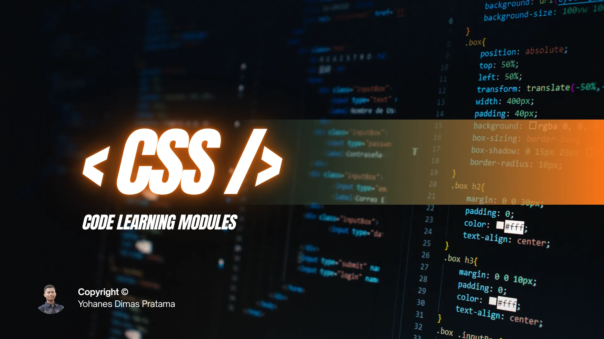

# CSS Learning Modules




## Project Overview

**CSS Learning Modules** is a structured web styling curriculum designed to teach Cascading Style Sheets (CSS) systematically from foundational syntax to modern layout engines and production UI architecture. The repository organizes 18 progressive modules containing 300 focused submodules, pairing each standalone `.css` stylesheet with an interactive `.html` preview page, a module-level `README.md` study guide, and a verified `.png` browser render inside each module's `output/` directory.

## Learning Objectives

The curriculum is structured to build progressive proficiency across core styling mechanisms, layout systems, visual effects, and scalable stylesheet engineering:

- Understand CSS rule syntax, selectors, combinators, attribute matching, cascade precedence, specificity calculation, and property inheritance.
- Control element dimensions, spacing, typography, color models, borders, shadows, filters, and document positioning using standard and logical properties.
- Design responsive one-dimensional and two-dimensional interfaces with Flexbox, CSS Grid, media queries, fluid `clamp()` sizing, and container queries.
- Implement interactive state styling, 2D/3D transforms, transitions, `@keyframes` animations, CSS custom properties, design tokens, and modern `@layer` / `@scope` / native nesting rules.
- Apply maintainable styling conventions including CSS Reset, Normalize, BEM naming, utility classes, and complete multi-section web page builds.

## Learning Level & Approach

The curriculum progresses from introductory fundamentals in Modules 01–04 through intermediate layout and visual styling in Modules 05–12 to advanced modern CSS features, architecture, and capstone builds in Modules 13–18. Each submodule isolates a single concept with commented stylesheet rules and an immediately inspectable HTML preview.

| Attribute | Description |
| --- | --- |
| Learning Level | Beginner to Advanced |
| Learning Approach | Module-Based & Practice-Driven |
| Learning Format | Theory Guides, CSS Source Files, HTML Previews, and PNG Outputs |
| Programming Focus | CSS and HTML |
| Learning Pace | Self-Paced |

## Learning Path & Curriculum

Follow the 18 modules sequentially to build from basic ruleset syntax up to responsive multi-page UI layouts:

1. **Foundations & Core Mechanics (Modules 01–04)**: CSS syntax, selectors, cascade/specificity/inheritance, and the CSS Box Model.
2. **Typography, Color & Visual Surface (Modules 05–08)**: Web typography, color systems and gradients, borders/shadows/filters, and display/positioning/overflow.
3. **Modern Layout & Interactivity (Modules 09–12)**: Flexbox, CSS Grid, Responsive Web Design, and pseudo-classes/pseudo-elements.
4. **Motion, Tokens & Modern Specifications (Modules 13–15)**: Transforms/transitions/animations, CSS variables and math/color functions, and modern at-rules.
5. **UI Components, Architecture & Capstones (Modules 16–18)**: Form/table/component styling, CSS architecture and best practices, and five real-world capstone projects.

| Order | Module | Main Topics | Materials |
| --- | --- | --- | --- |
| 01 | [Module 01 — CSS Introduction & Basic Syntax](module-01-pengenalan-css-dan-sintaks-dasar/README.md) | Rulesets, declarations, inline/internal/external CSS, units, colors, browser defaults | 15 CSS, 15 HTML, 15 PNG |
| 02 | [Module 02 — CSS Selectors](module-02-css-selectors/README.md) | Basic selectors, combinators, attribute matchers, selector lists | 20 CSS, 20 HTML, 20 PNG |
| 03 | [Module 03 — Cascade, Specificity & Inheritance](module-03-cascade-specificity-dan-inheritance/README.md) | Specificity math, source order, `inherit`/`initial`/`unset`/`revert`, `@layer` | 15 CSS, 15 HTML, 15 PNG |
| 04 | [Module 04 — CSS Box Model](module-04-css-box-model/README.md) | `content-box` vs `border-box`, margin collapse, logical properties, `aspect-ratio` | 20 CSS, 20 HTML, 20 PNG |
| 05 | [Module 05 — Typography & Text Formatting](module-05-typography-dan-pemformatan-teks/README.md) | Font stacks, `line-height`, text decoration, wrapping, `@font-face` | 20 CSS, 20 HTML, 20 PNG |
| 06 | [Module 06 — Colors & Backgrounds](module-06-warna-dan-background/README.md) | HEX/RGB/HSL/alpha, layered backgrounds, linear/radial/conic gradients, blend modes | 20 CSS, 20 HTML, 20 PNG |
| 07 | [Module 07 — Borders, Outlines, Shadows & Visual Effects](module-07-border-outline-shadow-dan-efek-visual/README.md) | Borders, `outline-offset`, layered `box-shadow`, `filter`, `backdrop-filter`, `clip-path` | 15 CSS, 15 HTML, 15 PNG |
| 08 | [Module 08 — Display, Positioning & Overflow](module-08-display-positioning-dan-overflow/README.md) | Block/inline flows, `relative`/`absolute`/`fixed`/`sticky`, `z-index`, `overflow`, `object-fit` | 20 CSS, 20 HTML, 20 PNG |
| 09 | [Module 09 — Flexbox Layout](module-09-flexbox-layout/README.md) | Main/cross axes, alignment, `flex-grow`/`shrink`/`basis`, `gap`, navigation & cards | 20 CSS, 20 HTML, 20 PNG |
| 10 | [Module 10 — CSS Grid Layout](module-10-css-grid-layout/README.md) | Grid tracks, `grid-template-areas`, `auto-fit`/`auto-fill`, `minmax()`, `fr`, dashboards | 20 CSS, 20 HTML, 20 PNG |
| 11 | [Module 11 — Responsive Web Design](module-11-responsive-web-design/README.md) | Media queries, mobile-first vs desktop-first, `clamp()`, `prefers-color-scheme`, `@container` | 20 CSS, 20 HTML, 20 PNG |
| 12 | [Module 12 — Pseudo-classes & Pseudo-elements](module-12-pseudo-class-dan-pseudo-element/README.md) | Interaction states, structural `:nth-child()`, `:is()`/`:where()`/`:has()`, `::before`/`::after` | 20 CSS, 20 HTML, 20 PNG |
| 13 | [Module 13 — Transform, Transition & Animation](module-13-transform-transition-dan-animation/README.md) | 2D/3D transforms, `perspective`, transitions, `@keyframes`, multi-animation composition | 20 CSS, 20 HTML, 20 PNG |
| 14 | [Module 14 — CSS Variables, Functions & Calculations](module-14-css-variables-functions-dan-perhitungan/README.md) | Custom properties, `calc()`, `min()`/`max()`/`clamp()`, `color-mix()`, `light-dark()`, counters, tokens | 20 CSS, 20 HTML, 20 PNG |
| 15 | [Module 15 — At-rules & Modern CSS Features](module-15-at-rules-dan-fitur-css-modern/README.md) | `@supports`, `@layer`, `@scope`, `@property`, native CSS nesting, scroll snap | 15 CSS, 15 HTML, 15 PNG |
| 16 | [Module 16 — Forms, Tables & Component Styling](module-16-form-tabel-dan-styling-komponen/README.md) | Form validation states, custom checkboxes/radios, buttons, responsive tables, `<details>` | 10 CSS, 10 HTML, 10 PNG |
| 17 | [Module 17 — CSS Architecture, Debugging & Best Practices](module-17-arsitektur-css-debugging-dan-best-practices/README.md) | CSS Reset, Normalize, BEM naming, utility classes, modular organization | 5 CSS, 5 HTML, 5 PNG |
| 18 | [Module 18 — CSS Practical Projects](module-18-proyek-praktik-css/README.md) | Profile card, responsive portfolio, dashboard layout, e-commerce grid, full landing page | 5 CSS, 5 HTML, 5 PNG |

## Learning Modules & Contents

Each module directory provides a detailed Indonesian lesson guide (`README.md`) indexing all submodules, alongside paired `.css` source files, `.html` preview files, and verified `.png` execution screenshots in `output/`.

### Module 01 — CSS Introduction & Basic Syntax (Submodules 01–15)

- Learning Material: [Module 01 Guide](module-01-pengenalan-css-dan-sintaks-dasar/README.md)
- Representative Source & Preview: [Basic Syntax CSS](module-01-pengenalan-css-dan-sintaks-dasar/01_css_basic_syntax.css) | [HTML Preview](module-01-pengenalan-css-dan-sintaks-dasar/01_css_basic_syntax.html) | [Browser Defaults CSS](module-01-pengenalan-css-dan-sintaks-dasar/15_css_browser_defaults.css)
- Execution Output: [Module 01 Output Directory](module-01-pengenalan-css-dan-sintaks-dasar/output)

### Module 02 — CSS Selectors (Submodules 16–35)

- Learning Material: [Module 02 Guide](module-02-css-selectors/README.md)
- Representative Source & Preview: [Universal Selector CSS](module-02-css-selectors/16_universal_selector.css) | [HTML Preview](module-02-css-selectors/16_universal_selector.html) | [Selector List Patterns CSS](module-02-css-selectors/35_selector_list_patterns.css)
- Execution Output: [Module 02 Output Directory](module-02-css-selectors/output)

### Module 03 — Cascade, Specificity & Inheritance (Submodules 36–50)

- Learning Material: [Module 03 Guide](module-03-cascade-specificity-dan-inheritance/README.md)
- Representative Source & Preview: [CSS Cascade CSS](module-03-cascade-specificity-dan-inheritance/36_css_cascade.css) | [HTML Preview](module-03-cascade-specificity-dan-inheritance/36_css_cascade.html) | [Cascade Conflict Resolution CSS](module-03-cascade-specificity-dan-inheritance/50_cascade_conflict_resolution.css)
- Execution Output: [Module 03 Output Directory](module-03-cascade-specificity-dan-inheritance/output)

### Module 04 — CSS Box Model (Submodules 51–70)

- Learning Material: [Module 04 Guide](module-04-css-box-model/README.md)
- Representative Source & Preview: [Box Model Basic CSS](module-04-css-box-model/51_box_model_basic.css) | [HTML Preview](module-04-css-box-model/51_box_model_basic.html) | [Aspect Ratio CSS](module-04-css-box-model/70_aspect_ratio.css)
- Execution Output: [Module 04 Output Directory](module-04-css-box-model/output)

### Module 05 — Typography & Text Formatting (Submodules 71–90)

- Learning Material: [Module 05 Guide](module-05-typography-dan-pemformatan-teks/README.md)
- Representative Source & Preview: [Font Family CSS](module-05-typography-dan-pemformatan-teks/71_font_family.css) | [HTML Preview](module-05-typography-dan-pemformatan-teks/71_font_family.html) | [Web Fonts CSS](module-05-typography-dan-pemformatan-teks/90_web_fonts.css)
- Execution Output: [Module 05 Output Directory](module-05-typography-dan-pemformatan-teks/output)

### Module 06 — Colors & Backgrounds (Submodules 91–110)

- Learning Material: [Module 06 Guide](module-06-warna-dan-background/README.md)
- Representative Source & Preview: [Named Colors CSS](module-06-warna-dan-background/91_named_colors.css) | [HTML Preview](module-06-warna-dan-background/91_named_colors.html) | [Background Clip & Origin CSS](module-06-warna-dan-background/110_background_clip_origin.css)
- Execution Output: [Module 06 Output Directory](module-06-warna-dan-background/output)

### Module 07 — Borders, Outlines, Shadows & Visual Effects (Submodules 111–125)

- Learning Material: [Module 07 Guide](module-07-border-outline-shadow-dan-efek-visual/README.md)
- Representative Source & Preview: [Border Property CSS](module-07-border-outline-shadow-dan-efek-visual/111_border_property.css) | [HTML Preview](module-07-border-outline-shadow-dan-efek-visual/111_border_property.html) | [Clip Path CSS](module-07-border-outline-shadow-dan-efek-visual/125_clip_path.css)
- Execution Output: [Module 07 Output Directory](module-07-border-outline-shadow-dan-efek-visual/output)

### Module 08 — Display, Positioning & Overflow (Submodules 126–145)

- Learning Material: [Module 08 Guide](module-08-display-positioning-dan-overflow/README.md)
- Representative Source & Preview: [Display Block CSS](module-08-display-positioning-dan-overflow/126_display_block.css) | [HTML Preview](module-08-display-positioning-dan-overflow/126_display_block.html) | [Object Position CSS](module-08-display-positioning-dan-overflow/145_object_position.css)
- Execution Output: [Module 08 Output Directory](module-08-display-positioning-dan-overflow/output)

### Module 09 — Flexbox Layout (Submodules 146–165)

- Learning Material: [Module 09 Guide](module-09-flexbox-layout/README.md)
- Representative Source & Preview: [Flexbox Basic CSS](module-09-flexbox-layout/146_flexbox_basic.css) | [HTML Preview](module-09-flexbox-layout/146_flexbox_basic.html) | [Flexbox Responsive Layout CSS](module-09-flexbox-layout/165_flexbox_responsive_layout.css)
- Execution Output: [Module 09 Output Directory](module-09-flexbox-layout/output)

### Module 10 — CSS Grid Layout (Submodules 166–185)

- Learning Material: [Module 10 Guide](module-10-css-grid-layout/README.md)
- Representative Source & Preview: [Grid Basic CSS](module-10-css-grid-layout/166_grid_basic.css) | [HTML Preview](module-10-css-grid-layout/166_grid_basic.html) | [Grid Dashboard Layout CSS](module-10-css-grid-layout/185_grid_dashboard_layout.css)
- Execution Output: [Module 10 Output Directory](module-10-css-grid-layout/output)

### Module 11 — Responsive Web Design (Submodules 186–205)

- Learning Material: [Module 11 Guide](module-11-responsive-web-design/README.md)
- Representative Source & Preview: [Media Queries Basic CSS](module-11-responsive-web-design/186_media_queries_basic.css) | [HTML Preview](module-11-responsive-web-design/186_media_queries_basic.html) | [Responsive Design System CSS](module-11-responsive-web-design/205_responsive_design_system.css)
- Execution Output: [Module 11 Output Directory](module-11-responsive-web-design/output)

### Module 12 — Pseudo-classes & Pseudo-elements (Submodules 206–225)

- Learning Material: [Module 12 Guide](module-12-pseudo-class-dan-pseudo-element/README.md)
- Representative Source & Preview: [Hover Pseudo-class CSS](module-12-pseudo-class-dan-pseudo-element/206_hover_pseudo_class.css) | [HTML Preview](module-12-pseudo-class-dan-pseudo-element/206_hover_pseudo_class.html) | [Marker, Selection & Placeholder CSS](module-12-pseudo-class-dan-pseudo-element/225_marker_selection_placeholder.css)
- Execution Output: [Module 12 Output Directory](module-12-pseudo-class-dan-pseudo-element/output)

### Module 13 — Transform, Transition & Animation (Submodules 226–245)

- Learning Material: [Module 13 Guide](module-13-transform-transition-dan-animation/README.md)
- Representative Source & Preview: [Transform Translate CSS](module-13-transform-transition-dan-animation/226_transform_translate.css) | [HTML Preview](module-13-transform-transition-dan-animation/226_transform_translate.html) | [Animation Composition CSS](module-13-transform-transition-dan-animation/245_animation_composition.css)
- Execution Output: [Module 13 Output Directory](module-13-transform-transition-dan-animation/output)

### Module 14 — CSS Variables, Functions & Calculations (Submodules 246–265)

- Learning Material: [Module 14 Guide](module-14-css-variables-functions-dan-perhitungan/README.md)
- Representative Source & Preview: [CSS Custom Properties CSS](module-14-css-variables-functions-dan-perhitungan/246_css_custom_properties.css) | [HTML Preview](module-14-css-variables-functions-dan-perhitungan/246_css_custom_properties.html) | [Theme Variables CSS](module-14-css-variables-functions-dan-perhitungan/265_theme_variables.css)
- Execution Output: [Module 14 Output Directory](module-14-css-variables-functions-dan-perhitungan/output)

### Module 15 — At-rules & Modern CSS Features (Submodules 266–280)

- Learning Material: [Module 15 Guide](module-15-at-rules-dan-fitur-css-modern/README.md)
- Representative Source & Preview: [Media At-Rule CSS](module-15-at-rules-dan-fitur-css-modern/266_media_at_rule.css) | [HTML Preview](module-15-at-rules-dan-fitur-css-modern/266_media_at_rule.html) | [Scroll Behavior CSS](module-15-at-rules-dan-fitur-css-modern/280_scroll_behavior.css)
- Execution Output: [Module 15 Output Directory](module-15-at-rules-dan-fitur-css-modern/output)

### Module 16 — Forms, Tables & Component Styling (Submodules 281–290)

- Learning Material: [Module 16 Guide](module-16-form-tabel-dan-styling-komponen/README.md)
- Representative Source & Preview: [Form Input Styling CSS](module-16-form-tabel-dan-styling-komponen/281_form_input_styling.css) | [HTML Preview](module-16-form-tabel-dan-styling-komponen/281_form_input_styling.html) | [Details & Summary Styling CSS](module-16-form-tabel-dan-styling-komponen/290_details_summary_styling.css)
- Execution Output: [Module 16 Output Directory](module-16-form-tabel-dan-styling-komponen/output)

### Module 17 — CSS Architecture, Debugging & Best Practices (Submodules 291–295)

- Learning Material: [Module 17 Guide](module-17-arsitektur-css-debugging-dan-best-practices/README.md)
- Representative Source & Preview: [CSS Reset CSS](module-17-arsitektur-css-debugging-dan-best-practices/291_css_reset.css) | [HTML Preview](module-17-arsitektur-css-debugging-dan-best-practices/291_css_reset.html) | [CSS Organization CSS](module-17-arsitektur-css-debugging-dan-best-practices/295_css_organization.css)
- Execution Output: [Module 17 Output Directory](module-17-arsitektur-css-debugging-dan-best-practices/output)

### Module 18 — CSS Practical Projects (Submodules 296–300)

- Learning Material: [Module 18 Guide](module-18-proyek-praktik-css/README.md)
- Source & Preview: [Profile Card CSS](module-18-proyek-praktik-css/296_profile_card_project.css) | [Responsive Portfolio CSS](module-18-proyek-praktik-css/297_responsive_portfolio_project.css) | [Dashboard Layout CSS](module-18-proyek-praktik-css/298_dashboard_layout_project.css) | [E-Commerce Layout CSS](module-18-proyek-praktik-css/299_ecommerce_layout_project.css) | [Full Website Design CSS](module-18-proyek-praktik-css/300_full_website_design_project.css)
- Execution Output: [Module 18 Output Directory](module-18-proyek-praktik-css/output)

## Projects & Coding Challenges

Module 18 synthesizes concepts from Modules 01 through 17 into five completed practical UI implementations, each accompanied by standalone CSS, HTML markup, and a verified browser render:

| Project | Learning Focus | Source & Preview |
| --- | --- | --- |
| 296. Profile Card Component | Flexbox alignment, circular avatar styling, absolute status indicator, and KPI summary grid | [CSS](module-18-proyek-praktik-css/296_profile_card_project.css) / [HTML](module-18-proyek-praktik-css/296_profile_card_project.html) |
| 297. Responsive Portfolio Page | Hero banner composition and adaptive multi-column project gallery layout | [CSS](module-18-proyek-praktik-css/297_responsive_portfolio_project.css) / [HTML](module-18-proyek-praktik-css/297_responsive_portfolio_project.html) |
| 298. Analytics Dashboard Layout | Two-dimensional CSS Grid shell (`200px 1fr`), dark sidebar navigation, header bar, and 3-column KPI grid | [CSS](module-18-proyek-praktik-css/298_dashboard_layout_project.css) / [HTML](module-18-proyek-praktik-css/298_dashboard_layout_project.html) |
| 299. E-Commerce Storefront Layout | Product catalog grid, discount badges, pricing hierarchy, and interactive commercial cards | [CSS](module-18-proyek-praktik-css/299_ecommerce_layout_project.css) / [HTML](module-18-proyek-praktik-css/299_ecommerce_layout_project.html) |
| 300. Full Website Landing Page | Sticky blurred header (`backdrop-filter`), hero CTA group, feature grid, and integrated footer | [CSS](module-18-proyek-praktik-css/300_full_website_design_project.css) / [HTML](module-18-proyek-praktik-css/300_full_website_design_project.html) |

## Programming Languages & Tech Stack

| Category | Technology | Purpose |
| --- | --- | --- |
| Styling Language | CSS (Vanilla CSS3 & Modern W3C Specs) | Core subject taught across all 18 modules and 300 submodules |
| Markup Language | HTML5 | Semantic document structure pairing every CSS module with a live preview |
| Execution Runtime | Modern Web Browser (Chrome, Edge, Firefox) | Rendering engine for live `.html` + `.css` examples and DevTools inspection |
| Development Tooling | Visual Studio Code / Live Server | Optional local static server and code editing environment |
| Documentation | Markdown | Module-level study guides (`README.md`) and submodule navigation |

## Prerequisites & Setup

No build tools, package managers, or external frameworks are required to study and run the examples in this repository.

- **Required**: A modern Chromium, Firefox, or WebKit-based web browser with Developer Tools for inspecting computed styles, box models, Flexbox, and Grid overlays.
- **Required**: Basic familiarity with HTML document tags (`<div>`, `<section>`, `<form>`, `<table>`, semantic headings, and `<link>`).
- **Optional**: Visual Studio Code with a local static server extension (such as Live Server) or Python's built-in HTTP server for serving files over `localhost`.

```bash
git clone https://github.com/weztcy/CSS-Learning-Modules.git
cd "CSS-Learning-Modules"
```

## Code Execution & Usage

Every submodule is self-contained and pairs a `.css` stylesheet with a matching `.html` preview file inside its module directory.

1. Navigate to any module folder (for example, `module-01-pengenalan-css-dan-sintaks-dasar/`).
2. Read the module's `README.md` for scope, objectives, and submodule explanations.
3. Open any `.html` file directly in your browser or start a local static server from the repository root:

```bash
# Windows (PowerShell / CMD) — open a specific preview directly
start "" "module-01-pengenalan-css-dan-sintaks-dasar/01_css_basic_syntax.html"

# Or serve the entire curriculum locally via Python HTTP server
python -m http.server 8000
```

4. Compare your live browser rendering against the reference `.png` capture stored in each module's `output/` folder, and inspect rules live in Browser DevTools.

## Contributing

Contributions to improve lesson clarity, fix styling edge cases, or add supplementary examples are welcome through a standard pull request workflow:

1. Fork the repository.
2. Create a branch for the change.
3. Add or improve learning materials, source code, exercises, or documentation.
4. Verify code examples and links where practical.
5. Commit and push the branch.
6. Open a pull request with a clear explanation.

## License

This project is licensed under the MIT License.
See the [LICENSE](LICENSE) file for details.

## Author & Contact

**Yohanes Dimas Pratama**

- GitHub: [github.com/weztcy](https://github.com/weztcy)
- Portfolio: [yohanesdimas.com](https://yohanesdimas.com)
- LinkedIn: [linkedin.com/in/yohanes-dimas](https://www.linkedin.com/in/yohanes-dimas)
