# Modul 01: Pengenalan CSS dan Sintaks Dasar

## Ringkasan Ruang Lingkup Materi

Modul ini membahas konsep paling mendasar dari Cascading Style Sheets (CSS), mulai dari struktur sintaks dasar, anatomi ruleset, deklarasi, properti dan nilai, tiga metode penulisan CSS (inline, internal, external), penulisan komentar edukatif, penanganan whitespace dan case sensitivity, ragam satuan nilai CSS, format warna, hingga pemahaman terhadap default styling (user-agent stylesheet) yang diterapkan oleh peramban web.

## Tujuan Pembelajaran Modul

- Memahami struktur sintaks dasar CSS yang terdiri dari selector, property, dan value.
- Menganalisis anatomi ruleset CSS dan blok deklarasi secara sistematis.
- Mengidentifikasi dan membedakan penerapan inline CSS, internal CSS, dan external CSS.
- Menerapkan penulisan komentar edukatif serta memahami sifat whitespace dan case sensitivity pada CSS.
- Menggunakan berbagai satuan nilai CSS (px, rem, em, %) dan format representasi warna (HEX, RGB, HSL).
- Menyadari keberadaan styling default peramban (user-agent styles) dan dampaknya pada perancangan antarmuka.

## Daftar Submodul

- [1. Sintaks dasar CSS](01_css_basic_syntax.css) — [Halaman Preview](01_css_basic_syntax.html)
- [2. CSS ruleset](02_css_ruleset.css) — [Halaman Preview](02_css_ruleset.html)
- [3. Pengenalan selector](03_css_selectors_intro.css) — [Halaman Preview](03_css_selectors_intro.html)
- [4. CSS declarations](04_css_declarations.css) — [Halaman Preview](04_css_declarations.html)
- [5. Properties dan values](05_css_properties_values.css) — [Halaman Preview](05_css_properties_values.html)
- [6. Inline CSS](06_inline_css.css) — [Halaman Preview](06_inline_css.html)
- [7. Internal CSS](07_internal_css.css) — [Halaman Preview](07_internal_css.html)
- [8. External CSS](08_external_css.css) — [Halaman Preview](08_external_css.html)
- [9. Komentar CSS](09_css_comments.css) — [Halaman Preview](09_css_comments.html)
- [10. Multiple declarations](10_css_multiple_declarations.css) — [Halaman Preview](10_css_multiple_declarations.html)
- [11. Whitespace dalam CSS](11_css_whitespace.css) — [Halaman Preview](11_css_whitespace.html)
- [12. Case sensitivity pada CSS](12_css_case_sensitivity.css) — [Halaman Preview](12_css_case_sensitivity.html)
- [13. Satuan nilai CSS](13_css_property_units.css) — [Halaman Preview](13_css_property_units.html)
- [14. Format nilai warna](14_css_color_values.css) — [Halaman Preview](14_css_color_values.html)
- [15. Default styling browser](15_css_browser_defaults.css) — [Halaman Preview](15_css_browser_defaults.html)

---

## Pembahasan dan Penjelasan Submodul

### 1. Sintaks dasar CSS

**Tujuan:** Memahami komponen dasar penyusun sintaks CSS yaitu selector, property, dan value.

**Konsep Utama:**
Sintaks CSS memiliki pola universal: `selector { property: value; }`. Selector menentukan elemen HTML target, property menentukan aspek visual yang ingin diubah, dan value menentukan nilai pengaturannya.

**Penjelasan Source Code:**
File mendefinisikan aturan untuk elemen heading `h1` dan paragraf `p`. Setiap aturan dibungkus dalam kurung kurawal `{}` dengan pasangan properti dan nilai yang dipisahkan titik dua `:` dan diakhiri titik koma `;`.

**Source code utama:** [01_css_basic_syntax.css](01_css_basic_syntax.css)

**File pendukung preview:** [01_css_basic_syntax.html](01_css_basic_syntax.html)

**Cara Menjalankan:**
Buka file HTML pendukung di peramban web (Google Chrome, Microsoft Edge, atau Mozilla Firefox), atau gunakan Live Server / HTTP Server:

```bash
# Buka langsung file HTML di browser default
start "" "01_css_basic_syntax.html"
```

**Hasil yang Diharapkan:**
Judul halaman tampil dengan warna biru dongker dan ukuran besar, sedangkan paragraf pendukung tampil dengan warna abu-abu gelap dengan keterbacaan tinggi.

**Screenshot Hasil Eksekusi:**

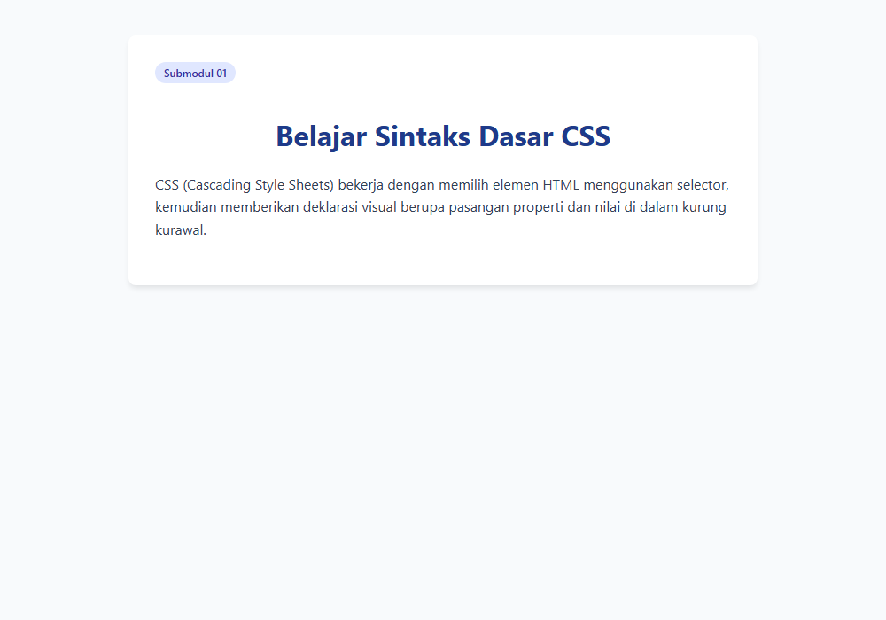

---

### 2. CSS ruleset

**Tujuan:** Mengenali anatomi lengkap satu ruleset CSS yang terdiri atas selector dan declaration block.

**Konsep Utama:**
Satu kesatuan blok aturan dalam CSS disebut ruleset. Ruleset diawali oleh selector list dan diikuti oleh declaration block yang memuat satu atau lebih deklarasi gaya.

**Penjelasan Source Code:**
Ruleset `.banner` dan `.banner-btn` menunjukkan pengelompokan beberapa deklarasi gaya untuk membentuk komponen kartu banner visual yang utuh.

**Source code utama:** [02_css_ruleset.css](02_css_ruleset.css)

**File pendukung preview:** [02_css_ruleset.html](02_css_ruleset.html)

**Cara Menjalankan:**
Buka file HTML pendukung di peramban web (Google Chrome, Microsoft Edge, atau Mozilla Firefox), atau gunakan Live Server / HTTP Server:

```bash
# Buka langsung file HTML di browser default
start "" "02_css_ruleset.html"
```

**Hasil yang Diharapkan:**
Kotak banner berlatar biru gradasi dengan teks putih dan tombol aksi berpenampilan modern.

**Screenshot Hasil Eksekusi:**

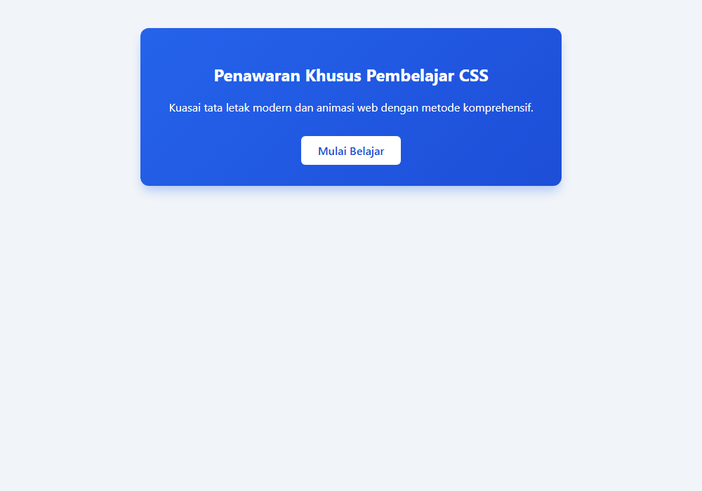

---

### 3. Pengenalan selector

**Tujuan:** Mempelajari peran selector dalam menghubungkan stylesheet dengan elemen HTML target.

**Konsep Utama:**
Selector adalah pola pencarian yang digunakan peramban untuk menentukan elemen mana pada struktur DOM yang akan dikenai gaya visual tertentu.

**Penjelasan Source Code:**
Menggunakan selector tipe elemen `h2`, selector kelas `.highlight`, dan selector ID `#unique-status` untuk memberikan gaya berbeda pada elemen target.

**Source code utama:** [03_css_selectors_intro.css](03_css_selectors_intro.css)

**File pendukung preview:** [03_css_selectors_intro.html](03_css_selectors_intro.html)

**Cara Menjalankan:**
Buka file HTML pendukung di peramban web (Google Chrome, Microsoft Edge, atau Mozilla Firefox), atau gunakan Live Server / HTTP Server:

```bash
# Buka langsung file HTML di browser default
start "" "03_css_selectors_intro.html"
```

**Hasil yang Diharapkan:**
Heading dengan gaya tegas, teks dengan highlight warna kuning pastel, dan label status dengan badge khusus.

**Screenshot Hasil Eksekusi:**

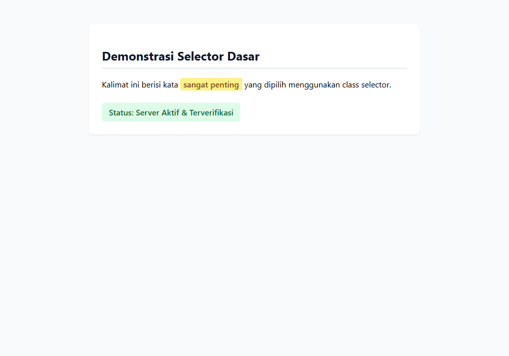

---

### 4. CSS declarations

**Tujuan:** Menjelaskan komponen deklarasi CSS yang terdiri atas pasangan nama properti dan nilai.

**Konsep Utama:**
Setiap baris instruksi gaya disebut deklarasi (declaration). Deklarasi memuat `properti: nilai;`. Tanda titik dua memisahkan properti dari nilai, dan titik koma mengakhiri deklarasi.

**Penjelasan Source Code:**
Komponen `.quote-box` dideklarasikan dengan serangkaian deklarasi individual untuk warna latar, garis batas kiri, margin, dan padding.

**Source code utama:** [04_css_declarations.css](04_css_declarations.css)

**File pendukung preview:** [04_css_declarations.html](04_css_declarations.html)

**Cara Menjalankan:**
Buka file HTML pendukung di peramban web (Google Chrome, Microsoft Edge, atau Mozilla Firefox), atau gunakan Live Server / HTTP Server:

```bash
# Buka langsung file HTML di browser default
start "" "04_css_declarations.html"
```

**Hasil yang Diharapkan:**
Kutipan bergaya callout dengan aksen border tebal di sisi kiri dan latar belakang kontras lembut.

**Screenshot Hasil Eksekusi:**

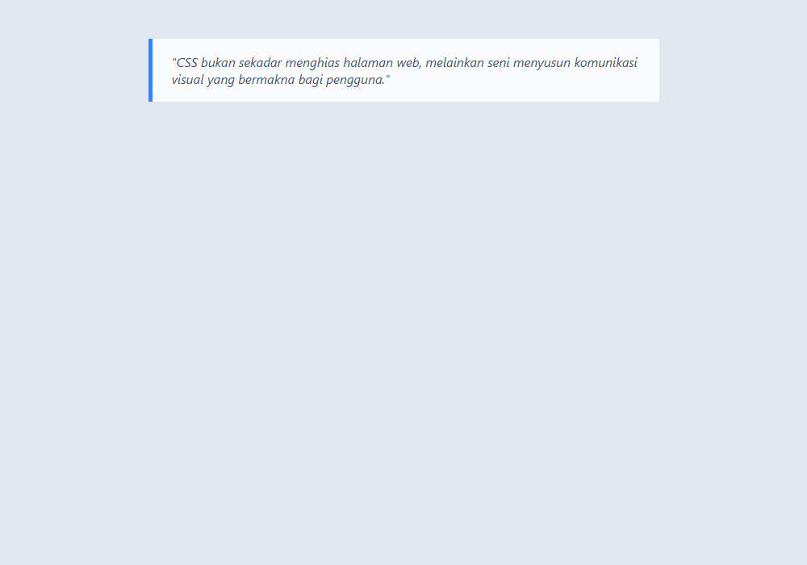

---

### 5. Properties dan values

**Tujuan:** Membedakan properti standar CSS dan tipe-tipe nilai yang valid untuk setiap properti.

**Konsep Utama:**
Properti adalah atribut gaya yang telah distandardisasi oleh W3C (seperti font-size, background, margin), sedangkan nilai (value) adalah besaran atau kata kunci spesifik yang diterima oleh properti tersebut.

**Penjelasan Source Code:**
Mengatur kartu produk menggunakan properti ukuran, bentuk sudut, dan tata letak teks dengan kombinasi nilai numerik, kata kunci, dan fungsi warna.

**Source code utama:** [05_css_properties_values.css](05_css_properties_values.css)

**File pendukung preview:** [05_css_properties_values.html](05_css_properties_values.html)

**Cara Menjalankan:**
Buka file HTML pendukung di peramban web (Google Chrome, Microsoft Edge, atau Mozilla Firefox), atau gunakan Live Server / HTTP Server:

```bash
# Buka langsung file HTML di browser default
start "" "05_css_properties_values.html"
```

**Hasil yang Diharapkan:**
Kartu produk sederhana yang tertata rapi dengan judul, harga yang menonjol, dan tombol beli.

**Screenshot Hasil Eksekusi:**

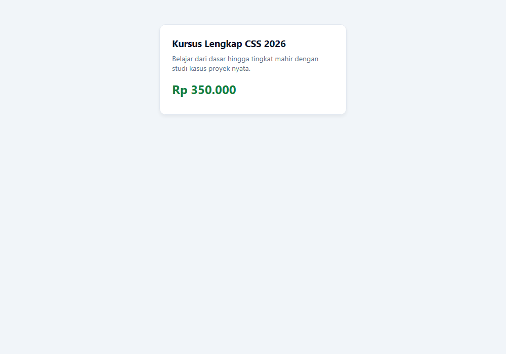

---

### 6. Inline CSS

**Tujuan:** Memahami konsep, sintaks atribut style, serta batasan penggunaan Inline CSS.

**Konsep Utama:**
Inline CSS dituliskan langsung pada atribut `style` di dalam tag pembuka elemen HTML. Memiliki prioritas spesifisitas sangat tinggi, namun tidak disarankan untuk styling berskala besar karena mencampur presentasi dengan markup.

**Penjelasan Source Code:**
File CSS ini menyediakan perbandingan styling eksternal untuk melengkapi demonstrasi atribut inline style pada file HTML pendukung.

**Source code utama:** [06_inline_css.css](06_inline_css.css)

**File pendukung preview:** [06_inline_css.html](06_inline_css.html)

**Cara Menjalankan:**
Buka file HTML pendukung di peramban web (Google Chrome, Microsoft Edge, atau Mozilla Firefox), atau gunakan Live Server / HTTP Server:

```bash
# Buka langsung file HTML di browser default
start "" "06_inline_css.html"
```

**Hasil yang Diharapkan:**
Perbandingan visual antara elemen yang ditata dengan stylesheet eksternal dan elemen yang ditimpa langsung dengan atribut style inline.

**Screenshot Hasil Eksekusi:**

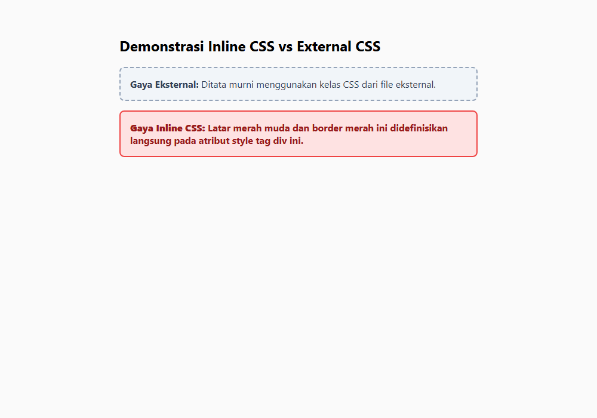

---

### 7. Internal CSS

**Tujuan:** Mengetahui cara penyisipan Internal CSS menggunakan tag <style> pada bagian <head> HTML.

**Konsep Utama:**
Internal (atau embedded) CSS didefinisikan di dalam tag `<style>` di dalam elemen `<head>` dokumen HTML. Sangat berguna untuk styling spesifik satu halaman tunggal tanpa memerlukan file terpisah.

**Penjelasan Source Code:**
File CSS ini mendampingi file HTML yang memuat blok tag <style> untuk mendemonstrasikan bagaimana aturan internal berlaku pada seluruh lingkup dokumen tersebut.

**Source code utama:** [07_internal_css.css](07_internal_css.css)

**File pendukung preview:** [07_internal_css.html](07_internal_css.html)

**Cara Menjalankan:**
Buka file HTML pendukung di peramban web (Google Chrome, Microsoft Edge, atau Mozilla Firefox), atau gunakan Live Server / HTTP Server:

```bash
# Buka langsung file HTML di browser default
start "" "07_internal_css.html"
```

**Hasil yang Diharapkan:**
Halaman web yang ditata menggunakan kombinasi aturan internal pada header dengan tampilan yang rapi dan terisolasi pada halaman terkait.

**Screenshot Hasil Eksekusi:**

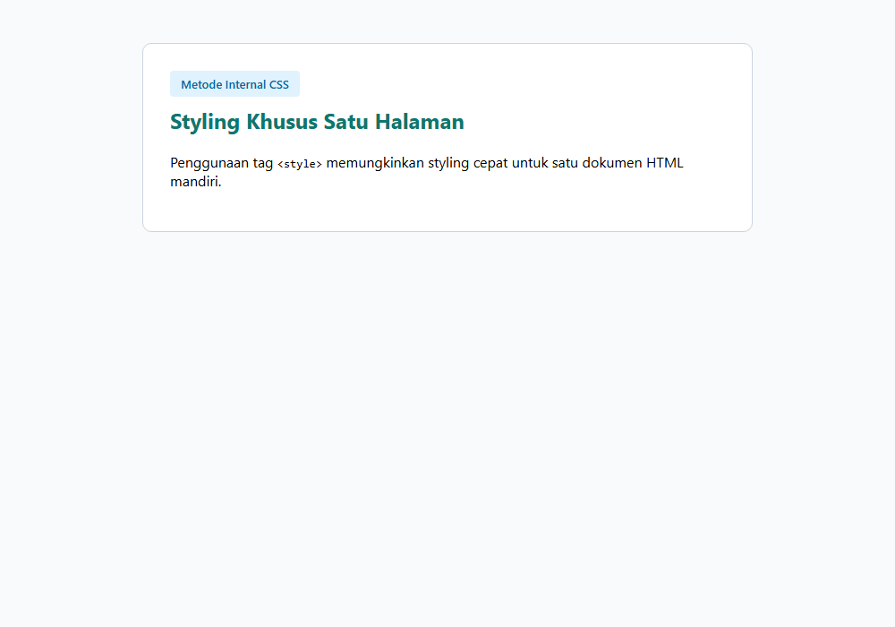

---

### 8. External CSS

**Tujuan:** Menjelaskan metode External CSS menggunakan tag <link rel='stylesheet'> dan manfaat pemisahan kode.

**Konsep Utama:**
External CSS adalah praktik industri terbaik (best practice) di mana seluruh aturan gaya disimpan pada file berekstensi .css terpisah dan dihubungkan ke HTML menggunakan elemen `<link rel='stylesheet' href='...'>`. Memungkinkan pemakaian ulang (reusability) dan caching efisien.

**Penjelasan Source Code:**
Mendefinisikan gaya layout modular dengan header, konten utama, dan footer bergaya korporat yang dapat digunakan kembali di banyak halaman HTML sekaligus.

**Source code utama:** [08_external_css.css](08_external_css.css)

**File pendukung preview:** [08_external_css.html](08_external_css.html)

**Cara Menjalankan:**
Buka file HTML pendukung di peramban web (Google Chrome, Microsoft Edge, atau Mozilla Firefox), atau gunakan Live Server / HTTP Server:

```bash
# Buka langsung file HTML di browser default
start "" "08_external_css.html"
```

**Hasil yang Diharapkan:**
Struktur layout halaman web lengkap dengan navigasi, area isi, dan footer yang terhubung rapi ke file CSS eksternal.

**Screenshot Hasil Eksekusi:**

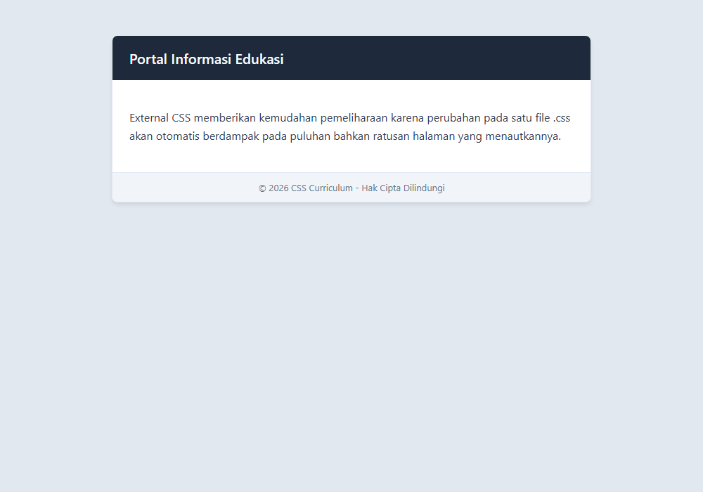

---

### 9. Komentar CSS

**Tujuan:** Memahami sintaks penulisan komentar CSS dan fungsi dokumentasi kode.

**Konsep Utama:**
CSS hanya mendukung sintaks komentar multi-line dengan format `/* komentar di sini */`. Komentar diabaikan oleh mesin peramban dan berfungsi untuk dokumentasi serta memudahkan pemeliharaan kode oleh pengembang.

**Penjelasan Source Code:**
Mendemonstrasikan berbagai gaya komentar: header blok, komentar penjelasan sebaris, dan penonaktifan sementara aturan CSS tertentu.

**Source code utama:** [09_css_comments.css](09_css_comments.css)

**File pendukung preview:** [09_css_comments.html](09_css_comments.html)

**Cara Menjalankan:**
Buka file HTML pendukung di peramban web (Google Chrome, Microsoft Edge, atau Mozilla Firefox), atau gunakan Live Server / HTTP Server:

```bash
# Buka langsung file HTML di browser default
start "" "09_css_comments.html"
```

**Hasil yang Diharapkan:**
Elemen kartu styled yang aktif dengan catatan dokumentasi yang jelas di dalam source code.

**Screenshot Hasil Eksekusi:**

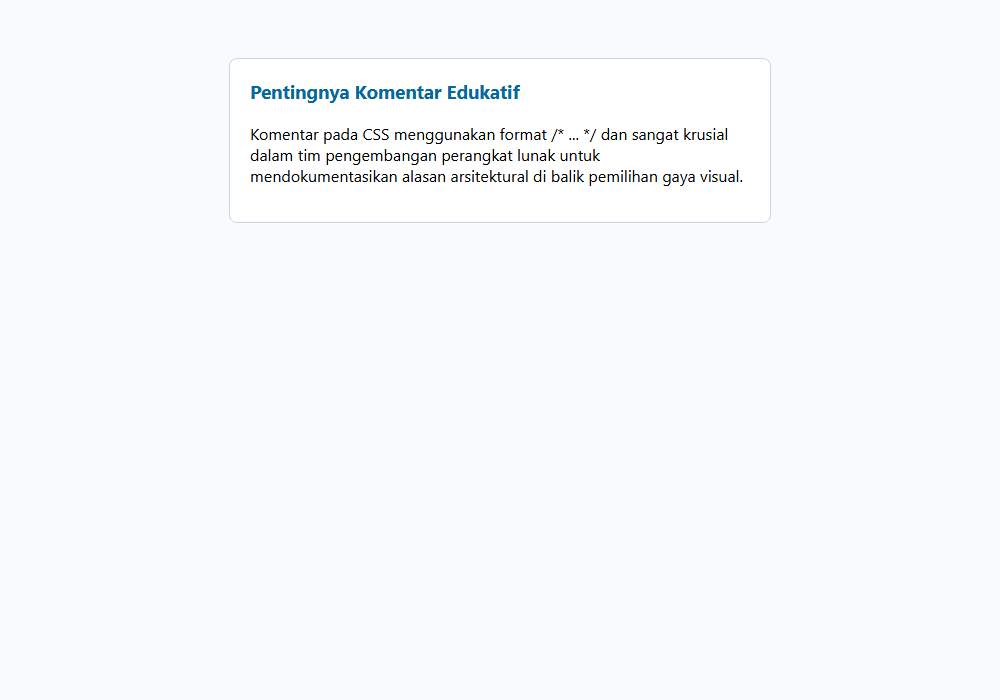

---

### 10. Multiple declarations

**Tujuan:** Menuliskan banyak deklarasi dalam satu declaration block dengan rapi.

**Konsep Utama:**
Di dalam satu blok ruleset `{ ... }`, kita dapat menyematkan sebanyak mungkin deklarasi. Setiap deklarasi harus dipisahkan oleh titik koma `;` untuk mencegah kesalahan parsing peramban.

**Penjelasan Source Code:**
Ruleset `.feature-badge` menggabungkan 8 deklarasi berbeda (display, background, color, font-size, font-weight, padding, border-radius, text-transform) untuk membentuk lencana visual.

**Source code utama:** [10_css_multiple_declarations.css](10_css_multiple_declarations.css)

**File pendukung preview:** [10_css_multiple_declarations.html](10_css_multiple_declarations.html)

**Cara Menjalankan:**
Buka file HTML pendukung di peramban web (Google Chrome, Microsoft Edge, atau Mozilla Firefox), atau gunakan Live Server / HTTP Server:

```bash
# Buka langsung file HTML di browser default
start "" "10_css_multiple_declarations.html"
```

**Hasil yang Diharapkan:**
Lencana fitur berbentuk kapsul berwarna ungu dengan teks huruf kapital yang terpusat dan rapi.

**Screenshot Hasil Eksekusi:**

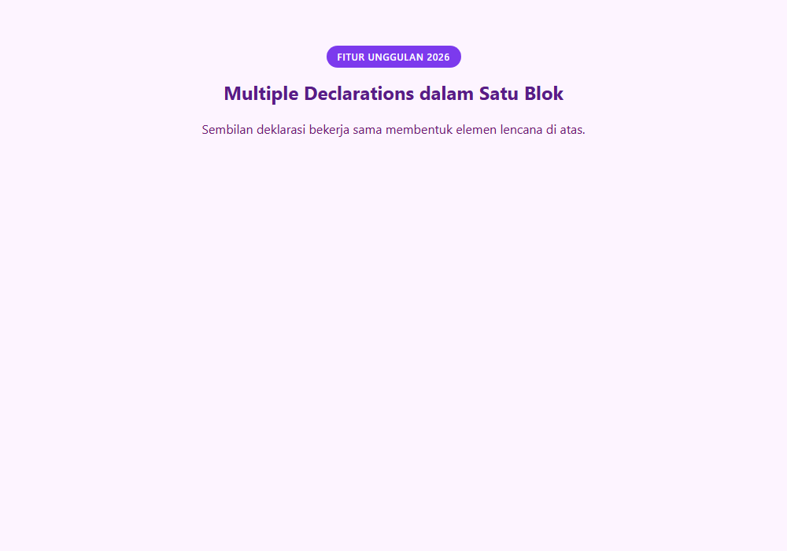

---

### 11. Whitespace dalam CSS

**Tujuan:** Menjelaskan bagaimana peramban memperlakukan whitespace (spasi, tab, newline) dalam stylesheet.

**Konsep Utama:**
CSS bersifat whitespace-insensitive pada sebagian besar konteks. Spasi ganda, baris baru, dan indentasi diabaikan oleh peramban sehingga pengembang bebas menyusun format kode yang rapi (terbaca manusia) maupun meminifikasinya untuk produksi.

**Penjelasan Source Code:**
Menampilkan dua cara penulisan dengan hasil visual yang identik: gaya multiline yang nyaman dibaca dan gaya single-line kompak.

**Source code utama:** [11_css_whitespace.css](11_css_whitespace.css)

**File pendukung preview:** [11_css_whitespace.html](11_css_whitespace.html)

**Cara Menjalankan:**
Buka file HTML pendukung di peramban web (Google Chrome, Microsoft Edge, atau Mozilla Firefox), atau gunakan Live Server / HTTP Server:

```bash
# Buka langsung file HTML di browser default
start "" "11_css_whitespace.html"
```

**Hasil yang Diharapkan:**
Dua kotak perbandingan visual dengan styling seragam yang membuktikan whitespace tidak mengubah hasil render.

**Screenshot Hasil Eksekusi:**

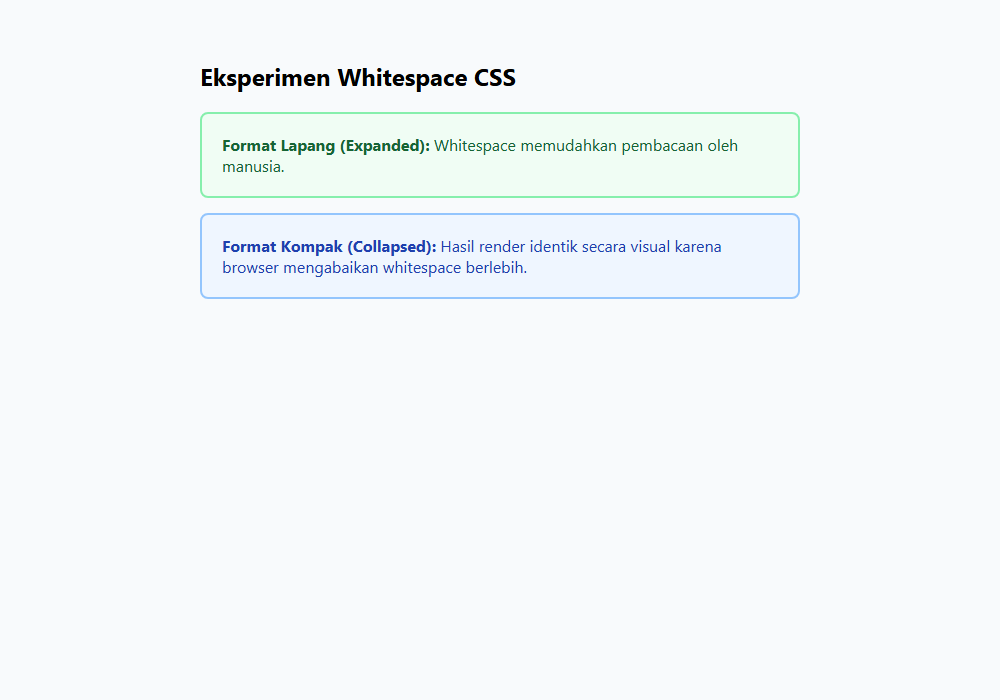

---

### 12. Case sensitivity pada CSS

**Tujuan:** Mengetahui bagian CSS yang case-insensitive dan bagian yang peka huruf besar-kecil (case-sensitive).

**Konsep Utama:**
Properti dan nilai kata kunci CSS umumnya case-insensitive (`COLOR: RED` sama dengan `color: red`). Namun selector kelas, ID, nama font, dan URL dalam dokumen HTML yang case-sensitive harus ditulis persis huruf besar-kecilnya.

**Penjelasan Source Code:**
Mendemonstrasikan penulisan properti dalam huruf kecil standar dan seleksi kelas yang menuntut ketelitian kapitalisasi.

**Source code utama:** [12_css_case_sensitivity.css](12_css_case_sensitivity.css)

**File pendukung preview:** [12_css_case_sensitivity.html](12_css_case_sensitivity.html)

**Cara Menjalankan:**
Buka file HTML pendukung di peramban web (Google Chrome, Microsoft Edge, atau Mozilla Firefox), atau gunakan Live Server / HTTP Server:

```bash
# Buka langsung file HTML di browser default
start "" "12_css_case_sensitivity.html"
```

**Hasil yang Diharapkan:**
Dua kotak pesan yang menampilkan contoh penulisan class name yang tepat.

**Screenshot Hasil Eksekusi:**

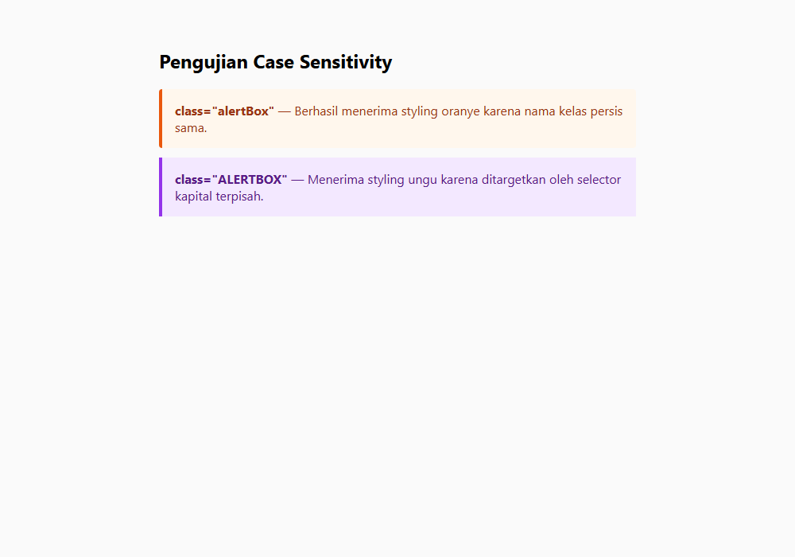

---

### 13. Satuan nilai CSS

**Tujuan:** Mengenal perbedaan satuan absolut (px) dan satuan relatif (rem, em, %, vh, vw).

**Konsep Utama:**
CSS menyediakan satuan absolut seperti `px` yang memiliki ukuran pasti, dan satuan relatif seperti `rem` (relatif terhadap ukuran font root html), `em` (relatif terhadap font elemen induk), `%` (persentase dari ukuran induk), serta satuan viewport `vw`/`vh`.

**Penjelasan Source Code:**
Mengatur wadah dengan lebar persentase, ukuran teks dengan satuan rem, padding dengan em, dan batas border dengan piksel absolut.

**Source code utama:** [13_css_property_units.css](13_css_property_units.css)

**File pendukung preview:** [13_css_property_units.html](13_css_property_units.html)

**Cara Menjalankan:**
Buka file HTML pendukung di peramban web (Google Chrome, Microsoft Edge, atau Mozilla Firefox), atau gunakan Live Server / HTTP Server:

```bash
# Buka langsung file HTML di browser default
start "" "13_css_property_units.html"
```

**Hasil yang Diharapkan:**
Komponen visual dengan proporsi ukuran teks dan kotak yang adaptif dan fleksibel.

**Screenshot Hasil Eksekusi:**

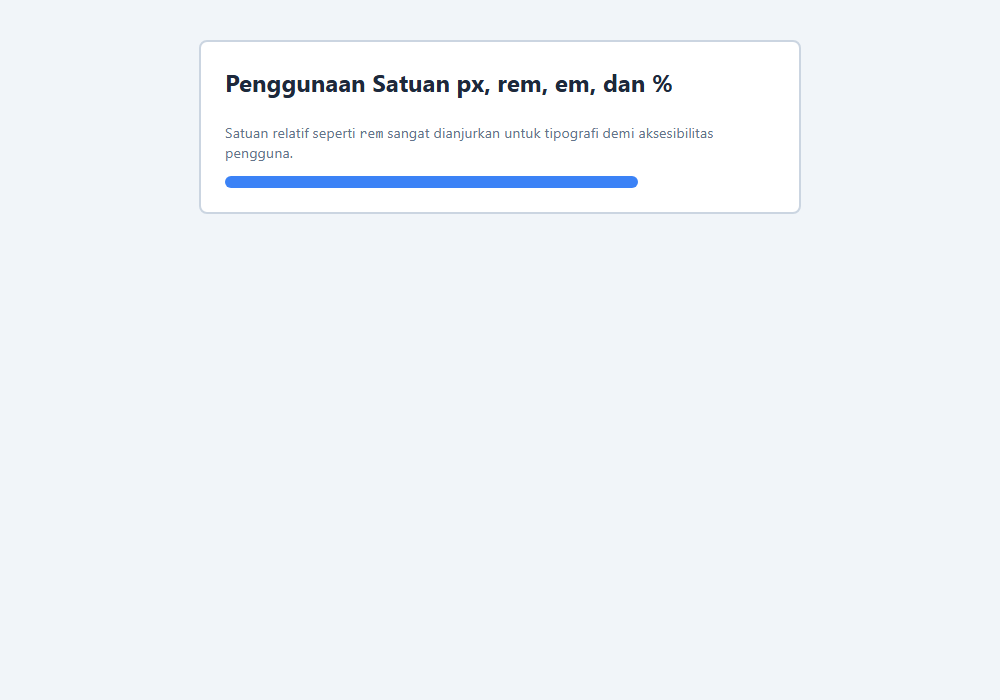

---

### 14. Format nilai warna

**Tujuan:** Menggunakan format warna Named, Hexadecimal, RGB, RGBA, dan HSL dalam CSS.

**Konsep Utama:**
CSS mendukung beragam format warna: Named Colors (seperti `tomato`, `navy`), Hexadecimal (`#2563eb`), RGB/RGBA (`rgb(37, 99, 235)` atau `rgba(...)`), dan HSL (`hsl(217, 91%, 60%)`).

**Penjelasan Source Code:**
Membuat swatch warna yang menampilkan representasi warna yang sama atau bervariasi dengan metode penulisan berbeda.

**Source code utama:** [14_css_color_values.css](14_css_color_values.css)

**File pendukung preview:** [14_css_color_values.html](14_css_color_values.html)

**Cara Menjalankan:**
Buka file HTML pendukung di peramban web (Google Chrome, Microsoft Edge, atau Mozilla Firefox), atau gunakan Live Server / HTTP Server:

```bash
# Buka langsung file HTML di browser default
start "" "14_css_color_values.html"
```

**Hasil yang Diharapkan:**
Deretan swatch kartu warna dengan latar belakang warna HEX, RGB, HSL, dan RGBA transparan.

**Screenshot Hasil Eksekusi:**

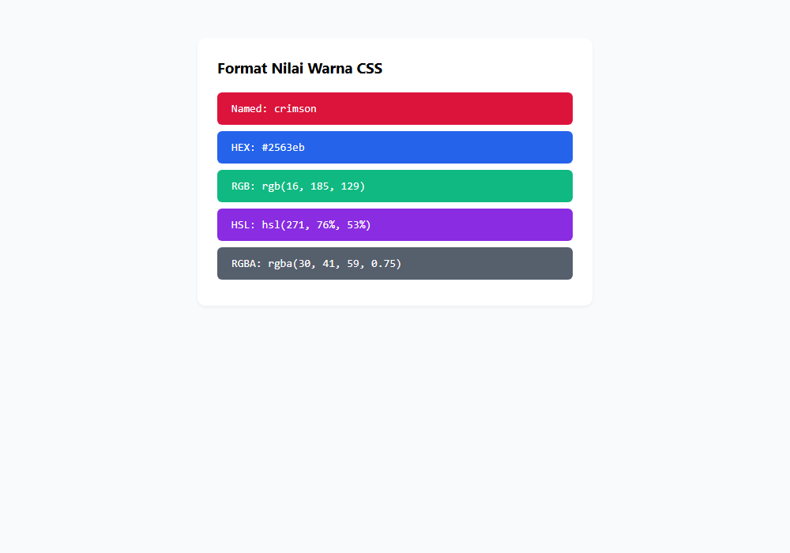

---

### 15. Default styling browser

**Tujuan:** Memahami User-Agent Stylesheet dan bagaimana browser menerapkan styling bawaan pada elemen HTML.

**Konsep Utama:**
Setiap peramban web memiliki stylesheet bawaan (User-Agent Stylesheet) yang otomatis memberikan margin pada `body`, ukuran bertingkat pada `h1` hingga `h6`, jarak pada `p`, serta margin dan padding bullet pada `ul`/`ol`.

**Penjelasan Source Code:**
Memperlihatkan perbandingan antara elemen yang masih memakai default styling browser dan elemen yang telah diatur ulang (reset/customized) secara sengaja.

**Source code utama:** [15_css_browser_defaults.css](15_css_browser_defaults.css)

**File pendukung preview:** [15_css_browser_defaults.html](15_css_browser_defaults.html)

**Cara Menjalankan:**
Buka file HTML pendukung di peramban web (Google Chrome, Microsoft Edge, atau Mozilla Firefox), atau gunakan Live Server / HTTP Server:

```bash
# Buka langsung file HTML di browser default
start "" "15_css_browser_defaults.html"
```

**Hasil yang Diharapkan:**
Dua kolom perbandingan yang jelas memperlihatkan perbedaan antara elemen mentah default browser dan elemen yang telah dikustomisasi.

**Screenshot Hasil Eksekusi:**

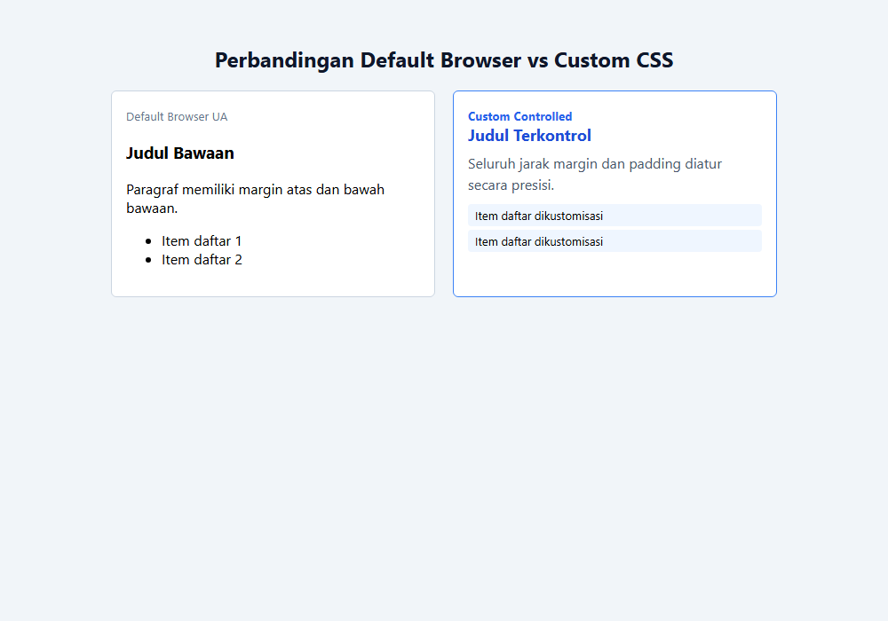

---

## Ringkasan Modul

Modul 1 telah memberikan fondasi esensial mengenai bagaimana CSS berinteraksi dengan dokumen HTML. Dengan memahami aturan sintaks, metode penyisipan stylesheet, jenis nilai dan unit, serta gaya bawaan browser, pembelajar kini siap melangkah ke mekanisme seleksi elemen yang lebih kaya pada Modul 2.

### Keterkaitan Materi
Seluruh submodul dalam modul ini dirancang secara berjenjang untuk membangun pemahaman yang kokoh dan aplikatif. Lanjutkan ke modul berikutnya setelah menguasai seluruh konsep di atas.
