# Modul 03: Cascade, Specificity, dan Inheritance

## Ringkasan Ruang Lingkup Materi

Modul ini mengeksplorasi mekanisme inti algoritma rendering CSS: Cascade (tata urutan dan resolusi konflik), Specificity (perhitungan bobot selector inline > ID > class > type), Source Order, Inheritance (pewarisan nilai dari induk ke anak), Inherited vs Non-inherited properties, keyword pengatur nilai universal (initial, inherit, unset, revert, revert-layer), bahaya dan penggunaan tepat deklarasi !important, hingga fitur mutakhir Cascade Layers (@layer).

## Tujuan Pembelajaran Modul

- Memahami prinsip kerja Cascade dalam menentukan deklarasi gaya yang menang saat terjadi konflik.
- Menghitung skor specificity (ID, Class/Attribute/Pseudo-class, Element) secara matematis dan sistematis.
- Menganalisis pengaruh urutan penulisan kode (source order) terhadap penerapan style.
- Mengidentifikasi properti yang diwariskan secara alami (misal: color, font) dan yang tidak (misal: margin, border).
- Mengontrol pewarisan menggunakan keyword universal: inherit, initial, unset, revert, revert-layer.
- Memahami cara kerja @layer untuk arsitektur CSS modern tanpa bergantung pada !important.

## Daftar Submodul

- [36. CSS cascade](36_css_cascade.css) — [Halaman Preview](36_css_cascade.html)
- [37. Selector specificity](37_selector_specificity.css) — [Halaman Preview](37_selector_specificity.html)
- [38. Perbandingan specificity](38_specificity_comparison.css) — [Halaman Preview](38_specificity_comparison.html)
- [39. Source order](39_source_order.css) — [Halaman Preview](39_source_order.html)
- [40. Inheritance](40_css_inheritance.css) — [Halaman Preview](40_css_inheritance.html)
- [41. Inherited properties](41_inherited_properties.css) — [Halaman Preview](41_inherited_properties.html)
- [42. Non-inherited properties](42_non_inherited_properties.css) — [Halaman Preview](42_non_inherited_properties.html)
- [43. Nilai initial](43_initial_value.css) — [Halaman Preview](43_initial_value.html)
- [44. Keyword inherit](44_inherit_keyword.css) — [Halaman Preview](44_inherit_keyword.html)
- [45. Keyword unset](45_unset_keyword.css) — [Halaman Preview](45_unset_keyword.html)
- [46. Keyword revert](46_revert_keyword.css) — [Halaman Preview](46_revert_keyword.html)
- [47. Keyword revert-layer](47_revert_layer.css) — [Halaman Preview](47_revert_layer.html)
- [48. Deklarasi !important](48_important_declaration.css) — [Halaman Preview](48_important_declaration.html)
- [49. Pengenalan cascade layers](49_cascade_layers_intro.css) — [Halaman Preview](49_cascade_layers_intro.html)
- [50. Resolusi konflik CSS](50_cascade_conflict_resolution.css) — [Halaman Preview](50_cascade_conflict_resolution.html)

---

## Pembahasan dan Penjelasan Submodul

### 36. CSS cascade

**Tujuan:** Memahami konsep air terjun (cascade) yang menyelesaikan persaingan beberapa deklarasi gaya.

**Konsep Utama:**
Cascade adalah algoritma peramban yang menggabungkan asal stylesheet (user agent, user, author), pentingnya deklarasi (!important), bobot specificity, dan source order untuk menentukan nilai akhir yang diterapkan pada elemen.

**Penjelasan Source Code:**
Menampilkan demonstrasi dua aturan bersaing pada elemen teks di mana aturan dengan spesifisitas atau posisi paling akhir menjadi pemenang.

**Source code utama:** [36_css_cascade.css](36_css_cascade.css)

**File pendukung preview:** [36_css_cascade.html](36_css_cascade.html)

**Cara Menjalankan:**
Buka file HTML pendukung di peramban web (Google Chrome, Microsoft Edge, atau Mozilla Firefox), atau gunakan Live Server / HTTP Server:

```bash
# Buka langsung file HTML di browser default
start "" "36_css_cascade.html"
```

**Hasil yang Diharapkan:**
Kotak pengumuman berpenampilan biru laut yang dihasilkan dari proses penyaringan cascade.

**Screenshot Hasil Eksekusi:**

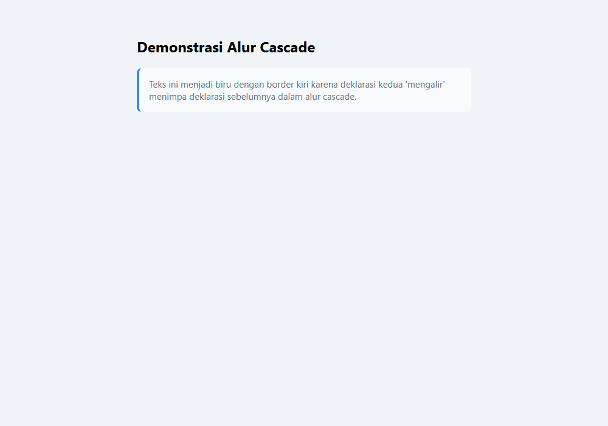

---

### 37. Selector specificity

**Tujuan:** Menghitung nilai bobot spesifisitas selector (Inline, ID, Class, Element).

**Konsep Utama:**
Specificity dihitung dengan sistem peringkat (Inline, ID, Class/Attribute/Pseudo-class, Type). Misalnya ID bernilai (0,1,0,0) yang selalu mengalahkan class selector (0,0,1,0) tidak peduli berapa banyak class yang digabungkan.

**Penjelasan Source Code:**
Memperlihatkan persaingan antara selector elemen `h2`, selector kelas `.title-class`, dan selector ID `#title-id` terhadap elemen yang sama.

**Source code utama:** [37_selector_specificity.css](37_selector_specificity.css)

**File pendukung preview:** [37_selector_specificity.html](37_selector_specificity.html)

**Cara Menjalankan:**
Buka file HTML pendukung di peramban web (Google Chrome, Microsoft Edge, atau Mozilla Firefox), atau gunakan Live Server / HTTP Server:

```bash
# Buka langsung file HTML di browser default
start "" "37_selector_specificity.html"
```

**Hasil yang Diharapkan:**
Judul menampilkan warna ungu dari ID selector karena memiliki specificity tertinggi dibanding class dan type selector.

**Screenshot Hasil Eksekusi:**

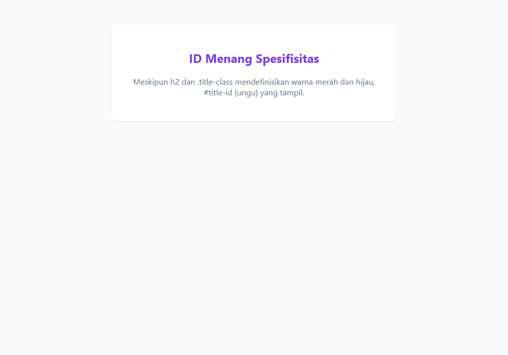

---

### 38. Perbandingan specificity

**Tujuan:** Membandingkan berbagai kombinasi selector untuk menganalisis pemenang spesifisitas.

**Konsep Utama:**
Perbandingan dilakukan kolom demi kolom dari kiri ke kanan. Selector dengan 1 ID (0,1,0,0) akan selalu mengalahkan selector dengan 10 class (0,0,10,0).

**Penjelasan Source Code:**
Mengadu kombinasi selector `nav.navbar ul.menu li.active a` (0,0,3,3) melawan `#main-nav a` (0,1,0,1).

**Source code utama:** [38_specificity_comparison.css](38_specificity_comparison.css)

**File pendukung preview:** [38_specificity_comparison.html](38_specificity_comparison.html)

**Cara Menjalankan:**
Buka file HTML pendukung di peramban web (Google Chrome, Microsoft Edge, atau Mozilla Firefox), atau gunakan Live Server / HTTP Server:

```bash
# Buka langsung file HTML di browser default
start "" "38_specificity_comparison.html"
```

**Hasil yang Diharapkan:**
Tautan aktif bernilai warna oranye tebal karena satu ID mengalahkan banyak kelas.

**Screenshot Hasil Eksekusi:**

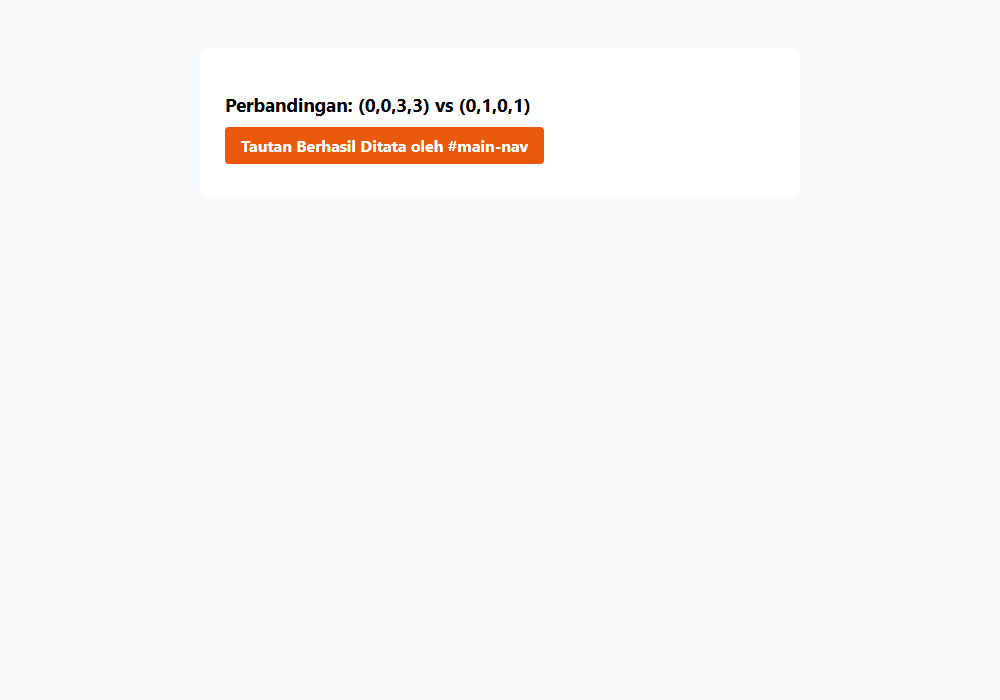

---

### 39. Source order

**Tujuan:** Mengetahui peran urutan penulisan kode sumber ketika dua selector memiliki specificity berbobot identik.

**Konsep Utama:**
Ketika dua atau lebih ruleset memiliki bobot specificity yang persis sama, aturan yang dideklarasikan paling akhir (paling bawah di dokumen) yang akan diterapkan oleh peramban.

**Penjelasan Source Code:**
Dua kelas utilitas `.bg-blue` dan `.bg-emerald` memiliki bobot sama (0,0,1,0); aturan yang ditulis belakangan memenangkan persaingan.

**Source code utama:** [39_source_order.css](39_source_order.css)

**File pendukung preview:** [39_source_order.html](39_source_order.html)

**Cara Menjalankan:**
Buka file HTML pendukung di peramban web (Google Chrome, Microsoft Edge, atau Mozilla Firefox), atau gunakan Live Server / HTTP Server:

```bash
# Buka langsung file HTML di browser default
start "" "39_source_order.html"
```

**Hasil yang Diharapkan:**
Kotak kartu berlatar hijau zamrud karena kelas bg-emerald didefinisikan setelah bg-blue pada berkas CSS.

**Screenshot Hasil Eksekusi:**

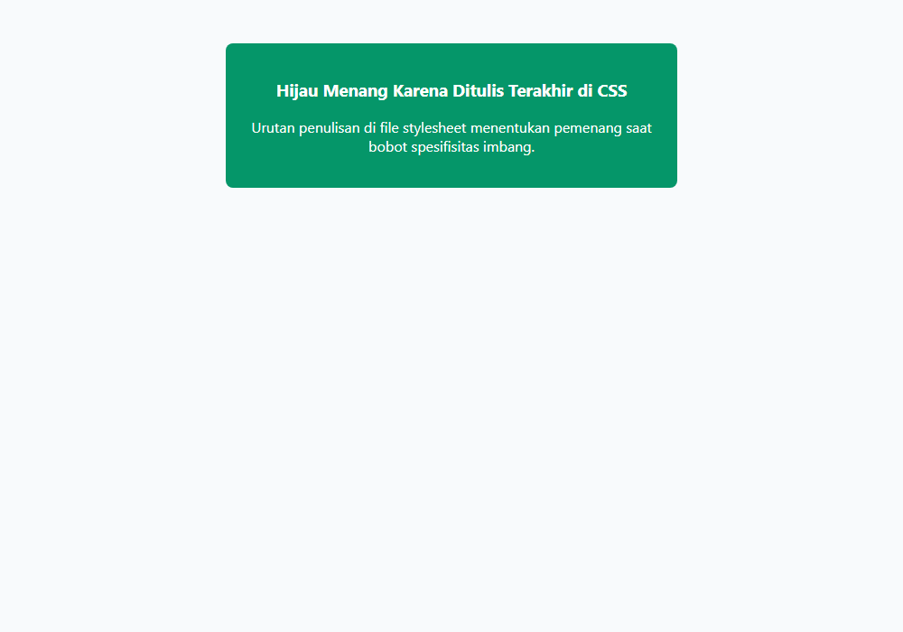

---

### 40. Inheritance

**Tujuan:** Memahami konsep pewarisan nilai CSS dari elemen induk ke elemen anak.

**Konsep Utama:**
Secara alami, sebagian properti CSS yang diterapkan pada elemen induk akan otomatis diwariskan ke seluruh elemen keturunannya di dalam dokumen, mengurangi kebutuhan pendefinisian berulang.

**Penjelasan Source Code:**
Mengatur `font-family`, `color`, dan `line-height` pada `.parent-card`, dan membuktikan anak-anaknya (`h3`, `p`, `span`) otomatis mewarisi nilai tersebut.

**Source code utama:** [40_css_inheritance.css](40_css_inheritance.css)

**File pendukung preview:** [40_css_inheritance.html](40_css_inheritance.html)

**Cara Menjalankan:**
Buka file HTML pendukung di peramban web (Google Chrome, Microsoft Edge, atau Mozilla Firefox), atau gunakan Live Server / HTTP Server:

```bash
# Buka langsung file HTML di browser default
start "" "40_css_inheritance.html"
```

**Hasil yang Diharapkan:**
Seluruh teks di dalam kartu memiliki keseragaman warna abu-abu gelap dan font serif elegan secara otomatis.

**Screenshot Hasil Eksekusi:**

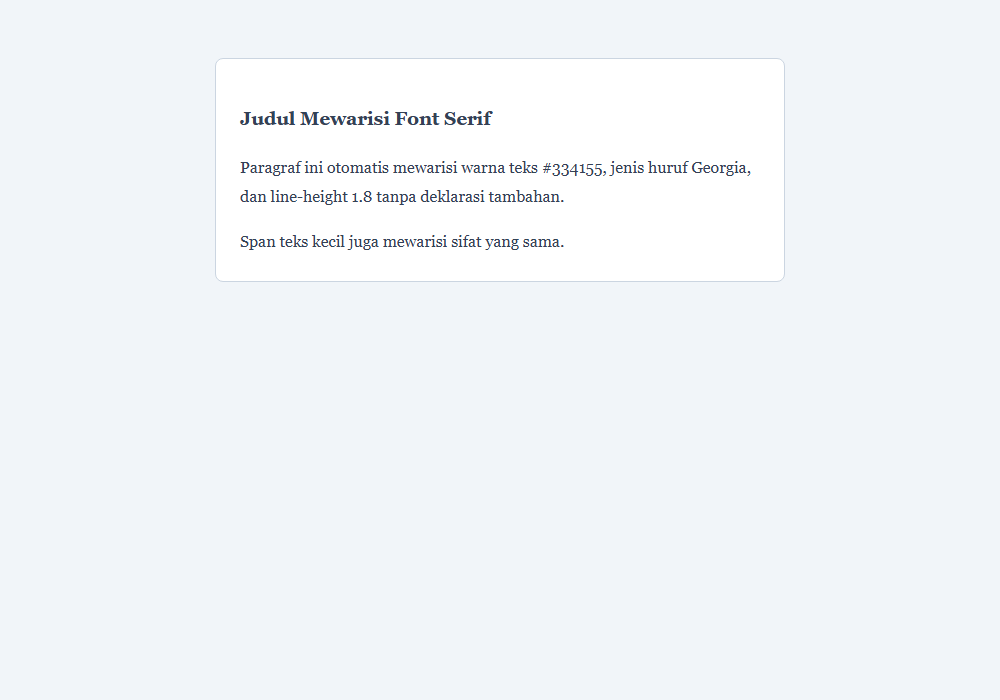

---

### 41. Inherited properties

**Tujuan:** Mengidentifikasi daftar properti CSS yang otomatis diwariskan.

**Konsep Utama:**
Sebagian besar properti terkait tipografi dan teks diwariskan secara default, antara lain: `color`, `font-family`, `font-size`, `font-weight`, `line-height`, `letter-spacing`, `text-align`, `visibility`.

**Penjelasan Source Code:**
Mendemonstrasikan efek pewarisan `letter-spacing`, `text-align`, dan `color` dari elemen induk ke subelemen.

**Source code utama:** [41_inherited_properties.css](41_inherited_properties.css)

**File pendukung preview:** [41_inherited_properties.html](41_inherited_properties.html)

**Cara Menjalankan:**
Buka file HTML pendukung di peramban web (Google Chrome, Microsoft Edge, atau Mozilla Firefox), atau gunakan Live Server / HTTP Server:

```bash
# Buka langsung file HTML di browser default
start "" "41_inherited_properties.html"
```

**Hasil yang Diharapkan:**
Area teks terpusat dengan spasi huruf renggang yang merata di semua anak elemen.

**Screenshot Hasil Eksekusi:**

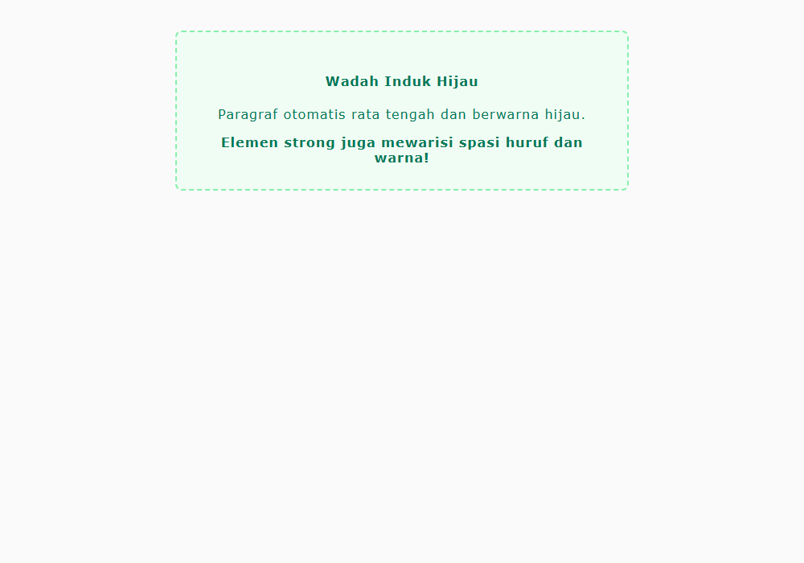

---

### 42. Non-inherited properties

**Tujuan:** Mengidentifikasi properti yang tidak diwariskan dan memahami alasan logisnya.

**Konsep Utama:**
Properti yang mengatur box-model, ukuran, latar belakang, dan border TIDAK diwariskan demi mencegah kekacauan layout visual. Contoh: `margin`, `padding`, `border`, `background`, `width`, `height`, `position`.

**Penjelasan Source Code:**
Elemen induk memiliki border tebal dan background; elemen anak di dalamnya tidak otomatis memiliki border sendiri.

**Source code utama:** [42_non_inherited_properties.css](42_non_inherited_properties.css)

**File pendukung preview:** [42_non_inherited_properties.html](42_non_inherited_properties.html)

**Cara Menjalankan:**
Buka file HTML pendukung di peramban web (Google Chrome, Microsoft Edge, atau Mozilla Firefox), atau gunakan Live Server / HTTP Server:

```bash
# Buka langsung file HTML di browser default
start "" "42_non_inherited_properties.html"
```

**Hasil yang Diharapkan:**
Kontainer dengan border dan latar, sedangkan elemen teks di dalamnya tidak memiliki border berulang.

**Screenshot Hasil Eksekusi:**

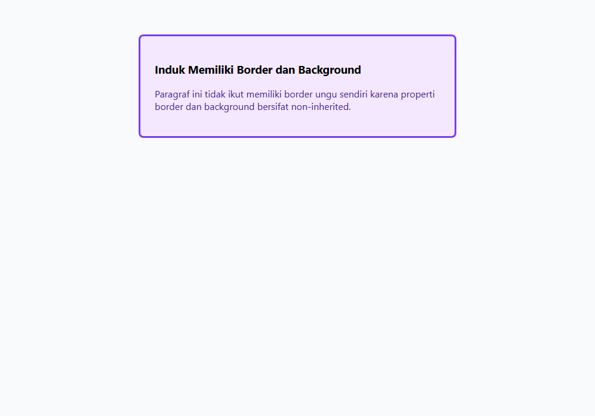

---

### 43. Nilai initial

**Tujuan:** Mengembalikan nilai properti ke nilai default standar spesifikasi CSS menggunakan keyword initial.

**Konsep Utama:**
Keyword `initial` menyetel ulang properti ke nilai awalnya sebagaimana ditentukan oleh spesifikasi resmi CSS (bukan default bawaan peramban). Misalnya `color: initial` akan menghasilkan warna hitam (`#000000`).

**Penjelasan Source Code:**
Mereset warna teks elemen turunan agar melepaskan pewarisan dari induk dan kembali ke nilai awal resmi CSS.

**Source code utama:** [43_initial_value.css](43_initial_value.css)

**File pendukung preview:** [43_initial_value.html](43_initial_value.html)

**Cara Menjalankan:**
Buka file HTML pendukung di peramban web (Google Chrome, Microsoft Edge, atau Mozilla Firefox), atau gunakan Live Server / HTTP Server:

```bash
# Buka langsung file HTML di browser default
start "" "43_initial_value.html"
```

**Hasil yang Diharapkan:**
Elemen induk berwarna oranye terang, sedangkan elemen anak dengan `color: initial` kembali menjadi hitam standar.

**Screenshot Hasil Eksekusi:**

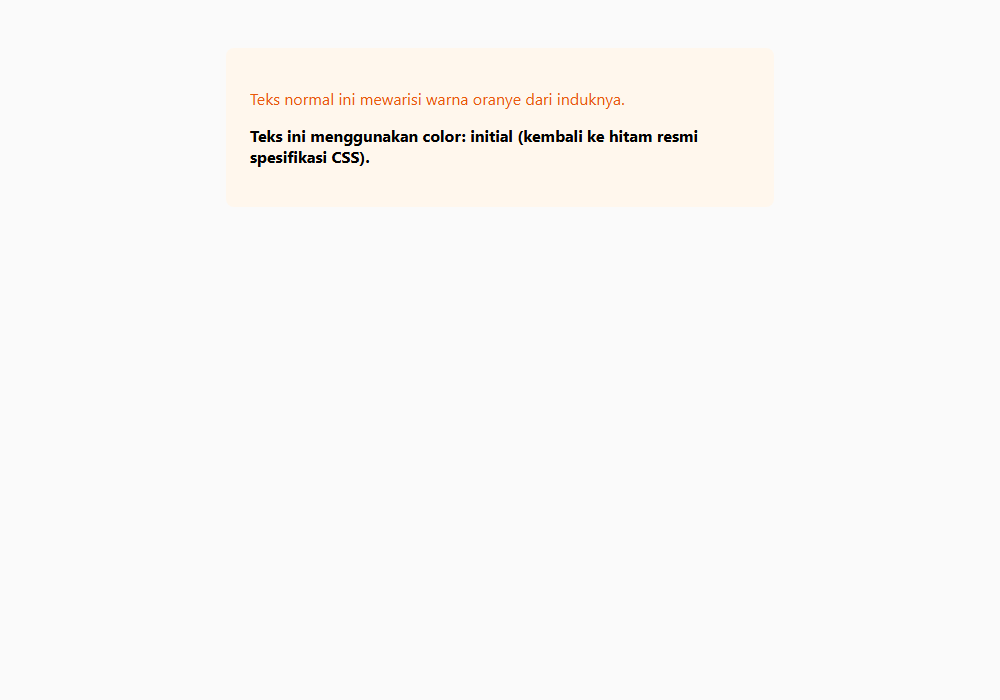

---

### 44. Keyword inherit

**Tujuan:** Memaksa properti non-inherited untuk mewarisi nilai dari elemen induk menggunakan keyword inherit.

**Konsep Utama:**
Keyword `inherit` memerintahkan peramban untuk mengambil nilai properti yang sama persis dari elemen induknya, bahkan untuk properti yang biasanya tidak diwariskan seperti border atau background.

**Penjelasan Source Code:**
Membuat tombol `<button>` mewarisi warna border atau font secara eksplisit dari wadah induknya.

**Source code utama:** [44_inherit_keyword.css](44_inherit_keyword.css)

**File pendukung preview:** [44_inherit_keyword.html](44_inherit_keyword.html)

**Cara Menjalankan:**
Buka file HTML pendukung di peramban web (Google Chrome, Microsoft Edge, atau Mozilla Firefox), atau gunakan Live Server / HTTP Server:

```bash
# Buka langsung file HTML di browser default
start "" "44_inherit_keyword.html"
```

**Hasil yang Diharapkan:**
Tombol di dalam kontainer mewarisi jenis font dan warna border induk secara mulus.

**Screenshot Hasil Eksekusi:**

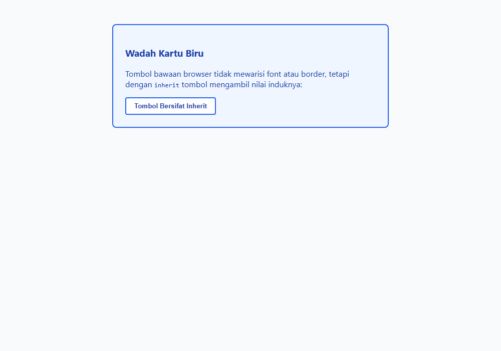

---

### 45. Keyword unset

**Tujuan:** Memahami keyword unset yang bertindak sebagai inherit untuk inherited property, dan initial untuk non-inherited property.

**Konsep Utama:**
Keyword `unset` bekerja secara dinamis: jika properti yang disetel bersifat inherited secara alami, nilainya berubah menjadi `inherit`; jika non-inherited, nilainya berubah menjadi `initial`.

**Penjelasan Source Code:**
Menggunakan `all: unset` untuk menghapus seluruh styling bawaan tombol sehingga menjadi elemen teks polos fleksibel.

**Source code utama:** [45_unset_keyword.css](45_unset_keyword.css)

**File pendukung preview:** [45_unset_keyword.html](45_unset_keyword.html)

**Cara Menjalankan:**
Buka file HTML pendukung di peramban web (Google Chrome, Microsoft Edge, atau Mozilla Firefox), atau gunakan Live Server / HTTP Server:

```bash
# Buka langsung file HTML di browser default
start "" "45_unset_keyword.html"
```

**Hasil yang Diharapkan:**
Tombol HTML yang bersih dari styling default kaku peramban (tanpa border bevel, background abu-abu, dll).

**Screenshot Hasil Eksekusi:**

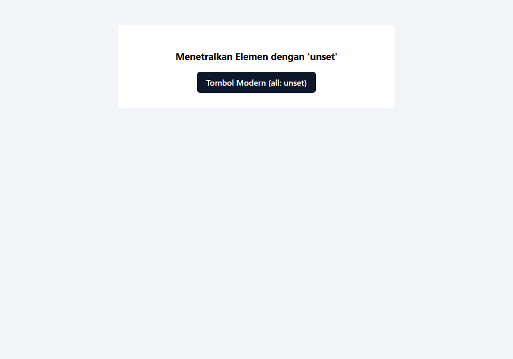

---

### 46. Keyword revert

**Tujuan:** Mengembalikan gaya ke stylesheet level sebelumnya (user-agent stylesheet) menggunakan keyword revert.

**Konsep Utama:**
Berbeda dengan `initial` yang merujuk pada standar CSS murni, `revert` mengembalikan nilai ke default bawaan peramban (User-Agent Stylesheet) seolah-olah penulis kode tidak pernah memberikan aturan.

**Penjelasan Source Code:**
Mereset daftar list yang dihilangkan bullet-nya agar kembali memiliki bullet bawaan browser menggunakan `list-style: revert`.

**Source code utama:** [46_revert_keyword.css](46_revert_keyword.css)

**File pendukung preview:** [46_revert_keyword.html](46_revert_keyword.html)

**Cara Menjalankan:**
Buka file HTML pendukung di peramban web (Google Chrome, Microsoft Edge, atau Mozilla Firefox), atau gunakan Live Server / HTTP Server:

```bash
# Buka langsung file HTML di browser default
start "" "46_revert_keyword.html"
```

**Hasil yang Diharapkan:**
Daftar menu kembali menampilkan titik bullet bawaan browser setelah sebelumnya di-reset.

**Screenshot Hasil Eksekusi:**

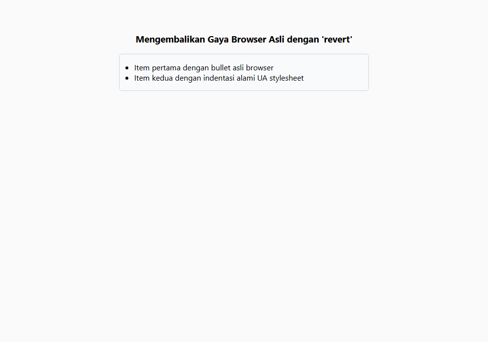

---

### 47. Keyword revert-layer

**Tujuan:** Mengembalikan nilai gaya ke cascade layer sebelumnya menggunakan revert-layer.

**Konsep Utama:**
Keyword `revert-layer` mengabaikan deklarasi pada `@layer` saat ini dan mengambil nilai yang didefinisikan pada cascade layer di bawahnya.

**Penjelasan Source Code:**
Elemen teks dalam layer override menggunakan `revert-layer` untuk memakai styling dari layer tema dasar.

**Source code utama:** [47_revert_layer.css](47_revert_layer.css)

**File pendukung preview:** [47_revert_layer.html](47_revert_layer.html)

**Cara Menjalankan:**
Buka file HTML pendukung di peramban web (Google Chrome, Microsoft Edge, atau Mozilla Firefox), atau gunakan Live Server / HTTP Server:

```bash
# Buka langsung file HTML di browser default
start "" "47_revert_layer.html"
```

**Hasil yang Diharapkan:**
Komponen yang mengambil warna dari layer dasar karena layer atasnya melakukan pembalikan (revert-layer).

**Screenshot Hasil Eksekusi:**

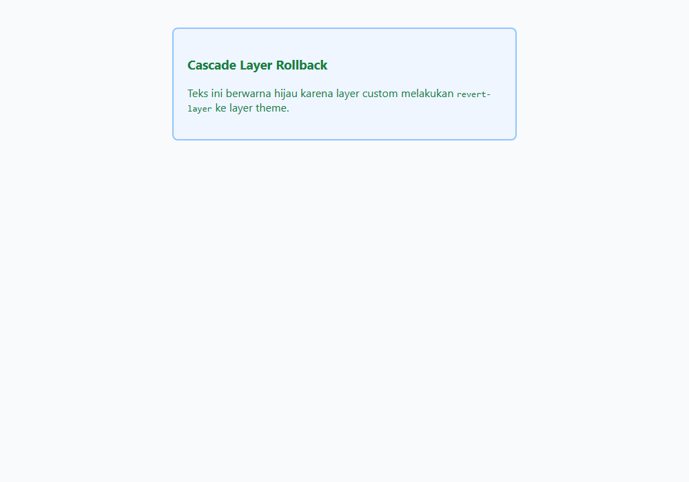

---

### 48. Deklarasi !important

**Tujuan:** Memahami mekanisme !important yang melompati specificity reguler serta risiko pemakaiannya.

**Konsep Utama:**
Deklarasi yang diakhiri `!important` akan menembus perhitungan specificity biasa dan langsung menang terhadap deklarasi biasa. Deklarasi ini harus digunakan sangat hemat, terutama hanya untuk kelas utilitas darurat.

**Penjelasan Source Code:**
Selector sederhana dengan `!important` mampu menimpa selector berbobot ID tinggi.

**Source code utama:** [48_important_declaration.css](48_important_declaration.css)

**File pendukung preview:** [48_important_declaration.html](48_important_declaration.html)

**Cara Menjalankan:**
Buka file HTML pendukung di peramban web (Google Chrome, Microsoft Edge, atau Mozilla Firefox), atau gunakan Live Server / HTTP Server:

```bash
# Buka langsung file HTML di browser default
start "" "48_important_declaration.html"
```

**Hasil yang Diharapkan:**
Kotak utilitas merah terang berhasil memaksakan warnanya terhadap selector ID berkat !important.

**Screenshot Hasil Eksekusi:**

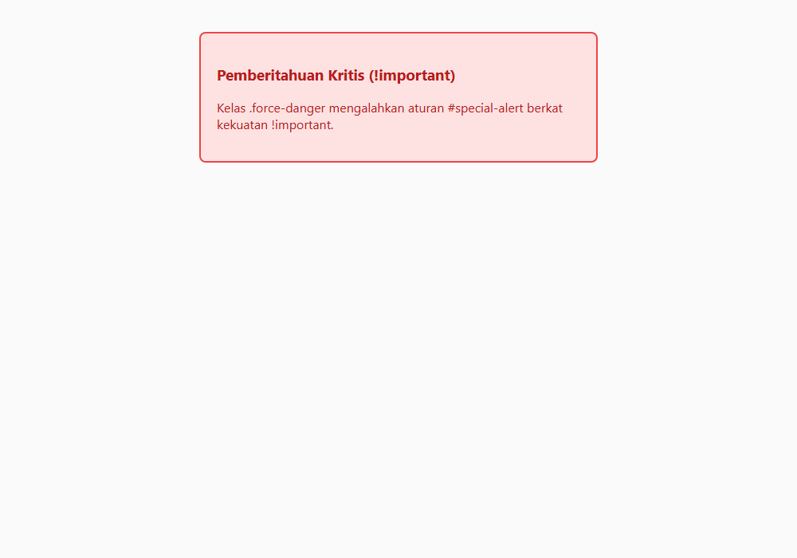

---

### 49. Pengenalan cascade layers

**Tujuan:** Menyusun arsitektur stylesheet bertingkat menggunakan fitur @layer modern.

**Konsep Utama:**
Cascade Layers (`@layer`) memungkinkan developer mengatur prioritas sekumpulan aturan secara eksplisit. Aturan di dalam layer yang didefinisikan belakangan akan selalu mengalahkan layer sebelumnya, terlepas dari nilai spesifisitas selector di dalamnya.

**Penjelasan Source Code:**
Mendefinisikan urutan `@layer reset, framework, components;` sehingga komponen developer selalu mengalahkan selector framework.

**Source code utama:** [49_cascade_layers_intro.css](49_cascade_layers_intro.css)

**File pendukung preview:** [49_cascade_layers_intro.html](49_cascade_layers_intro.html)

**Cara Menjalankan:**
Buka file HTML pendukung di peramban web (Google Chrome, Microsoft Edge, atau Mozilla Firefox), atau gunakan Live Server / HTTP Server:

```bash
# Buka langsung file HTML di browser default
start "" "49_cascade_layers_intro.html"
```

**Hasil yang Diharapkan:**
Komponen tombol yang ditata oleh layer components berhasil menimpa selector ID milik layer framework.

**Screenshot Hasil Eksekusi:**

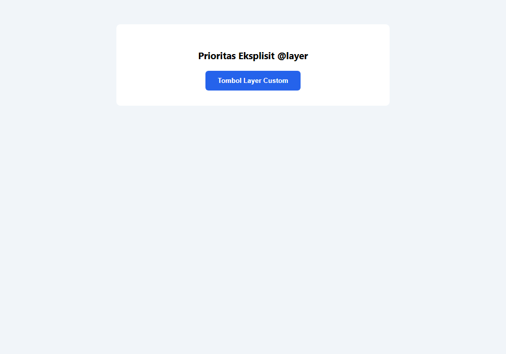

---

### 50. Resolusi konflik CSS

**Tujuan:** Menganalisis skenario penyelesaian konflik lengkap yang melibatkan asal, bobot, layer, dan posisi baris.

**Konsep Utama:**
Resolusi konflik CSS mengikuti urutan tahapan evaluasi: 1. Origin & Importance -> 2. Context -> 3. Element proximity -> 4. Cascade Layers -> 5. Specificity -> 6. Order of Appearance.

**Penjelasan Source Code:**
Mendemonstrasikan kartu informasi status yang memadukan berbagai tingkatan aturan sehingga menghasilkan output terprediksi.

**Source code utama:** [50_cascade_conflict_resolution.css](50_cascade_conflict_resolution.css)

**File pendukung preview:** [50_cascade_conflict_resolution.html](50_cascade_conflict_resolution.html)

**Cara Menjalankan:**
Buka file HTML pendukung di peramban web (Google Chrome, Microsoft Edge, atau Mozilla Firefox), atau gunakan Live Server / HTTP Server:

```bash
# Buka langsung file HTML di browser default
start "" "50_cascade_conflict_resolution.html"
```

**Hasil yang Diharapkan:**
Kartu profil status yang menampilkan gaya hasil resolusi konflik terencana dengan palet warna biru korporat.

**Screenshot Hasil Eksekusi:**

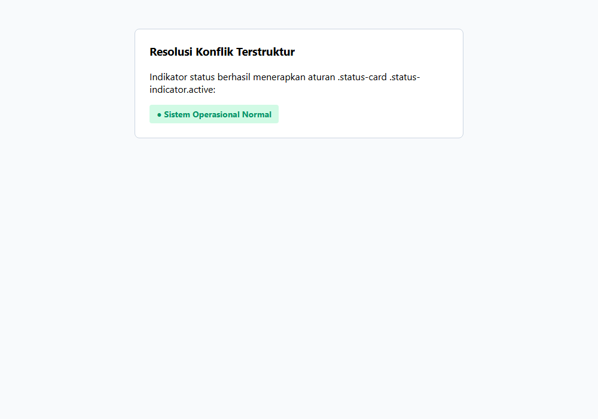

---

## Ringkasan Modul

Memahami Cascade, Specificity, dan Inheritance adalah kunci membedakan developer pemula dari profesional CSS. Dengan modul ini, pembelajar tidak lagi 'berkelahi' melawan CSS menggunakan !important liar, melainkan merancang stylesheet yang elegan, terprediksi, dan mudah dirawat.

### Keterkaitan Materi
Seluruh submodul dalam modul ini dirancang secara berjenjang untuk membangun pemahaman yang kokoh dan aplikatif. Lanjutkan ke modul berikutnya setelah menguasai seluruh konsep di atas.
