# Modul 05: Typography dan Pemformatan Teks

## Ringkasan Ruang Lingkup Materi

Modul ini membahas prinsip perancangan tipografi web dan pemformatan teks secara mendalam: pemilihan font-family dengan font fallback stack, pengaturan skala font-size responsif, bobot font-weight numerik dan kata kunci, font-style, font-variant (small-caps), font-stretch, shorthand font, kenyamanan membaca dengan line-height proporsional, perataan text-align, dekorasi garis text-decoration modern (underline offset, thickness, color), text-transform, text-indent, kerning letter-spacing dan word-spacing, efek visual text-shadow, penanganan truncation text-overflow ellipsis, kontrol spasi white-space, word-break vs overflow-wrap, hingga integrasi web fonts kustom menggunakan at-rule @font-face.

## Tujuan Pembelajaran Modul

- Menyusun tumpukan jenis huruf (font stack) yang aman dan tangguh menggunakan font-family.
- Mengatur ukuran huruf dengan satuan aksesibel (rem) dan mengontrol keterbacaan dengan line-height.
- Menerapkan variasi bobot (font-weight), gaya miring (font-style), dan varian huruf (font-variant).
- Menata dekorasi, transformasi huruf kapital/kecil, serta spasi antarhuruf dan antarkata.
- Menangani teks panjang yang meluap menggunakan text-overflow, word-break, dan overflow-wrap.
- Memuat dan mengoptimalkan font kustom berbasis berkas web menggunakan @font-face.

## Daftar Submodul

- [71. Properti font-family](71_font_family.css) — [Halaman Preview](71_font_family.html)
- [72. Properti font-size](72_font_size.css) — [Halaman Preview](72_font_size.html)
- [73. Properti font-weight](73_font_weight.css) — [Halaman Preview](73_font_weight.html)
- [74. Properti font-style](74_font_style.css) — [Halaman Preview](74_font_style.html)
- [75. Properti font-variant](75_font_variant.css) — [Halaman Preview](75_font_variant.html)
- [76. Properti font-stretch](76_font_stretch.css) — [Halaman Preview](76_font_stretch.html)
- [77. Shorthand font](77_font_shorthand.css) — [Halaman Preview](77_font_shorthand.html)
- [78. Properti line-height](78_line_height.css) — [Halaman Preview](78_line_height.html)
- [79. Properti text-align](79_text_align.css) — [Halaman Preview](79_text_align.html)
- [80. Properti text-decoration](80_text_decoration.css) — [Halaman Preview](80_text_decoration.html)
- [81. Properti text-transform](81_text_transform.css) — [Halaman Preview](81_text_transform.html)
- [82. Properti text-indent](82_text_indent.css) — [Halaman Preview](82_text_indent.html)
- [83. Properti letter-spacing](83_letter_spacing.css) — [Halaman Preview](83_letter_spacing.html)
- [84. Properti word-spacing](84_word_spacing.css) — [Halaman Preview](84_word_spacing.html)
- [85. Properti text-shadow](85_text_shadow.css) — [Halaman Preview](85_text_shadow.html)
- [86. Properti text-overflow](86_text_overflow.css) — [Halaman Preview](86_text_overflow.html)
- [87. Properti white-space](87_white_space.css) — [Halaman Preview](87_white_space.html)
- [88. Properti word-break](88_word_break.css) — [Halaman Preview](88_word_break.html)
- [89. Properti overflow-wrap](89_overflow_wrap.css) — [Halaman Preview](89_overflow_wrap.html)
- [90. Web fonts menggunakan @font-face](90_web_fonts.css) — [Halaman Preview](90_web_fonts.html)

---

## Pembahasan dan Penjelasan Submodul

### 71. Properti font-family

**Tujuan:** Menyusun tumpukan font fallback yang aman dan universal menggunakan font-family.

**Konsep Utama:**
Properti `font-family` menerima daftar nama font yang dipisahkan koma. Peramban akan mencoba memuat font dari kiri ke kanan; jika font pertama tidak terpasang di sistem pengguna, peramban beralih ke font berikutnya hingga tiba di generic family (seperti sans-serif, serif, monospace).

**Penjelasan Source Code:**
Mendefinisikan tumpukan font modern sistem UI sans-serif pada kontainer utama dan tumpukan font serif klasik pada kutipan.

**Source code utama:** [71_font_family.css](71_font_family.css)

**File pendukung preview:** [71_font_family.html](71_font_family.html)

**Cara Menjalankan:**
Buka file HTML pendukung di peramban web (Google Chrome, Microsoft Edge, atau Mozilla Firefox), atau gunakan Live Server / HTTP Server:

```bash
# Buka langsung file HTML di browser default
start "" "71_font_family.html"
```

**Hasil yang Diharapkan:**
Dua paragraf dengan jenis huruf yang kontras: sans-serif bersih dan serif berwibawa.

**Screenshot Hasil Eksekusi:**

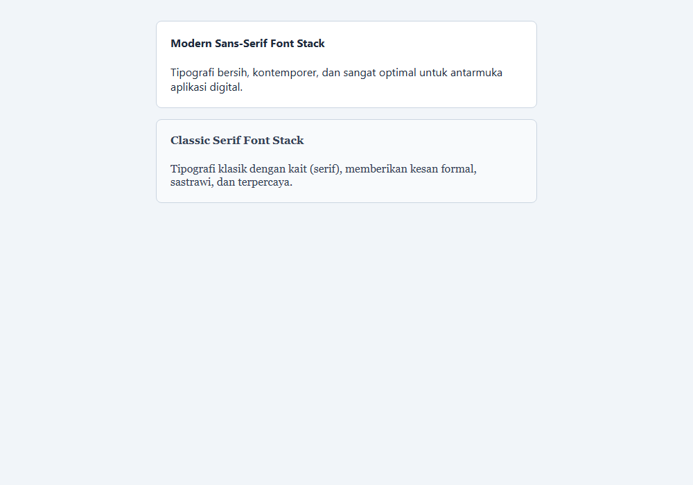

---

### 72. Properti font-size

**Tujuan:** Mengatur ukuran huruf dengan hierarki yang jelas menggunakan unit rem dan px.

**Konsep Utama:**
Properti `font-size` menentukan skala ukuran teks. Menggunakan satuan relatif `rem` sangat dianjurkan daripada `px` agar menghargai preferensi zoom dan ukuran teks yang diatur pengguna di pengaturan perambannya.

**Penjelasan Source Code:**
Mendefinisikan skala modular tipografi: judul (2rem), subjudul (1.25rem), dan teks isi (1rem).

**Source code utama:** [72_font_size.css](72_font_size.css)

**File pendukung preview:** [72_font_size.html](72_font_size.html)

**Cara Menjalankan:**
Buka file HTML pendukung di peramban web (Google Chrome, Microsoft Edge, atau Mozilla Firefox), atau gunakan Live Server / HTTP Server:

```bash
# Buka langsung file HTML di browser default
start "" "72_font_size.html"
```

**Hasil yang Diharapkan:**
Struktur hierarki visual teks bertingkat yang rapi dan mudah dicerna.

**Screenshot Hasil Eksekusi:**

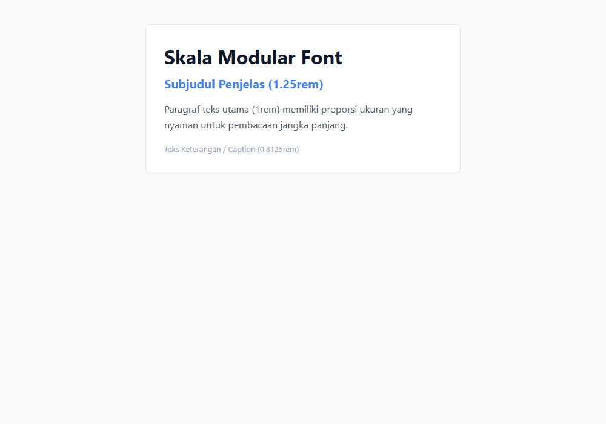

---

### 73. Properti font-weight

**Tujuan:** Mengatur bobot ketebalan huruf menggunakan angka numerik (100-900) dan kata kunci.

**Konsep Utama:**
Properti `font-weight` menerima nilai kata kunci (`normal`, `bold`, `lighter`, `bolder`) atau nilai numerik bertingkat dari 100 (Thin) hingga 900 (Black). Nilai standar teks normal adalah 400 dan bold adalah 700.

**Penjelasan Source Code:**
Menampilkan 4 tingkatan ketebalan huruf dari light (300), normal (400), semi-bold (600), hingga extra-bold (800).

**Source code utama:** [73_font_weight.css](73_font_weight.css)

**File pendukung preview:** [73_font_weight.html](73_font_weight.html)

**Cara Menjalankan:**
Buka file HTML pendukung di peramban web (Google Chrome, Microsoft Edge, atau Mozilla Firefox), atau gunakan Live Server / HTTP Server:

```bash
# Buka langsung file HTML di browser default
start "" "73_font_weight.html"
```

**Hasil yang Diharapkan:**
Empat baris teks yang memperlihatkan spektrum ketebalan font secara visual.

**Screenshot Hasil Eksekusi:**

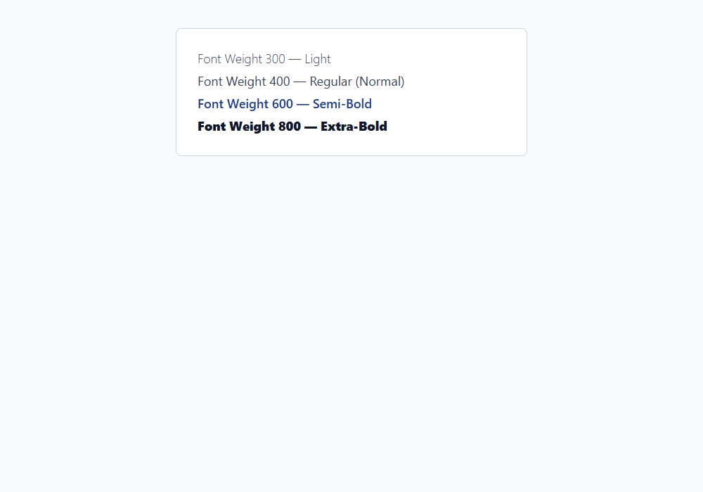

---

### 74. Properti font-style

**Tujuan:** Mengatur gaya kemiringan font menggunakan normal, italic, dan oblique.

**Konsep Utama:**
Properti `font-style` memungkinkan pengaturan kemiringan huruf: `normal` (tegak), `italic` (huruf kursif khusus rancangan desainer font), dan `oblique` (huruf tegak yang dimiringkan secara artifisial oleh peramban).

**Penjelasan Source Code:**
Menampilkan kutipan dengan gaya miring `font-style: italic` dan memulihkan teks penekanan ke `normal`.

**Source code utama:** [74_font_style.css](74_font_style.css)

**File pendukung preview:** [74_font_style.html](74_font_style.html)

**Cara Menjalankan:**
Buka file HTML pendukung di peramban web (Google Chrome, Microsoft Edge, atau Mozilla Firefox), atau gunakan Live Server / HTTP Server:

```bash
# Buka langsung file HTML di browser default
start "" "74_font_style.html"
```

**Hasil yang Diharapkan:**
Kutipan miring yang anggun dengan aksen garis vertikal lembut.

**Screenshot Hasil Eksekusi:**

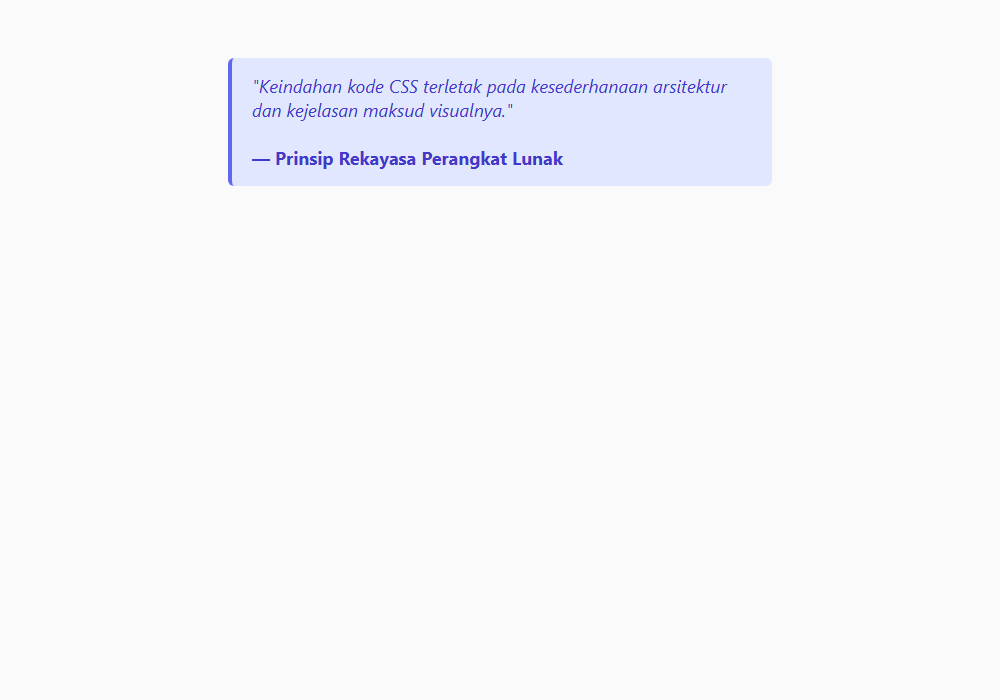

---

### 75. Properti font-variant

**Tujuan:** Menampilkan karakter huruf kapital kecil (small-caps) menggunakan font-variant.

**Konsep Utama:**
Properti `font-variant: small-caps` menampilkan semua huruf kecil sebagai huruf kapital, namun dengan ukuran vertikal (x-height) yang setara dengan huruf kecil biasa. Sangat umum digunakan pada akronim, judul bab, dan label eksklusif.

**Penjelasan Source Code:**
Menerapkan `font-variant: small-caps` pada label judul kategori.

**Source code utama:** [75_font_variant.css](75_font_variant.css)

**File pendukung preview:** [75_font_variant.html](75_font_variant.html)

**Cara Menjalankan:**
Buka file HTML pendukung di peramban web (Google Chrome, Microsoft Edge, atau Mozilla Firefox), atau gunakan Live Server / HTTP Server:

```bash
# Buka langsung file HTML di browser default
start "" "75_font_variant.html"
```

**Hasil yang Diharapkan:**
Label teks dengan gaya kapital kecil yang elegan dan berkelas.

**Screenshot Hasil Eksekusi:**

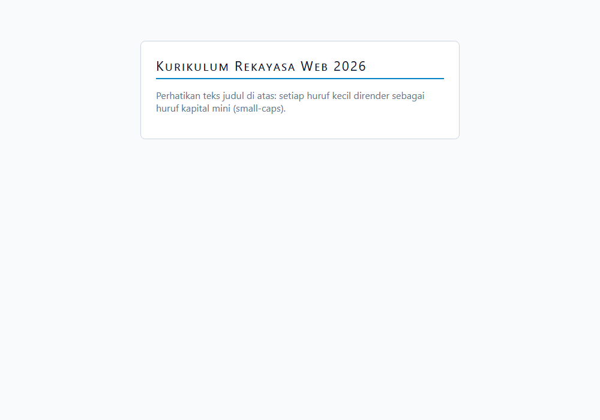

---

### 76. Properti font-stretch

**Tujuan:** Memilih varian lebar karakter (condensed vs expanded) pada font yang mendukung.

**Konsep Utama:**
Properti `font-stretch` mengatur pelebaran atau perapatan karakter (seperti `condensed`, `normal`, `expanded`). Bekerja optimal pada font yang memang memiliki variasi lebar atau variable fonts.

**Penjelasan Source Code:**
Mendemonstrasikan penerapan font-stretch pada font keluarga sistem.

**Source code utama:** [76_font_stretch.css](76_font_stretch.css)

**File pendukung preview:** [76_font_stretch.html](76_font_stretch.html)

**Cara Menjalankan:**
Buka file HTML pendukung di peramban web (Google Chrome, Microsoft Edge, atau Mozilla Firefox), atau gunakan Live Server / HTTP Server:

```bash
# Buka langsung file HTML di browser default
start "" "76_font_stretch.html"
```

**Hasil yang Diharapkan:**
Teks dengan varian karakter kompak (condensed) dan lebar (expanded).

**Screenshot Hasil Eksekusi:**

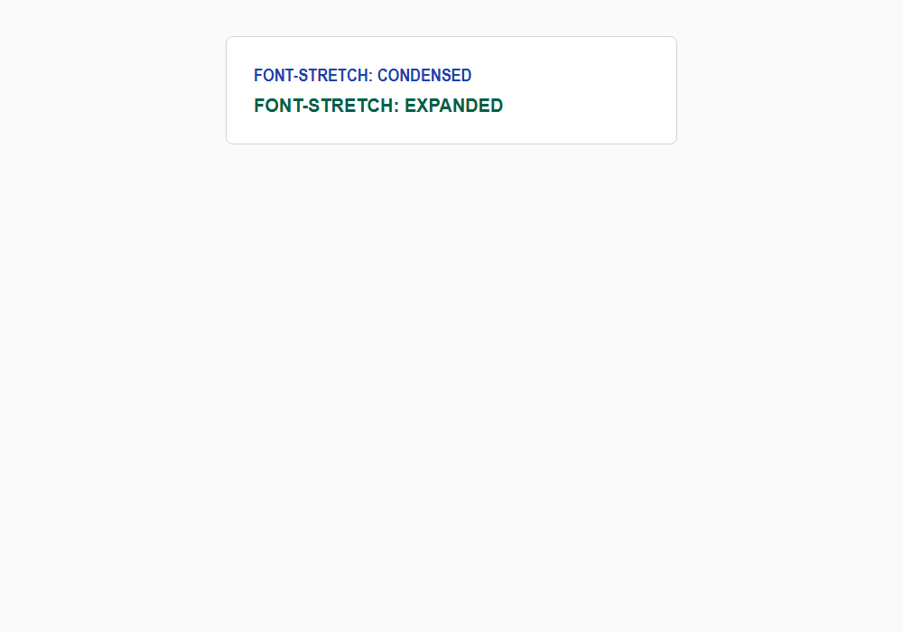

---

### 77. Shorthand font

**Tujuan:** Menuliskan seluruh properti font dalam satu baris shorthand dengan urutan sintaks yang tepat.

**Konsep Utama:**
Shorthand `font` menggabungkan: `[font-style] [font-variant] [font-weight] font-size[/line-height] font-family`. Ketentuan mutlak W3C: `font-size` dan `font-family` WAJIB disertakan agar shorthand valid.

**Penjelasan Source Code:**
Menerapkan shorthand lengkap `font: italic bold 1.25rem/1.6 'Segoe UI', sans-serif`.

**Source code utama:** [77_font_shorthand.css](77_font_shorthand.css)

**File pendukung preview:** [77_font_shorthand.html](77_font_shorthand.html)

**Cara Menjalankan:**
Buka file HTML pendukung di peramban web (Google Chrome, Microsoft Edge, atau Mozilla Firefox), atau gunakan Live Server / HTTP Server:

```bash
# Buka langsung file HTML di browser default
start "" "77_font_shorthand.html"
```

**Hasil yang Diharapkan:**
Komponen headline yang langsung memiliki style, bobot, ukuran, line-height, dan font stack dalam satu aturan.

**Screenshot Hasil Eksekusi:**

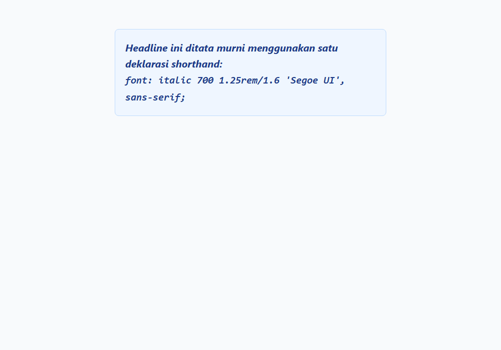

---

### 78. Properti line-height

**Tujuan:** Mengatur jarak antar-baris teks untuk kenyamanan membaca optimal menggunakan angka unitless.

**Konsep Utama:**
Properti `line-height` menentukan tinggi satu baris kotak teks. Best practice industri adalah menggunakan angka murni tanpa unit (unitless number), seperti `1.5` atau `1.6`, agar diwariskan secara proporsional terhadap ukuran font masing-masing anak.

**Penjelasan Source Code:**
Membandingkan baris teks rapat (1.1) yang melelahkan mata dengan baris teks proporsional (1.7) yang nyaman dibaca.

**Source code utama:** [78_line_height.css](78_line_height.css)

**File pendukung preview:** [78_line_height.html](78_line_height.html)

**Cara Menjalankan:**
Buka file HTML pendukung di peramban web (Google Chrome, Microsoft Edge, atau Mozilla Firefox), atau gunakan Live Server / HTTP Server:

```bash
# Buka langsung file HTML di browser default
start "" "78_line_height.html"
```

**Hasil yang Diharapkan:**
Dua kartu perbandingan yang memperlihatkan perbedaan nyata antara keterbacaan teks rapat vs lega.

**Screenshot Hasil Eksekusi:**

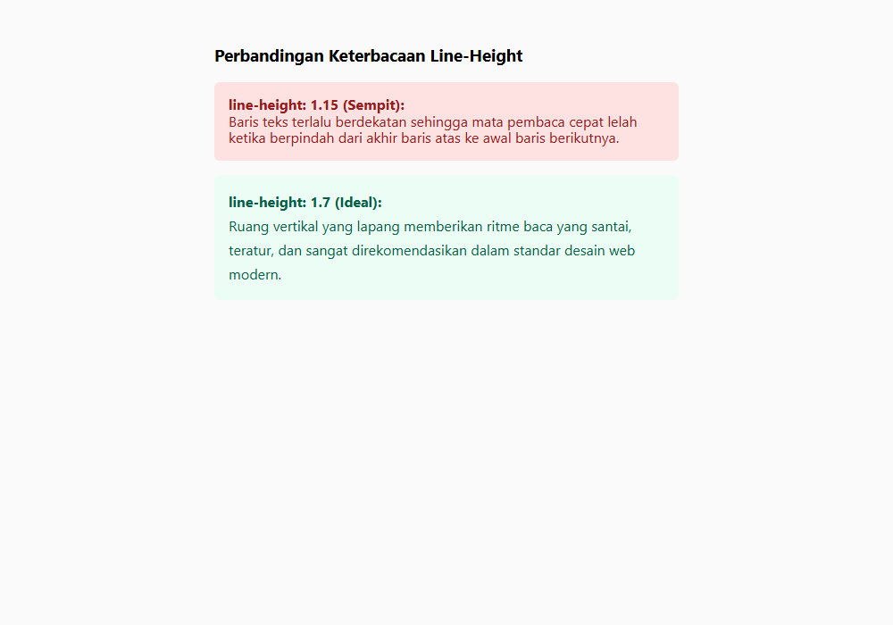

---

### 79. Properti text-align

**Tujuan:** Mengatur perataan horizontal teks (left, center, right, justify).

**Konsep Utama:**
Properti `text-align` mengontrol perataan horizontal konten inline di dalam elemen blok: `left` (kiri), `center` (tengah), `right` (kanan), dan `justify` (rata kiri-kanan).

**Penjelasan Source Code:**
Menampilkan 3 kotak demonstrasi dengan teks rata kiri, rata tengah, dan rata kanan.

**Source code utama:** [79_text_align.css](79_text_align.css)

**File pendukung preview:** [79_text_align.html](79_text_align.html)

**Cara Menjalankan:**
Buka file HTML pendukung di peramban web (Google Chrome, Microsoft Edge, atau Mozilla Firefox), atau gunakan Live Server / HTTP Server:

```bash
# Buka langsung file HTML di browser default
start "" "79_text_align.html"
```

**Hasil yang Diharapkan:**
Tiga variasi posisi perataan teks yang ditampilkan dalam deretan rapi.

**Screenshot Hasil Eksekusi:**

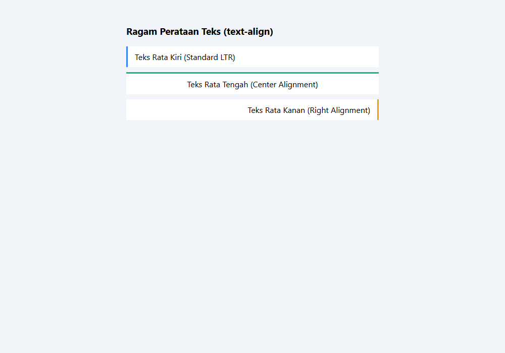

---

### 80. Properti text-decoration

**Tujuan:** Menghias teks dengan garis bawah modern, garis coret, warna garis, dan offset.

**Konsep Utama:**
CSS modern membagi `text-decoration` menjadi beberapa kontrol presisi: `text-decoration-line` (underline, line-through), `text-decoration-color`, `text-decoration-style` (wavy, dashed), dan `text-underline-offset`.

**Penjelasan Source Code:**
Membuat tautan modern dengan garis bawah berjarak (offset) serta teks diskon yang dicoret rapi.

**Source code utama:** [80_text_decoration.css](80_text_decoration.css)

**File pendukung preview:** [80_text_decoration.html](80_text_decoration.html)

**Cara Menjalankan:**
Buka file HTML pendukung di peramban web (Google Chrome, Microsoft Edge, atau Mozilla Firefox), atau gunakan Live Server / HTTP Server:

```bash
# Buka langsung file HTML di browser default
start "" "80_text_decoration.html"
```

**Hasil yang Diharapkan:**
Tautan elegan dengan garis bawah biru bergelombang dan teks diskon harga bertanda coret merah.

**Screenshot Hasil Eksekusi:**

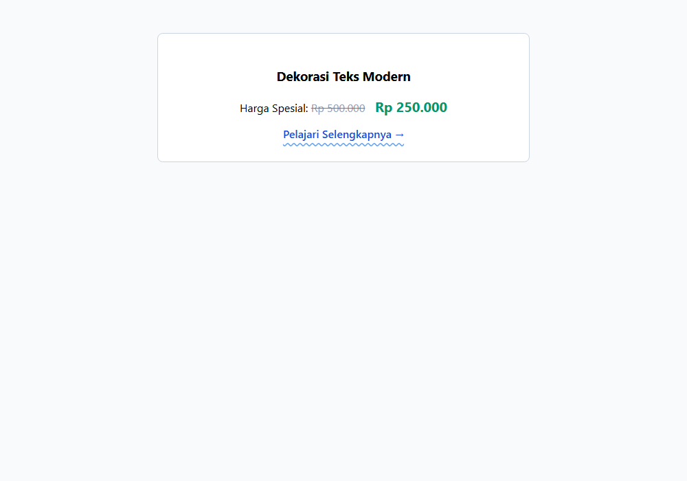

---

### 81. Properti text-transform

**Tujuan:** Mengubah kapitalisasi huruf teks (uppercase, lowercase, capitalize) tanpa mengubah HTML.

**Konsep Utama:**
Properti `text-transform` memodifikasi tampilan kapitalisasi teks di sisi presentasi: `uppercase` (semua kapital), `lowercase` (semua huruf kecil), dan `capitalize` (huruf pertama setiap kata menjadi kapital).

**Penjelasan Source Code:**
Menata label kategori dengan uppercase dan judul artikel dengan format capitalize otomatis.

**Source code utama:** [81_text_transform.css](81_text_transform.css)

**File pendukung preview:** [81_text_transform.html](81_text_transform.html)

**Cara Menjalankan:**
Buka file HTML pendukung di peramban web (Google Chrome, Microsoft Edge, atau Mozilla Firefox), atau gunakan Live Server / HTTP Server:

```bash
# Buka langsung file HTML di browser default
start "" "81_text_transform.html"
```

**Hasil yang Diharapkan:**
Lencana berhuruf kapital penuh dan judul artikel dengan huruf awal setiap kata membesar otomatis.

**Screenshot Hasil Eksekusi:**

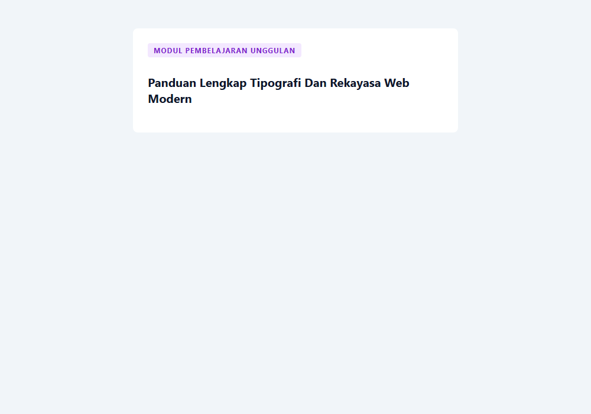

---

### 82. Properti text-indent

**Tujuan:** Mengatur indentasi awal baris pertama paragraf layaknya format buku cetak.

**Konsep Utama:**
Properti `text-indent` memberikan indentasi (jarak tab masuk) hanya pada baris pertama sebuah blok teks.

**Penjelasan Source Code:**
Mengatur `text-indent: 2em` pada paragraf narasi untuk menciptakan tata letak paragraf khas buku atau artikel sastra.

**Source code utama:** [82_text_indent.css](82_text_indent.css)

**File pendukung preview:** [82_text_indent.html](82_text_indent.html)

**Cara Menjalankan:**
Buka file HTML pendukung di peramban web (Google Chrome, Microsoft Edge, atau Mozilla Firefox), atau gunakan Live Server / HTTP Server:

```bash
# Buka langsung file HTML di browser default
start "" "82_text_indent.html"
```

**Hasil yang Diharapkan:**
Paragraf naratif dengan awalan baris pertama menjorok ke dalam secara rapi.

**Screenshot Hasil Eksekusi:**

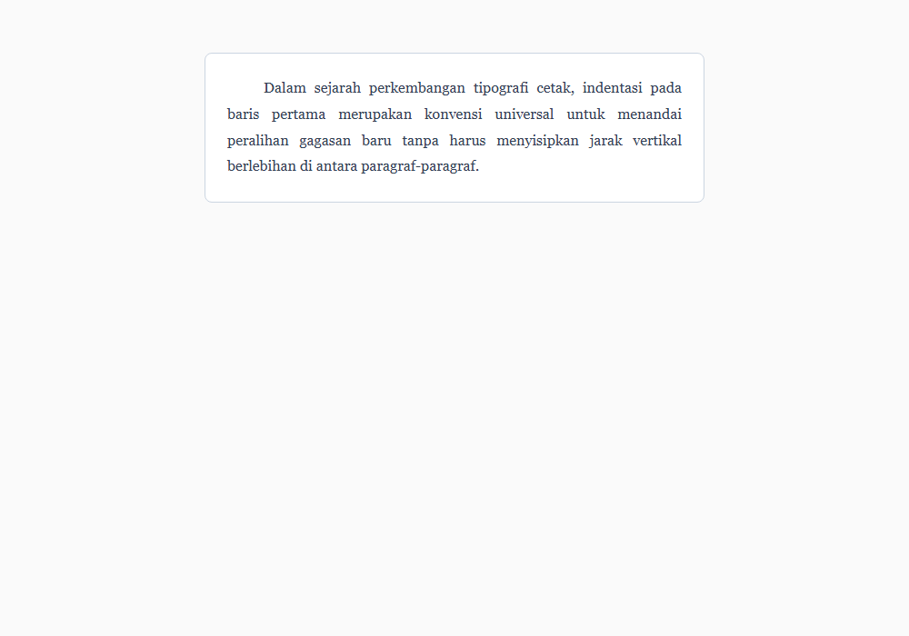

---

### 83. Properti letter-spacing

**Tujuan:** Mengatur spasi jarak antarkarakter (tracking/kerning) untuk meningkatkan estetika teks.

**Konsep Utama:**
Properti `letter-spacing` menambah atau mengurangi jarak antarhuruf. Nilai positif membuat huruf lebih renggang (bagus untuk teks kapital pendek), sedangkan nilai negatif merapatkan huruf.

**Penjelasan Source Code:**
Membandingkan header dengan letter-spacing renggang `2px` dan normal `0`.

**Source code utama:** [83_letter_spacing.css](83_letter_spacing.css)

**File pendukung preview:** [83_letter_spacing.html](83_letter_spacing.html)

**Cara Menjalankan:**
Buka file HTML pendukung di peramban web (Google Chrome, Microsoft Edge, atau Mozilla Firefox), atau gunakan Live Server / HTTP Server:

```bash
# Buka langsung file HTML di browser default
start "" "83_letter_spacing.html"
```

**Hasil yang Diharapkan:**
Teks judul berjarak renggang yang terkesan futuristik dan modern.

**Screenshot Hasil Eksekusi:**

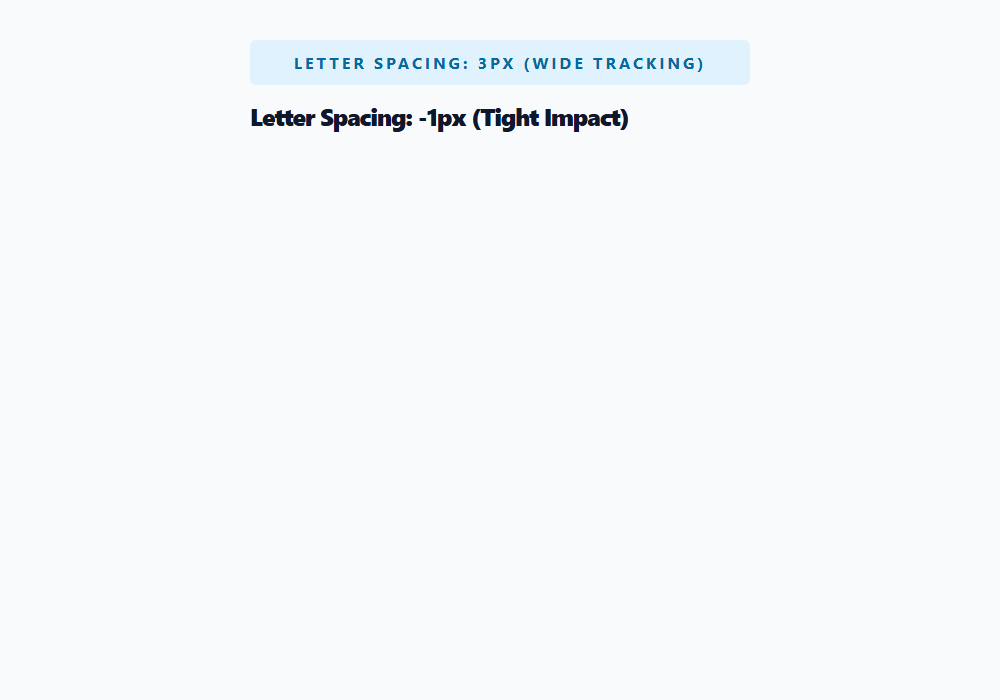

---

### 84. Properti word-spacing

**Tujuan:** Mengatur jarak antar-kata dalam baris kalimat teks.

**Konsep Utama:**
Properti `word-spacing` menambah atau mengurangi spasi kosong di antara setiap kata dalam kalimat.

**Penjelasan Source Code:**
Mendemonstrasikan teks slogan dengan `word-spacing: 6px` untuk memberikan penekanan intonasi kata.

**Source code utama:** [84_word_spacing.css](84_word_spacing.css)

**File pendukung preview:** [84_word_spacing.html](84_word_spacing.html)

**Cara Menjalankan:**
Buka file HTML pendukung di peramban web (Google Chrome, Microsoft Edge, atau Mozilla Firefox), atau gunakan Live Server / HTTP Server:

```bash
# Buka langsung file HTML di browser default
start "" "84_word_spacing.html"
```

**Hasil yang Diharapkan:**
Kalimat slogan dengan jeda antarkata yang lebar dan berirama tegas.

**Screenshot Hasil Eksekusi:**

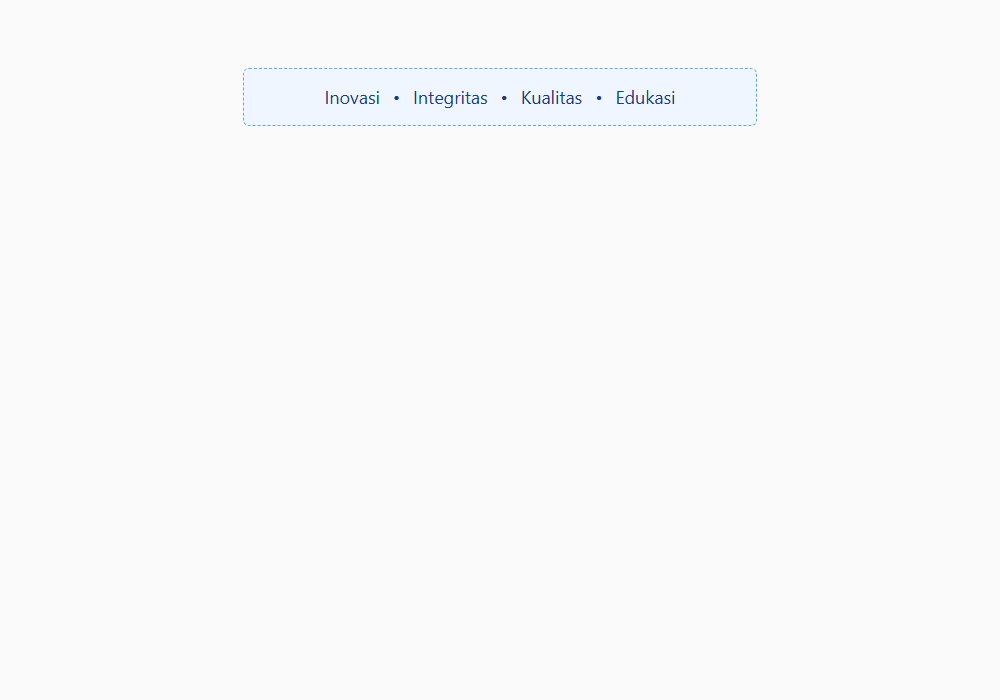

---

### 85. Properti text-shadow

**Tujuan:** Memberikan efek bayangan visual pada teks menggunakan offset X, Y, blur, dan warna.

**Konsep Utama:**
Properti `text-shadow` menerima 4 parameter: `offset-x offset-y [blur-radius] color`. Dapat ditumpuk berlapis menggunakan pemisah koma untuk menciptakan efek glowing atau teks 3D timbul.

**Penjelasan Source Code:**
Membuat judul bergaya neon glow dan teks timbul halus pada latar gelap.

**Source code utama:** [85_text_shadow.css](85_text_shadow.css)

**File pendukung preview:** [85_text_shadow.html](85_text_shadow.html)

**Cara Menjalankan:**
Buka file HTML pendukung di peramban web (Google Chrome, Microsoft Edge, atau Mozilla Firefox), atau gunakan Live Server / HTTP Server:

```bash
# Buka langsung file HTML di browser default
start "" "85_text_shadow.html"
```

**Hasil yang Diharapkan:**
Judul dengan efek bayangan biru bercahaya (neon glow) yang futuristik.

**Screenshot Hasil Eksekusi:**

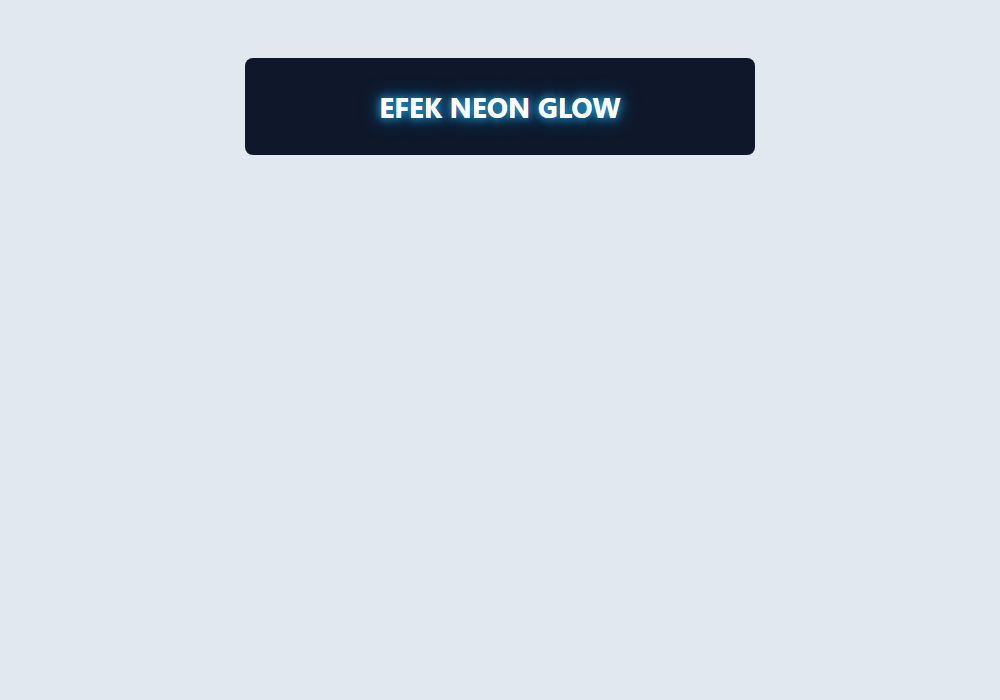

---

### 86. Properti text-overflow

**Tujuan:** Memotong teks yang meluap dan menggantikannya dengan tanda elipsis (...) menggunakan text-overflow: ellipsis.

**Konsep Utama:**
Agar `text-overflow: ellipsis` berfungsi, diperlukan 3 serangkai properti wajib: `white-space: nowrap`, `overflow: hidden`, dan `text-overflow: ellipsis`.

**Penjelasan Source Code:**
Membuat baris judul email atau tabel yang dipangkas rapi dengan tiga titik elipsis ketika kolom menyempit.

**Source code utama:** [86_text_overflow.css](86_text_overflow.css)

**File pendukung preview:** [86_text_overflow.html](86_text_overflow.html)

**Cara Menjalankan:**
Buka file HTML pendukung di peramban web (Google Chrome, Microsoft Edge, atau Mozilla Firefox), atau gunakan Live Server / HTTP Server:

```bash
# Buka langsung file HTML di browser default
start "" "86_text_overflow.html"
```

**Hasil yang Diharapkan:**
Kotak sempit berisi teks panjang yang terpotong rapi dengan akhiran '...'.

**Screenshot Hasil Eksekusi:**

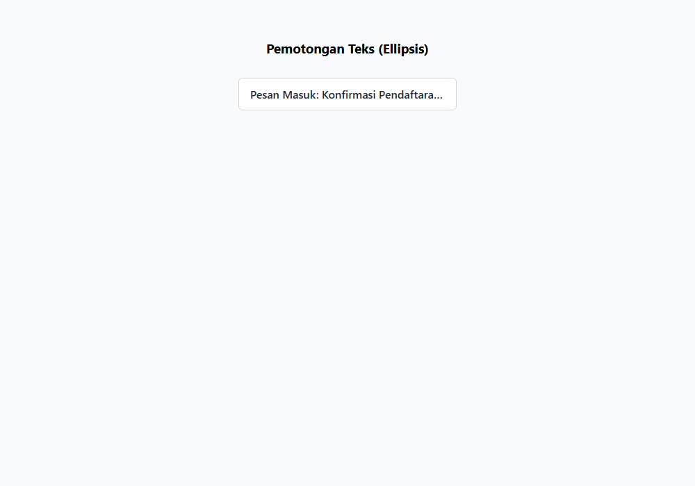

---

### 87. Properti white-space

**Tujuan:** Mengontrol penanganan spasi dan pergantian baris otomatis menggunakan white-space (nowrap, pre, pre-wrap).

**Konsep Utama:**
Properti `white-space` mengatur bagaimana spasi kosong dan jeda baris diperlakukan: `normal` (collapse spasi), `nowrap` (tidak pernah ganti baris), `pre` (mempertahankan semua spasi & enter seperti tag pre), `pre-wrap` (mempertahankan spasi dan tetap wrapping jika perlu).

**Penjelasan Source Code:**
Menampilkan cuplikan kode format ASCII art menggunakan `white-space: pre`.

**Source code utama:** [87_white_space.css](87_white_space.css)

**File pendukung preview:** [87_white_space.html](87_white_space.html)

**Cara Menjalankan:**
Buka file HTML pendukung di peramban web (Google Chrome, Microsoft Edge, atau Mozilla Firefox), atau gunakan Live Server / HTTP Server:

```bash
# Buka langsung file HTML di browser default
start "" "87_white_space.html"
```

**Hasil yang Diharapkan:**
Blok teks dengan struktur spasi dan indentasi asli yang terjaga sempurna.

**Screenshot Hasil Eksekusi:**

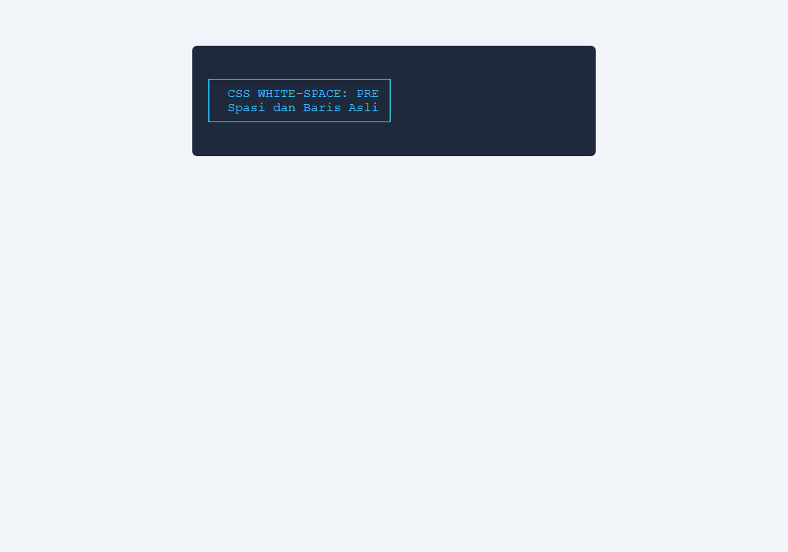

---

### 88. Properti word-break

**Tujuan:** Mematahkan kata panjang yang meluap menggunakan word-break: break-all.

**Konsep Utama:**
Properti `word-break: break-all` memaksa peramban memotong kata di titik mana pun (bahkan di tengah huruf satu kata) jika kata tersebut melampaui lebar wadah, sangat efektif untuk menangani URL super panjang.

**Penjelasan Source Code:**
Mendemonstrasikan pematahan string URL yang panjang agar tidak merusak layout kontainer kartu.

**Source code utama:** [88_word_break.css](88_word_break.css)

**File pendukung preview:** [88_word_break.html](88_word_break.html)

**Cara Menjalankan:**
Buka file HTML pendukung di peramban web (Google Chrome, Microsoft Edge, atau Mozilla Firefox), atau gunakan Live Server / HTTP Server:

```bash
# Buka langsung file HTML di browser default
start "" "88_word_break.html"
```

**Hasil yang Diharapkan:**
URL panjang yang terbelah rapi di tepi batas kartu tanpa menembus keluar.

**Screenshot Hasil Eksekusi:**

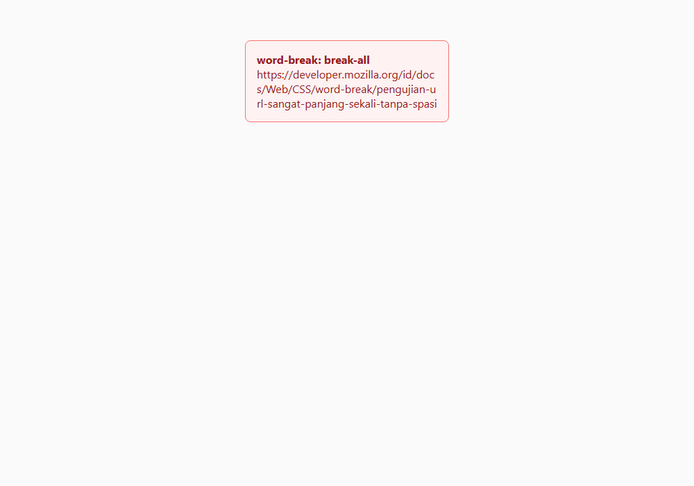

---

### 89. Properti overflow-wrap

**Tujuan:** Mencegah teks meluap dengan memprioritaskan kata utuh sebelum memecahnya (overflow-wrap: break-word).

**Konsep Utama:**
Berbeda dengan `word-break: break-all` yang agresif, `overflow-wrap: break-word` (dulu `word-wrap`) hanya akan memecah kata panjang jika memang tidak ada cara lain untuk menempatkannya pada baris baru secara utuh.

**Penjelasan Source Code:**
Menata pesan chat pengguna agar kata normal tetap utuh di baris baru, namun string tak terputus tetap dipecah tanpa overflow.

**Source code utama:** [89_overflow_wrap.css](89_overflow_wrap.css)

**File pendukung preview:** [89_overflow_wrap.html](89_overflow_wrap.html)

**Cara Menjalankan:**
Buka file HTML pendukung di peramban web (Google Chrome, Microsoft Edge, atau Mozilla Firefox), atau gunakan Live Server / HTTP Server:

```bash
# Buka langsung file HTML di browser default
start "" "89_overflow_wrap.html"
```

**Hasil yang Diharapkan:**
Gelembung chat pesan yang rapi dan terlindungi dari teks super panjang.

**Screenshot Hasil Eksekusi:**

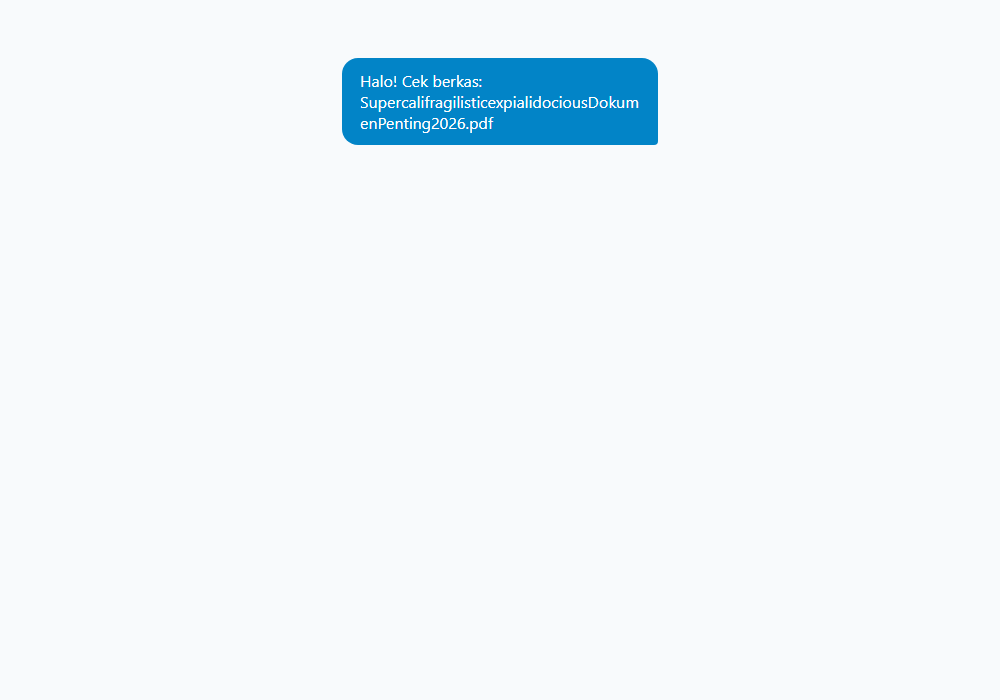

---

### 90. Web fonts menggunakan @font-face

**Tujuan:** Mengimpor dan mendefinisikan font web kustom menggunakan at-rule @font-face.

**Konsep Utama:**
At-rule `@font-face` memungkinkan pemuatan jenis font kustom langsung dari server web, melepaskan ketergantungan pada font lokal sistem pengguna. Mendukung format modern woff2 dan woff.

**Penjelasan Source Code:**
Mendefinisikan nama font kustom `CustomFont` dengan format sumber dan fallback yang terstruktur.

**Source code utama:** [90_web_fonts.css](90_web_fonts.css)

**File pendukung preview:** [90_web_fonts.html](90_web_fonts.html)

**Cara Menjalankan:**
Buka file HTML pendukung di peramban web (Google Chrome, Microsoft Edge, atau Mozilla Firefox), atau gunakan Live Server / HTTP Server:

```bash
# Buka langsung file HTML di browser default
start "" "90_web_fonts.html"
```

**Hasil yang Diharapkan:**
Komponen tipografi dengan styling font kustom yang terintegrasi secara profesional.

**Screenshot Hasil Eksekusi:**

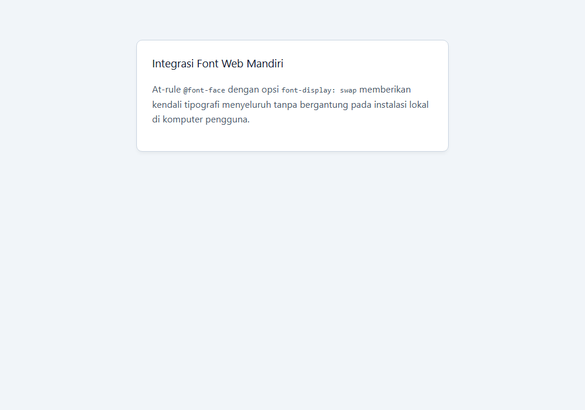

---

## Ringkasan Modul

Lebih dari 90% informasi di web disampaikan melalui teks. Penguasaan Modul 5 menjamin setiap karya antarmuka web memiliki keterbacaan (readability) prima, estetika tipografi profesional, serta ketahanan terhadap variasi panjang teks dan bahasa.

### Keterkaitan Materi
Seluruh submodul dalam modul ini dirancang secara berjenjang untuk membangun pemahaman yang kokoh dan aplikatif. Lanjutkan ke modul berikutnya setelah menguasai seluruh konsep di atas.
