# Modul 06: Warna dan Background

## Ringkasan Ruang Lingkup Materi

Modul ini menyajikan panduan komprehensif penataan warna dan latar belakang dalam CSS: koleksi Named Colors, sintaks Hexadecimal 3/6/8 digit, fungsi rgb() dan hsl() modern bebas koma, pengelolaan transparansi alpha kanal, properti color dan background-color, manipulasi gambar latar (background-image, repeat, position, size cover/contain, attachment fixed/scroll), shorthand background, multiple background layers, keluarga gradasi (linear, radial, conic, serta pengaturan color-stops), efek pencampuran background-blend-mode, hingga pemotongan background-clip dan titik awal background-origin.

## Tujuan Pembelajaran Modul

- Menguasai ragam model warna digital (HEX, RGB, HSL) dan transparansi Alpha.
- Menerapkan properti background-color dan background-image secara optimal.
- Mengatur tata letak latar dengan repeat, position, dan sizing responsif (cover/contain).
- Menyusun background bertumpuk banyak (multiple backgrounds) dalam satu deklarasi.
- Membuat gradasi visual yang memukau (linear, radial, conic) murni dengan CSS.
- Mengombinasikan background-blend-mode, background-clip, dan background-origin untuk efek grafis artistik.

## Daftar Submodul

- [91. Named colors](91_named_colors.css) — [Halaman Preview](91_named_colors.html)
- [92. Warna hexadecimal](92_hex_colors.css) — [Halaman Preview](92_hex_colors.html)
- [93. Fungsi rgb()](93_rgb_colors.css) — [Halaman Preview](93_rgb_colors.html)
- [94. Fungsi hsl()](94_hsl_colors.css) — [Halaman Preview](94_hsl_colors.html)
- [95. Transparansi warna](95_alpha_colors.css) — [Halaman Preview](95_alpha_colors.html)
- [96. Properti color](96_color_property.css) — [Halaman Preview](96_color_property.html)
- [97. Properti background-color](97_background_color.css) — [Halaman Preview](97_background_color.html)
- [98. Properti background-image](98_background_image.css) — [Halaman Preview](98_background_image.html)
- [99. Properti background-repeat](99_background_repeat.css) — [Halaman Preview](99_background_repeat.html)
- [100. Properti background-position](100_background_position.css) — [Halaman Preview](100_background_position.html)
- [101. Properti background-size](101_background_size.css) — [Halaman Preview](101_background_size.html)
- [102. Properti background-attachment](102_background_attachment.css) — [Halaman Preview](102_background_attachment.html)
- [103. Shorthand background](103_background_shorthand.css) — [Halaman Preview](103_background_shorthand.html)
- [104. Multiple background layers](104_multiple_backgrounds.css) — [Halaman Preview](104_multiple_backgrounds.html)
- [105. Linear gradient](105_background_gradients.css) — [Halaman Preview](105_background_gradients.html)
- [106. Radial gradient](106_radial_gradient.css) — [Halaman Preview](106_radial_gradient.html)
- [107. Conic gradient](107_conic_gradient.css) — [Halaman Preview](107_conic_gradient.html)
- [108. Gradient color stops](108_gradient_color_stops.css) — [Halaman Preview](108_gradient_color_stops.html)
- [109. background-blend-mode](109_background_blend_mode.css) — [Halaman Preview](109_background_blend_mode.html)
- [110. background-clip dan background-origin](110_background_clip_origin.css) — [Halaman Preview](110_background_clip_origin.html)

---

## Pembahasan dan Penjelasan Submodul

### 91. Named colors

**Tujuan:** Mengenal dan menggunakan palet warna standar bernama (Named Colors) dalam CSS.

**Konsep Utama:**
CSS mendukung 140+ kata kunci warna resmi yang diakui oleh seluruh peramban, seperti `crimson`, `royalblue`, `forestgreen`, `gold`, dan `darkslategray`.

**Penjelasan Source Code:**
Menampilkan kartu palet warna dengan nama-nama warna resmi CSS yang populer.

**Source code utama:** [91_named_colors.css](91_named_colors.css)

**File pendukung preview:** [91_named_colors.html](91_named_colors.html)

**Cara Menjalankan:**
Buka file HTML pendukung di peramban web (Google Chrome, Microsoft Edge, atau Mozilla Firefox), atau gunakan Live Server / HTTP Server:

```bash
# Buka langsung file HTML di browser default
start "" "91_named_colors.html"
```

**Hasil yang Diharapkan:**
Empat kotak lencana warna dengan nuansa named colors yang cerah.

**Screenshot Hasil Eksekusi:**

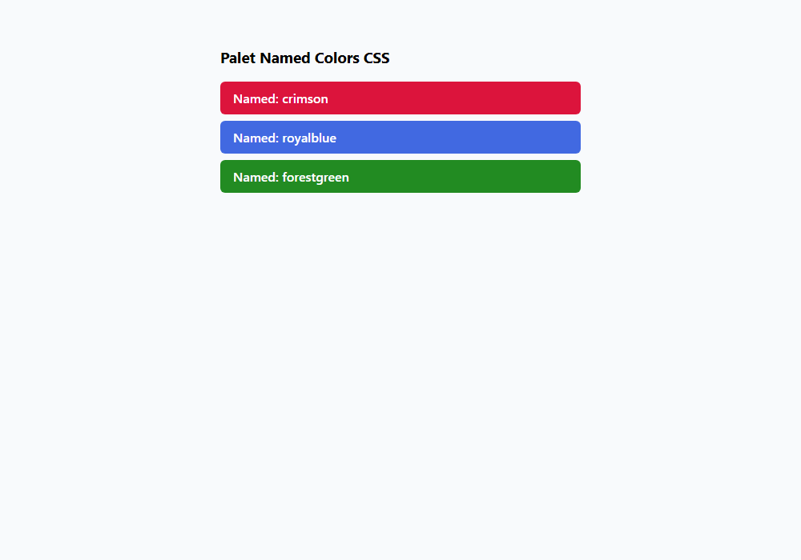

---

### 92. Warna hexadecimal

**Tujuan:** Memahami format heksadesimal #RRGGBB, versi singkat #RGB, dan 8 digit dengan alpha #RRGGBBAA.

**Konsep Utama:**
Format heksadesimal merepresentasikan intensitas cahaya Red, Green, Blue dari 00 hingga FF (0 - 255 dalam desimal). Format 8 digit menambahkan AA di akhir sebagai kanal transparansi.

**Penjelasan Source Code:**
Mendemonstrasikan warna hex 6-digit dan hex 8-digit dengan transparansi alpha.

**Source code utama:** [92_hex_colors.css](92_hex_colors.css)

**File pendukung preview:** [92_hex_colors.html](92_hex_colors.html)

**Cara Menjalankan:**
Buka file HTML pendukung di peramban web (Google Chrome, Microsoft Edge, atau Mozilla Firefox), atau gunakan Live Server / HTTP Server:

```bash
# Buka langsung file HTML di browser default
start "" "92_hex_colors.html"
```

**Hasil yang Diharapkan:**
Kotak kartu berpenampilan warna biru hex pekat dan biru hex transparan 50%.

**Screenshot Hasil Eksekusi:**

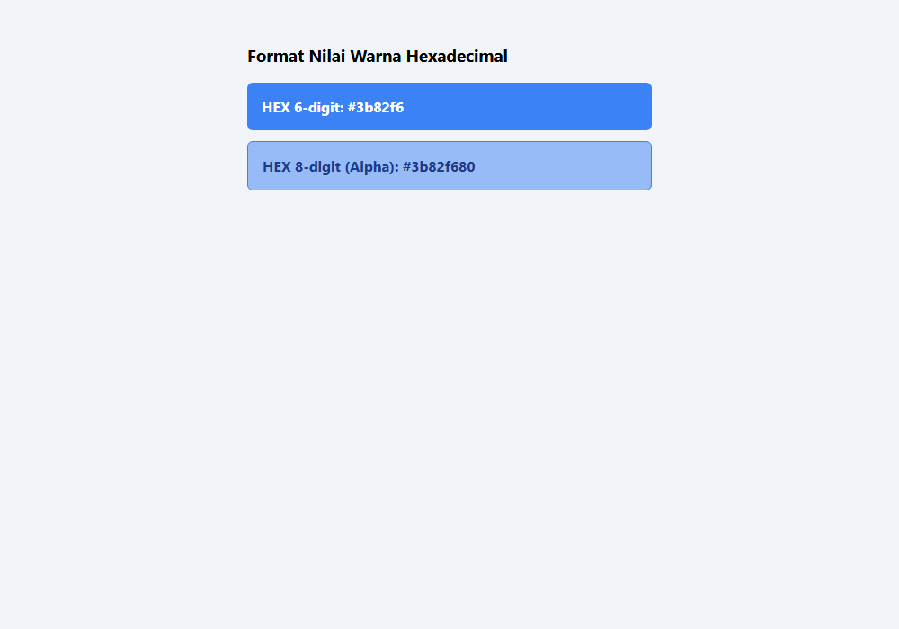

---

### 93. Fungsi rgb()

**Tujuan:** Menggunakan fungsi rgb() dengan sintaks koma tradisional dan sintaks modern CSS Color 4.

**Konsep Utama:**
Fungsi `rgb(r, g, b)` menerima nilai angka 0-255 atau persentase 0%-100%. Sintaks modern CSS Color Module 4 menggunakan spasi sebagai pemisah tanpa koma, misalnya `rgb(37 99 235)`.

**Penjelasan Source Code:**
Menampilkan dua kartu warna hijau menggunakan sintaks rgb() koma dan sintaks spasi modern.

**Source code utama:** [93_rgb_colors.css](93_rgb_colors.css)

**File pendukung preview:** [93_rgb_colors.html](93_rgb_colors.html)

**Cara Menjalankan:**
Buka file HTML pendukung di peramban web (Google Chrome, Microsoft Edge, atau Mozilla Firefox), atau gunakan Live Server / HTTP Server:

```bash
# Buka langsung file HTML di browser default
start "" "93_rgb_colors.html"
```

**Hasil yang Diharapkan:**
Dua kotak warna hijau zamrud identik dengan dua metode penulisan rgb() yang berbeda.

**Screenshot Hasil Eksekusi:**

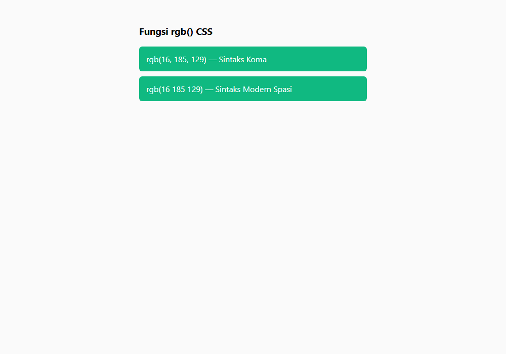

---

### 94. Fungsi hsl()

**Tujuan:** Memahami model warna intuitif HSL (Hue, Saturation, Lightness).

**Konsep Utama:**
Model HSL sangat disukai desainer karena intuitif: Hue (derajat sudut lingkaran warna 0-360: merah=0, hijau=120, biru=240), Saturation (kejenuhan warna 0%-100%), dan Lightness (kecerahan 0%=hitam, 50%=normal, 100%=putih).

**Penjelasan Source Code:**
Membuat palet variasi warna ungu dengan mempertahankan Hue (270) dan memanipulasi Lightness (30%, 50%, 80%).

**Source code utama:** [94_hsl_colors.css](94_hsl_colors.css)

**File pendukung preview:** [94_hsl_colors.html](94_hsl_colors.html)

**Cara Menjalankan:**
Buka file HTML pendukung di peramban web (Google Chrome, Microsoft Edge, atau Mozilla Firefox), atau gunakan Live Server / HTTP Server:

```bash
# Buka langsung file HTML di browser default
start "" "94_hsl_colors.html"
```

**Hasil yang Diharapkan:**
Tiga tingkat warna ungu dari gelap, sedang, hingga cerah pastel.

**Screenshot Hasil Eksekusi:**

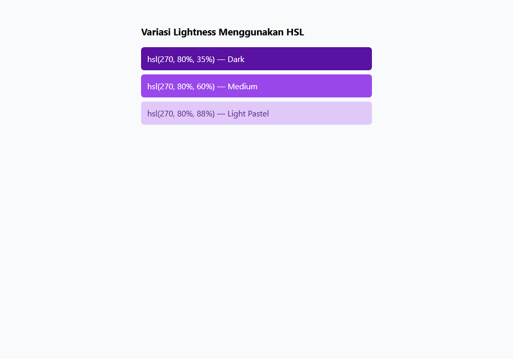

---

### 95. Transparansi warna

**Tujuan:** Menerapkan kanal alpha untuk menciptakan transparansi latar tanpa membuat teks ikut pudar.

**Konsep Utama:**
Berbeda dengan properti `opacity` yang memudarkan seluruh elemen beserta teks anaknya, menggunakan kanal alpha pada warna latar (misal `rgba(0,0,0,0.6)` atau `hsl(210 100% 50% / 0.5)`) hanya mentransparankan warna latar saja.

**Penjelasan Source Code:**
Membuat kotak overlay semi-transparan di atas latar gradasi dengan teks putih solid 100%.

**Source code utama:** [95_alpha_colors.css](95_alpha_colors.css)

**File pendukung preview:** [95_alpha_colors.html](95_alpha_colors.html)

**Cara Menjalankan:**
Buka file HTML pendukung di peramban web (Google Chrome, Microsoft Edge, atau Mozilla Firefox), atau gunakan Live Server / HTTP Server:

```bash
# Buka langsung file HTML di browser default
start "" "95_alpha_colors.html"
```

**Hasil yang Diharapkan:**
Kotak overlay gelap tembus pandang dengan teks putih jernih dan tajam di atasnya.

**Screenshot Hasil Eksekusi:**

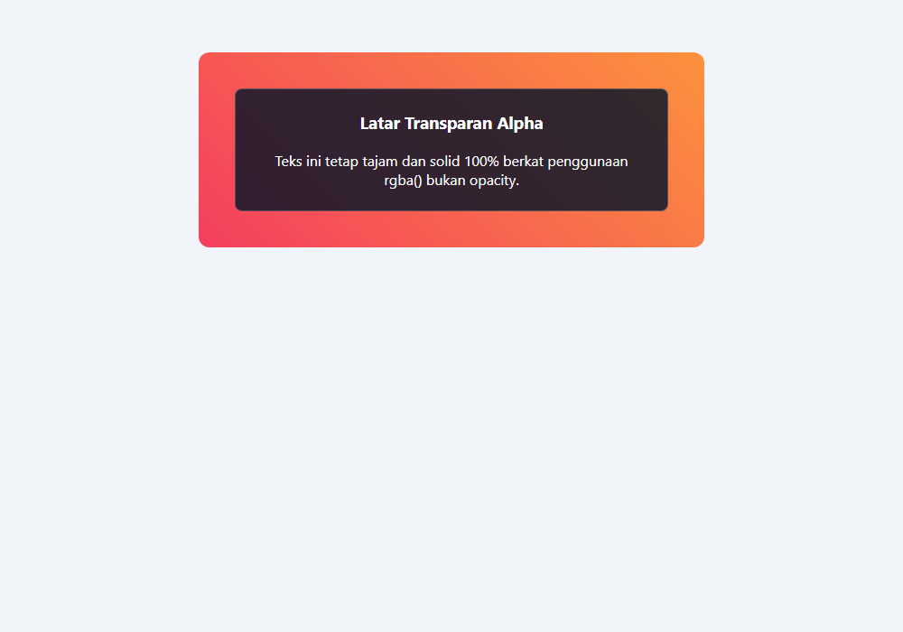

---

### 96. Properti color

**Tujuan:** Menetapkan warna teks dan memahami peran kata kunci currentColor.

**Konsep Utama:**
Properti `color` mengatur warna teks (foreground). Nilai ini juga menjadi referensi untuk kata kunci `currentColor` yang dapat digunakan pada border, fill SVG, atau bayangan.

**Penjelasan Source Code:**
Mengatur warna teks tombol dan menggunakan `border: 2px solid currentColor` agar warna border otomatis mengikuti teks.

**Source code utama:** [96_color_property.css](96_color_property.css)

**File pendukung preview:** [96_color_property.html](96_color_property.html)

**Cara Menjalankan:**
Buka file HTML pendukung di peramban web (Google Chrome, Microsoft Edge, atau Mozilla Firefox), atau gunakan Live Server / HTTP Server:

```bash
# Buka langsung file HTML di browser default
start "" "96_color_property.html"
```

**Hasil yang Diharapkan:**
Tombol dengan warna teks dan warna garis border yang sinkron otomatis.

**Screenshot Hasil Eksekusi:**

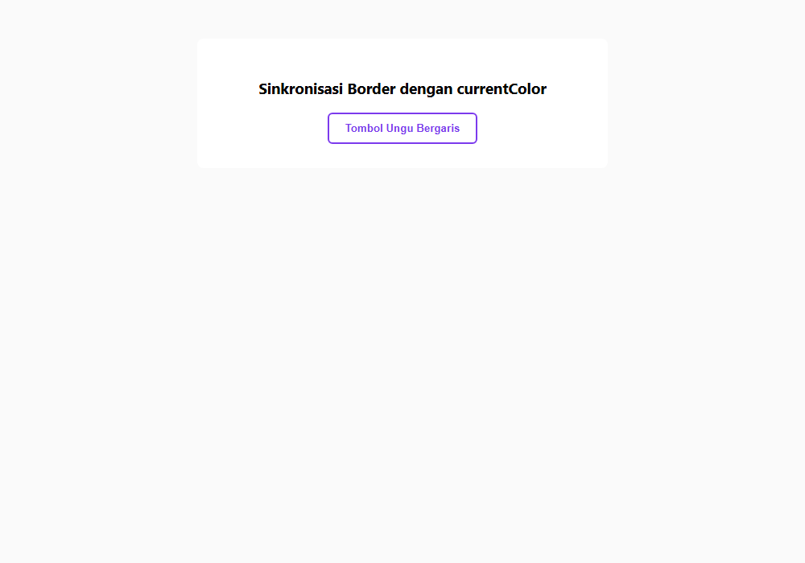

---

### 97. Properti background-color

**Tujuan:** Menetapkan warna latar belakang pada kontainer dan elemen visual.

**Konsep Utama:**
Properti `background-color` mewarnai area konten, padding, dan di bawah border elemen. Nilai default-nya adalah `transparent`.

**Penjelasan Source Code:**
Membuat kartu notifikasi informasi dengan latar belakang biru muda pastel yang menyejukkan mata.

**Source code utama:** [97_background_color.css](97_background_color.css)

**File pendukung preview:** [97_background_color.html](97_background_color.html)

**Cara Menjalankan:**
Buka file HTML pendukung di peramban web (Google Chrome, Microsoft Edge, atau Mozilla Firefox), atau gunakan Live Server / HTTP Server:

```bash
# Buka langsung file HTML di browser default
start "" "97_background_color.html"
```

**Hasil yang Diharapkan:**
Kotak notifikasi berlatar biru cerah dengan teks gelap kontras.

**Screenshot Hasil Eksekusi:**

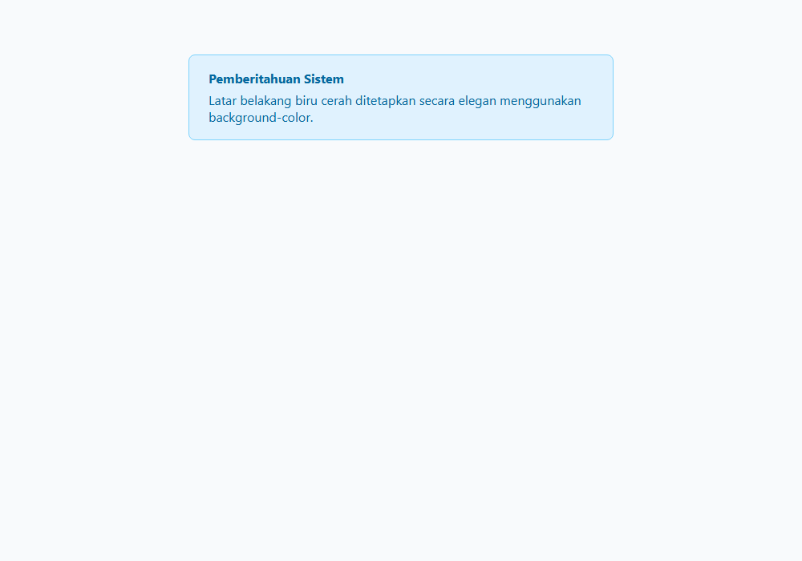

---

### 98. Properti background-image

**Tujuan:** Memuat gambar atau pola grafis SVG sebagai latar belakang menggunakan url().

**Konsep Utama:**
Properti `background-image` menerima fungsi `url('path/to/image.ext')` atau fungsi gradasi. SVG data-URI dapat disematkan langsung untuk membuat pola latar mandiri tanpa ketergantungan berkas gambar eksternal.

**Penjelasan Source Code:**
Membuat pola kotak-kotak halus (grid pattern) menggunakan SVG data-URI pada `background-image`.

**Source code utama:** [98_background_image.css](98_background_image.css)

**File pendukung preview:** [98_background_image.html](98_background_image.html)

**Cara Menjalankan:**
Buka file HTML pendukung di peramban web (Google Chrome, Microsoft Edge, atau Mozilla Firefox), atau gunakan Live Server / HTTP Server:

```bash
# Buka langsung file HTML di browser default
start "" "98_background_image.html"
```

**Hasil yang Diharapkan:**
Kotak pameran dengan pola latar belakang kisi-kisi (grid) teknikal yang elegan.

**Screenshot Hasil Eksekusi:**

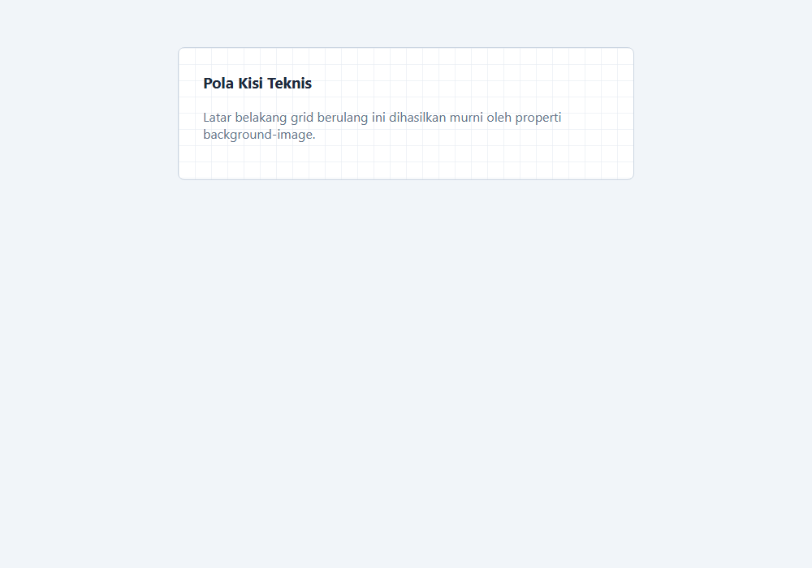

---

### 99. Properti background-repeat

**Tujuan:** Mengatur pengulangan gambar latar (repeat, no-repeat, repeat-x, repeat-y).

**Konsep Utama:**
Secara default gambar latar akan berulang ke seluruh sumbu horizontal dan vertikal (`repeat`). Kita dapat menghentikannya dengan `no-repeat` atau membatasi pengulangan pada satu sumbu saja.

**Penjelasan Source Code:**
Mendemonstrasikan kartu dengan `background-repeat: no-repeat` dipadukan dengan icon dekoratif sudut.

**Source code utama:** [99_background_repeat.css](99_background_repeat.css)

**File pendukung preview:** [99_background_repeat.html](99_background_repeat.html)

**Cara Menjalankan:**
Buka file HTML pendukung di peramban web (Google Chrome, Microsoft Edge, atau Mozilla Firefox), atau gunakan Live Server / HTTP Server:

```bash
# Buka langsung file HTML di browser default
start "" "99_background_repeat.html"
```

**Hasil yang Diharapkan:**
Kartu dengan satu ikon grafis tunggal di sudut tanpa terjadi pengulangan yang mengotori tampilan.

**Screenshot Hasil Eksekusi:**

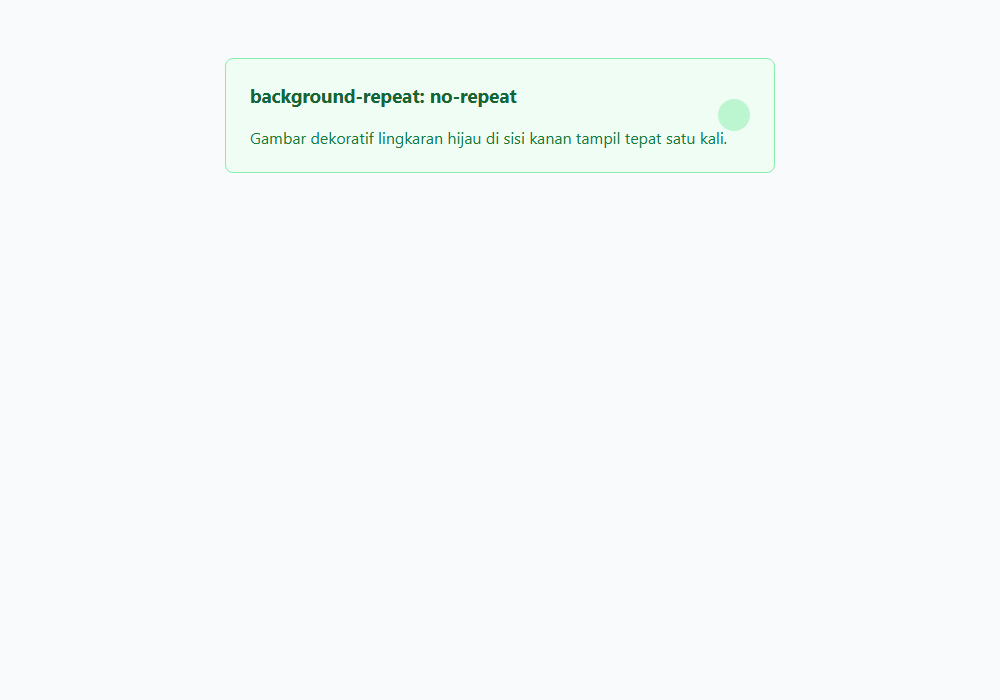

---

### 100. Properti background-position

**Tujuan:** Menentukan posisi koordinat gambar latar menggunakan kata kunci dan offset.

**Konsep Utama:**
Properti `background-position` mengatur letak awal gambar latar: kata kunci (`top`, `bottom`, `left`, `right`, `center`), satuan nilai (`px`, `rem`), persentase (`50% 50%`), atau offset modern 4-nilai (`right 20px bottom 15px`).

**Penjelasan Source Code:**
Menempatkan logo dekorasi tepat di pojok kanan bawah dengan jarak offset 16px dari tepi.

**Source code utama:** [100_background_position.css](100_background_position.css)

**File pendukung preview:** [100_background_position.html](100_background_position.html)

**Cara Menjalankan:**
Buka file HTML pendukung di peramban web (Google Chrome, Microsoft Edge, atau Mozilla Firefox), atau gunakan Live Server / HTTP Server:

```bash
# Buka langsung file HTML di browser default
start "" "100_background_position.html"
```

**Hasil yang Diharapkan:**
Kotak kartu di mana grafis latar bertengger manis di pojok kanan bawah.

**Screenshot Hasil Eksekusi:**

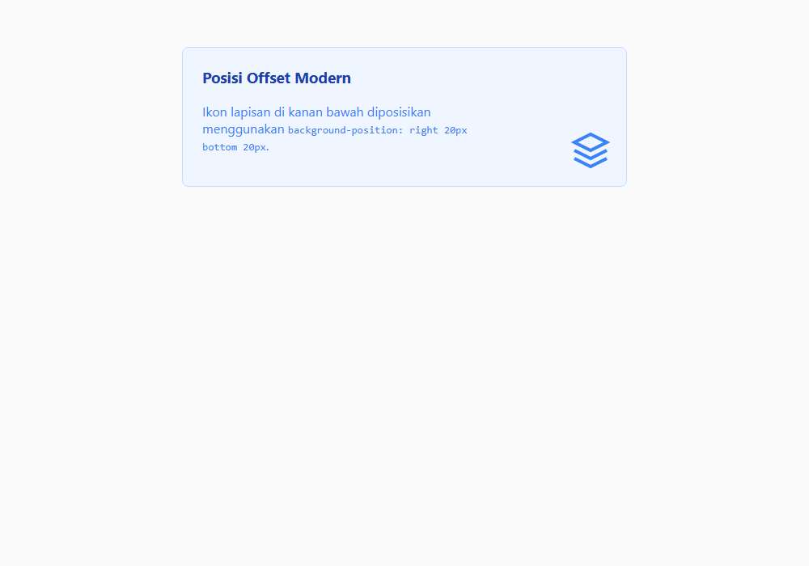

---

### 101. Properti background-size

**Tujuan:** Menyesuaikan ukuran gambar latar dengan nilai cover, contain, dan persentase.

**Konsep Utama:**
Properti `background-size` mengontrol skala gambar: `cover` (memenuhi seluruh wadah, memotong tepi jika rasio beda), `contain` (menampilkan seluruh gambar utuh tanpa terpotong), atau ukuran numerik pasti (`100% auto`).

**Penjelasan Source Code:**
Mendemonstrasikan penerapan `background-size: cover` pada banner hero visual.

**Source code utama:** [101_background_size.css](101_background_size.css)

**File pendukung preview:** [101_background_size.html](101_background_size.html)

**Cara Menjalankan:**
Buka file HTML pendukung di peramban web (Google Chrome, Microsoft Edge, atau Mozilla Firefox), atau gunakan Live Server / HTTP Server:

```bash
# Buka langsung file HTML di browser default
start "" "101_background_size.html"
```

**Hasil yang Diharapkan:**
Spanduk hero berlatar grafis yang skalanya menutup penuh seluruh permukaan tanpa terdistorsi.

**Screenshot Hasil Eksekusi:**

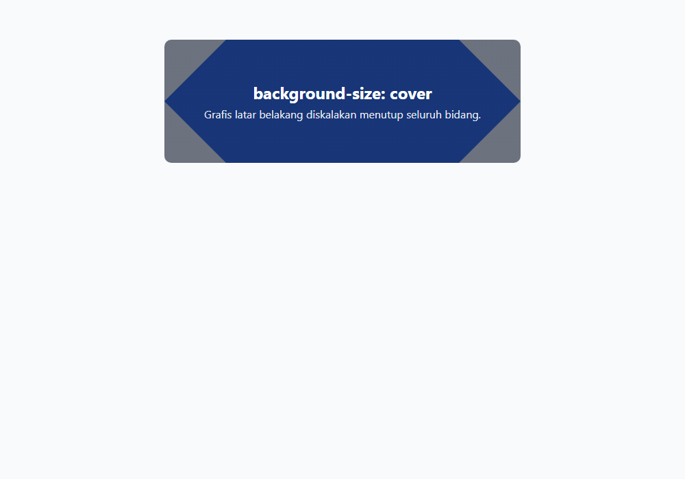

---

### 102. Properti background-attachment

**Tujuan:** Mengatur keterikatan latar saat halaman digulir menggunakan scroll dan fixed.

**Konsep Utama:**
Properti `background-attachment` menentukan apakah gambar latar ikut bergeser bersama konten (`scroll` - default) atau tetap terpaku pada viewport jendela peramban (`fixed` - efek parallax sederhana).

**Penjelasan Source Code:**
Mengatur `background-attachment: fixed` pada bagian kartu latar belakang.

**Source code utama:** [102_background_attachment.css](102_background_attachment.css)

**File pendukung preview:** [102_background_attachment.html](102_background_attachment.html)

**Cara Menjalankan:**
Buka file HTML pendukung di peramban web (Google Chrome, Microsoft Edge, atau Mozilla Firefox), atau gunakan Live Server / HTTP Server:

```bash
# Buka langsung file HTML di browser default
start "" "102_background_attachment.html"
```

**Hasil yang Diharapkan:**
Kotak pameran dengan efek latar belakang yang terkunci pada tempatnya.

**Screenshot Hasil Eksekusi:**

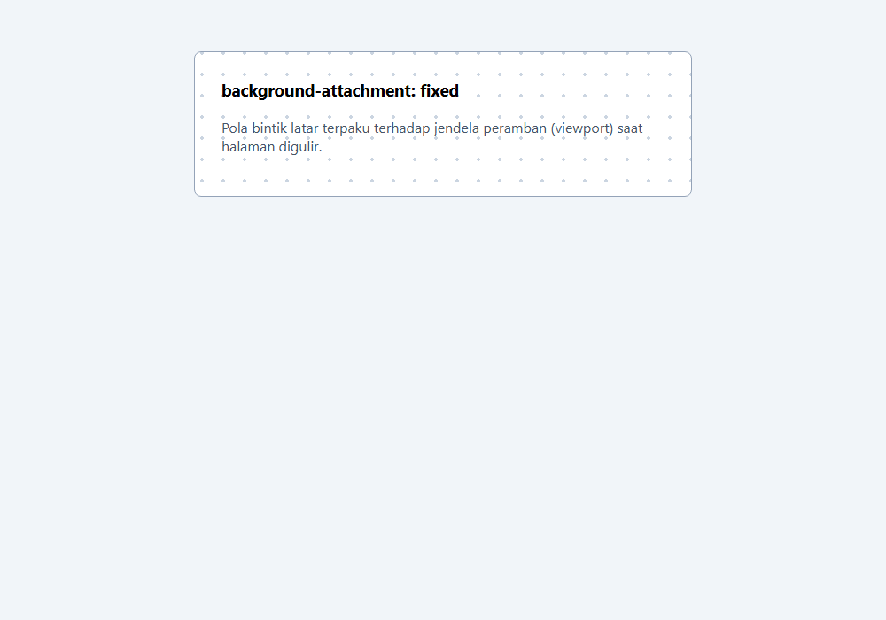

---

### 103. Shorthand background

**Tujuan:** Menuliskan seluruh properti background dalam satu deklarasi shorthand yang ringkas.

**Konsep Utama:**
Shorthand `background` dapat memadukan: `[color] [image] [position][/size] [repeat] [attachment]`. Aturan penting: jika menyertakan `size`, posisinya harus diawali garis miring setelah `position`, misalnya `center / cover`.

**Penjelasan Source Code:**
Menggabungkan warna, pola gradasi, posisi center, repeat no-repeat, dan border radius dalam satu baris deklarasi.

**Source code utama:** [103_background_shorthand.css](103_background_shorthand.css)

**File pendukung preview:** [103_background_shorthand.html](103_background_shorthand.html)

**Cara Menjalankan:**
Buka file HTML pendukung di peramban web (Google Chrome, Microsoft Edge, atau Mozilla Firefox), atau gunakan Live Server / HTTP Server:

```bash
# Buka langsung file HTML di browser default
start "" "103_background_shorthand.html"
```

**Hasil yang Diharapkan:**
Kotak kartu styled profesional yang didefinisikan melalui shorthand tunggal.

**Screenshot Hasil Eksekusi:**

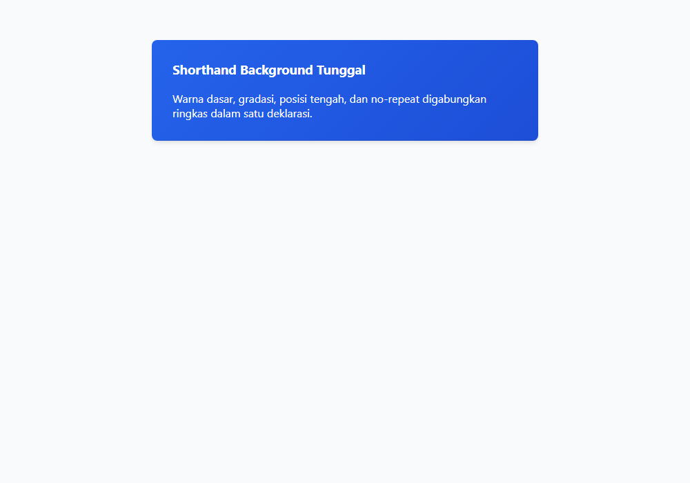

---

### 104. Multiple background layers

**Tujuan:** Menumpuk beberapa gambar/gradasi latar belakang menggunakan pemisah koma.

**Konsep Utama:**
CSS memungkinkan penumpukan banyak lapisan background. Lapisan yang ditulis pertama akan berada di paling atas (paling dekat dengan pandangan mata), sedangkan lapisan berikutnya berada di bawahnya.

**Penjelasan Source Code:**
Menumpuk lapisan ikon lingkaran di atas lapisan gradasi lembut di atas warna dasar putih.

**Source code utama:** [104_multiple_backgrounds.css](104_multiple_backgrounds.css)

**File pendukung preview:** [104_multiple_backgrounds.html](104_multiple_backgrounds.html)

**Cara Menjalankan:**
Buka file HTML pendukung di peramban web (Google Chrome, Microsoft Edge, atau Mozilla Firefox), atau gunakan Live Server / HTTP Server:

```bash
# Buka langsung file HTML di browser default
start "" "104_multiple_backgrounds.html"
```

**Hasil yang Diharapkan:**
Kotak visual artistik dengan tumpukan grafis lingkaran di atas gradasi halus.

**Screenshot Hasil Eksekusi:**

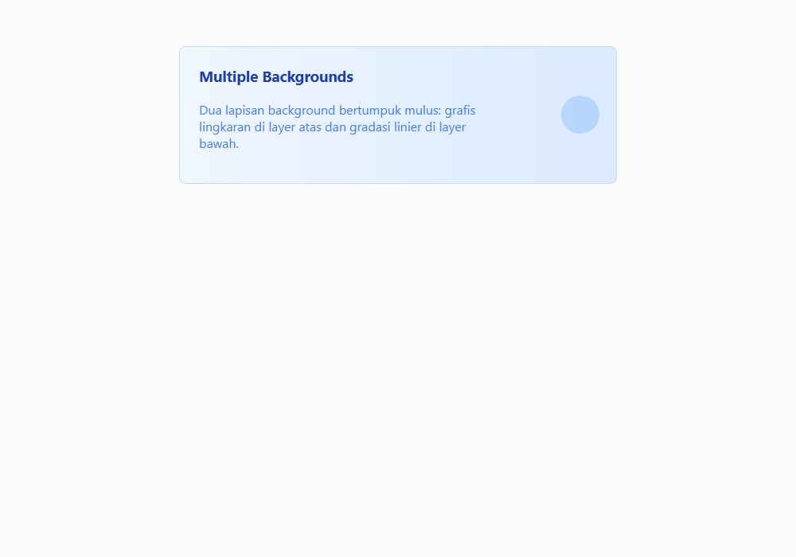

---

### 105. Linear gradient

**Tujuan:** Membuat gradasi warna linier menggunakan fungsi linear-gradient().

**Konsep Utama:**
Fungsi `linear-gradient([sudut/arah], warna1, warna2, ...)` menghasilkan transisi warna mulus sepanjang garis lurus. Arah dapat berupa kata kunci (`to right`, `to bottom right`) atau sudut (`135deg`).

**Penjelasan Source Code:**
Membuat kartu bergradasi diagonal 135 derajat dari biru safir ke ungu violet.

**Source code utama:** [105_background_gradients.css](105_background_gradients.css)

**File pendukung preview:** [105_background_gradients.html](105_background_gradients.html)

**Cara Menjalankan:**
Buka file HTML pendukung di peramban web (Google Chrome, Microsoft Edge, atau Mozilla Firefox), atau gunakan Live Server / HTTP Server:

```bash
# Buka langsung file HTML di browser default
start "" "105_background_gradients.html"
```

**Hasil yang Diharapkan:**
Kotak kartu berlatar gradasi modern biru-ke-ungu dengan pencahayaan halus.

**Screenshot Hasil Eksekusi:**

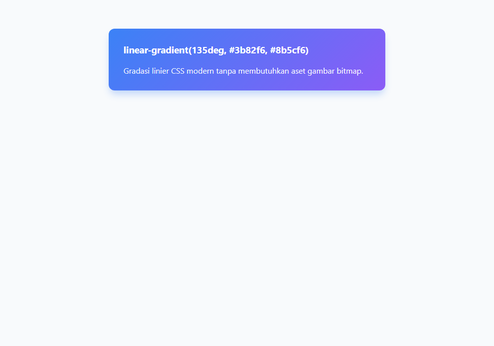

---

### 106. Radial gradient

**Tujuan:** Membuat gradasi melingkar memancar dari satu titik pusat menggunakan radial-gradient().

**Konsep Utama:**
Fungsi `radial-gradient([bentuk] [ukuran] at [posisi], warna1, warna2)` memancarkan gradasi dari titik pusat (default: center) keluar ke arah lingkaran (circle) atau elips (ellipse).

**Penjelasan Source Code:**
Membuat efek lampu sorot (vignette/glow) di bagian tengah kartu.

**Source code utama:** [106_radial_gradient.css](106_radial_gradient.css)

**File pendukung preview:** [106_radial_gradient.html](106_radial_gradient.html)

**Cara Menjalankan:**
Buka file HTML pendukung di peramban web (Google Chrome, Microsoft Edge, atau Mozilla Firefox), atau gunakan Live Server / HTTP Server:

```bash
# Buka langsung file HTML di browser default
start "" "106_radial_gradient.html"
```

**Hasil yang Diharapkan:**
Kotak gelap dengan pendaran cahaya biru melingkar di tengah kartu.

**Screenshot Hasil Eksekusi:**

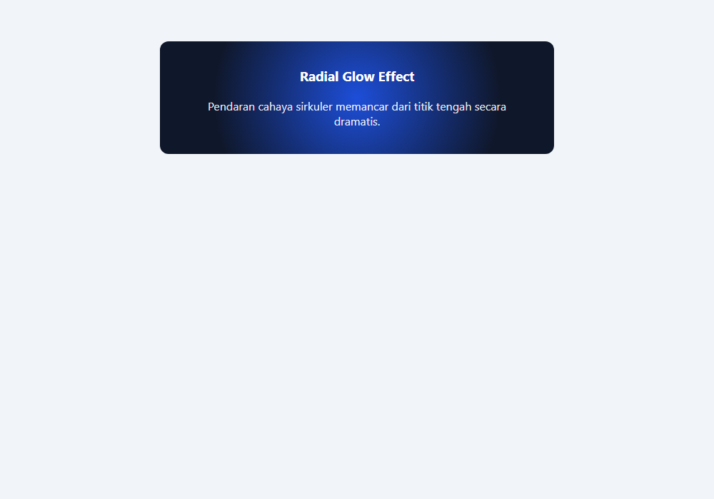

---

### 107. Conic gradient

**Tujuan:** Membuat gradasi kerucut berputar mengelilingi titik pusat menggunakan conic-gradient().

**Konsep Utama:**
Fungsi `conic-gradient([from sudut] at [posisi], warna1, warna2)` menciptakan gradasi yang bertransisi memutar mengelilingi poros tengah (seperti roda warna atau diagram lingkaran pie chart).

**Penjelasan Source Code:**
Membuat diagram pie chart visual 70% dan 30% murni menggunakan conic-gradient.

**Source code utama:** [107_conic_gradient.css](107_conic_gradient.css)

**File pendukung preview:** [107_conic_gradient.html](107_conic_gradient.html)

**Cara Menjalankan:**
Buka file HTML pendukung di peramban web (Google Chrome, Microsoft Edge, atau Mozilla Firefox), atau gunakan Live Server / HTTP Server:

```bash
# Buka langsung file HTML di browser default
start "" "107_conic_gradient.html"
```

**Hasil yang Diharapkan:**
Diagram lingkaran pie chart presisi yang terbentuk murni dari gradasi kerucut CSS.

**Screenshot Hasil Eksekusi:**

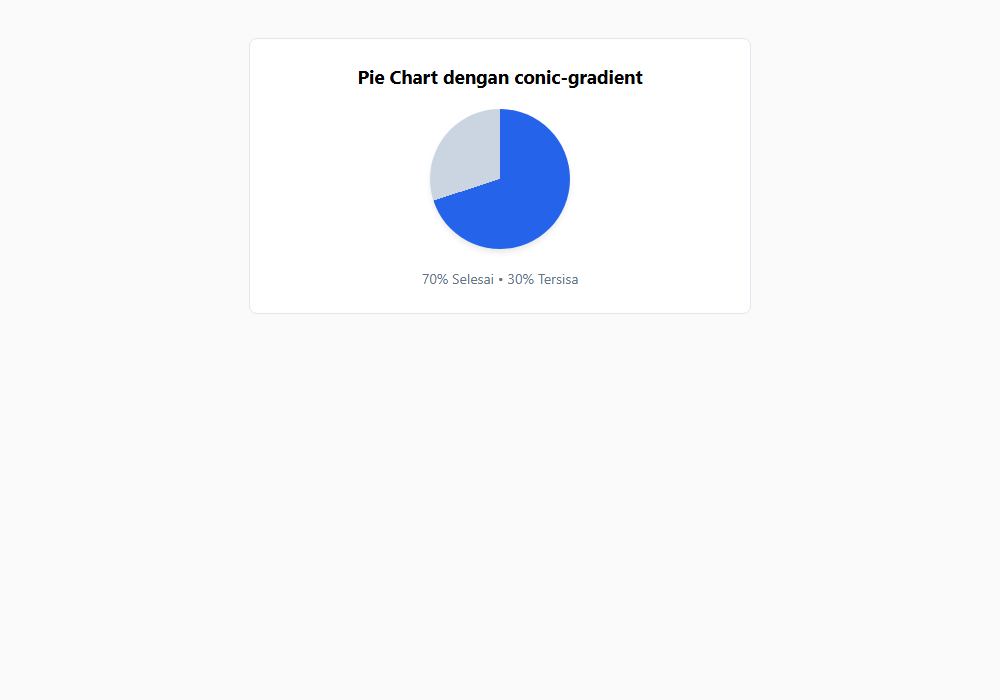

---

### 108. Gradient color stops

**Tujuan:** Mengatur titik perhentian warna (color stops) untuk menciptakan garis batas tegas atau transisi terkontrol.

**Konsep Utama:**
Color stops menentukan di persentase atau jarak mana sebuah warna dimulai dan berakhir. Jika dua warna bertemu pada persentase yang sama persis (misal #fff 50%, #000 50%), akan tercipta garis batas potong tajam (hard stop).

**Penjelasan Source Code:**
Membuat pola garis-garis zebra (stripes) menggunakan hard color stops.

**Source code utama:** [108_gradient_color_stops.css](108_gradient_color_stops.css)

**File pendukung preview:** [108_gradient_color_stops.html](108_gradient_color_stops.html)

**Cara Menjalankan:**
Buka file HTML pendukung di peramban web (Google Chrome, Microsoft Edge, atau Mozilla Firefox), atau gunakan Live Server / HTTP Server:

```bash
# Buka langsung file HTML di browser default
start "" "108_gradient_color_stops.html"
```

**Hasil yang Diharapkan:**
Pola latar belang-belang bergaris tegas (stripes) yang diciptakan melalui hard color stops.

**Screenshot Hasil Eksekusi:**

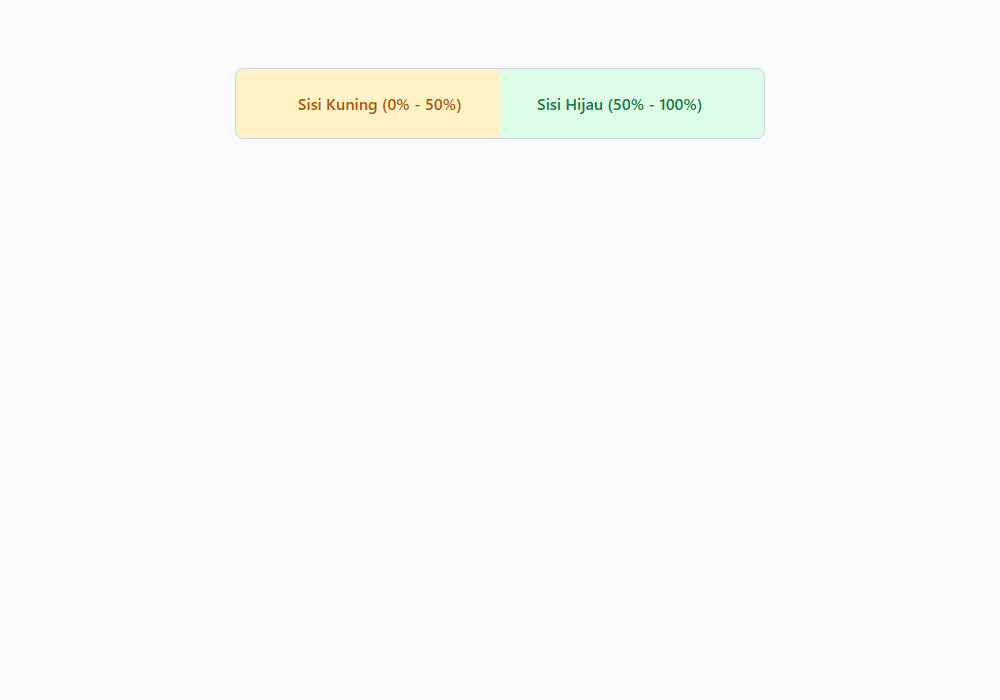

---

### 109. background-blend-mode

**Tujuan:** Mencampurkan warna dan gambar latar menggunakan mode blending (multiply, screen, overlay).

**Konsep Utama:**
Properti `background-blend-mode` mengatur bagaimana lapisan-lapisan background saling berbaur satu sama lain seperti layer blending di Photoshop: `multiply`, `screen`, `overlay`, `darken`, `lighten`.

**Penjelasan Source Code:**
Membaurkan pola grafis geometris dengan warna ungu tua menggunakan mode multiply.

**Source code utama:** [109_background_blend_mode.css](109_background_blend_mode.css)

**File pendukung preview:** [109_background_blend_mode.html](109_background_blend_mode.html)

**Cara Menjalankan:**
Buka file HTML pendukung di peramban web (Google Chrome, Microsoft Edge, atau Mozilla Firefox), atau gunakan Live Server / HTTP Server:

```bash
# Buka langsung file HTML di browser default
start "" "109_background_blend_mode.html"
```

**Hasil yang Diharapkan:**
Gambar pola geometris yang menyatu harmonis dengan warna ungu di bawahnya.

**Screenshot Hasil Eksekusi:**

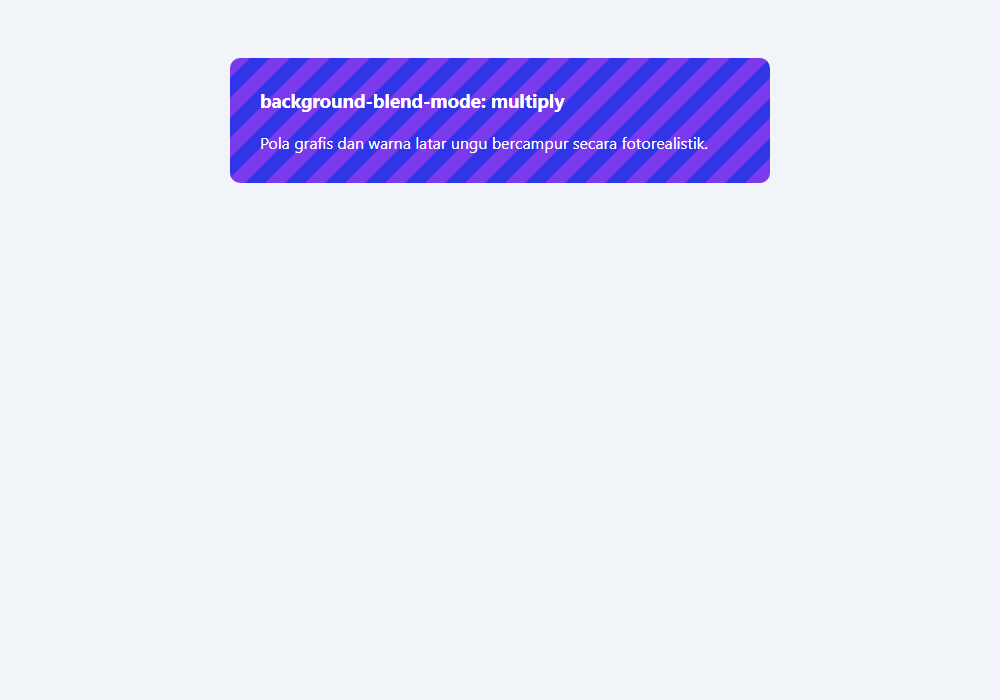

---

### 110. background-clip dan background-origin

**Tujuan:** Mengatur batas pemotongan latar (background-clip) dan titik awal koordinat (background-origin).

**Konsep Utama:**
`background-clip` menentukan apakah latar belakang digambar hingga ke `border-box`, `padding-box`, atau `content-box` (bahkan `text` untuk gradasi teks). `background-origin` menentukan titik acuan (0,0) bagi gambar latar.

**Penjelasan Source Code:**
Mendemonstrasikan efek teks gradasi memukau menggunakan `background-clip: text` dan `-webkit-text-fill-color: transparent`.

**Source code utama:** [110_background_clip_origin.css](110_background_clip_origin.css)

**File pendukung preview:** [110_background_clip_origin.html](110_background_clip_origin.html)

**Cara Menjalankan:**
Buka file HTML pendukung di peramban web (Google Chrome, Microsoft Edge, atau Mozilla Firefox), atau gunakan Live Server / HTTP Server:

```bash
# Buka langsung file HTML di browser default
start "" "110_background_clip_origin.html"
```

**Hasil yang Diharapkan:**
Teks judul besar dengan isi warna bergradasi pelangi yang memotong latar belakang teks.

**Screenshot Hasil Eksekusi:**

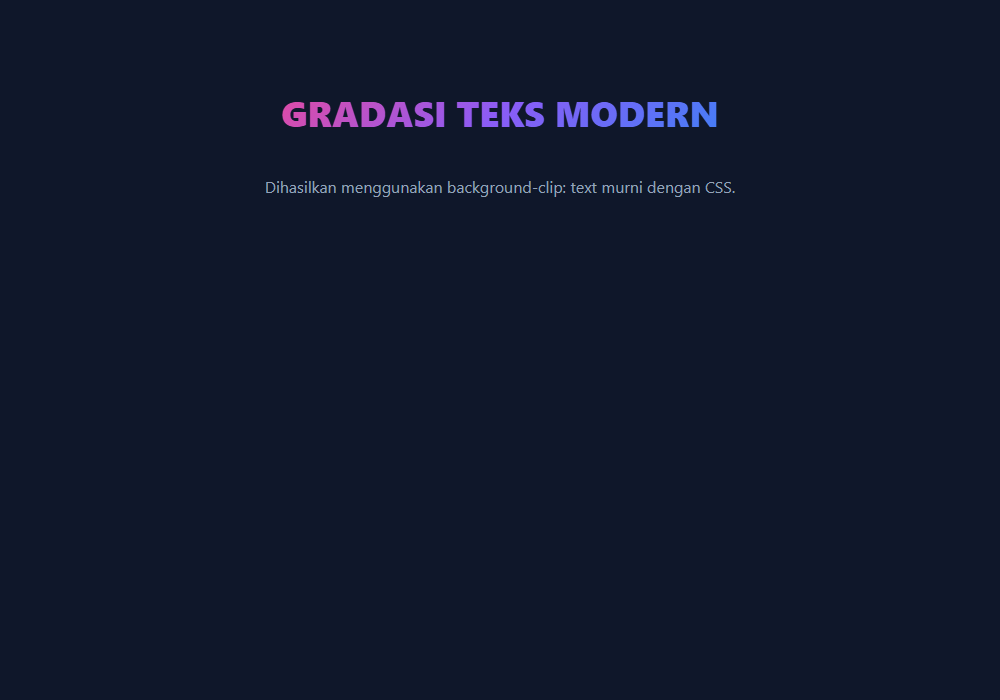

---

## Ringkasan Modul

Warna dan latar belakang adalah jiwa estetika visual antarmuka web. Dengan menguasai modul 6, pembelajar mampu menciptakan desain modern yang kaya gradasi, tekstur grafis, dan efek visual kelas profesional tanpa memerlukan software pengolah gambar eksternal.

### Keterkaitan Materi
Seluruh submodul dalam modul ini dirancang secara berjenjang untuk membangun pemahaman yang kokoh dan aplikatif. Lanjutkan ke modul berikutnya setelah menguasai seluruh konsep di atas.
