# Modul 07: Border, Outline, Shadow, dan Efek Visual

## Ringkasan Ruang Lingkup Materi

Modul ini memperdalam penataan garis batas, bayangan, dan efek grafis visual mutakhir pada elemen: properti border dan ragam variasinya (width, style solid/dashed/dotted/double, color, kelengkungan border-radius kapsul dan lingkaran, border individual per sisi), perbedaan esensial antara border dan outline (aksesibilitas focus ring dan outline-offset), kedalaman elevasi dengan box-shadow dan multiple box-shadows halus, transparansi elemen opacity, filter grafis (blur, grayscale, brightness, drop-shadow), efek kaca buram modern (glassmorphism) dengan backdrop-filter, pencampuran elemen mix-blend-mode, hingga pemotongan bentuk geometris kompleks menggunakan clip-path.

## Tujuan Pembelajaran Modul

- Menata garis batas elemen dengan presisi (ketebalan, gaya garis, warna, kelengkungan sudut).
- Membedakan sifat fisik border yang memengaruhi box model dari outline yang tidak mengambil ruang layout.
- Menciptakan sistem elevasi visual yang realistis dan lembut menggunakan box-shadow berlapis.
- Mengaplikasikan efek filter grafis (blur, drop-shadow, brightness) secara performan.
- Mengimplementasikan efek kaca buram (glassmorphism) yang elegan menggunakan backdrop-filter.
- Membuat bentuk poligon, lingkaran, dan elips kustom menggunakan properti clip-path.

## Daftar Submodul

- [111. Properti border](111_border_property.css) — [Halaman Preview](111_border_property.html)
- [112. Properti border-width](112_border_width.css) — [Halaman Preview](112_border_width.html)
- [113. Properti border-style](113_border_style.css) — [Halaman Preview](113_border_style.html)
- [114. Properti border-color](114_border_color.css) — [Halaman Preview](114_border_color.html)
- [115. Properti border-radius](115_border_radius.css) — [Halaman Preview](115_border_radius.html)
- [116. Pengaturan border individual](116_individual_borders.css) — [Halaman Preview](116_individual_borders.html)
- [117. Properti outline](117_outline_property.css) — [Halaman Preview](117_outline_property.html)
- [118. Properti outline-offset](118_outline_offset.css) — [Halaman Preview](118_outline_offset.html)
- [119. Properti box-shadow](119_box_shadow.css) — [Halaman Preview](119_box_shadow.html)
- [120. Multiple box shadows](120_multiple_box_shadows.css) — [Halaman Preview](120_multiple_box_shadows.html)
- [121. Properti opacity](121_opacity_property.css) — [Halaman Preview](121_opacity_property.html)
- [122. Properti filter](122_filter_property.css) — [Halaman Preview](122_filter_property.html)
- [123. Properti backdrop-filter](123_backdrop_filter.css) — [Halaman Preview](123_backdrop_filter.html)
- [124. mix-blend-mode](124_mix_blend_mode.css) — [Halaman Preview](124_mix_blend_mode.html)
- [125. Properti clip-path](125_clip_path.css) — [Halaman Preview](125_clip_path.html)

---

## Pembahasan dan Penjelasan Submodul

### 111. Properti border

**Tujuan:** Menetapkan garis batas elemen menggunakan shorthand border.

**Konsep Utama:**
Shorthand `border` menggabungkan 3 komponen wajib: `border-width`, `border-style`, dan `border-color`. Jika `border-style` diabaikan, border tidak akan muncul karena nilai default-nya adalah `none`.

**Penjelasan Source Code:**
Mendemonstrasikan kartu informasi dengan border solid 2px berwarna biru korporat.

**Source code utama:** [111_border_property.css](111_border_property.css)

**File pendukung preview:** [111_border_property.html](111_border_property.html)

**Cara Menjalankan:**
Buka file HTML pendukung di peramban web (Google Chrome, Microsoft Edge, atau Mozilla Firefox), atau gunakan Live Server / HTTP Server:

```bash
# Buka langsung file HTML di browser default
start "" "111_border_property.html"
```

**Hasil yang Diharapkan:**
Kotak bergaris batas biru solid yang rapi dan tegas.

**Screenshot Hasil Eksekusi:**

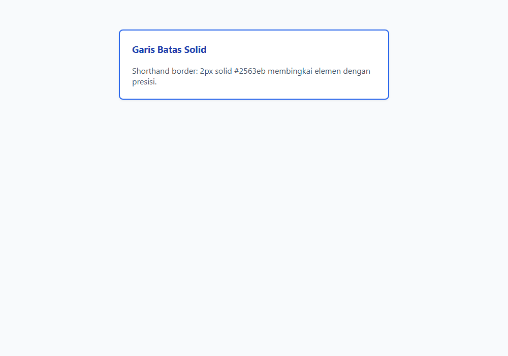

---

### 112. Properti border-width

**Tujuan:** Mengatur ketebalan garis batas menggunakan ukuran piksel atau kata kunci.

**Konsep Utama:**
Properti `border-width` mengatur ketebalan garis batas: nilai pasti (`1px`, `4px`, `8px`) atau kata kunci (`thin`, `medium`, `thick`). Dapat diatur 4 sisi sekaligus secara independen.

**Penjelasan Source Code:**
Membuat kotak dengan batas border tebal asimetris di bagian atas dan tipis di bagian lainnya.

**Source code utama:** [112_border_width.css](112_border_width.css)

**File pendukung preview:** [112_border_width.html](112_border_width.html)

**Cara Menjalankan:**
Buka file HTML pendukung di peramban web (Google Chrome, Microsoft Edge, atau Mozilla Firefox), atau gunakan Live Server / HTTP Server:

```bash
# Buka langsung file HTML di browser default
start "" "112_border_width.html"
```

**Hasil yang Diharapkan:**
Kotak kartu dengan border atas tebal 6px sebagai aksen dekorasi.

**Screenshot Hasil Eksekusi:**

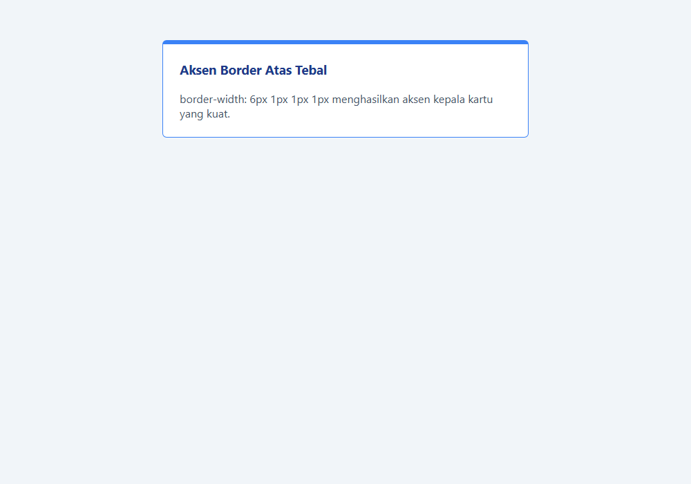

---

### 113. Properti border-style

**Tujuan:** Mengeksplorasi ragam gaya garis batas: solid, dashed, dotted, double, groove, ridge.

**Konsep Utama:**
`border-style` menentukan bentuk goresan garis: `solid` (garis lurus), `dashed` (garis putus-putus), `dotted` (titik-titik), `double` (garis ganda), `groove`, dan `ridge`.

**Penjelasan Source Code:**
Menampilkan 3 kotak berdampingan dengan border dashed untuk area upload, dotted untuk kupon, dan double untuk sertifikat.

**Source code utama:** [113_border_style.css](113_border_style.css)

**File pendukung preview:** [113_border_style.html](113_border_style.html)

**Cara Menjalankan:**
Buka file HTML pendukung di peramban web (Google Chrome, Microsoft Edge, atau Mozilla Firefox), atau gunakan Live Server / HTTP Server:

```bash
# Buka langsung file HTML di browser default
start "" "113_border_style.html"
```

**Hasil yang Diharapkan:**
Tiga kotak berbeda dengan gaya border dashed, dotted, dan double yang sangat khas.

**Screenshot Hasil Eksekusi:**

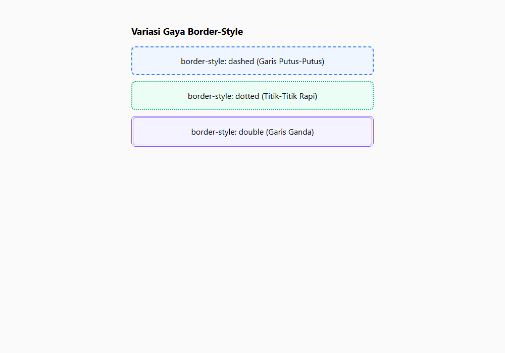

---

### 114. Properti border-color

**Tujuan:** Menetapkan warna border menggunakan nilai warna mandiri atau multi-sisi.

**Konsep Utama:**
Properti `border-color` mengatur pewarnaan garis batas. Mendukung 1 hingga 4 nilai warna berbeda untuk tiap sisi elemen.

**Penjelasan Source Code:**
Mengatur border kartu dengan 4 warna berbeda di setiap sisi untuk memperlihatkan pembagian sudut.

**Source code utama:** [114_border_color.css](114_border_color.css)

**File pendukung preview:** [114_border_color.html](114_border_color.html)

**Cara Menjalankan:**
Buka file HTML pendukung di peramban web (Google Chrome, Microsoft Edge, atau Mozilla Firefox), atau gunakan Live Server / HTTP Server:

```bash
# Buka langsung file HTML di browser default
start "" "114_border_color.html"
```

**Hasil yang Diharapkan:**
Kotak kartu di mana sisi atas, kanan, bawah, dan kiri memiliki warna berbeda.

**Screenshot Hasil Eksekusi:**

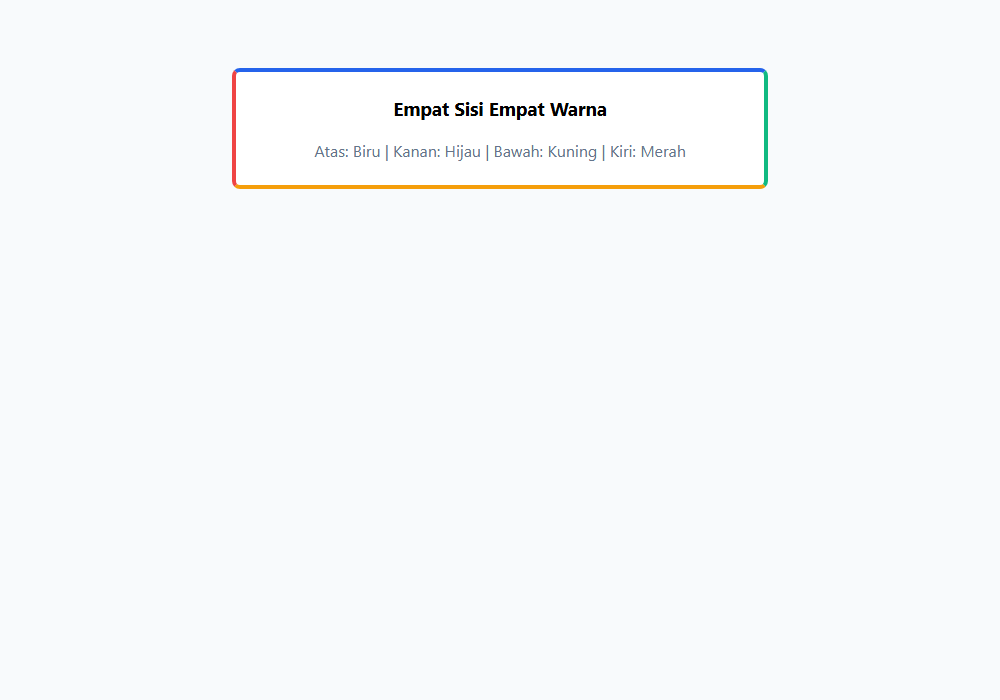

---

### 115. Properti border-radius

**Tujuan:** Membuat sudut melengkung, kapsul, dan lingkaran sempurna menggunakan border-radius.

**Konsep Utama:**
Properti `border-radius` melengkungkan sudut luar elemen. Nilai `50%` pada kotak bujur sangkar menciptakan lingkaran sempurna, sedangkan `9999px` menghasilkan bentuk pil/kapsul adaptif.

**Penjelasan Source Code:**
Menampilkan 3 bentuk: sudut kartu lembut (8px), tombol kapsul (9999px), dan avatar lingkaran (50%).

**Source code utama:** [115_border_radius.css](115_border_radius.css)

**File pendukung preview:** [115_border_radius.html](115_border_radius.html)

**Cara Menjalankan:**
Buka file HTML pendukung di peramban web (Google Chrome, Microsoft Edge, atau Mozilla Firefox), atau gunakan Live Server / HTTP Server:

```bash
# Buka langsung file HTML di browser default
start "" "115_border_radius.html"
```

**Hasil yang Diharapkan:**
Deretan elemen dengan kelengkungan sudut persegi bulat, bentuk kapsul, dan lingkaran bulat.

**Screenshot Hasil Eksekusi:**

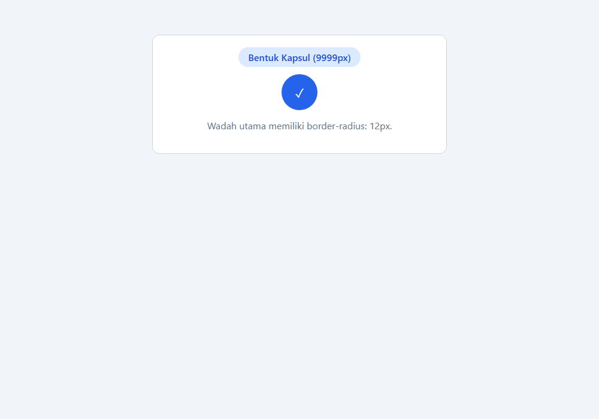

---

### 116. Pengaturan border individual

**Tujuan:** Menetapkan border pada satu sisi tertentu (border-top, border-bottom, border-left, border-right).

**Konsep Utama:**
Sering kali desain hanya membutuhkan garis pembatas di satu sisi, misalnya `border-left` untuk callout quote atau `border-bottom` untuk pemisah header tabel.

**Penjelasan Source Code:**
Membuat komponen kartu callout penting yang hanya memiliki garis tebal di sisi kiri.

**Source code utama:** [116_individual_borders.css](116_individual_borders.css)

**File pendukung preview:** [116_individual_borders.html](116_individual_borders.html)

**Cara Menjalankan:**
Buka file HTML pendukung di peramban web (Google Chrome, Microsoft Edge, atau Mozilla Firefox), atau gunakan Live Server / HTTP Server:

```bash
# Buka langsung file HTML di browser default
start "" "116_individual_borders.html"
```

**Hasil yang Diharapkan:**
Kotak pesan callout dengan garis vertikal biru di sisi kiri.

**Screenshot Hasil Eksekusi:**

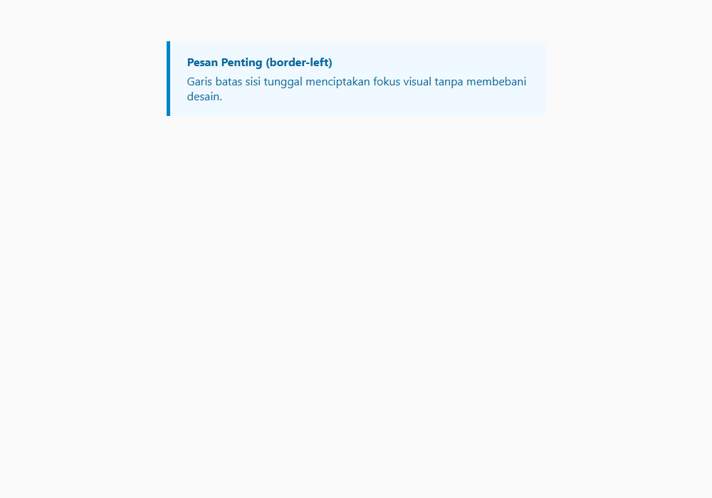

---

### 117. Properti outline

**Tujuan:** Membedakan garis luar (outline) dari border dan perannya dalam aksesibilitas.

**Konsep Utama:**
Berbeda dengan `border`, properti `outline` TIDAK memakan ruang pada box model dan tidak memicu pergeseran layout (reflow). Outline digambar persis di luar border dan sangat krusial sebagai indikator fokus navigasi keyboard.

**Penjelasan Source Code:**
Menata tombol fokus dengan outline biru tegas yang tidak mengubah dimensi fisik tombol.

**Source code utama:** [117_outline_property.css](117_outline_property.css)

**File pendukung preview:** [117_outline_property.html](117_outline_property.html)

**Cara Menjalankan:**
Buka file HTML pendukung di peramban web (Google Chrome, Microsoft Edge, atau Mozilla Firefox), atau gunakan Live Server / HTTP Server:

```bash
# Buka langsung file HTML di browser default
start "" "117_outline_property.html"
```

**Hasil yang Diharapkan:**
Tombol aksi dengan garis outline mengitari luar border secara rapi.

**Screenshot Hasil Eksekusi:**

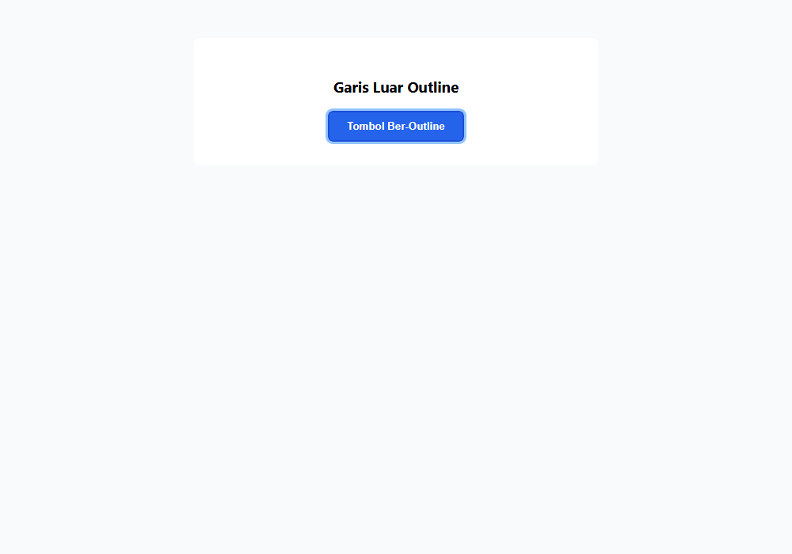

---

### 118. Properti outline-offset

**Tujuan:** Memberikan jarak celah antara border elemen dengan outline menggunakan outline-offset.

**Konsep Utama:**
Properti `outline-offset` memberikan celah spasi transparan di antara border fisik elemen dengan garis outline luarnya. Nilai positif menjauhkan outline, sedangkan nilai negatif menarik outline ke dalam.

**Penjelasan Source Code:**
Memberikan `outline-offset: 4px` pada elemen kartu untuk menciptakan efek bingkai melayang.

**Source code utama:** [118_outline_offset.css](118_outline_offset.css)

**File pendukung preview:** [118_outline_offset.html](118_outline_offset.html)

**Cara Menjalankan:**
Buka file HTML pendukung di peramban web (Google Chrome, Microsoft Edge, atau Mozilla Firefox), atau gunakan Live Server / HTTP Server:

```bash
# Buka langsung file HTML di browser default
start "" "118_outline_offset.html"
```

**Hasil yang Diharapkan:**
Kotak kartu yang dikelilingi garis luar melayang dengan celah spasi 4px dari tepi kartu.

**Screenshot Hasil Eksekusi:**

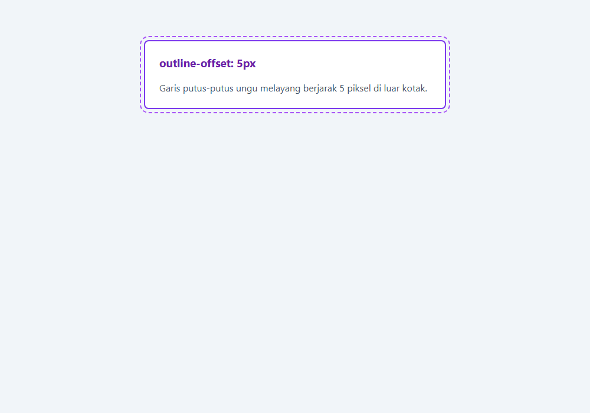

---

### 119. Properti box-shadow

**Tujuan:** Memberikan kedalaman elevasi elemen menggunakan properti box-shadow.

**Konsep Utama:**
Sintaks `box-shadow: [inset] offset-x offset-y [blur-radius] [spread-radius] color`. Bayangan lembut memberikan ilusi 3D bahwa elemen terangkat di atas permukaan kertas halaman.

**Penjelasan Source Code:**
Membuat kartu dengan bayangan lembut yang memberikan kedalaman elevasi halus.

**Source code utama:** [119_box_shadow.css](119_box_shadow.css)

**File pendukung preview:** [119_box_shadow.html](119_box_shadow.html)

**Cara Menjalankan:**
Buka file HTML pendukung di peramban web (Google Chrome, Microsoft Edge, atau Mozilla Firefox), atau gunakan Live Server / HTTP Server:

```bash
# Buka langsung file HTML di browser default
start "" "119_box_shadow.html"
```

**Hasil yang Diharapkan:**
Kotak kartu putih yang tampak melayang anggun di atas latar belakang abu-abu terang.

**Screenshot Hasil Eksekusi:**

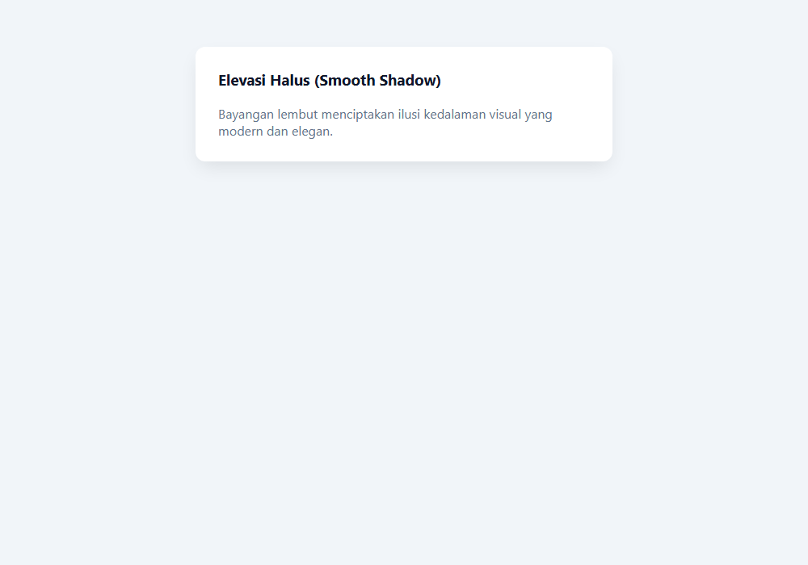

---

### 120. Multiple box shadows

**Tujuan:** Menumpuk beberapa lapisan bayangan untuk menghasilkan bayangan fotorealistik alami.

**Konsep Utama:**
Di dunia nyata, bayangan cahaya terdiri dari lapisan bayangan tajam dekat benda (umbra) dan bayangan pudar jauh (penumbra). Menggabungkan dua atau lebih box-shadow menghasilkan elevasi yang jauh lebih realistis daripada satu bayangan tebal.

**Penjelasan Source Code:**
Menumpuk 2 lapisan bayangan: bayangan kontak dekat dan bayangan pendaran jauh.

**Source code utama:** [120_multiple_box_shadows.css](120_multiple_box_shadows.css)

**File pendukung preview:** [120_multiple_box_shadows.html](120_multiple_box_shadows.html)

**Cara Menjalankan:**
Buka file HTML pendukung di peramban web (Google Chrome, Microsoft Edge, atau Mozilla Firefox), atau gunakan Live Server / HTTP Server:

```bash
# Buka langsung file HTML di browser default
start "" "120_multiple_box_shadows.html"
```

**Hasil yang Diharapkan:**
Kartu dengan kualitas bayangan tingkat tinggi layaknya antarmuka sistem operasi modern.

**Screenshot Hasil Eksekusi:**

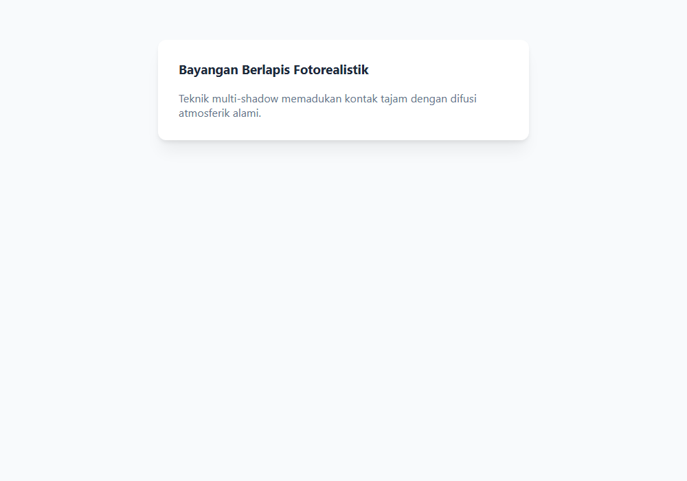

---

### 121. Properti opacity

**Tujuan:** Mengatur transparansi keseluruhan elemen beserta seluruh elemen turunannya.

**Konsep Utama:**
Properti `opacity` menerima nilai 0.0 (tembus pandang total) hingga 1.0 (padat sempurna). Penting diingat bahwa seluruh elemen anak di dalamnya akan ikut menjadi transparan.

**Penjelasan Source Code:**
Menampilkan kartu dinonaktifkan (disabled state) dengan `opacity: 0.5`.

**Source code utama:** [121_opacity_property.css](121_opacity_property.css)

**File pendukung preview:** [121_opacity_property.html](121_opacity_property.html)

**Cara Menjalankan:**
Buka file HTML pendukung di peramban web (Google Chrome, Microsoft Edge, atau Mozilla Firefox), atau gunakan Live Server / HTTP Server:

```bash
# Buka langsung file HTML di browser default
start "" "121_opacity_property.html"
```

**Hasil yang Diharapkan:**
Kotak kartu yang tampak pudar setengah transparan menandakan kondisi tidak aktif.

**Screenshot Hasil Eksekusi:**

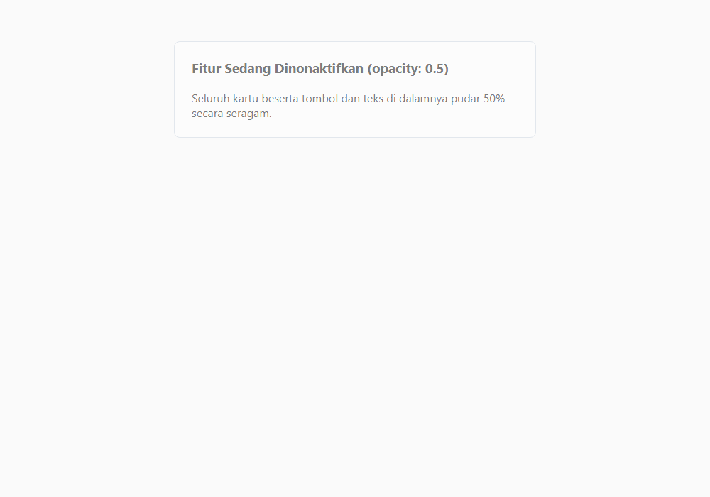

---

### 122. Properti filter

**Tujuan:** Menerapkan filter grafis CSS (blur, grayscale, brightness, contrast, drop-shadow).

**Konsep Utama:**
Properti `filter` memproses rendering grafis elemen: `blur(5px)`, `grayscale(100%)`, `brightness(1.2)`, `contrast(150%)`, dan `drop-shadow()`.

**Penjelasan Source Code:**
Mendemonstrasikan efek lencana dengan grayscale dan drop-shadow grafis.

**Source code utama:** [122_filter_property.css](122_filter_property.css)

**File pendukung preview:** [122_filter_property.html](122_filter_property.html)

**Cara Menjalankan:**
Buka file HTML pendukung di peramban web (Google Chrome, Microsoft Edge, atau Mozilla Firefox), atau gunakan Live Server / HTTP Server:

```bash
# Buka langsung file HTML di browser default
start "" "122_filter_property.html"
```

**Hasil yang Diharapkan:**
Komponen visual yang dipercantik dengan efek filter grafis cerah dan bayangan presisi.

**Screenshot Hasil Eksekusi:**

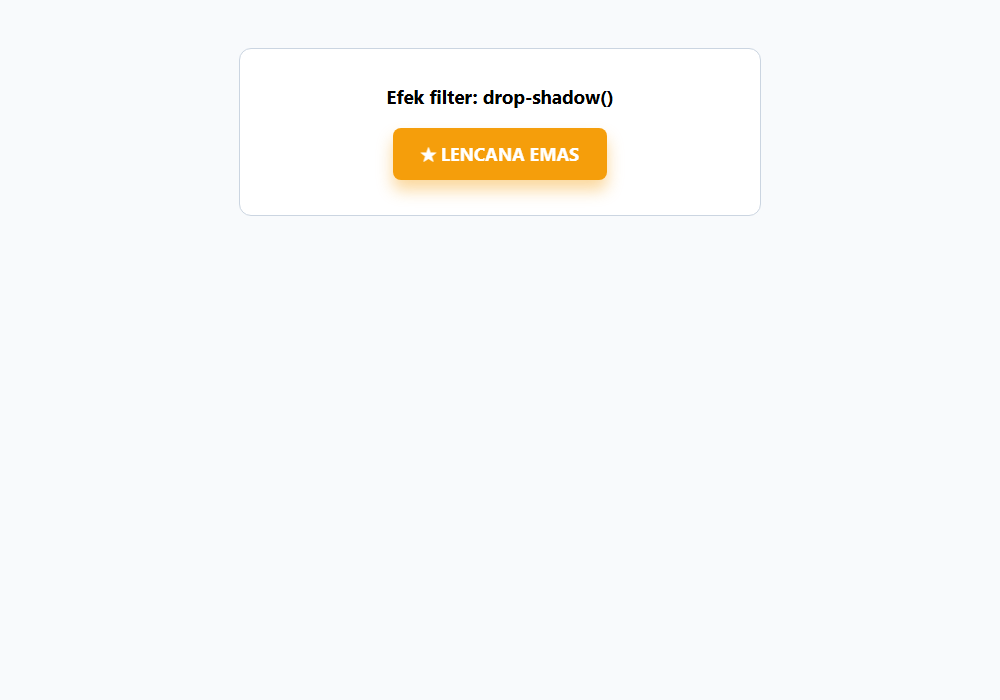

---

### 123. Properti backdrop-filter

**Tujuan:** Menciptakan efek kaca buram modern (Glassmorphism) menggunakan backdrop-filter: blur().

**Konsep Utama:**
Properti `backdrop-filter` menerapkan filter grafis (seperti `blur()`) ke area DI BELAKANG elemen, menciptakan efek frosted glass yang sangat populer pada UI modern (Apple iOS, macOS, Windows Acrylic).

**Penjelasan Source Code:**
Membuat kartu kaca transparan semi-tembus pandang dengan `backdrop-filter: blur(12px)` di atas latar gambar penuh warna.

**Source code utama:** [123_backdrop_filter.css](123_backdrop_filter.css)

**File pendukung preview:** [123_backdrop_filter.html](123_backdrop_filter.html)

**Cara Menjalankan:**
Buka file HTML pendukung di peramban web (Google Chrome, Microsoft Edge, atau Mozilla Firefox), atau gunakan Live Server / HTTP Server:

```bash
# Buka langsung file HTML di browser default
start "" "123_backdrop_filter.html"
```

**Hasil yang Diharapkan:**
Kartu bergaya kaca buram (glassmorphism) yang membiaskan warna-warni latar belakang di baliknya.

**Screenshot Hasil Eksekusi:**

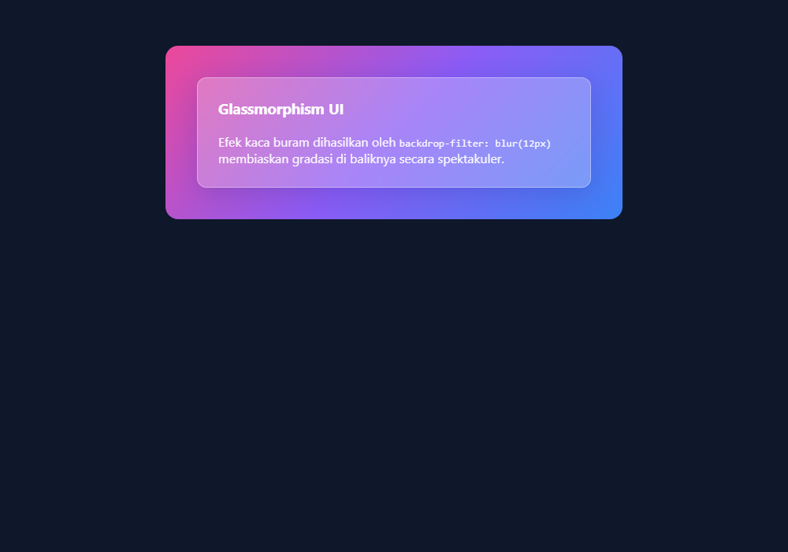

---

### 124. mix-blend-mode

**Tujuan:** Mencampurkan elemen dengan konten latar belakang dokumen menggunakan mix-blend-mode.

**Konsep Utama:**
Properti `mix-blend-mode` menentukan bagaimana konten sebuah elemen berbaur dengan elemen-elemen yang berada di belakangnya dalam dokumen DOM.

**Penjelasan Source Code:**
Mencampurkan teks tebal dengan lingkaran warna menggunakan `mix-blend-mode: difference`.

**Source code utama:** [124_mix_blend_mode.css](124_mix_blend_mode.css)

**File pendukung preview:** [124_mix_blend_mode.html](124_mix_blend_mode.html)

**Cara Menjalankan:**
Buka file HTML pendukung di peramban web (Google Chrome, Microsoft Edge, atau Mozilla Firefox), atau gunakan Live Server / HTTP Server:

```bash
# Buka langsung file HTML di browser default
start "" "124_mix_blend_mode.html"
```

**Hasil yang Diharapkan:**
Teks yang secara dramatis membalik warnanya ketika bersinggungan dengan lingkaran latar.

**Screenshot Hasil Eksekusi:**

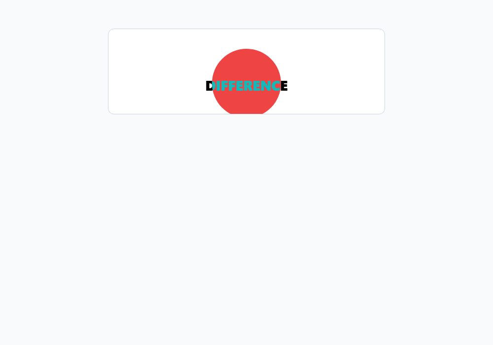

---

### 125. Properti clip-path

**Tujuan:** Memotong elemen menjadi bentuk geometris kustom (polygon, circle, inset) menggunakan clip-path.

**Konsep Utama:**
Properti `clip-path` mendefinisikan area kliping (pemotongan). Hanya bagian di dalam area bentuk yang akan tampil, sedangkan bagian luar menjadi transparan sempurna.

**Penjelasan Source Code:**
Membuat spanduk pita berbentuk pita panah (arrow/chevron) menggunakan fungsi `polygon()`.

**Source code utama:** [125_clip_path.css](125_clip_path.css)

**File pendukung preview:** [125_clip_path.html](125_clip_path.html)

**Cara Menjalankan:**
Buka file HTML pendukung di peramban web (Google Chrome, Microsoft Edge, atau Mozilla Firefox), atau gunakan Live Server / HTTP Server:

```bash
# Buka langsung file HTML di browser default
start "" "125_clip_path.html"
```

**Hasil yang Diharapkan:**
Spanduk dengan ujung berbentuk panah yang terpotong rapi dengan polygon clip-path.

**Screenshot Hasil Eksekusi:**

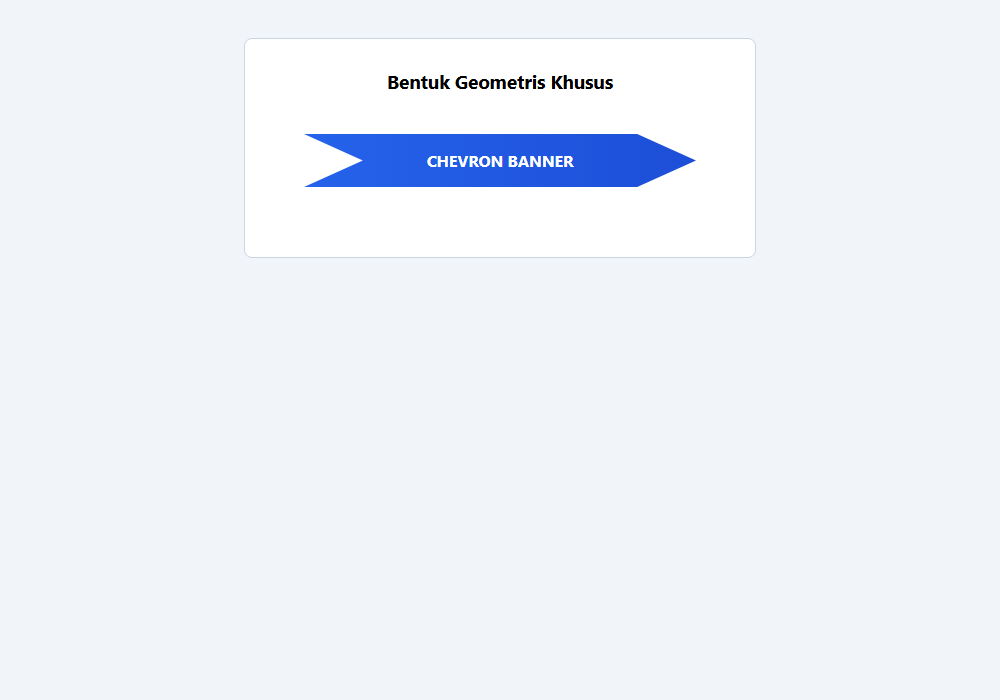

---

## Ringkasan Modul

Efek visual, bayangan bertingkat, dan border yang dirancang dengan matang memberikan persepsi kedalaman (depth) dan hierarki informasi yang intuitif bagi pengguna. Modul 7 melengkapi skillset styling dengan teknik-teknik visual grafis mutakhir web.

### Keterkaitan Materi
Seluruh submodul dalam modul ini dirancang secara berjenjang untuk membangun pemahaman yang kokoh dan aplikatif. Lanjutkan ke modul berikutnya setelah menguasai seluruh konsep di atas.
