# Modul 08: Display, Positioning, dan Overflow

## Ringkasan Ruang Lingkup Materi

Modul ini membahas tata letak alur dokumen (normal flow) dan penempatan elemen di ruang 2D/3D: tipe display klasik (block, inline, inline-block), perbedaan display: none vs visibility: hidden dalam hal alokasi ruang layout, skema positioning (static, relative, absolute berpedoman containing block, fixed pada layar, sticky pada saat digulir), properti inset fisik (top, right, bottom, left) dan shorthand inset modern, pengelolaan lapisan z-index dan pembentukan stacking context, penanganan peluapan konten overflow (hidden, auto, scroll, overflow-x dan overflow-y mandiri), hingga penyesuaian media gambar dengan object-fit dan object-position.

## Tujuan Pembelajaran Modul

- Memahami perilaku alur dokumen pada display block, inline, dan inline-block.
- Menganalisis perbedaan krusial display: none (menghilangkan elemen dari layout) vs visibility: hidden.
- Menguasai kelima nilai position: static, relative, absolute, fixed, dan sticky.
- Mengontrol penumpukan elemen di sumbu Z menggunakan z-index dan memahami pembentukan Stacking Context.
- Mengatasi masalah konten meluap dengan variasi properti overflow.
- Mengatur proporsi tampilan media gambar dan video tanpa distorsi menggunakan object-fit dan object-position.

## Daftar Submodul

- [126. display: block](126_display_block.css) — [Halaman Preview](126_display_block.html)
- [127. display: inline](127_display_inline.css) — [Halaman Preview](127_display_inline.html)
- [128. display: inline-block](128_display_inline_block.css) — [Halaman Preview](128_display_inline_block.html)
- [129. display: none](129_display_none.css) — [Halaman Preview](129_display_none.html)
- [130. Properti visibility](130_visibility_property.css) — [Halaman Preview](130_visibility_property.html)
- [131. position: static](131_position_static.css) — [Halaman Preview](131_position_static.html)
- [132. position: relative](132_position_relative.css) — [Halaman Preview](132_position_relative.html)
- [133. position: absolute](133_position_absolute.css) — [Halaman Preview](133_position_absolute.html)
- [134. position: fixed](134_position_fixed.css) — [Halaman Preview](134_position_fixed.html)
- [135. position: sticky](135_position_sticky.css) — [Halaman Preview](135_position_sticky.html)
- [136. Properti inset fisik](136_top_right_bottom_left.css) — [Halaman Preview](136_top_right_bottom_left.html)
- [137. Logical inset properties](137_inset_logical_properties.css) — [Halaman Preview](137_inset_logical_properties.html)
- [138. Properti z-index](138_z_index.css) — [Halaman Preview](138_z_index.html)
- [139. Stacking context](139_stacking_context.css) — [Halaman Preview](139_stacking_context.html)
- [140. overflow: hidden](140_overflow_hidden.css) — [Halaman Preview](140_overflow_hidden.html)
- [141. overflow: auto](141_overflow_auto.css) — [Halaman Preview](141_overflow_auto.html)
- [142. overflow: scroll](142_overflow_scroll.css) — [Halaman Preview](142_overflow_scroll.html)
- [143. overflow-x dan overflow-y](143_overflow_x_y.css) — [Halaman Preview](143_overflow_x_y.html)
- [144. Properti object-fit](144_object_fit.css) — [Halaman Preview](144_object_fit.html)
- [145. Properti object-position](145_object_position.css) — [Halaman Preview](145_object_position.html)

---

## Pembahasan dan Penjelasan Submodul

### 126. display: block

**Tujuan:** Memahami karakteristik elemen blok yang selalu memulai baris baru dan mengambil lebar penuh 100%.

**Konsep Utama:**
Elemen dengan `display: block` selalu memulai baris baru, meregang memenuhi lebar penuh kontainer induknya secara default, serta dapat diatur properti `width`, `height`, `margin`, dan `padding`-nya secara leluasa.

**Penjelasan Source Code:**
Menampilkan dua kotak blok yang bertumpuk vertikal secara otomatis.

**Source code utama:** [126_display_block.css](126_display_block.css)

**File pendukung preview:** [126_display_block.html](126_display_block.html)

**Cara Menjalankan:**
Buka file HTML pendukung di peramban web (Google Chrome, Microsoft Edge, atau Mozilla Firefox), atau gunakan Live Server / HTTP Server:

```bash
# Buka langsung file HTML di browser default
start "" "126_display_block.html"
```

**Hasil yang Diharapkan:**
Dua kotak biru yang masing-masing menempati baris tersendiri membentang horizontal.

**Screenshot Hasil Eksekusi:**

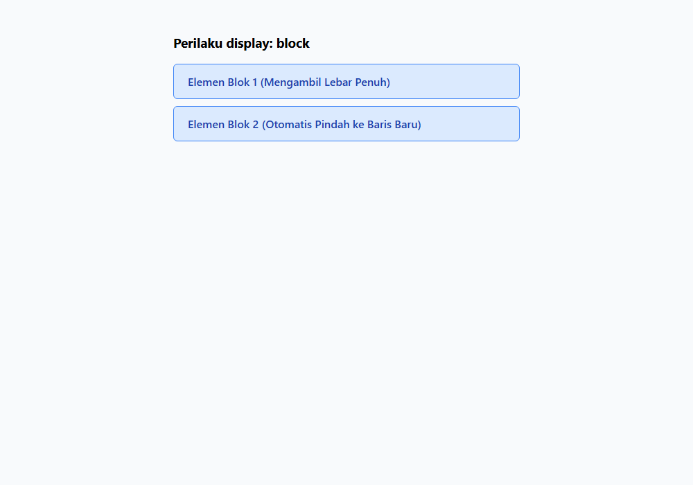

---

### 127. display: inline

**Tujuan:** Memahami karakteristik elemen inline yang mengalir bersama teks dan tidak menerima width/height.

**Konsep Utama:**
Elemen dengan `display: inline` hanya memakan lebar sebesar kontennya saja dan tidak memulai baris baru. Properti `width`, `height`, serta `margin-top`/`margin-bottom` TIDAK berlaku pada elemen inline murni.

**Penjelasan Source Code:**
Mendemonstrasikan tag `span` berlatar warna yang mengalir di tengah kalimat paragraf.

**Source code utama:** [127_display_inline.css](127_display_inline.css)

**File pendukung preview:** [127_display_inline.html](127_display_inline.html)

**Cara Menjalankan:**
Buka file HTML pendukung di peramban web (Google Chrome, Microsoft Edge, atau Mozilla Firefox), atau gunakan Live Server / HTTP Server:

```bash
# Buka langsung file HTML di browser default
start "" "127_display_inline.html"
```

**Hasil yang Diharapkan:**
Teks berlatar kuning yang mengalir alami di tengah baris kalimat tanpa memutus paragraf.

**Screenshot Hasil Eksekusi:**

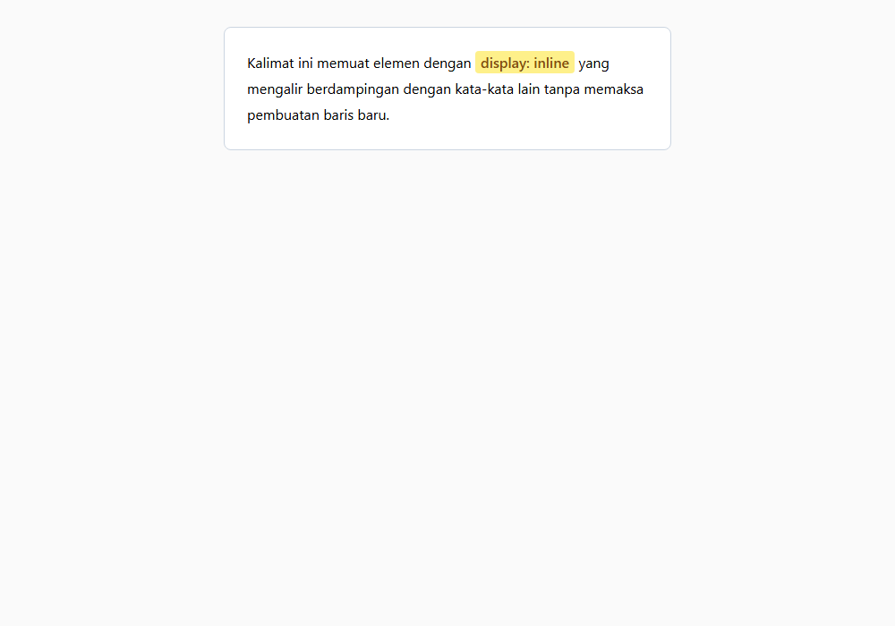

---

### 128. display: inline-block

**Tujuan:** Menggabungkan fleksibilitas alur inline dengan kemampuan ukuran kotak elemen blok.

**Konsep Utama:**
Elemen `inline-block` dapat berdampingan secara horizontal layaknya elemen inline, tetapi tetap dapat diatur `width`, `height`, `margin`, dan `padding`-nya secara sempurna layaknya elemen blok.

**Penjelasan Source Code:**
Membuat 3 lencana kotak berukuran seragam 130px yang berjejer horizontal berdampingan.

**Source code utama:** [128_display_inline_block.css](128_display_inline_block.css)

**File pendukung preview:** [128_display_inline_block.html](128_display_inline_block.html)

**Cara Menjalankan:**
Buka file HTML pendukung di peramban web (Google Chrome, Microsoft Edge, atau Mozilla Firefox), atau gunakan Live Server / HTTP Server:

```bash
# Buka langsung file HTML di browser default
start "" "128_display_inline_block.html"
```

**Hasil yang Diharapkan:**
Tiga kotak bertuliskan fitur yang sejajar berdampingan secara horizontal dengan ukuran terukur.

**Screenshot Hasil Eksekusi:**

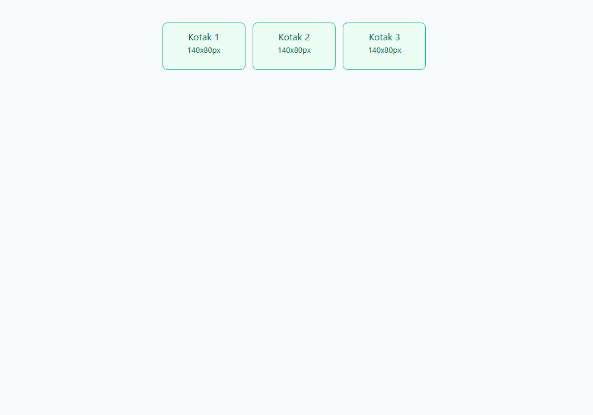

---

### 129. display: none

**Tujuan:** Menghilangkan elemen sepenuhnya dari dokumen visual tanpa menyisakan ruang kosong layout.

**Konsep Utama:**
`display: none` menghapus elemen dari alur rendering dokumen. Elemen tidak tampak dan ruang fisiknya hilang seolah elemen tersebut tidak pernah ada di halaman web.

**Penjelasan Source Code:**
Mendemonstrasikan kartu di antara dua elemen di mana elemen tengah disembunyikan menggunakan `display: none`.

**Source code utama:** [129_display_none.css](129_display_none.css)

**File pendukung preview:** [129_display_none.html](129_display_none.html)

**Cara Menjalankan:**
Buka file HTML pendukung di peramban web (Google Chrome, Microsoft Edge, atau Mozilla Firefox), atau gunakan Live Server / HTTP Server:

```bash
# Buka langsung file HTML di browser default
start "" "129_display_none.html"
```

**Hasil yang Diharapkan:**
Elemen pertama dan ketiga saling menempel rapat karena elemen kedua yang disembunyikan tidak menyisakan celah.

**Screenshot Hasil Eksekusi:**

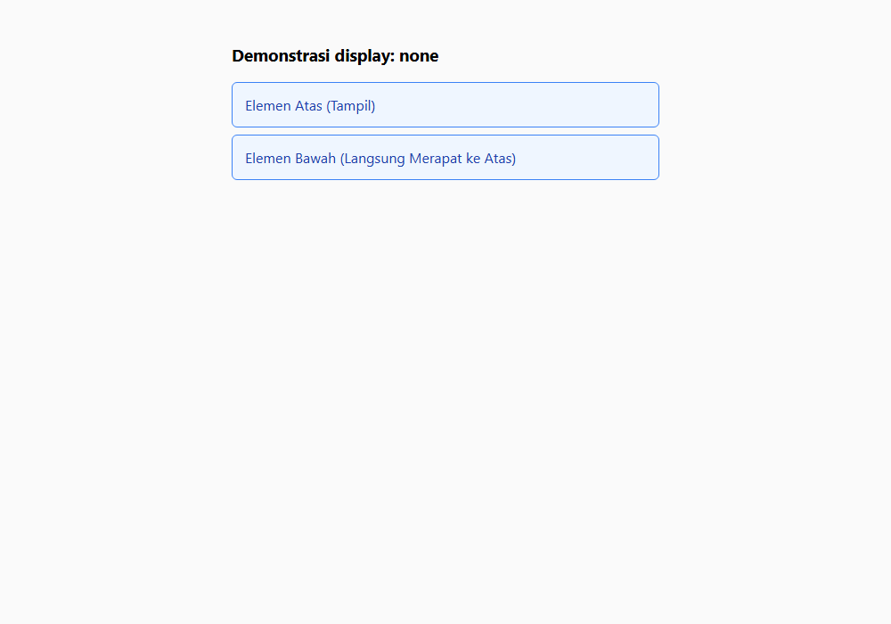

---

### 130. Properti visibility

**Tujuan:** Menyembunyikan konten secara visual namun tetap mempertahankan ruang kosong layout (visibility: hidden).

**Konsep Utama:**
Berbeda dengan `display: none`, `visibility: hidden` membuat elemen menjadi tak kasat mata, namun RUANG FISIKNYA TETAP ADA dan ditempati di halaman.

**Penjelasan Source Code:**
Memperlihatkan celah kosong di antara elemen atas dan bawah akibat penggunaan `visibility: hidden`.

**Source code utama:** [130_visibility_property.css](130_visibility_property.css)

**File pendukung preview:** [130_visibility_property.html](130_visibility_property.html)

**Cara Menjalankan:**
Buka file HTML pendukung di peramban web (Google Chrome, Microsoft Edge, atau Mozilla Firefox), atau gunakan Live Server / HTTP Server:

```bash
# Buka langsung file HTML di browser default
start "" "130_visibility_property.html"
```

**Hasil yang Diharapkan:**
Elemen atas dan bawah terpisah oleh ruang kosong seukuran elemen tengah yang tak kasat mata.

**Screenshot Hasil Eksekusi:**

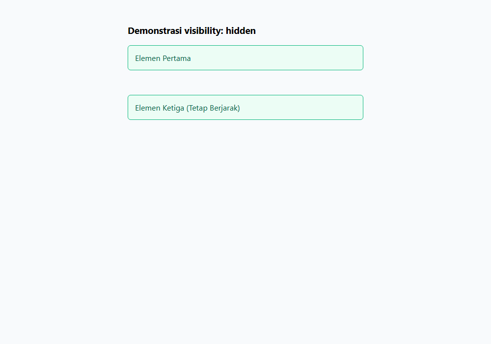

---

### 131. position: static

**Tujuan:** Memahami posisi default alur dokumen (static) di mana inset top/left dan z-index diabaikan.

**Konsep Utama:**
`position: static` adalah posisi default setiap elemen HTML. Elemen mengalir secara alami mengikuti dokumen, dan properti inset (`top`, `right`, `bottom`, `left`) serta `z-index` TIDAK memiliki efek apa pun.

**Penjelasan Source Code:**
Menunjukkan bahwa memberikan `top: 50px` pada elemen `position: static` tidak akan menggeser elemen sama sekali.

**Source code utama:** [131_position_static.css](131_position_static.css)

**File pendukung preview:** [131_position_static.html](131_position_static.html)

**Cara Menjalankan:**
Buka file HTML pendukung di peramban web (Google Chrome, Microsoft Edge, atau Mozilla Firefox), atau gunakan Live Server / HTTP Server:

```bash
# Buka langsung file HTML di browser default
start "" "131_position_static.html"
```

**Hasil yang Diharapkan:**
Kotak yang tetap berada di posisi alur alaminya meskipun properti inset dituliskan.

**Screenshot Hasil Eksekusi:**

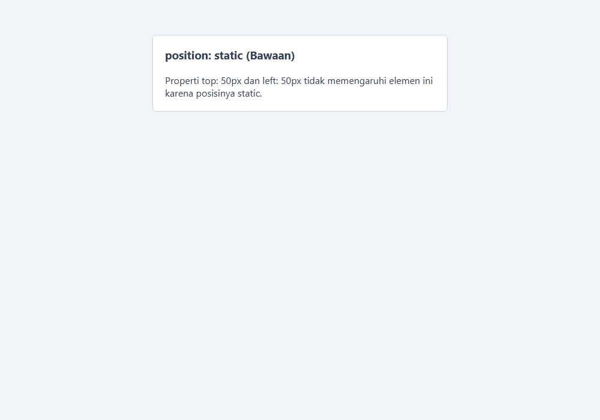

---

### 132. position: relative

**Tujuan:** Menggeser posisi elemen relatif terhadap posisi aslinya tanpa mengganggu alur elemen tetangga.

**Konsep Utama:**
Pada `position: relative`, elemen digeser menggunakan `top`, `bottom`, `left`, `right` dihitung dari posisi aslinya dalam alur dokumen. Ruang asli elemen tetap dipertahankan, dan elemen ini menjadi referensi patokan (containing block) bagi anak yang berposisi `absolute`.

**Penjelasan Source Code:**
Menggeser kotak sejauh `top: 15px` dan `left: 25px` dari posisi aslinya.

**Source code utama:** [132_position_relative.css](132_position_relative.css)

**File pendukung preview:** [132_position_relative.html](132_position_relative.html)

**Cara Menjalankan:**
Buka file HTML pendukung di peramban web (Google Chrome, Microsoft Edge, atau Mozilla Firefox), atau gunakan Live Server / HTTP Server:

```bash
# Buka langsung file HTML di browser default
start "" "132_position_relative.html"
```

**Hasil yang Diharapkan:**
Kotak biru yang tampak bergeser sedikit ke kanan bawah dari garis posisi aslinya.

**Screenshot Hasil Eksekusi:**

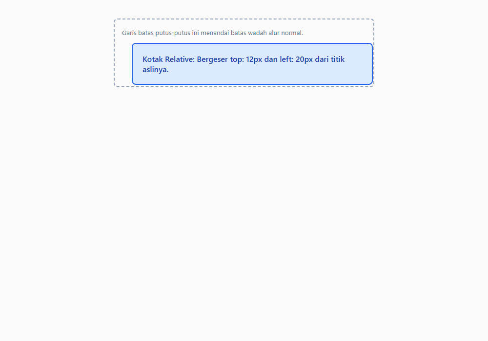

---

### 133. position: absolute

**Tujuan:** Menempatkan elemen bebas di mana saja berpatokan pada leluhur terdekat yang berposisi non-static.

**Konsep Utama:**
Elemen `position: absolute` dicabut sepenuhnya dari alur dokumen (tidak memakan ruang). Posisinya ditentukan oleh koordinat `top`/`bottom`/`left`/`right` relatif terhadap leluhur terdekat yang memiliki posisi selain `static` (umumnya induk diberi `position: relative`).

**Penjelasan Source Code:**
Membuat lencana notifikasi 'Baru' yang menempel di pojok kanan atas kartu produk.

**Source code utama:** [133_position_absolute.css](133_position_absolute.css)

**File pendukung preview:** [133_position_absolute.html](133_position_absolute.html)

**Cara Menjalankan:**
Buka file HTML pendukung di peramban web (Google Chrome, Microsoft Edge, atau Mozilla Firefox), atau gunakan Live Server / HTTP Server:

```bash
# Buka langsung file HTML di browser default
start "" "133_position_absolute.html"
```

**Hasil yang Diharapkan:**
Kartu produk putih dengan lencana bulat merah melayang presisi di pojok kanan atas.

**Screenshot Hasil Eksekusi:**

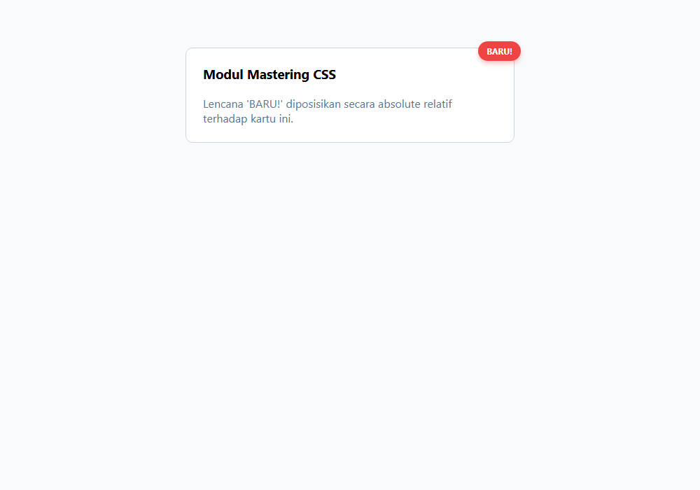

---

### 134. position: fixed

**Tujuan:** Mengunci posisi elemen pada viewport layar sehingga tidak bergeser saat halaman digulir.

**Konsep Utama:**
Elemen `position: fixed` dicabut dari alur dokumen dan ditempatkan relatif terhadap viewport layar jendela peramban. Sangat umum digunakan untuk tombol WhatsApp melayang, cookie banner, atau navbar atas.

**Penjelasan Source Code:**
Membuat tombol bantuan mengambang di pojok kanan bawah jendela dokumen.

**Source code utama:** [134_position_fixed.css](134_position_fixed.css)

**File pendukung preview:** [134_position_fixed.html](134_position_fixed.html)

**Cara Menjalankan:**
Buka file HTML pendukung di peramban web (Google Chrome, Microsoft Edge, atau Mozilla Firefox), atau gunakan Live Server / HTTP Server:

```bash
# Buka langsung file HTML di browser default
start "" "134_position_fixed.html"
```

**Hasil yang Diharapkan:**
Tombol bantuan bulat berwarna hijau yang menetap di pojok kanan bawah layar.

**Screenshot Hasil Eksekusi:**

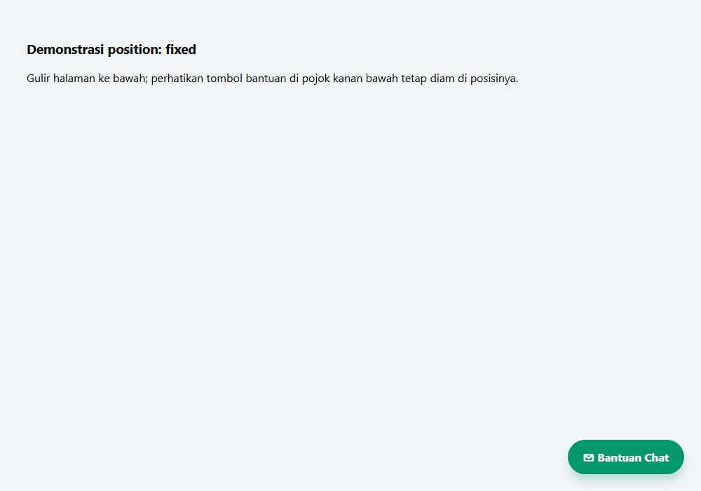

---

### 135. position: sticky

**Tujuan:** Menggabungkan perilaku relative dan fixed saat elemen mencapai batas ambang gulir.

**Konsep Utama:**
`position: sticky` bertindak sebagai `relative` hingga halaman digulir sampai batas ambang tertentu (misal `top: 0`), lalu berubah menjadi `fixed` menempel di layar selama masih berada di dalam batas kontainer induknya.

**Penjelasan Source Code:**
Membuat header bagian tabel/daftar yang menempel di bagian atas saat daftar digulir.

**Source code utama:** [135_position_sticky.css](135_position_sticky.css)

**File pendukung preview:** [135_position_sticky.html](135_position_sticky.html)

**Cara Menjalankan:**
Buka file HTML pendukung di peramban web (Google Chrome, Microsoft Edge, atau Mozilla Firefox), atau gunakan Live Server / HTTP Server:

```bash
# Buka langsung file HTML di browser default
start "" "135_position_sticky.html"
```

**Hasil yang Diharapkan:**
Bilah judul subbab yang tetap menempel di pucuk atas kontainer saat teks digulir.

**Screenshot Hasil Eksekusi:**

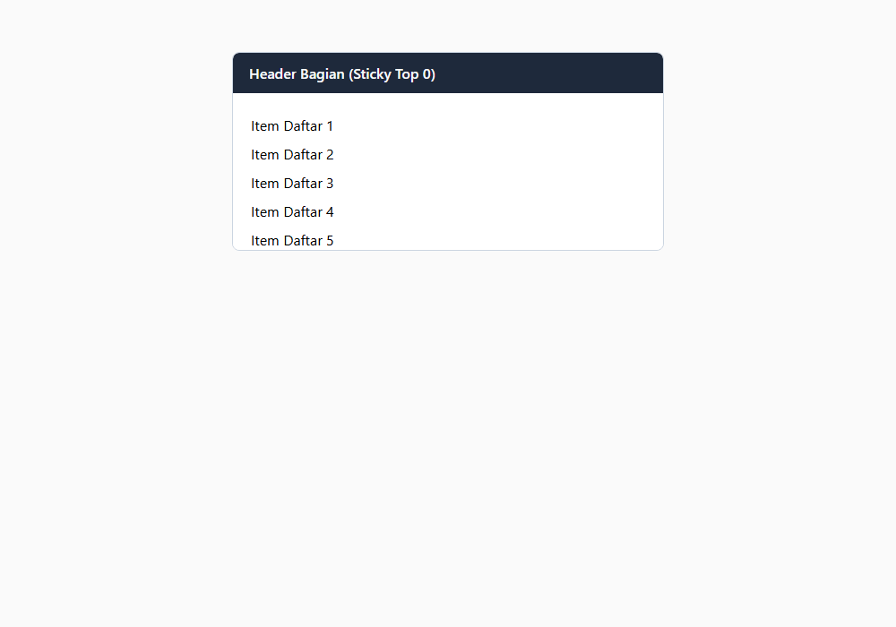

---

### 136. Properti inset fisik

**Tujuan:** Menggunakan properti koordinat fisik top, right, bottom, left untuk memposisikan elemen terposisi.

**Konsep Utama:**
Properti fisik `top`, `right`, `bottom`, `left` menentukan jarak pergeseran elemen dari tepi patokan. Mengatur `top: 0; bottom: 0; left: 0; right: 0;` pada elemen absolute membuat elemen merentang memenuhi seluruh bidang induknya.

**Penjelasan Source Code:**
Membuat lapisan backdrop overlay penuh menggunakan koordinat 4 sisi `top: 0; bottom: 0; left: 0; right: 0;`.

**Source code utama:** [136_top_right_bottom_left.css](136_top_right_bottom_left.css)

**File pendukung preview:** [136_top_right_bottom_left.html](136_top_right_bottom_left.html)

**Cara Menjalankan:**
Buka file HTML pendukung di peramban web (Google Chrome, Microsoft Edge, atau Mozilla Firefox), atau gunakan Live Server / HTTP Server:

```bash
# Buka langsung file HTML di browser default
start "" "136_top_right_bottom_left.html"
```

**Hasil yang Diharapkan:**
Kotak kartu di mana lapisan overlay transparan menutupi seluruh area dari ujung ke ujung.

**Screenshot Hasil Eksekusi:**

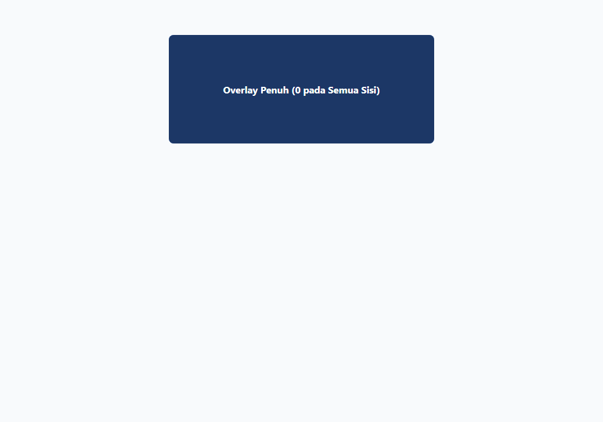

---

### 137. Logical inset properties

**Tujuan:** Menyederhanakan koordinat posisi menggunakan shorthand inset modern.

**Konsep Utama:**
Properti shorthand `inset: 0` adalah padanan modern dari penulisan panjang `top: 0; right: 0; bottom: 0; left: 0;`. Juga mendukung `inset-block` dan `inset-inline` untuk kontrol arah logis.

**Penjelasan Source Code:**
Menerapkan `inset: 15px` untuk memusatkan kotak sub-panel dengan margin otomatis.

**Source code utama:** [137_inset_logical_properties.css](137_inset_logical_properties.css)

**File pendukung preview:** [137_inset_logical_properties.html](137_inset_logical_properties.html)

**Cara Menjalankan:**
Buka file HTML pendukung di peramban web (Google Chrome, Microsoft Edge, atau Mozilla Firefox), atau gunakan Live Server / HTTP Server:

```bash
# Buka langsung file HTML di browser default
start "" "137_inset_logical_properties.html"
```

**Hasil yang Diharapkan:**
Panel anak yang berada pas di dalam wadah dengan jarak seragam 15px dari semua sisi berkat `inset: 15px`.

**Screenshot Hasil Eksekusi:**

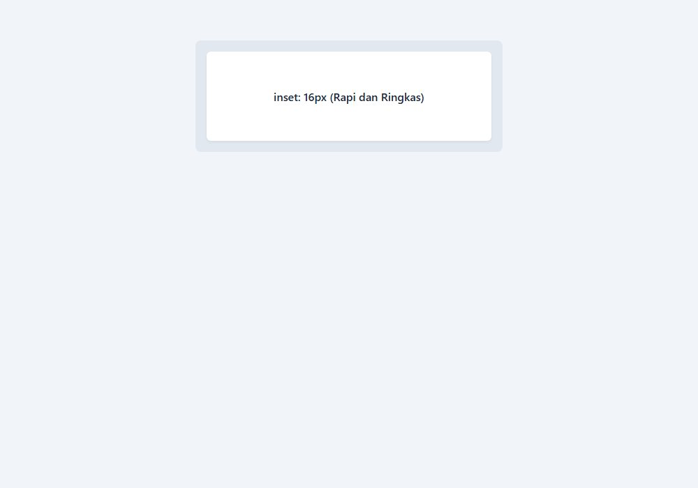

---

### 138. Properti z-index

**Tujuan:** Mengatur urutan tumpukan elemen di sumbu kedalaman Z menggunakan nilai numerik z-index.

**Konsep Utama:**
Properti `z-index` hanya berlaku pada elemen yang memiliki `position` selain `static` (atau item flex/grid). Nilai angka yang lebih besar akan berada di atas elemen dengan nilai z-index lebih kecil.

**Penjelasan Source Code:**
Dua kartu bertumpuk di mana kartu dengan `z-index: 2` berada di atas kartu dengan `z-index: 1`.

**Source code utama:** [138_z_index.css](138_z_index.css)

**File pendukung preview:** [138_z_index.html](138_z_index.html)

**Cara Menjalankan:**
Buka file HTML pendukung di peramban web (Google Chrome, Microsoft Edge, atau Mozilla Firefox), atau gunakan Live Server / HTTP Server:

```bash
# Buka langsung file HTML di browser default
start "" "138_z_index.html"
```

**Hasil yang Diharapkan:**
Dua kotak yang saling menumpuk sebagian dengan kartu biru berada di atas kartu abu-abu.

**Screenshot Hasil Eksekusi:**

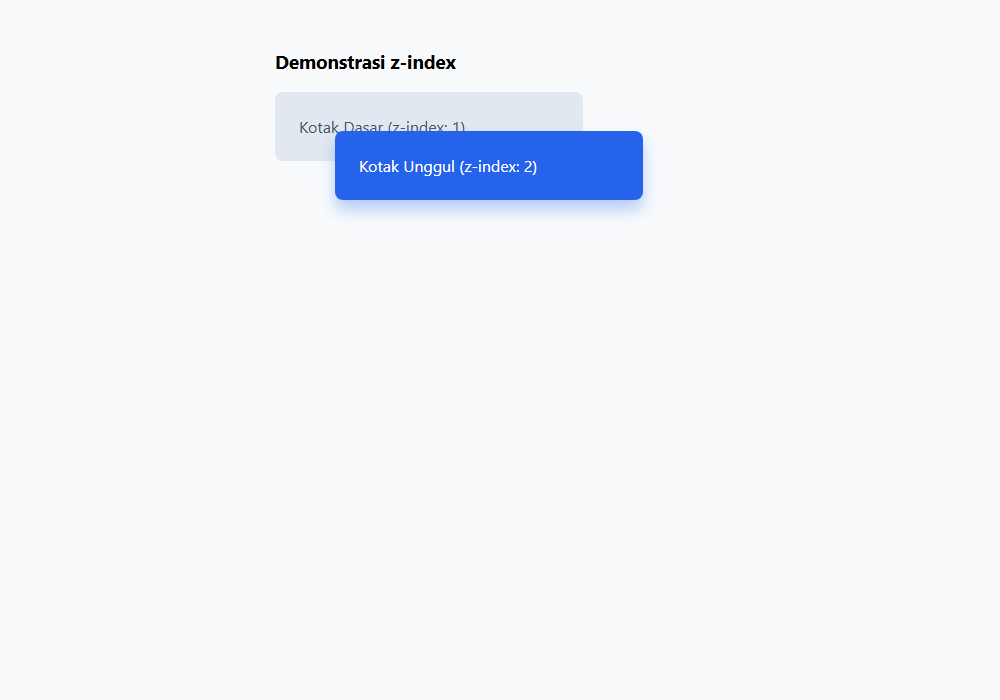

---

### 139. Stacking context

**Tujuan:** Memahami konsep Stacking Context dan mengapa z-index tinggi kadang kalah dari elemen lain.

**Konsep Utama:**
Stacking Context adalah pohon hierarki tumpukan 3D yang terisolasi. Elemen anak dengan z-index setinggi apa pun tidak akan pernah bisa melompat ke atas elemen di luar induknya jika induknya berada di stacking context yang lebih rendah.

**Penjelasan Source Code:**
Mendemonstrasikan isolasi stacking context menggunakan `opacity` atau `transform` pada induk.

**Source code utama:** [139_stacking_context.css](139_stacking_context.css)

**File pendukung preview:** [139_stacking_context.html](139_stacking_context.html)

**Cara Menjalankan:**
Buka file HTML pendukung di peramban web (Google Chrome, Microsoft Edge, atau Mozilla Firefox), atau gunakan Live Server / HTTP Server:

```bash
# Buka langsung file HTML di browser default
start "" "139_stacking_context.html"
```

**Hasil yang Diharapkan:**
Visualisasi dua pohon tumpukan terisolasi yang memperjelas aturan stacking context.

**Screenshot Hasil Eksekusi:**

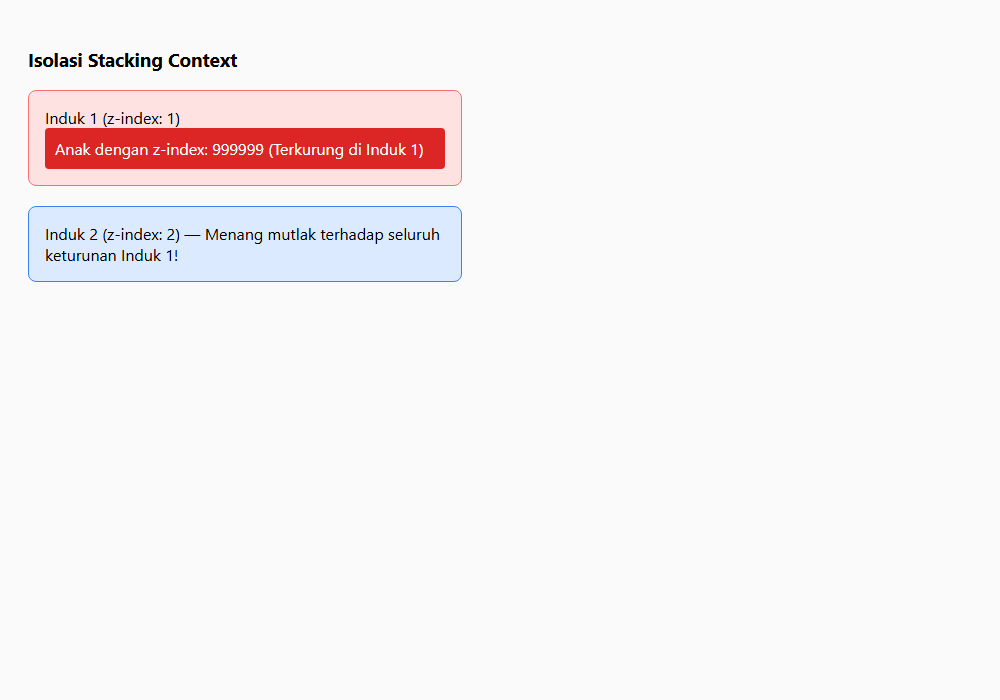

---

### 140. overflow: hidden

**Tujuan:** Menyembunyikan konten yang melampaui batas wadah dan membersihkan sudut border-radius.

**Konsep Utama:**
`overflow: hidden` memotong konten apa pun yang melebihi batas kotak elemen. Juga sangat penting dipasangkan pada kontainer dengan `border-radius` agar gambar anak di dalamnya tidak menusuk keluar sudut.

**Penjelasan Source Code:**
Membuat kartu dengan gambar tajam yang terpotong rapi mengikuti kelengkungan border-radius sudut.

**Source code utama:** [140_overflow_hidden.css](140_overflow_hidden.css)

**File pendukung preview:** [140_overflow_hidden.html](140_overflow_hidden.html)

**Cara Menjalankan:**
Buka file HTML pendukung di peramban web (Google Chrome, Microsoft Edge, atau Mozilla Firefox), atau gunakan Live Server / HTTP Server:

```bash
# Buka langsung file HTML di browser default
start "" "140_overflow_hidden.html"
```

**Hasil yang Diharapkan:**
Kotak bersudut melengkung yang memotong rapi seluruh elemen anak yang meluap.

**Screenshot Hasil Eksekusi:**

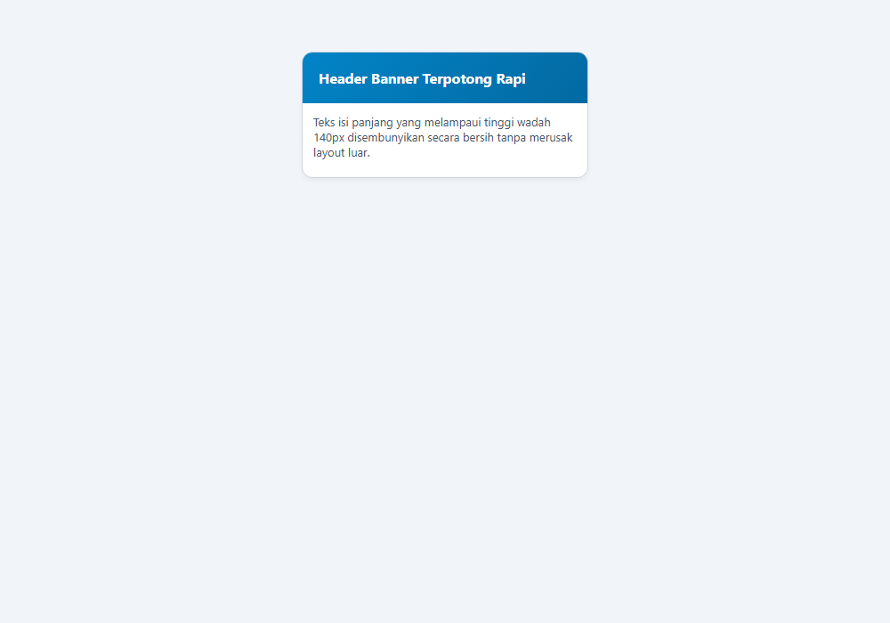

---

### 141. overflow: auto

**Tujuan:** Menampilkan scrollbar cerdas hanya jika konten melebihi kapasitas wadah menggunakan overflow: auto.

**Konsep Utama:**
`overflow: auto` adalah pendekatan paling aman: scrollbar hanya akan muncul bila konten memang meluap, dan tetap tersembunyi jika konten muat dengan sempurna.

**Penjelasan Source Code:**
Menata kotak daftar tugas dengan scrollbar otomatis saat daftar melampaui tinggi 130px.

**Source code utama:** [141_overflow_auto.css](141_overflow_auto.css)

**File pendukung preview:** [141_overflow_auto.html](141_overflow_auto.html)

**Cara Menjalankan:**
Buka file HTML pendukung di peramban web (Google Chrome, Microsoft Edge, atau Mozilla Firefox), atau gunakan Live Server / HTTP Server:

```bash
# Buka langsung file HTML di browser default
start "" "141_overflow_auto.html"
```

**Hasil yang Diharapkan:**
Kotak berpenampilan rapi dengan scrollbar halus saat isi teks bertambah banyak.

**Screenshot Hasil Eksekusi:**

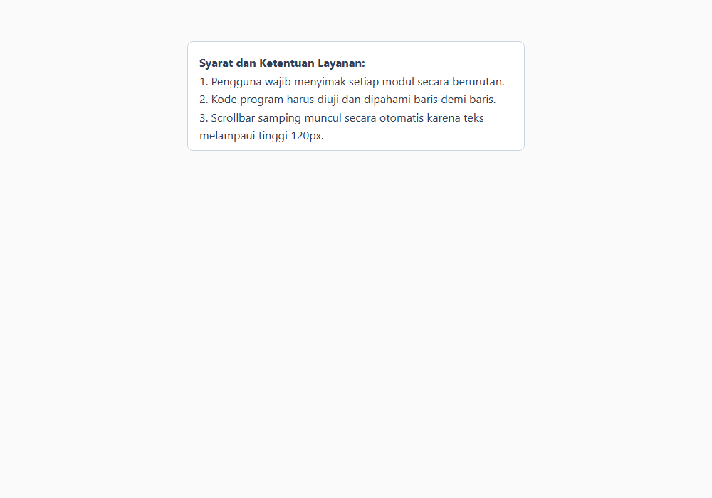

---

### 142. overflow: scroll

**Tujuan:** Memaksa keberadaan bilah scrollbar secara konsisten menggunakan overflow: scroll.

**Konsep Utama:**
`overflow: scroll` selalu menampilkan rel scrollbar permanen pada wadah elemen, terlepas dari apakah konten di dalamnya meluap atau tidak.

**Penjelasan Source Code:**
Mendemonstrasikan kotak dengan scrollbar yang selalu aktif.

**Source code utama:** [142_overflow_scroll.css](142_overflow_scroll.css)

**File pendukung preview:** [142_overflow_scroll.html](142_overflow_scroll.html)

**Cara Menjalankan:**
Buka file HTML pendukung di peramban web (Google Chrome, Microsoft Edge, atau Mozilla Firefox), atau gunakan Live Server / HTTP Server:

```bash
# Buka langsung file HTML di browser default
start "" "142_overflow_scroll.html"
```

**Hasil yang Diharapkan:**
Kotak dengan bilah scrollbar aktif di sisi kanan.

**Screenshot Hasil Eksekusi:**

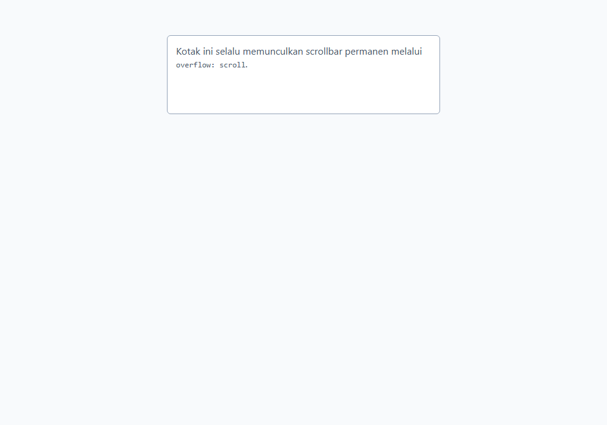

---

### 143. overflow-x dan overflow-y

**Tujuan:** Mengatur peluapan secara mandiri pada sumbu horizontal (overflow-x) dan vertikal (overflow-y).

**Konsep Utama:**
Sering kali kita ingin elemen dapat digeser ke samping (misal tabel lebar atau slider kartu) dengan `overflow-x: auto`, namun tidak mengizinkan scroll vertikal dengan `overflow-y: hidden`.

**Penjelasan Source Code:**
Membuat bilah tab navigasi geser horizontal tanpa scrollbar vertikal.

**Source code utama:** [143_overflow_x_y.css](143_overflow_x_y.css)

**File pendukung preview:** [143_overflow_x_y.html](143_overflow_x_y.html)

**Cara Menjalankan:**
Buka file HTML pendukung di peramban web (Google Chrome, Microsoft Edge, atau Mozilla Firefox), atau gunakan Live Server / HTTP Server:

```bash
# Buka langsung file HTML di browser default
start "" "143_overflow_x_y.html"
```

**Hasil yang Diharapkan:**
Deretan tombol filter yang dapat digeser secara horizontal dengan mulus.

**Screenshot Hasil Eksekusi:**

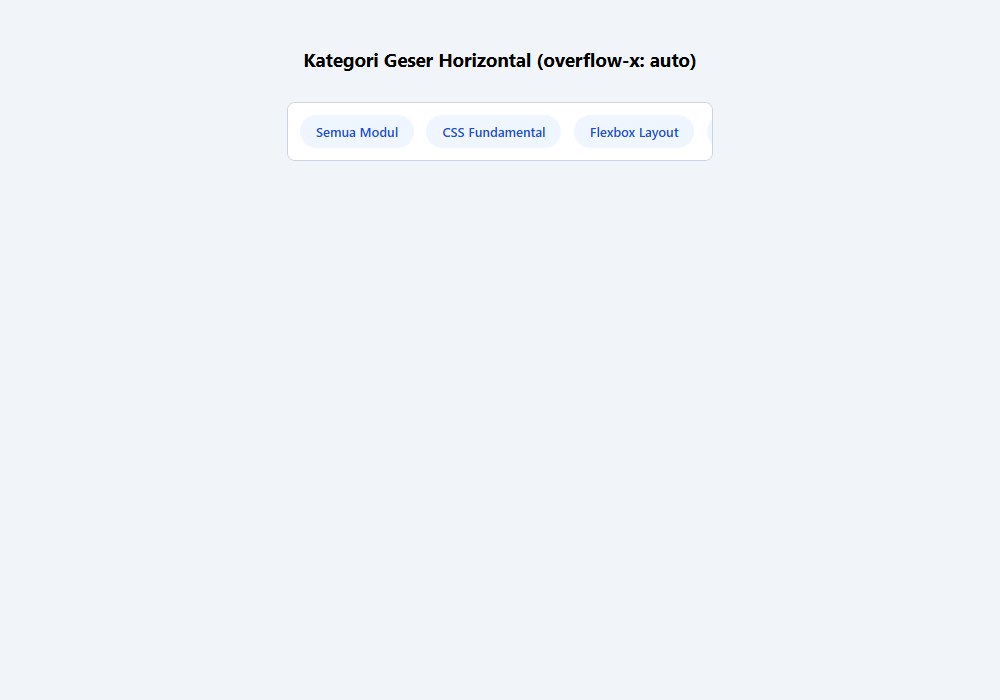

---

### 144. Properti object-fit

**Tujuan:** Menjaga proporsi gambar dan video agar tidak terdistorsi (cover, contain, fill).

**Konsep Utama:**
Properti `object-fit` menentukan bagaimana konten elemen yang digantikan (seperti `` atau `<video>`) menyesuaikan diri ke dalam kotak pembungkusnya: `cover` (menutup penuh tanpa gepeng), `contain` (tampil utuh), atau `fill` (distorsi).

**Penjelasan Source Code:**
Membuat thumbnail avatar dengan `object-fit: cover` untuk menjamin foto tidak peyot atau terdistorsi.

**Source code utama:** [144_object_fit.css](144_object_fit.css)

**File pendukung preview:** [144_object_fit.html](144_object_fit.html)

**Cara Menjalankan:**
Buka file HTML pendukung di peramban web (Google Chrome, Microsoft Edge, atau Mozilla Firefox), atau gunakan Live Server / HTTP Server:

```bash
# Buka langsung file HTML di browser default
start "" "144_object_fit.html"
```

**Hasil yang Diharapkan:**
Gambar SVG terpotong pas di dalam bingkai bujur sangkar tanpa kehilangan proporsi.

**Screenshot Hasil Eksekusi:**

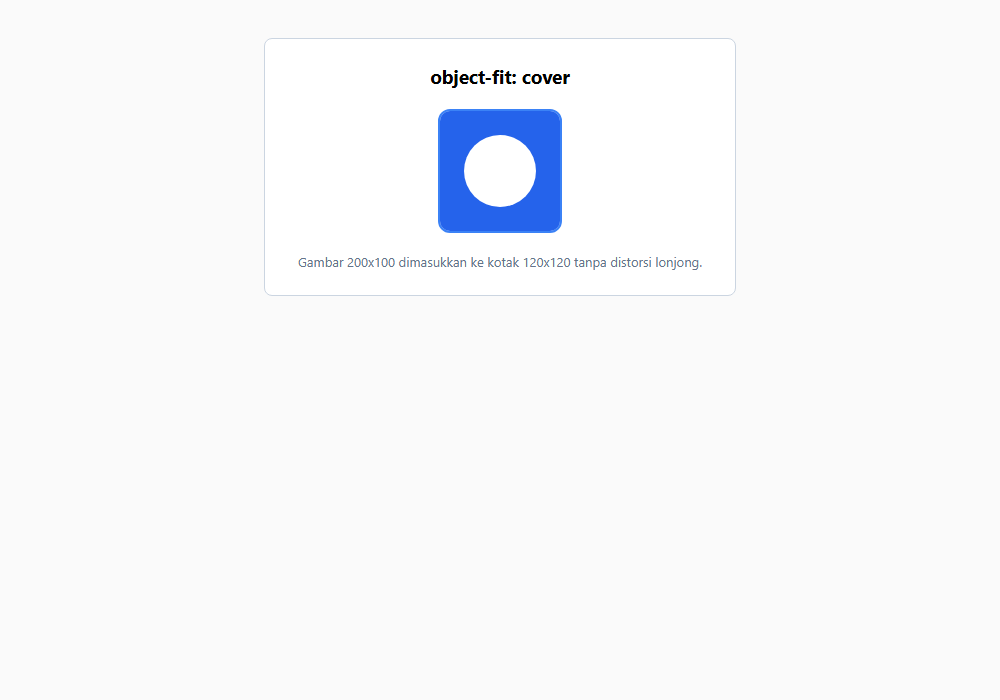

---

### 145. Properti object-position

**Tujuan:** Mengatur titik fokus pemangkasan gambar pada object-fit menggunakan object-position.

**Konsep Utama:**
Properti `object-position` berpadu dengan `object-fit` untuk menentukan bagian mana dari gambar yang harus diprioritaskan tetap terlihat (misal `center top` untuk mempertahankan wajah potret).

**Penjelasan Source Code:**
Mengarahkan fokus gambar ke bagian atas menggunakan `object-position: top center`.

**Source code utama:** [145_object_position.css](145_object_position.css)

**File pendukung preview:** [145_object_position.html](145_object_position.html)

**Cara Menjalankan:**
Buka file HTML pendukung di peramban web (Google Chrome, Microsoft Edge, atau Mozilla Firefox), atau gunakan Live Server / HTTP Server:

```bash
# Buka langsung file HTML di browser default
start "" "145_object_position.html"
```

**Hasil yang Diharapkan:**
Gambar banner yang memfokuskan pemotongan pada bagian atas objek gambar.

**Screenshot Hasil Eksekusi:**

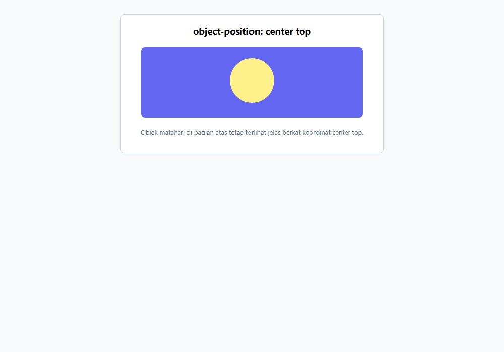

---

## Ringkasan Modul

Kombinasi sistem positioning, display, dan overflow adalah kunci dalam membangun komponen interaktif seperti modal dialog, sticky header, badge notifikasi mengambang, dan galeri gambar tanpa distorsi rasio.

### Keterkaitan Materi
Seluruh submodul dalam modul ini dirancang secara berjenjang untuk membangun pemahaman yang kokoh dan aplikatif. Lanjutkan ke modul berikutnya setelah menguasai seluruh konsep di atas.
