# Modul 09: Flexbox Layout

## Ringkasan Ruang Lingkup Materi

Modul ini membahas Flexible Box Layout Module (Flexbox) secara tuntas: konsep sumbu utama (main axis) dan sumbu silang (cross axis), aktivasi display: flex, arah aliran flex-direction (row, column, reverse), pembungkusan baris flex-wrap, shorthand flex-flow, perataan sumbu utama justify-content (start, center, end, space-between, space-around, space-evenly), perataan sumbu silang align-items dan align-content, penyesuaian individual align-self, tiga pilar dimensi item fleksibel (flex-grow, flex-shrink, flex-basis) dan shorthand flex, pengurutan visual dengan properti order, pengaturan spasi gap, hingga studi kasus nyata (navigasi responsif, card layout sama tinggi, pemusatan vertikal-horizontal sempurna, layout sidebar fleksibel, dan struktur tata letak adaptif).

## Tujuan Pembelajaran Modul

- Memahami arsitektur Flexbox berbasis sumbu utama (main axis) dan sumbu silang (cross axis).
- Mengontrol distribusi ruang dan perataan item dengan justify-content, align-items, dan align-content.
- Mengelola kelenturan item menggunakan rasio flex-grow, flex-shrink, dan flex-basis.
- Mengubah urutan visual item tanpa mengacak struktur semantik HTML menggunakan order.
- Menggunakan properti gap untuk memberi jarak antar-item secara bersih dan konsisten.
- Mengimplementasikan komponen nyata: navigasi, kartu sama tinggi, dan layout admin dengan sidebar.

## Daftar Submodul

- [146. Pengenalan Flexbox](146_flexbox_basic.css) — [Halaman Preview](146_flexbox_basic.html)
- [147. display: flex](147_display_flex.css) — [Halaman Preview](147_display_flex.html)
- [148. Properti flex-direction](148_flex_direction.css) — [Halaman Preview](148_flex_direction.html)
- [149. Properti flex-wrap](149_flex_wrap.css) — [Halaman Preview](149_flex_wrap.html)
- [150. Shorthand flex-flow](150_flex_flow.css) — [Halaman Preview](150_flex_flow.html)
- [151. Properti justify-content](151_justify_content.css) — [Halaman Preview](151_justify_content.html)
- [152. Properti align-items](152_align_items.css) — [Halaman Preview](152_align_items.html)
- [153. Properti align-content](153_align_content.css) — [Halaman Preview](153_align_content.html)
- [154. Properti align-self](154_align_self.css) — [Halaman Preview](154_align_self.html)
- [155. Properti flex-grow](155_flex_grow.css) — [Halaman Preview](155_flex_grow.html)
- [156. Properti flex-shrink](156_flex_shrink.css) — [Halaman Preview](156_flex_shrink.html)
- [157. Properti flex-basis](157_flex_basis.css) — [Halaman Preview](157_flex_basis.html)
- [158. Shorthand flex](158_flex_shorthand.css) — [Halaman Preview](158_flex_shorthand.html)
- [159. Properti order](159_order_property.css) — [Halaman Preview](159_order_property.html)
- [160. Gap pada Flexbox](160_gap_flexbox.css) — [Halaman Preview](160_gap_flexbox.html)
- [161. Navigasi dengan Flexbox](161_flexbox_navigation.css) — [Halaman Preview](161_flexbox_navigation.html)
- [162. Card layout dengan Flexbox](162_flexbox_cards.css) — [Halaman Preview](162_flexbox_cards.html)
- [163. Pemusatan elemen dengan Flexbox](163_flexbox_centering.css) — [Halaman Preview](163_flexbox_centering.html)
- [164. Sidebar dengan Flexbox](164_flexbox_sidebar.css) — [Halaman Preview](164_flexbox_sidebar.html)
- [165. Responsive layout dengan Flexbox](165_flexbox_responsive_layout.css) — [Halaman Preview](165_flexbox_responsive_layout.html)

---

## Pembahasan dan Penjelasan Submodul

### 146. Pengenalan Flexbox

**Tujuan:** Memahami konsep Flexible Box Layout sebagai solusi tata letak 1-dimensi.

**Konsep Utama:**
Flexbox didesain untuk menyusun, menyejajarkan, dan mendistribusikan ruang di antara item-item dalam satu wadah kontainer, bahkan ketika ukuran item tidak diketahui atau dinamis.

**Penjelasan Source Code:**
Mengubah kontainer biasa menjadi flex container dan melihat bagaimana elemen anak otomatis berjejer sejajar horizontal.

**Source code utama:** [146_flexbox_basic.css](146_flexbox_basic.css)

**File pendukung preview:** [146_flexbox_basic.html](146_flexbox_basic.html)

**Cara Menjalankan:**
Buka file HTML pendukung di peramban web (Google Chrome, Microsoft Edge, atau Mozilla Firefox), atau gunakan Live Server / HTTP Server:

```bash
# Buka langsung file HTML di browser default
start "" "146_flexbox_basic.html"
```

**Hasil yang Diharapkan:**
Tiga kotak item yang otomatis berbaris rapi secara horizontal dalam satu wadah.

**Screenshot Hasil Eksekusi:**

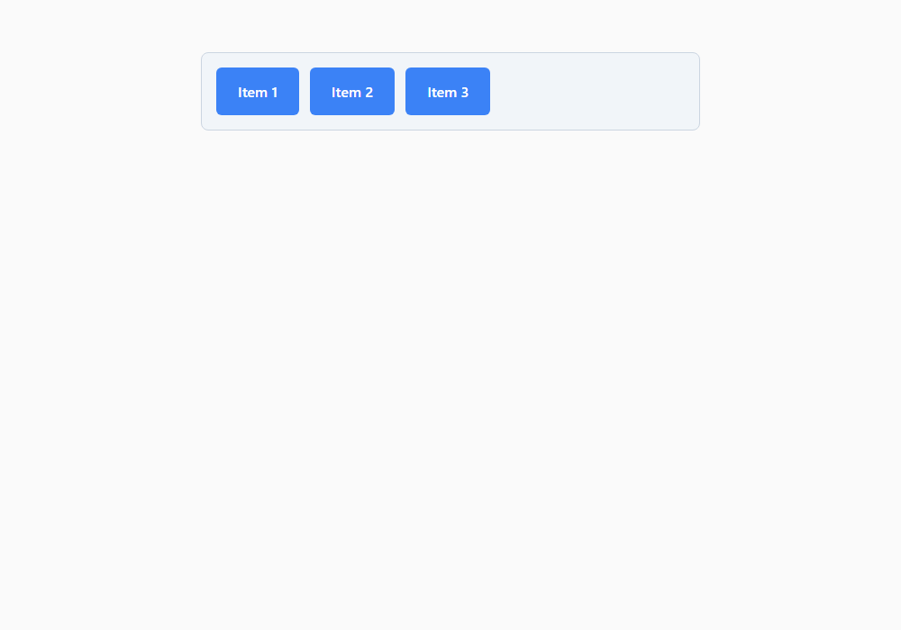

---

### 147. display: flex

**Tujuan:** Mengaktifkan mode flex pada elemen induk dan mengamati transformasi perilaku elemen anaknya.

**Konsep Utama:**
Menerapkan `display: flex` mengubah elemen menjadi flex container tingkat blok. Seluruh elemen anak langsungnya (direct children) otomatis menjadi flex items dengan tinggi yang seragam secara default.

**Penjelasan Source Code:**
Menampilkan 3 item dengan isi teks berbeda panjangnya namun otomatis memiliki tinggi kartu yang sama berkat sifat bawaan flex.

**Source code utama:** [147_display_flex.css](147_display_flex.css)

**File pendukung preview:** [147_display_flex.html](147_display_flex.html)

**Cara Menjalankan:**
Buka file HTML pendukung di peramban web (Google Chrome, Microsoft Edge, atau Mozilla Firefox), atau gunakan Live Server / HTTP Server:

```bash
# Buka langsung file HTML di browser default
start "" "147_display_flex.html"
```

**Hasil yang Diharapkan:**
Tiga kartu bertingkat yang tingginya otomatis sama rata secara mulus.

**Screenshot Hasil Eksekusi:**

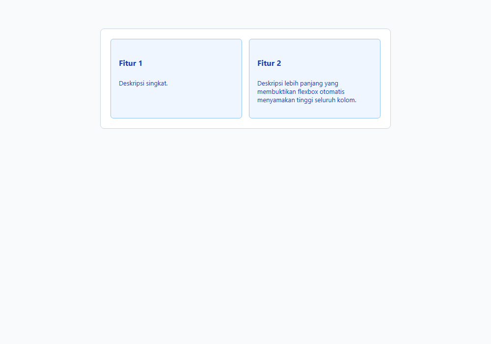

---

### 148. Properti flex-direction

**Tujuan:** Menentukan arah orientasi sumbu utama: row, row-reverse, column, column-reverse.

**Konsep Utama:**
Properti `flex-direction` menetapkan sumbu utama (main axis): `row` (horizontal kiri ke kanan - default), `column` (vertikal atas ke bawah), serta varian `reverse` yang membalik arah urutan.

**Penjelasan Source Code:**
Mengatur `flex-direction: column` untuk menyusun item secara vertikal dalam tata letak kartu profil.

**Source code utama:** [148_flex_direction.css](148_flex_direction.css)

**File pendukung preview:** [148_flex_direction.html](148_flex_direction.html)

**Cara Menjalankan:**
Buka file HTML pendukung di peramban web (Google Chrome, Microsoft Edge, atau Mozilla Firefox), atau gunakan Live Server / HTTP Server:

```bash
# Buka langsung file HTML di browser default
start "" "148_flex_direction.html"
```

**Hasil yang Diharapkan:**
Susunan vertikal elemen bertingkat yang teratur rapi dari atas ke bawah.

**Screenshot Hasil Eksekusi:**

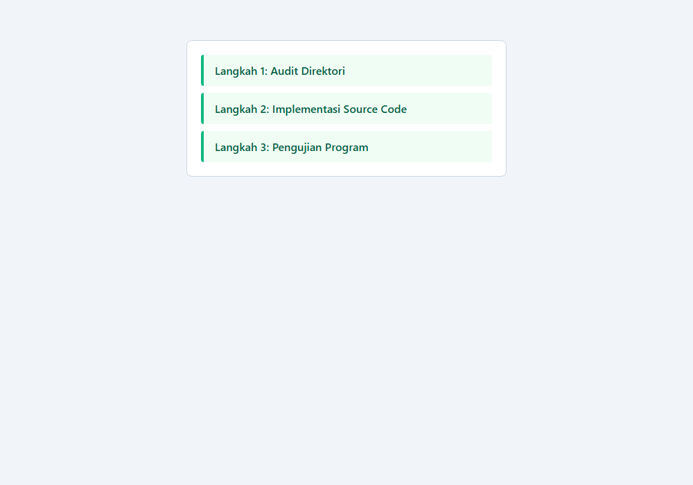

---

### 149. Properti flex-wrap

**Tujuan:** Mengizinkan item pindah ke baris baru ketika ruang kontainer habis (wrap vs nowrap).

**Konsep Utama:**
Secara default `flex-wrap: nowrap` memaksa semua item berada di satu baris walau harus menyusut. Memberikan `flex-wrap: wrap` mengizinkan item yang tidak muat untuk turun rapi ke baris berikutnya.

**Penjelasan Source Code:**
Membuat kumpulan tag filter yang otomatis membungkus (wrap) ke baris kedua ketika ruang horizontal penuh.

**Source code utama:** [149_flex_wrap.css](149_flex_wrap.css)

**File pendukung preview:** [149_flex_wrap.html](149_flex_wrap.html)

**Cara Menjalankan:**
Buka file HTML pendukung di peramban web (Google Chrome, Microsoft Edge, atau Mozilla Firefox), atau gunakan Live Server / HTTP Server:

```bash
# Buka langsung file HTML di browser default
start "" "149_flex_wrap.html"
```

**Hasil yang Diharapkan:**
Koleksi lencana tag yang mengalir rapi dalam beberapa baris bertingkat.

**Screenshot Hasil Eksekusi:**

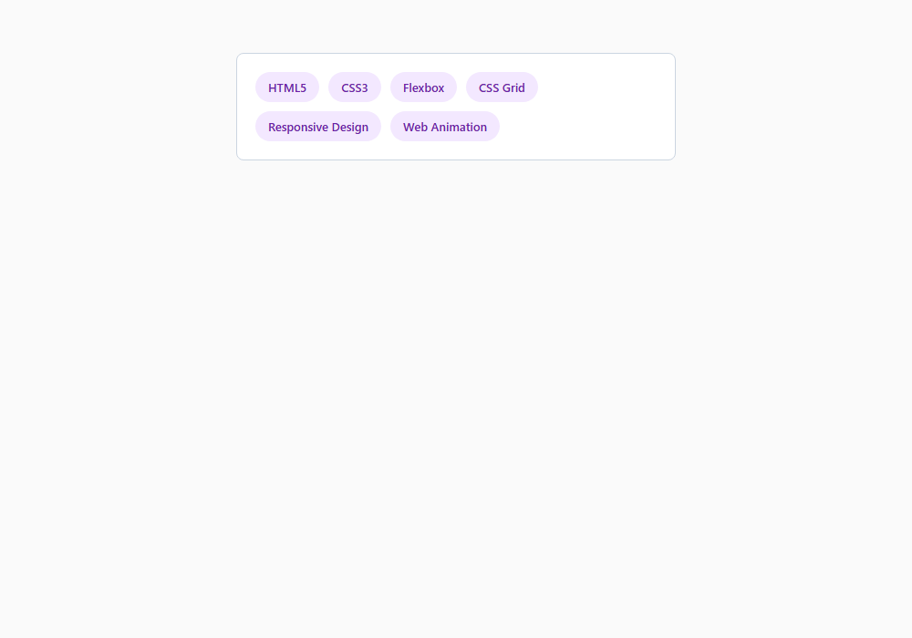

---

### 150. Shorthand flex-flow

**Tujuan:** Menggabungkan flex-direction dan flex-wrap dalam satu baris deklarasi flex-flow.

**Konsep Utama:**
Shorthand `flex-flow: [flex-direction] [flex-wrap]` memungkinkan penulisan ringkas, misalnya `flex-flow: row wrap` atau `flex-flow: column nowrap`.

**Penjelasan Source Code:**
Menerapkan `flex-flow: row wrap` pada galeri kartu mini.

**Source code utama:** [150_flex_flow.css](150_flex_flow.css)

**File pendukung preview:** [150_flex_flow.html](150_flex_flow.html)

**Cara Menjalankan:**
Buka file HTML pendukung di peramban web (Google Chrome, Microsoft Edge, atau Mozilla Firefox), atau gunakan Live Server / HTTP Server:

```bash
# Buka langsung file HTML di browser default
start "" "150_flex_flow.html"
```

**Hasil yang Diharapkan:**
Grid kartu mini fleksibel yang berjejer ke samping dan membungkus ke bawah.

**Screenshot Hasil Eksekusi:**

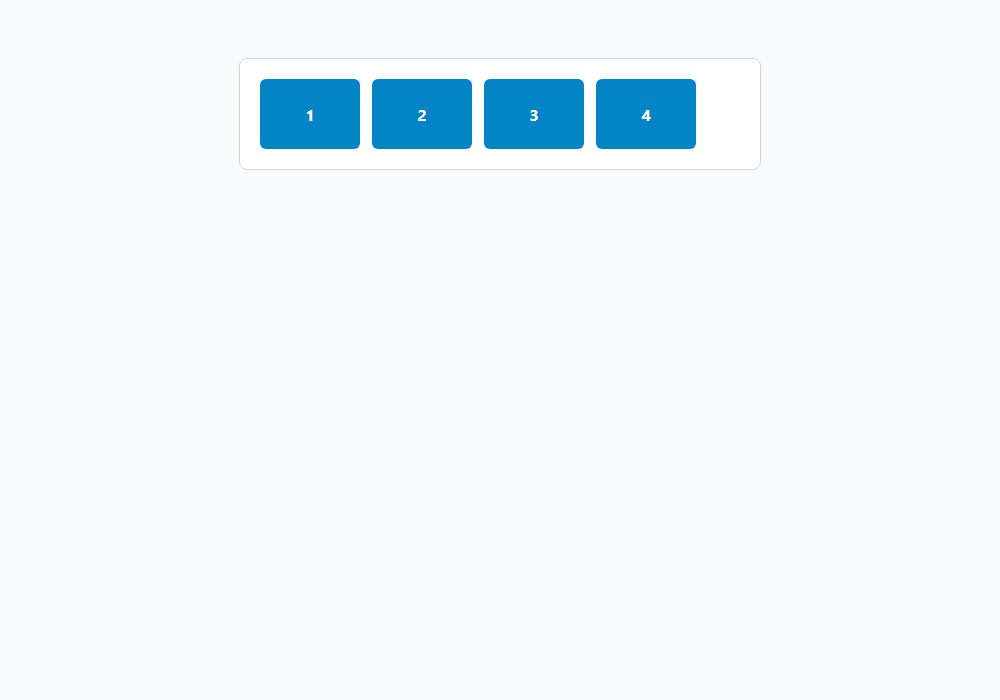

---

### 151. Properti justify-content

**Tujuan:** Mendistribusikan ruang kosong di sepanjang sumbu utama (start, center, end, space-between, space-around, space-evenly).

**Konsep Utama:**
Properti `justify-content` mengontrol posisi dan jarak item pada sumbu utama: `flex-start`, `center`, `flex-end`, `space-between` (item pertama dan terakhir menempel di ujung), `space-around`, dan `space-evenly` (jarak antar-item dan tepi sama persis).

**Penjelasan Source Code:**
Mendemonstrasikan bilah navigasi dengan `justify-content: space-between`.

**Source code utama:** [151_justify_content.css](151_justify_content.css)

**File pendukung preview:** [151_justify_content.html](151_justify_content.html)

**Cara Menjalankan:**
Buka file HTML pendukung di peramban web (Google Chrome, Microsoft Edge, atau Mozilla Firefox), atau gunakan Live Server / HTTP Server:

```bash
# Buka langsung file HTML di browser default
start "" "151_justify_content.html"
```

**Hasil yang Diharapkan:**
Bilah navigasi di mana logo berada di paling kiri dan menu berada di paling kanan.

**Screenshot Hasil Eksekusi:**

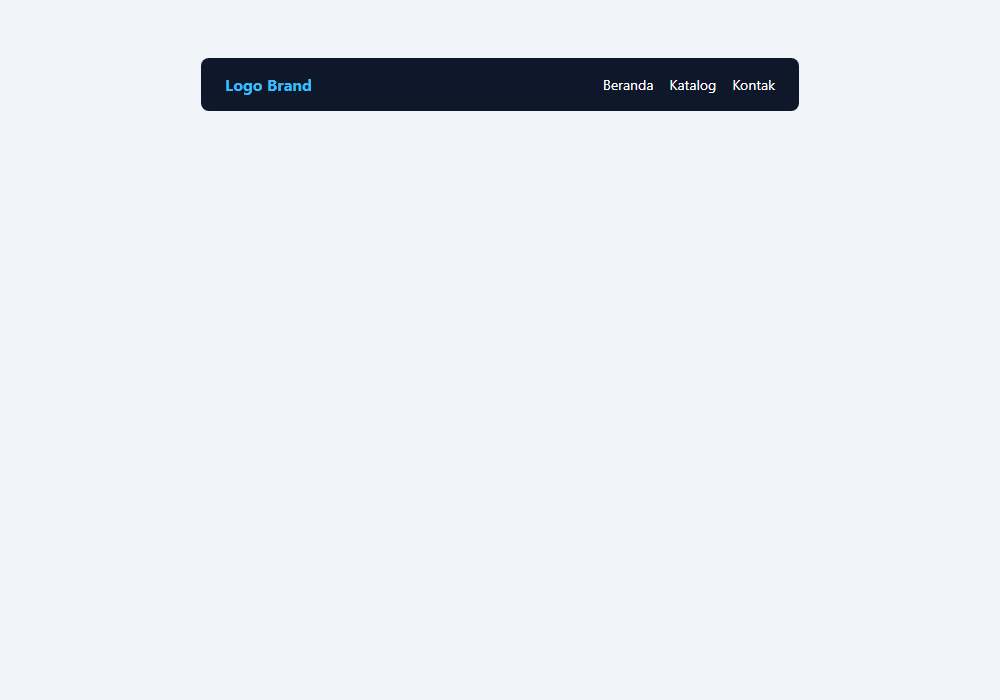

---

### 152. Properti align-items

**Tujuan:** Menyejajarkan item pada sumbu silang (cross-axis): stretch, flex-start, center, flex-end, baseline.

**Konsep Utama:**
Properti `align-items` mengatur perataan item pada sumbu silang (vertikal jika flex-direction: row): `stretch` (default: meregang penuh), `center` (tengah vertikal), `flex-start` (atas), `flex-end` (bawah), `baseline` (sejajar garis dasar huruf teks).

**Penjelasan Source Code:**
Membuat baris notifikasi dengan ikon dan teks yang sejajar tepat di tengah vertikal dengan `align-items: center`.

**Source code utama:** [152_align_items.css](152_align_items.css)

**File pendukung preview:** [152_align_items.html](152_align_items.html)

**Cara Menjalankan:**
Buka file HTML pendukung di peramban web (Google Chrome, Microsoft Edge, atau Mozilla Firefox), atau gunakan Live Server / HTTP Server:

```bash
# Buka langsung file HTML di browser default
start "" "152_align_items.html"
```

**Hasil yang Diharapkan:**
Ikon lingkaran dan pesan teks berderet lurus di tengah sumbu vertikal.

**Screenshot Hasil Eksekusi:**

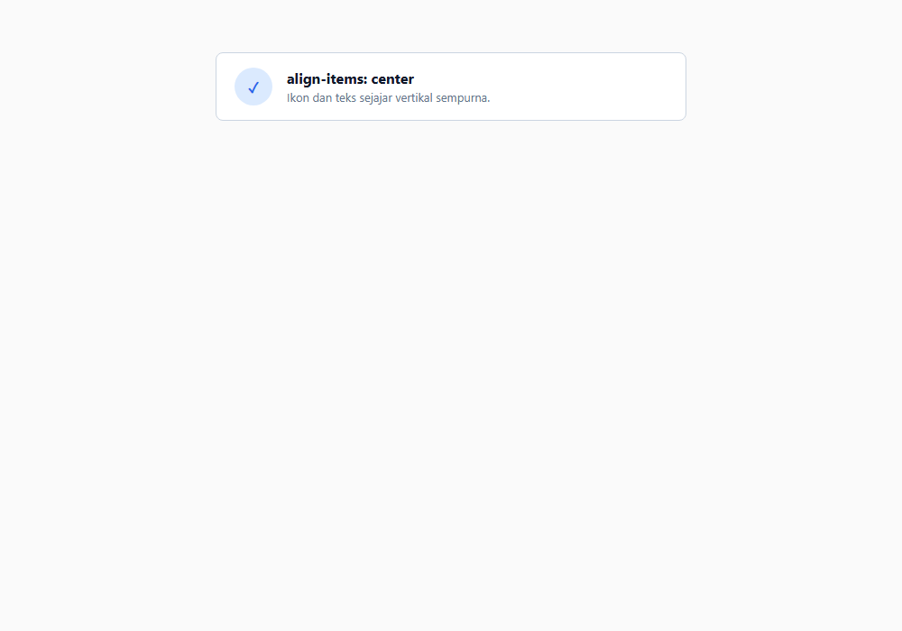

---

### 153. Properti align-content

**Tujuan:** Mendistribusikan ruang kosong di antara baris-baris multi-line flex container.

**Konsep Utama:**
Properti `align-content` HANYA berlaku jika flex container memiliki multi-baris (`flex-wrap: wrap`) dan ada sisa ruang pada sumbu silang. Mengontrol distribusi baris: `center`, `space-between`, `space-around`, dll.

**Penjelasan Source Code:**
Mendistribusikan 2 baris item yang dibungkus dengan `align-content: space-between` dalam wadah berketinggian 200px.

**Source code utama:** [153_align_content.css](153_align_content.css)

**File pendukung preview:** [153_align_content.html](153_align_content.html)

**Cara Menjalankan:**
Buka file HTML pendukung di peramban web (Google Chrome, Microsoft Edge, atau Mozilla Firefox), atau gunakan Live Server / HTTP Server:

```bash
# Buka langsung file HTML di browser default
start "" "153_align_content.html"
```

**Hasil yang Diharapkan:**
Dua baris kartu yang terpisah rapi menempel di tepi atas dan tepi bawah wadah.

**Screenshot Hasil Eksekusi:**

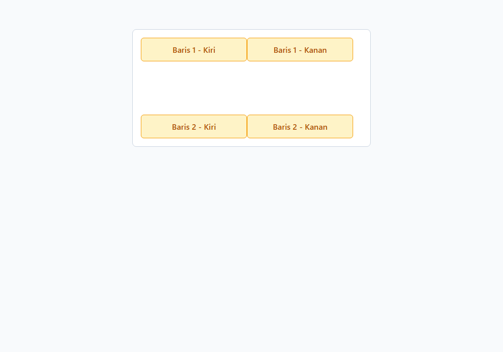

---

### 154. Properti align-self

**Tujuan:** Mengesampingkan nilai align-items untuk satu item flex individual.

**Konsep Utama:**
Properti `align-self` diterapkan pada flex item tertentu untuk menimpa aturan `align-items` yang ditetapkan oleh induk kontainer.

**Penjelasan Source Code:**
Semua item sejajar di atas (flex-start), namun item ketiga memiliki `align-self: flex-end` menempel di bawah.

**Source code utama:** [154_align_self.css](154_align_self.css)

**File pendukung preview:** [154_align_self.html](154_align_self.html)

**Cara Menjalankan:**
Buka file HTML pendukung di peramban web (Google Chrome, Microsoft Edge, atau Mozilla Firefox), atau gunakan Live Server / HTTP Server:

```bash
# Buka langsung file HTML di browser default
start "" "154_align_self.html"
```

**Hasil yang Diharapkan:**
Dua item berada di bagian atas dan satu item khusus berada di sudut bawah.

**Screenshot Hasil Eksekusi:**

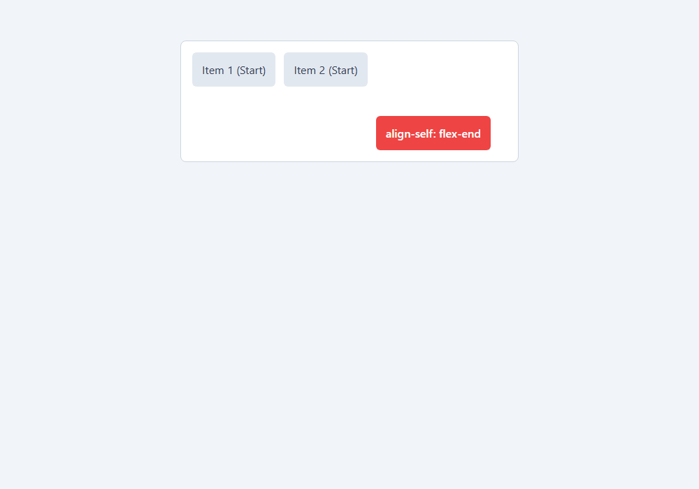

---

### 155. Properti flex-grow

**Tujuan:** Menentukan proporsi peregangan item untuk menyerap sisa ruang kosong kontainer.

**Konsep Utama:**
Properti `flex-grow` menerima angka rasio pertumbuhan (default 0: tidak membesar). Item dengan `flex-grow: 2` akan menyerap ruang kosong dua kali lebih banyak daripada item dengan `flex-grow: 1`.

**Penjelasan Source Code:**
Formulir pencarian di mana input teks memiliki `flex-grow: 1` (menyerap semua sisa ruang) dan tombol tetap dengan ukuran aslinya.

**Source code utama:** [155_flex_grow.css](155_flex_grow.css)

**File pendukung preview:** [155_flex_grow.html](155_flex_grow.html)

**Cara Menjalankan:**
Buka file HTML pendukung di peramban web (Google Chrome, Microsoft Edge, atau Mozilla Firefox), atau gunakan Live Server / HTTP Server:

```bash
# Buka langsung file HTML di browser default
start "" "155_flex_grow.html"
```

**Hasil yang Diharapkan:**
Bilah pencarian responsif di mana kotak input meregang otomatis mengisi ruang horizontal.

**Screenshot Hasil Eksekusi:**

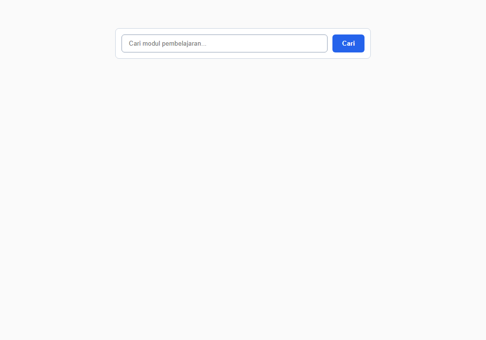

---

### 156. Properti flex-shrink

**Tujuan:** Menentukan proporsi penyusutan item saat ruang kontainer menyempit (mencegah overflow).

**Konsep Utama:**
Properti `flex-shrink` menentukan seberapa rela sebuah item menyusut saat total lebar item melebihi wadah. Menetapkan `flex-shrink: 0` mencegah elemen mengecil (misal avatar profil tidak boleh gepeng).

**Penjelasan Source Code:**
Avatar dengan `flex-shrink: 0` tetap berukuran bulat sempurna saat teks di sampingnya menyusut.

**Source code utama:** [156_flex_shrink.css](156_flex_shrink.css)

**File pendukung preview:** [156_flex_shrink.html](156_flex_shrink.html)

**Cara Menjalankan:**
Buka file HTML pendukung di peramban web (Google Chrome, Microsoft Edge, atau Mozilla Firefox), atau gunakan Live Server / HTTP Server:

```bash
# Buka langsung file HTML di browser default
start "" "156_flex_shrink.html"
```

**Hasil yang Diharapkan:**
Kotak avatar bulat yang kokoh dan tidak menyusut meskipun layar mengecil.

**Screenshot Hasil Eksekusi:**

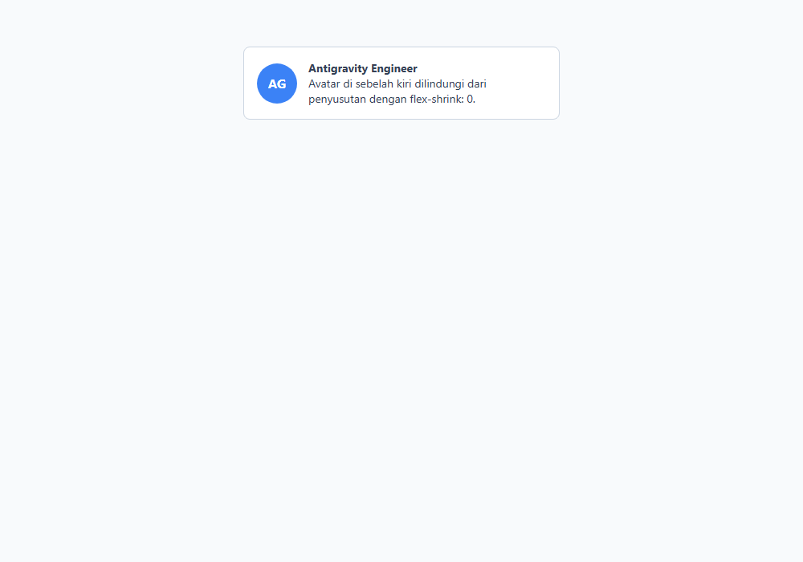

---

### 157. Properti flex-basis

**Tujuan:** Menetapkan ukuran dasar awal item sebelum sisa ruang didistribusikan oleh grow/shrink.

**Konsep Utama:**
Properti `flex-basis` menentukan ukuran awal (lebar pada row, tinggi pada column) sebuah flex item sebelum algoritma `flex-grow` atau `flex-shrink` bekerja.

**Penjelasan Source Code:**
Mengatur `flex-basis: 180px` pada kolom sidebar dan `flex-basis: 0` pada kolom konten utama.

**Source code utama:** [157_flex_basis.css](157_flex_basis.css)

**File pendukung preview:** [157_flex_basis.html](157_flex_basis.html)

**Cara Menjalankan:**
Buka file HTML pendukung di peramban web (Google Chrome, Microsoft Edge, atau Mozilla Firefox), atau gunakan Live Server / HTTP Server:

```bash
# Buka langsung file HTML di browser default
start "" "157_flex_basis.html"
```

**Hasil yang Diharapkan:**
Struktur dua kolom dengan kolom kiri memiliki lebar dasar 160px yang pasti.

**Screenshot Hasil Eksekusi:**

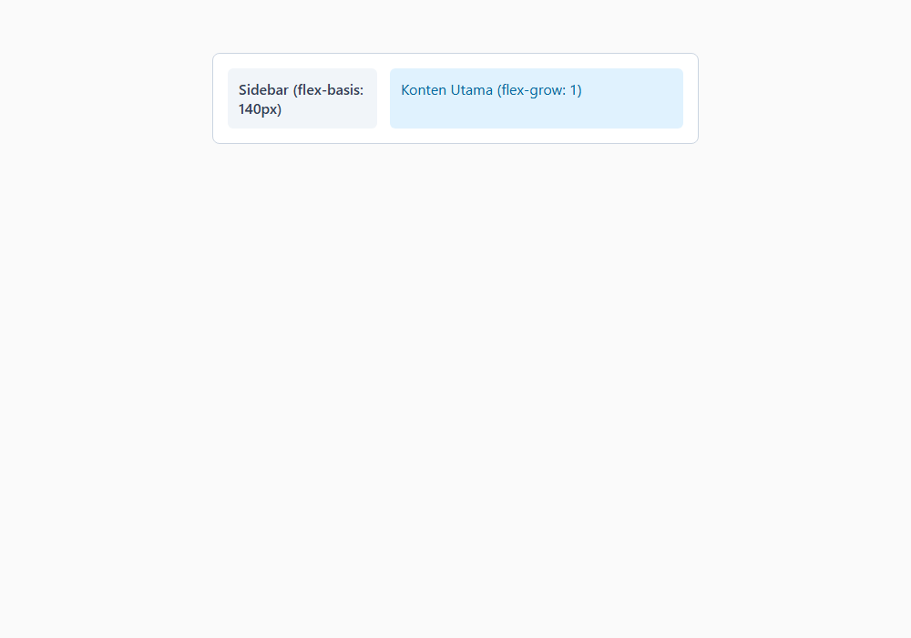

---

### 158. Shorthand flex

**Tujuan:** Menuliskan flex-grow, flex-shrink, dan flex-basis dalam shorthand flex yang direkomendasikan.

**Konsep Utama:**
Shorthand `flex: [grow] [shrink] [basis]`. Praktik standar: `flex: 1` setara `flex: 1 1 0%` (fleksibel penuh), sedangkan `flex: auto` setara `flex: 1 1 auto`.

**Penjelasan Source Code:**
Mendemonstrasikan 3 kartu kolom yang berbagi ruang 1:2:1 menggunakan shorthand `flex`.

**Source code utama:** [158_flex_shorthand.css](158_flex_shorthand.css)

**File pendukung preview:** [158_flex_shorthand.html](158_flex_shorthand.html)

**Cara Menjalankan:**
Buka file HTML pendukung di peramban web (Google Chrome, Microsoft Edge, atau Mozilla Firefox), atau gunakan Live Server / HTTP Server:

```bash
# Buka langsung file HTML di browser default
start "" "158_flex_shorthand.html"
```

**Hasil yang Diharapkan:**
Tiga kolom di mana kolom tengah otomatis memiliki lebar dua kali lipat kolom samping.

**Screenshot Hasil Eksekusi:**

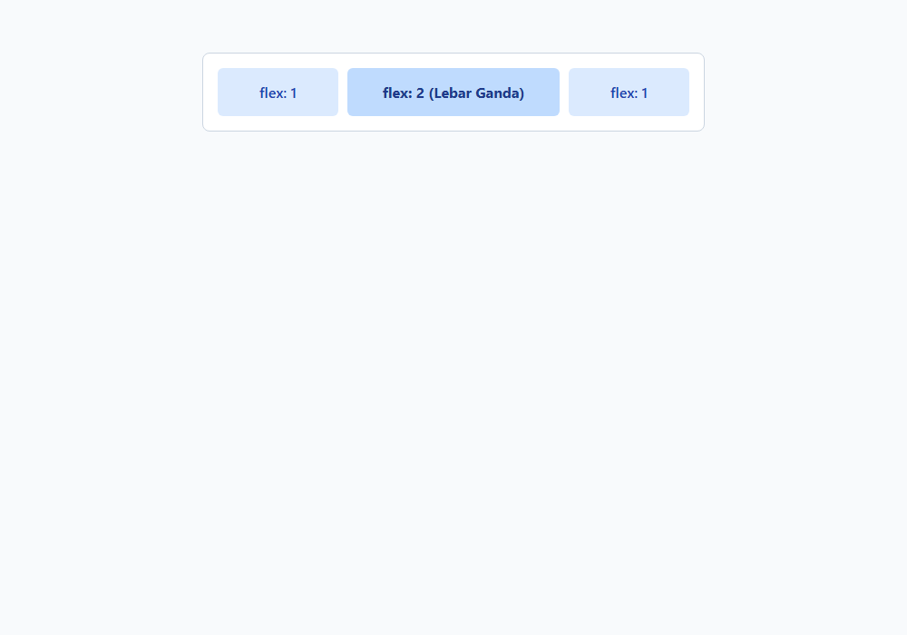

---

### 159. Properti order

**Tujuan:** Mengubah urutan tampilan visual flex item tanpa memodifikasi struktur HTML.

**Konsep Utama:**
Properti `order` menerima nilai angka bulat (default: 0). Item dengan nilai order lebih kecil akan dirender terlebih dahulu, memungkinkan pembalikan urutan visual tanpa merusak semantik HTML.

**Penjelasan Source Code:**
Memindahkan item terakhir di HTML menjadi urutan pertama secara visual dengan `order: -1`.

**Source code utama:** [159_order_property.css](159_order_property.css)

**File pendukung preview:** [159_order_property.html](159_order_property.html)

**Cara Menjalankan:**
Buka file HTML pendukung di peramban web (Google Chrome, Microsoft Edge, atau Mozilla Firefox), atau gunakan Live Server / HTTP Server:

```bash
# Buka langsung file HTML di browser default
start "" "159_order_property.html"
```

**Hasil yang Diharapkan:**
Kotak bertanda 'Item Terakhir di HTML' tampil di posisi paling kiri depan.

**Screenshot Hasil Eksekusi:**

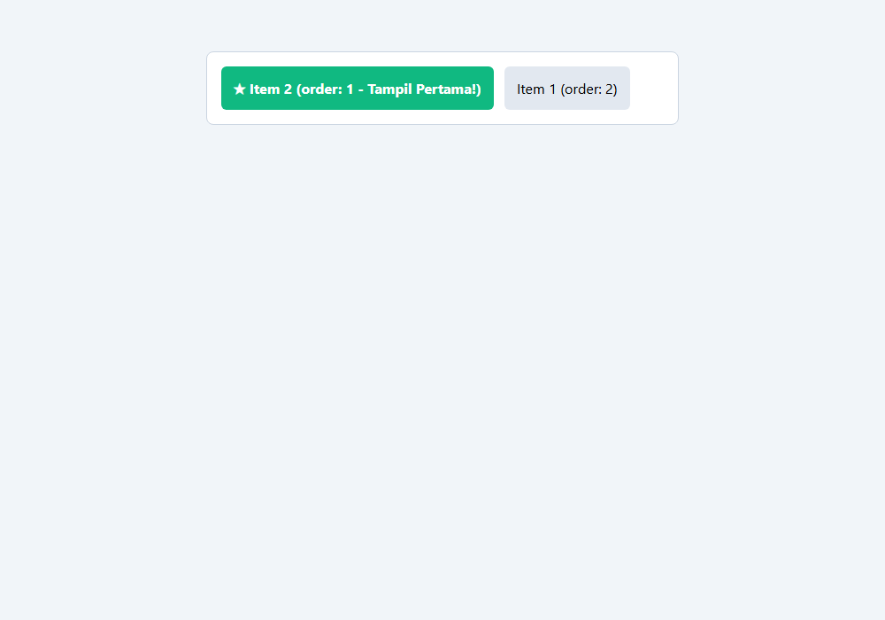

---

### 160. Gap pada Flexbox

**Tujuan:** Memberikan jarak celah bersih antar-item flex tanpa margin hack.

**Konsep Utama:**
Properti `gap` (atau `row-gap` dan `column-gap`) mengatur jarak antar item di dalam flex container tanpa menyisakan margin ekstra di tepi terluar kontainer.

**Penjelasan Source Code:**
Menerapkan `gap: 18px` pada deretan 3 tombol aksi.

**Source code utama:** [160_gap_flexbox.css](160_gap_flexbox.css)

**File pendukung preview:** [160_gap_flexbox.html](160_gap_flexbox.html)

**Cara Menjalankan:**
Buka file HTML pendukung di peramban web (Google Chrome, Microsoft Edge, atau Mozilla Firefox), atau gunakan Live Server / HTTP Server:

```bash
# Buka langsung file HTML di browser default
start "" "160_gap_flexbox.html"
```

**Hasil yang Diharapkan:**
Tiga tombol berjarak seragam tanpa margin luar yang merusak tata letak tepi.

**Screenshot Hasil Eksekusi:**

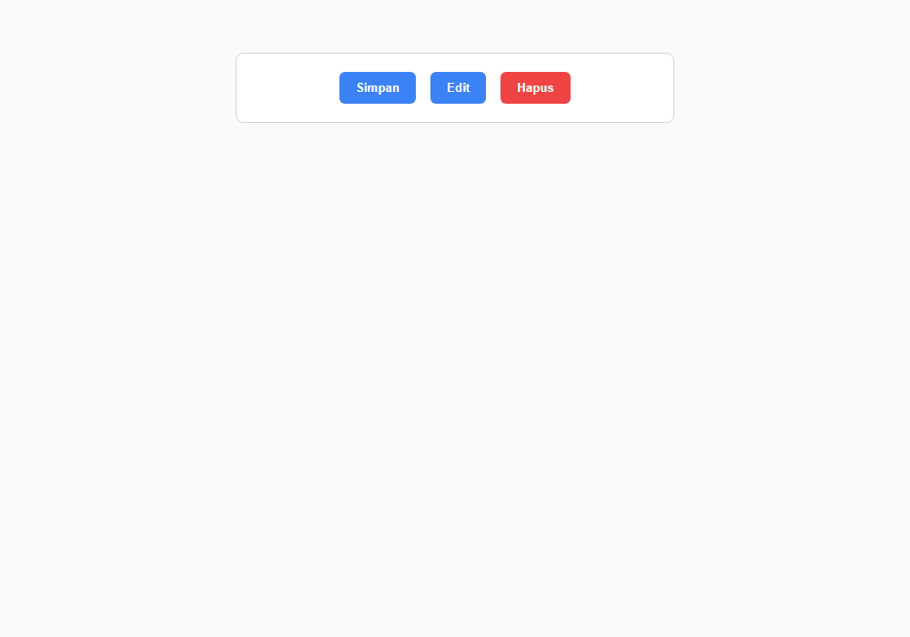

---

### 161. Navigasi dengan Flexbox

**Tujuan:** Membangun komponen navigasi situs web yang responsif dan terpusat dengan Flexbox.

**Konsep Utama:**
Flexbox adalah standar emas untuk bilah navigasi (navbar): logo di kiri, menu di tengah atau kanan, dan tombol CTA yang tersusun rapi.

**Penjelasan Source Code:**
Membuat navbar lengkap dengan brand di kiri, tautan menu di tengah, dan tombol login di kanan.

**Source code utama:** [161_flexbox_navigation.css](161_flexbox_navigation.css)

**File pendukung preview:** [161_flexbox_navigation.html](161_flexbox_navigation.html)

**Cara Menjalankan:**
Buka file HTML pendukung di peramban web (Google Chrome, Microsoft Edge, atau Mozilla Firefox), atau gunakan Live Server / HTTP Server:

```bash
# Buka langsung file HTML di browser default
start "" "161_flexbox_navigation.html"
```

**Hasil yang Diharapkan:**
Bilah navigasi modern berlatar gelap yang tertata proporsional.

**Screenshot Hasil Eksekusi:**

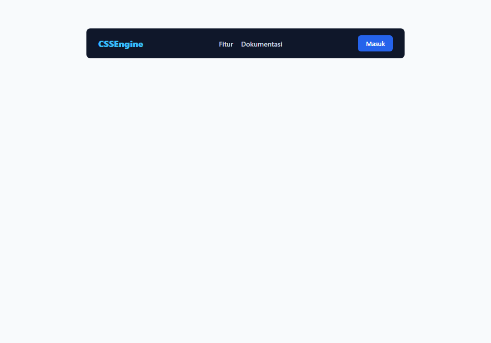

---

### 162. Card layout dengan Flexbox

**Tujuan:** Menyusun grid kartu sama tinggi dengan tombol yang selalu menempel di bagian bawah kartu.

**Konsep Utama:**
Di dalam kartu yang berposisi `display: flex; flex-direction: column;`, memberikan `margin-top: auto` pada tombol akan mendorong tombol selalu ke dasar kartu, menciptakan keselarasan vertikal antar-kartu.

**Penjelasan Source Code:**
Menampilkan dua kartu harga yang tombol belinya selalu sejajar di dasar kartu.

**Source code utama:** [162_flexbox_cards.css](162_flexbox_cards.css)

**File pendukung preview:** [162_flexbox_cards.html](162_flexbox_cards.html)

**Cara Menjalankan:**
Buka file HTML pendukung di peramban web (Google Chrome, Microsoft Edge, atau Mozilla Firefox), atau gunakan Live Server / HTTP Server:

```bash
# Buka langsung file HTML di browser default
start "" "162_flexbox_cards.html"
```

**Hasil yang Diharapkan:**
Dua kartu penawaran harga sama tinggi dengan tombol beli yang sejajar rata di bagian bawah.

**Screenshot Hasil Eksekusi:**

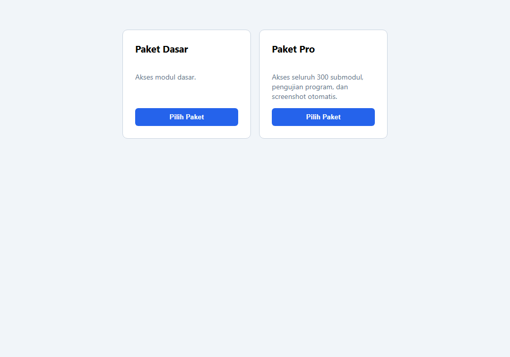

---

### 163. Pemusatan elemen dengan Flexbox

**Tujuan:** Menyelesaikan masalah pemusatan vertikal dan horizontal sempurna dalam dua baris kode.

**Konsep Utama:**
Solusi pamungkas pemusatan di CSS: berikan `display: flex; justify-content: center; align-items: center;` pada induk kontainer, maka elemen anak akan berada tepat di titik tengah horizontal dan vertikal.

**Penjelasan Source Code:**
Membuat kotak kartu modal yang berpusat sempurna di dalam bingkai kontainer.

**Source code utama:** [163_flexbox_centering.css](163_flexbox_centering.css)

**File pendukung preview:** [163_flexbox_centering.html](163_flexbox_centering.html)

**Cara Menjalankan:**
Buka file HTML pendukung di peramban web (Google Chrome, Microsoft Edge, atau Mozilla Firefox), atau gunakan Live Server / HTTP Server:

```bash
# Buka langsung file HTML di browser default
start "" "163_flexbox_centering.html"
```

**Hasil yang Diharapkan:**
Kotak putih yang bertengger tepat di titik tengah horizontal dan vertikal sebuah kontainer biru.

**Screenshot Hasil Eksekusi:**

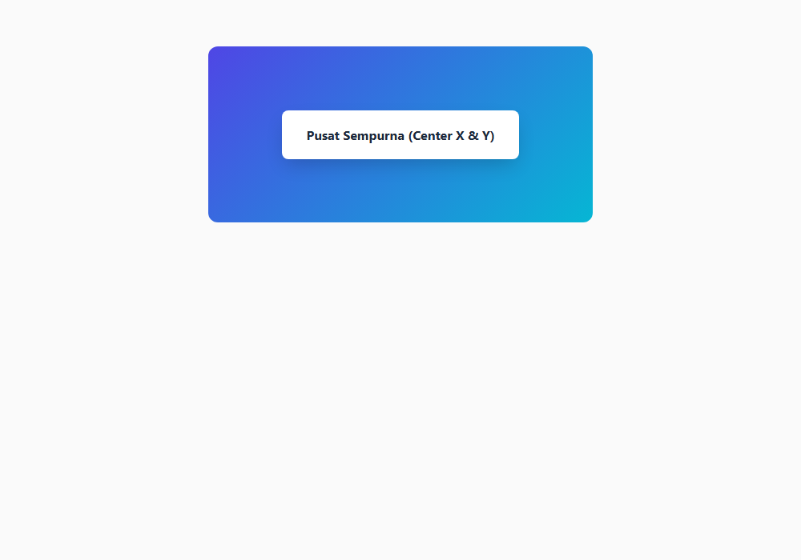

---

### 164. Sidebar dengan Flexbox

**Tujuan:** Membangun layout dashboard aplikasi dengan sidebar lebar tetap dan konten utama fleksibel.

**Konsep Utama:**
Pola layout sidebar klasik: sidebar diberi ukuran tetap dengan `flex: 0 0 180px`, sedangkan konten utama diberi `flex: 1` untuk memenuhi seluruh sisa layar.

**Penjelasan Source Code:**
Membangun kerangka dashboard admin dengan bilah menu samping dan panel data.

**Source code utama:** [164_flexbox_sidebar.css](164_flexbox_sidebar.css)

**File pendukung preview:** [164_flexbox_sidebar.html](164_flexbox_sidebar.html)

**Cara Menjalankan:**
Buka file HTML pendukung di peramban web (Google Chrome, Microsoft Edge, atau Mozilla Firefox), atau gunakan Live Server / HTTP Server:

```bash
# Buka langsung file HTML di browser default
start "" "164_flexbox_sidebar.html"
```

**Hasil yang Diharapkan:**
Layout dua kolom dashboard yang rapi dengan sidebar abu-abu dan konten utama putih.

**Screenshot Hasil Eksekusi:**

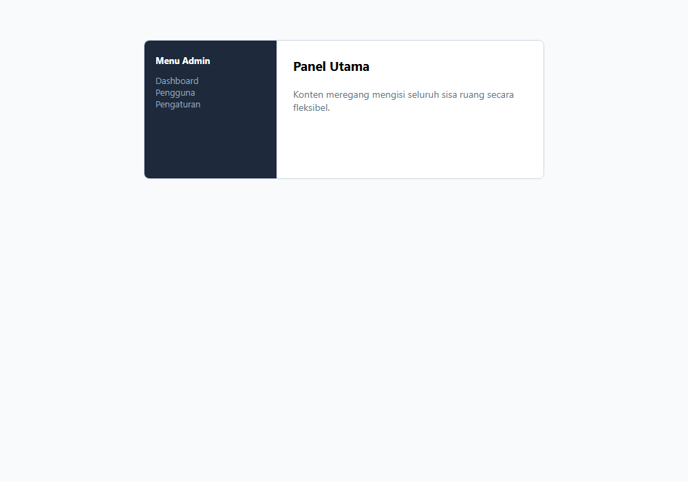

---

### 165. Responsive layout dengan Flexbox

**Tujuan:** Mengubah tata letak horizontal di desktop menjadi vertikal di layar ponsel menggunakan media queries.

**Konsep Utama:**
Di layar lebar, kontainer berjalan dalam `flex-direction: row`. Pada breakpoint layar sempit, kita cukup mengubahnya menjadi `flex-direction: column` agar item bertumpuk vertikal dengan ramah sentuhan.

**Penjelasan Source Code:**
Mendemonstrasikan komponen responsif flex yang siap beradaptasi di ponsel dan desktop.

**Source code utama:** [165_flexbox_responsive_layout.css](165_flexbox_responsive_layout.css)

**File pendukung preview:** [165_flexbox_responsive_layout.html](165_flexbox_responsive_layout.html)

**Cara Menjalankan:**
Buka file HTML pendukung di peramban web (Google Chrome, Microsoft Edge, atau Mozilla Firefox), atau gunakan Live Server / HTTP Server:

```bash
# Buka langsung file HTML di browser default
start "" "165_flexbox_responsive_layout.html"
```

**Hasil yang Diharapkan:**
Struktur layout 3 kolom yang fleksibel dan siap beradaptasi di berbagai resolusi layar.

**Screenshot Hasil Eksekusi:**

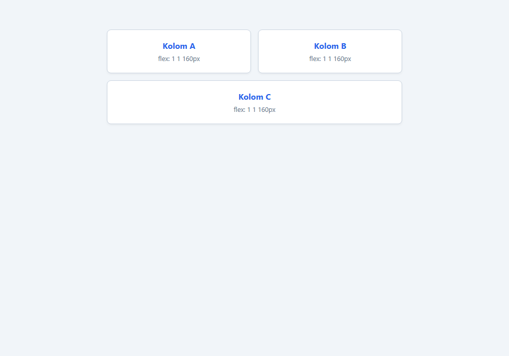

---

## Ringkasan Modul

Flexbox adalah standar de facto dalam pembuatan tata letak 1-dimensi modern pada antarmuka web. Dengan menyelesaikan Modul 9, pembelajar mampu merancang komponen UI yang fleksibel, adaptif terhadap berbagai resolusi layar, serta menyelesaikan masalah klasik pemusatan vertikal secara instan.

### Keterkaitan Materi
Seluruh submodul dalam modul ini dirancang secara berjenjang untuk membangun pemahaman yang kokoh dan aplikatif. Lanjutkan ke modul berikutnya setelah menguasai seluruh konsep di atas.
