# Modul 12: Pseudo-class dan Pseudo-element

## Ringkasan Ruang Lingkup Materi

Modul ini membedah selector mutakhir pseudo-class (kondisi/status elemen) dan pseudo-element (bagian virtual dari elemen): status interaksi dinamis (:hover, :active, :focus, aksesibilitas :focus-visible, dan pembungkus form :focus-within), posisi struktural hierarki DOM (:first-child, :last-child, rumus matematis :nth-child(An+B), :nth-of-type, :first-of-type, :last-of-type), pseudo-class fungsional modern (pengecualian :not(), pengelompokan toleran :is(), pembebas bobot specificity :where(), dan revolusi parent selector :has()), status formulir (:checked, :disabled, :enabled), serta injeksi konten virtual dekoratif menggunakan pseudo-element (::before, ::after dengan properti content) dan kustomisasi ::marker bullet, ::selection seleksi teks, serta teks petunjuk input ::placeholder.

## Tujuan Pembelajaran Modul

- Membedakan fungsi pseudo-class (titik dua tunggal :) untuk status dan pseudo-element (titik dua ganda ::) untuk sub-bagian.
- Mengelola seluruh status interaksi pengguna (hover, active, focus, focus-visible).
- Menyeleksi elemen struktural berdasarkan rumus ganjil-genap dan urutan (nth-child, nth-of-type).
- Menggunakan :is(), :where(), dan parent selector mutakhir :has() untuk seleksi CSS generasi baru.
- Menyisipkan ikon dan elemen dekoratif tanpa mengotori markup HTML menggunakan ::before dan ::after.
- Mengkustomisasi seleksi teks (::selection), teks placeholder form (::placeholder), dan bullet list (::marker).

## Daftar Submodul

- [206. Pseudo-class :hover](206_hover_pseudo_class.css) — [Halaman Preview](206_hover_pseudo_class.html)
- [207. Pseudo-class :active](207_active_pseudo_class.css) — [Halaman Preview](207_active_pseudo_class.html)
- [208. Pseudo-class :focus](208_focus_pseudo_class.css) — [Halaman Preview](208_focus_pseudo_class.html)
- [209. Pseudo-class :focus-visible](209_focus_visible.css) — [Halaman Preview](209_focus_visible.html)
- [210. Pseudo-class :focus-within](210_focus_within.css) — [Halaman Preview](210_focus_within.html)
- [211. Pseudo-class :first-child](211_first_child.css) — [Halaman Preview](211_first_child.html)
- [212. Pseudo-class :last-child](212_last_child.css) — [Halaman Preview](212_last_child.html)
- [213. Pseudo-class :nth-child()](213_nth_child.css) — [Halaman Preview](213_nth_child.html)
- [214. Pseudo-class :nth-of-type()](214_nth_of_type.css) — [Halaman Preview](214_nth_of_type.html)
- [215. Pseudo-class :first-of-type](215_first_of_type.css) — [Halaman Preview](215_first_of_type.html)
- [216. Pseudo-class :last-of-type](216_last_of_type.css) — [Halaman Preview](216_last_of_type.html)
- [217. Pseudo-class :not()](217_not_pseudo_class.css) — [Halaman Preview](217_not_pseudo_class.html)
- [218. Pseudo-class :is()](218_is_pseudo_class.css) — [Halaman Preview](218_is_pseudo_class.html)
- [219. Pseudo-class :where()](219_where_pseudo_class.css) — [Halaman Preview](219_where_pseudo_class.html)
- [220. Pseudo-class :has()](220_has_pseudo_class.css) — [Halaman Preview](220_has_pseudo_class.html)
- [221. Pseudo-class :checked](221_checked_pseudo_class.css) — [Halaman Preview](221_checked_pseudo_class.html)
- [222. Pseudo-class :disabled dan :enabled](222_disabled_enabled.css) — [Halaman Preview](222_disabled_enabled.html)
- [223. Pseudo-element ::before](223_before_pseudo_element.css) — [Halaman Preview](223_before_pseudo_element.html)
- [224. Pseudo-element ::after](224_after_pseudo_element.css) — [Halaman Preview](224_after_pseudo_element.html)
- [225. ::marker, ::selection, dan ::placeholder](225_marker_selection_placeholder.css) — [Halaman Preview](225_marker_selection_placeholder.html)

---

## Pembahasan dan Penjelasan Submodul

### 206. Pseudo-class :hover

**Tujuan:** Menerapkan gaya visual interaktif ketika kursor pengguna melayang di atas elemen (:hover).

**Konsep Utama:**
Pseudo-class `:hover` aktif saat pengguna menempatkan kursor di atas elemen. Merupakan indikator affordance visual paling universal di web.

**Penjelasan Source Code:**
Mengubah warna latar tombol dan memberikan bayangan elevasi saat disentuh kursor.

**Source code utama:** [206_hover_pseudo_class.css](206_hover_pseudo_class.css)

**File pendukung preview:** [206_hover_pseudo_class.html](206_hover_pseudo_class.html)

**Cara Menjalankan:**
Buka file HTML pendukung di peramban web (Google Chrome, Microsoft Edge, atau Mozilla Firefox), atau gunakan Live Server / HTTP Server:

```bash
# Buka langsung file HTML di browser default
start "" "206_hover_pseudo_class.html"
```

**Hasil yang Diharapkan:**
Tombol aksi dengan interaksi hover biru gelap dan transisi halus.

**Screenshot Hasil Eksekusi:**

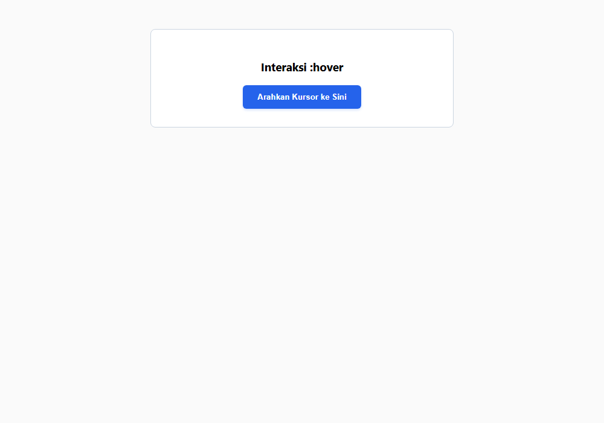

---

### 207. Pseudo-class :active

**Tujuan:** Memberikan umpan balik visual saat tombol sedang ditekan atau diklik (:active).

**Konsep Utama:**
Pseudo-class `:active` aktif dalam sepersekian detik ketika elemen sedang ditekan (antara mouse down dan mouse up), memberikan sensasi tombol fisik yang tenggelam.

**Penjelasan Source Code:**
Menurunkan posisi tombol sejauh 1px dan menggelapkan warnanya saat diklik aktif.

**Source code utama:** [207_active_pseudo_class.css](207_active_pseudo_class.css)

**File pendukung preview:** [207_active_pseudo_class.html](207_active_pseudo_class.html)

**Cara Menjalankan:**
Buka file HTML pendukung di peramban web (Google Chrome, Microsoft Edge, atau Mozilla Firefox), atau gunakan Live Server / HTTP Server:

```bash
# Buka langsung file HTML di browser default
start "" "207_active_pseudo_class.html"
```

**Hasil yang Diharapkan:**
Tombol yang memberikan sensasi tertekan secara taktil saat diklik.

**Screenshot Hasil Eksekusi:**

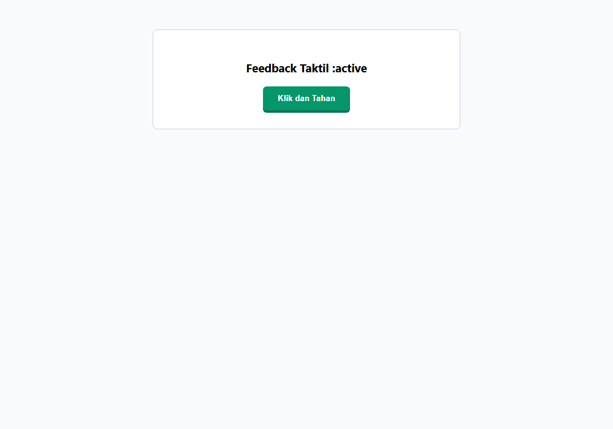

---

### 208. Pseudo-class :focus

**Tujuan:** Menandai elemen formulir atau tautan yang sedang menerima fokus input pengguna (:focus).

**Konsep Utama:**
Pseudo-class `:focus` aktif saat pengguna mengklik atau berpindah ke elemen input menggunakan tombol Tab pada keyboard, sangat vital untuk aksesibilitas navigasi.

**Penjelasan Source Code:**
Memberikan cincin bercahaya biru terang saat input sedang dalam kondisi fokus.

**Source code utama:** [208_focus_pseudo_class.css](208_focus_pseudo_class.css)

**File pendukung preview:** [208_focus_pseudo_class.html](208_focus_pseudo_class.html)

**Cara Menjalankan:**
Buka file HTML pendukung di peramban web (Google Chrome, Microsoft Edge, atau Mozilla Firefox), atau gunakan Live Server / HTTP Server:

```bash
# Buka langsung file HTML di browser default
start "" "208_focus_pseudo_class.html"
```

**Hasil yang Diharapkan:**
Input form dengan highlight border biru tebal saat aktif menerima ketikan.

**Screenshot Hasil Eksekusi:**

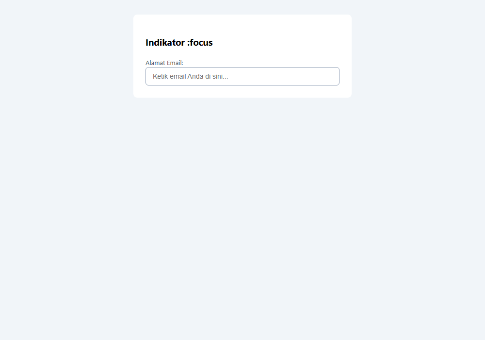

---

### 209. Pseudo-class :focus-visible

**Tujuan:** Menampilkan cincin fokus aksesibilitas HANYA saat navigasi keyboard tanpa mengganggu klik mouse biasa.

**Konsep Utama:**
Pseudo-class `:focus-visible` secara cerdas membedakan navigasi: hanya memunculkan outline fokus saat pengguna menggunakan keyboard (Tab), dan menyembunyikannya saat pengguna mengklik dengan mouse.

**Penjelasan Source Code:**
Mengatur outline tebal yang hanya muncul saat tombol difokuskan melalui papan ketik keyboard.

**Source code utama:** [209_focus_visible.css](209_focus_visible.css)

**File pendukung preview:** [209_focus_visible.html](209_focus_visible.html)

**Cara Menjalankan:**
Buka file HTML pendukung di peramban web (Google Chrome, Microsoft Edge, atau Mozilla Firefox), atau gunakan Live Server / HTTP Server:

```bash
# Buka langsung file HTML di browser default
start "" "209_focus_visible.html"
```

**Hasil yang Diharapkan:**
Tombol yang mematuhi standar aksesibilitas keyboard tanpa merusak estetika klik mouse.

**Screenshot Hasil Eksekusi:**

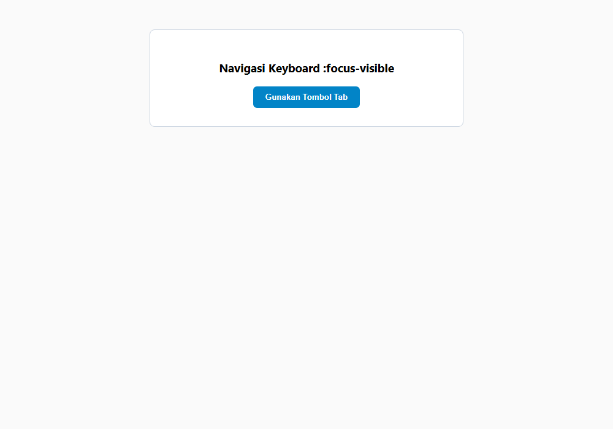

---

### 210. Pseudo-class :focus-within

**Tujuan:** Menata wadah induk ketika salah satu elemen anaknya sedang menerima fokus (:focus-within).

**Konsep Utama:**
Pseudo-class `:focus-within` aktif pada elemen induk ketika elemen tersebut ATAU salah satu anak di dalamnya menerima fokus, sangat efektif untuk menyorot seluruh kotak form atau baris tabel.

**Penjelasan Source Code:**
Memberikan border biru pada seluruh kartu wadah form saat input di dalamnya sedang diketik.

**Source code utama:** [210_focus_within.css](210_focus_within.css)

**File pendukung preview:** [210_focus_within.html](210_focus_within.html)

**Cara Menjalankan:**
Buka file HTML pendukung di peramban web (Google Chrome, Microsoft Edge, atau Mozilla Firefox), atau gunakan Live Server / HTTP Server:

```bash
# Buka langsung file HTML di browser default
start "" "210_focus_within.html"
```

**Hasil yang Diharapkan:**
Seluruh kotak formulir menyala biru saat ada input di dalamnya yang aktif.

**Screenshot Hasil Eksekusi:**

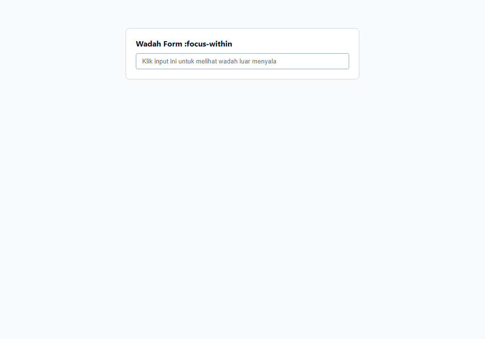

---

### 211. Pseudo-class :first-child

**Tujuan:** Menargetkan elemen yang posisinya persis sebagai anak pertama di dalam induknya.

**Konsep Utama:**
Pseudo-class `:first-child` mencocokkan elemen yang merupakan anak pertama mutlak dari induknya.

**Penjelasan Source Code:**
Menghilangkan border atas pada item pertama dalam daftar agar tidak menduplikasi border wadah.

**Source code utama:** [211_first_child.css](211_first_child.css)

**File pendukung preview:** [211_first_child.html](211_first_child.html)

**Cara Menjalankan:**
Buka file HTML pendukung di peramban web (Google Chrome, Microsoft Edge, atau Mozilla Firefox), atau gunakan Live Server / HTTP Server:

```bash
# Buka langsung file HTML di browser default
start "" "211_first_child.html"
```

**Hasil yang Diharapkan:**
Daftar list di mana item paling atas memiliki gaya header khusus.

**Screenshot Hasil Eksekusi:**

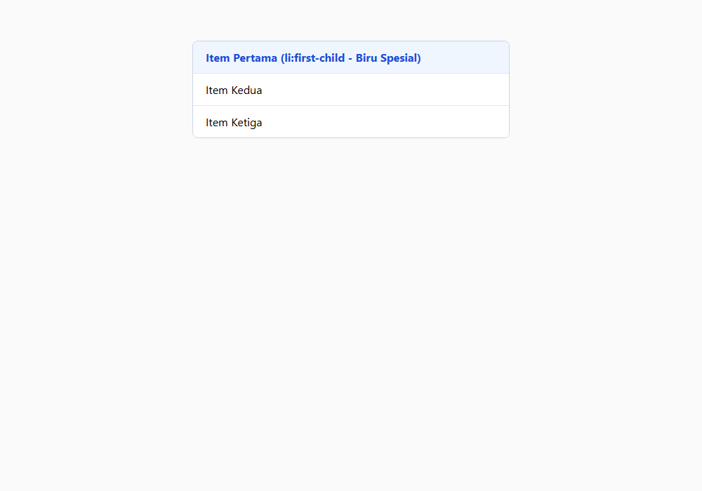

---

### 212. Pseudo-class :last-child

**Tujuan:** Menargetkan elemen yang posisinya persis sebagai anak terakhir di dalam induknya.

**Konsep Utama:**
Pseudo-class `:last-child` mencocokkan elemen yang merupakan anak terakhir mutlak dari induknya, sangat umum untuk menghilangkan margin bawah pada paragraf penutup.

**Penjelasan Source Code:**
Menata item terakhir dengan warna hijau kesimpulan penutup.

**Source code utama:** [212_last_child.css](212_last_child.css)

**File pendukung preview:** [212_last_child.html](212_last_child.html)

**Cara Menjalankan:**
Buka file HTML pendukung di peramban web (Google Chrome, Microsoft Edge, atau Mozilla Firefox), atau gunakan Live Server / HTTP Server:

```bash
# Buka langsung file HTML di browser default
start "" "212_last_child.html"
```

**Hasil yang Diharapkan:**
Item terbawah dalam daftar memiliki warna hijau khas penutup.

**Screenshot Hasil Eksekusi:**

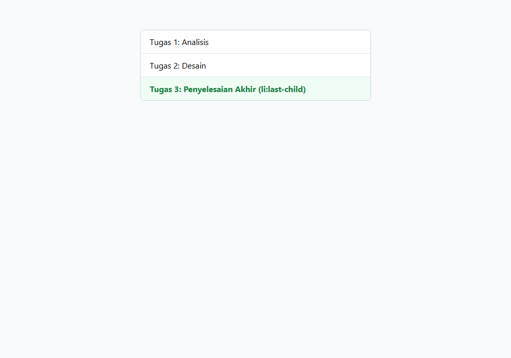

---

### 213. Pseudo-class :nth-child()

**Tujuan:** Menargetkan elemen menggunakan rumus aljabar pola An+B, ganjil (odd), atau genap (even).

**Konsep Utama:**
Pseudo-class `:nth-child(An+B)` menyeleksi elemen berdasarkan posisi indeks numeriknya. Nilai kata kunci `even` (genap) dan `odd` (ganjil) umum dipakai untuk membuat baris tabel belang-belang (zebra stripe).

**Penjelasan Source Code:**
Menerapkan zebra stripes bergantian warna abu-abu pada baris genap `:nth-child(even)`.

**Source code utama:** [213_nth_child.css](213_nth_child.css)

**File pendukung preview:** [213_nth_child.html](213_nth_child.html)

**Cara Menjalankan:**
Buka file HTML pendukung di peramban web (Google Chrome, Microsoft Edge, atau Mozilla Firefox), atau gunakan Live Server / HTTP Server:

```bash
# Buka langsung file HTML di browser default
start "" "213_nth_child.html"
```

**Hasil yang Diharapkan:**
Daftar baris belang-belang selang-seling abu-abu dan putih yang rapi.

**Screenshot Hasil Eksekusi:**

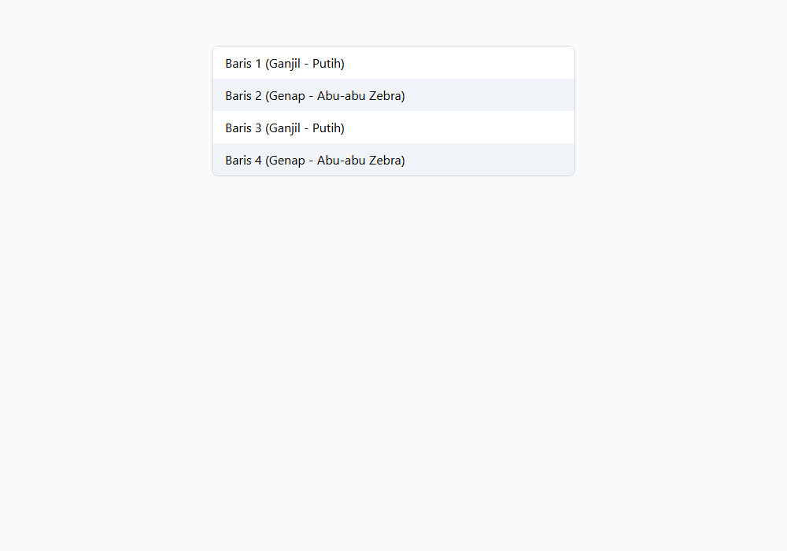

---

### 214. Pseudo-class :nth-of-type()

**Tujuan:** Menargetkan elemen berdasarkan urutan posisinya di antara sesama tipe tag yang sama.

**Konsep Utama:**
Berbeda dengan `:nth-child` yang menghitung semua anak tanpa pandang tipe tag, `:nth-of-type()` HANYA menghitung urutan di antara elemen yang memiliki nama tag yang persis sama.

**Penjelasan Source Code:**
Memilih paragraf kedua `p:nth-of-type(2)` meskipun ada elemen heading di atasnya.

**Source code utama:** [214_nth_of_type.css](214_nth_of_type.css)

**File pendukung preview:** [214_nth_of_type.html](214_nth_of_type.html)

**Cara Menjalankan:**
Buka file HTML pendukung di peramban web (Google Chrome, Microsoft Edge, atau Mozilla Firefox), atau gunakan Live Server / HTTP Server:

```bash
# Buka langsung file HTML di browser default
start "" "214_nth_of_type.html"
```

**Hasil yang Diharapkan:**
Paragraf kedua diwarnai biru pastel khusus berkat seleksi tepat tipe tag.

**Screenshot Hasil Eksekusi:**

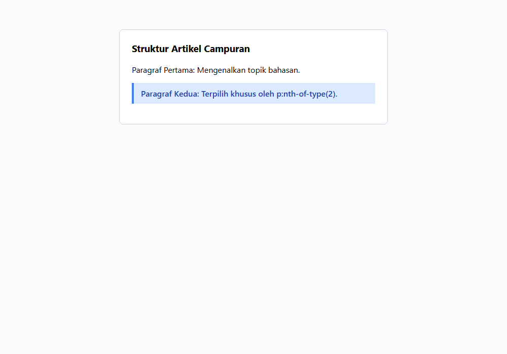

---

### 215. Pseudo-class :first-of-type

**Tujuan:** Menargetkan kemunculan pertama suatu tipe tag di dalam wadah induk.

**Konsep Utama:**
Pseudo-class `:first-of-type` mencocokkan kemunculan pertama elemen dari tipe tag tersebut di dalam induknya, bahkan jika ada elemen tipe lain yang lahir lebih dulu sebelum elemen tersebut.

**Penjelasan Source Code:**
Menata paragraf pembuka pertama (`p:first-of-type`) dengan ukuran font lebih besar layaknya lead paragraph.

**Source code utama:** [215_first_of_type.css](215_first_of_type.css)

**File pendukung preview:** [215_first_of_type.html](215_first_of_type.html)

**Cara Menjalankan:**
Buka file HTML pendukung di peramban web (Google Chrome, Microsoft Edge, atau Mozilla Firefox), atau gunakan Live Server / HTTP Server:

```bash
# Buka langsung file HTML di browser default
start "" "215_first_of_type.html"
```

**Hasil yang Diharapkan:**
Paragraf pembuka tampil lebih tegas dan besar dibanding paragraf biasa.

**Screenshot Hasil Eksekusi:**

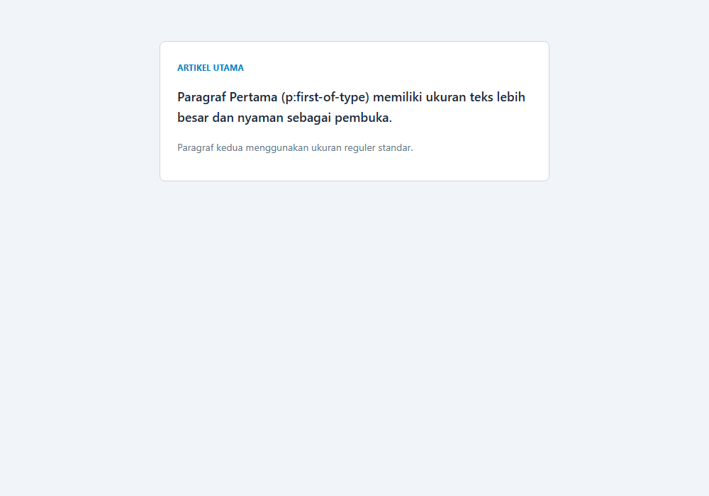

---

### 216. Pseudo-class :last-of-type

**Tujuan:** Menargetkan kemunculan terakhir suatu tipe tag di dalam wadah induk.

**Konsep Utama:**
Pseudo-class `:last-of-type` mencocokkan elemen terakhir dari tipe tag tersebut di antara saudara-saudaranya di dalam induk yang sama.

**Penjelasan Source Code:**
Memberikan aksen penutup pada paragraf terakhir (`p:last-of-type`).

**Source code utama:** [216_last_of_type.css](216_last_of_type.css)

**File pendukung preview:** [216_last_of_type.html](216_last_of_type.html)

**Cara Menjalankan:**
Buka file HTML pendukung di peramban web (Google Chrome, Microsoft Edge, atau Mozilla Firefox), atau gunakan Live Server / HTTP Server:

```bash
# Buka langsung file HTML di browser default
start "" "216_last_of_type.html"
```

**Hasil yang Diharapkan:**
Paragraf terakhir bergaris bawah lembut sebagai tanda penutup.

**Screenshot Hasil Eksekusi:**

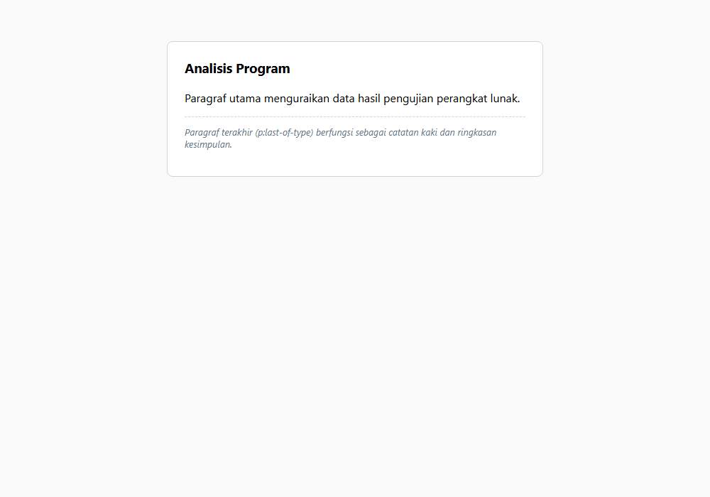

---

### 217. Pseudo-class :not()

**Tujuan:** Mengecualikan elemen dari seleksi aturan gaya menggunakan negasi :not().

**Konsep Utama:**
Pseudo-class negasi `:not(selector)` mencocokkan setiap elemen yang TIDAK memenuhi kriteria selector di dalam tanda kurungnya.

**Penjelasan Source Code:**
Memberikan garis bawah pemisah pada seluruh item daftar KECUALI item terakhir (`li:not(:last-child)`).

**Source code utama:** [217_not_pseudo_class.css](217_not_pseudo_class.css)

**File pendukung preview:** [217_not_pseudo_class.html](217_not_pseudo_class.html)

**Cara Menjalankan:**
Buka file HTML pendukung di peramban web (Google Chrome, Microsoft Edge, atau Mozilla Firefox), atau gunakan Live Server / HTTP Server:

```bash
# Buka langsung file HTML di browser default
start "" "217_not_pseudo_class.html"
```

**Hasil yang Diharapkan:**
Daftar list dengan garis pembatas rapi tanpa garis ekstra di paling bawah.

**Screenshot Hasil Eksekusi:**

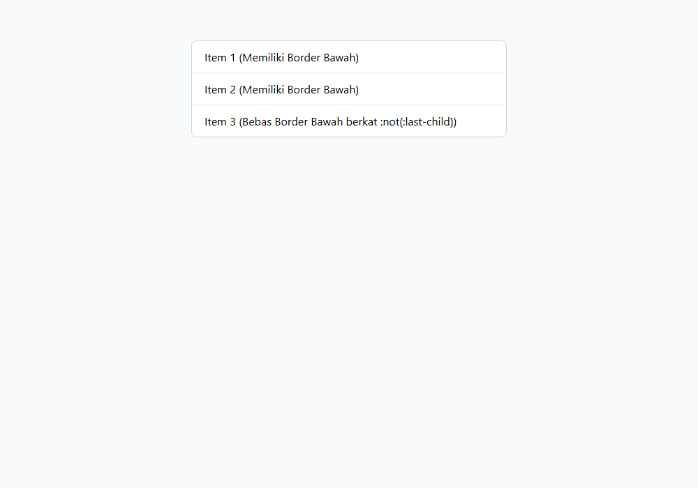

---

### 218. Pseudo-class :is()

**Tujuan:** Menyederhanakan selector majemuk panjang dan mengaktifkan toleransi kesalahan parsing dengan :is().

**Konsep Utama:**
Fungsi pseudo-class `:is(selector, ...)` mencocokkan salah satu selector dalam daftarnya. Memiliki sifat 'forgiving' (kesalahan satu selector tidak membatalkan ruleset) dan mengambil specificity tertinggi di antara pilihannya.

**Penjelasan Source Code:**
Menggantikan penulisan panjang `header h1, nav h1, footer h1` dengan `:is(header, nav, footer) h1`.

**Source code utama:** [218_is_pseudo_class.css](218_is_pseudo_class.css)

**File pendukung preview:** [218_is_pseudo_class.html](218_is_pseudo_class.html)

**Cara Menjalankan:**
Buka file HTML pendukung di peramban web (Google Chrome, Microsoft Edge, atau Mozilla Firefox), atau gunakan Live Server / HTTP Server:

```bash
# Buka langsung file HTML di browser default
start "" "218_is_pseudo_class.html"
```

**Hasil yang Diharapkan:**
Heading di dalam header dan footer otomatis memiliki format warna seragam.

**Screenshot Hasil Eksekusi:**

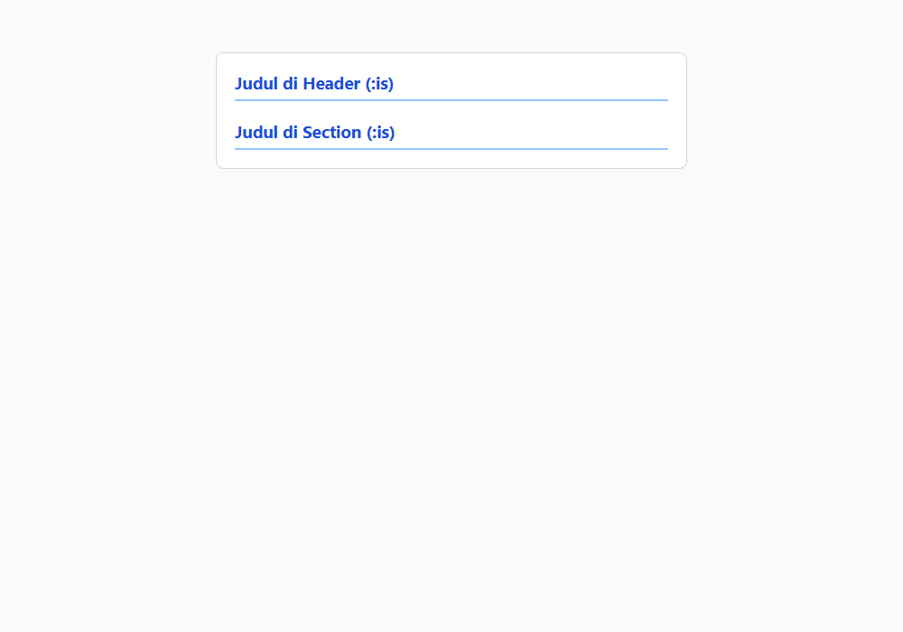

---

### 219. Pseudo-class :where()

**Tujuan:** Menuliskan selector dengan spesifisitas nol mutlak (0,0,0,0) untuk memudahkan override gaya.

**Konsep Utama:**
Fungsi `:where(...)` memiliki fungsi serupa dengan `:is()`, namun bobot specificity dari selector di dalamnya SELALU NOL MUTLAK (0,0,0,0). Sangat ideal untuk pustaka komponen (CSS reset/framework) agar mudah ditimpa developer tanpa perang specificity.

**Penjelasan Source Code:**
Menata tombol dengan `:where(button.btn-library)` yang dapat ditimpa dengan mudah oleh kelas biasa.

**Source code utama:** [219_where_pseudo_class.css](219_where_pseudo_class.css)

**File pendukung preview:** [219_where_pseudo_class.html](219_where_pseudo_class.html)

**Cara Menjalankan:**
Buka file HTML pendukung di peramban web (Google Chrome, Microsoft Edge, atau Mozilla Firefox), atau gunakan Live Server / HTTP Server:

```bash
# Buka langsung file HTML di browser default
start "" "219_where_pseudo_class.html"
```

**Hasil yang Diharapkan:**
Tombol dengan warna penimpa yang menang mudah berkat sifat specificity nol dari :where().

**Screenshot Hasil Eksekusi:**

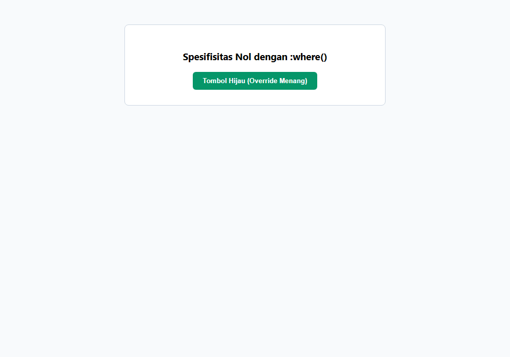

---

### 220. Pseudo-class :has()

**Tujuan:** Menggunakan parent selector revolusioner :has() untuk menata induk berdasarkan elemen anaknya.

**Konsep Utama:**
Pseudo-class relasional `:has(selector)` memungkinkan pemilihan elemen induk berdasarkan keberadaan atau status elemen anaknya di dalam DOM. Dikenal luas sebagai 'The CSS Parent Selector'.

**Penjelasan Source Code:**
Menata wadah kartu `.card:has(input:checked)` dengan border hijau tebal saat checkbox di dalamnya dicentang.

**Source code utama:** [220_has_pseudo_class.css](220_has_pseudo_class.css)

**File pendukung preview:** [220_has_pseudo_class.html](220_has_pseudo_class.html)

**Cara Menjalankan:**
Buka file HTML pendukung di peramban web (Google Chrome, Microsoft Edge, atau Mozilla Firefox), atau gunakan Live Server / HTTP Server:

```bash
# Buka langsung file HTML di browser default
start "" "220_has_pseudo_class.html"
```

**Hasil yang Diharapkan:**
Wadah kartu otomatis berubah warna dan berbingkai hijau ketika opsi di dalamnya dipilih.

**Screenshot Hasil Eksekusi:**

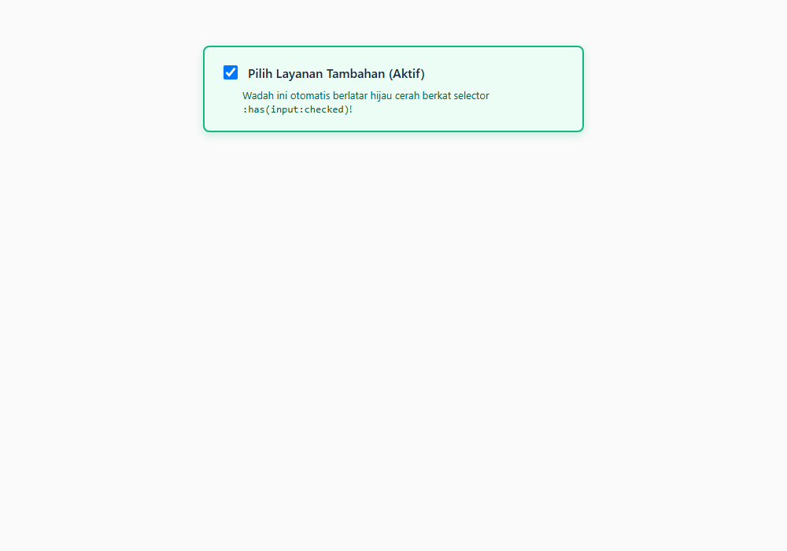

---

### 221. Pseudo-class :checked

**Tujuan:** Menata elemen checkbox atau radio button yang sedang dalam kondisi terpilih (:checked).

**Konsep Utama:**
Pseudo-class `:checked` aktif pada elemen form tipe radio, checkbox, atau `<option>` yang sedang dicentang atau dipilih.

**Penjelasan Source Code:**
Mengubah warna teks label di samping checkbox yang dicentang menggunakan kombinasi `input:checked + span`.

**Source code utama:** [221_checked_pseudo_class.css](221_checked_pseudo_class.css)

**File pendukung preview:** [221_checked_pseudo_class.html](221_checked_pseudo_class.html)

**Cara Menjalankan:**
Buka file HTML pendukung di peramban web (Google Chrome, Microsoft Edge, atau Mozilla Firefox), atau gunakan Live Server / HTTP Server:

```bash
# Buka langsung file HTML di browser default
start "" "221_checked_pseudo_class.html"
```

**Hasil yang Diharapkan:**
Item yang dicentang otomatis bertuliskan tebal dan berwarna hijau keberhasilan.

**Screenshot Hasil Eksekusi:**

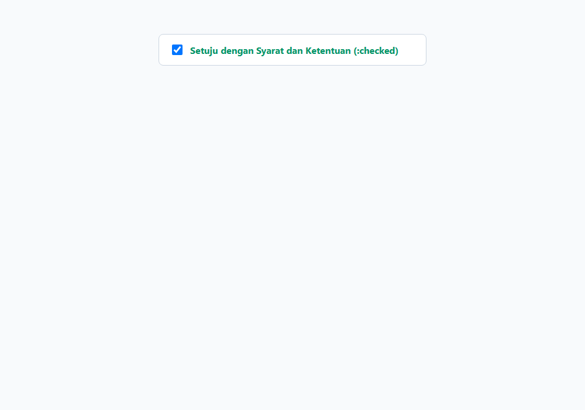

---

### 222. Pseudo-class :disabled dan :enabled

**Tujuan:** Membedakan penataan elemen formulir yang aktif (:enabled) dan nonaktif (:disabled).

**Konsep Utama:**
Pseudo-class `:disabled` menargetkan elemen input atau button yang memiliki atribut `disabled`, sedangkan `:enabled` menargetkan elemen yang siap menerima interaksi pengguna.

**Penjelasan Source Code:**
Membedakan visual tombol yang aktif dengan tombol dinonaktifkan yang berkursor not-allowed.

**Source code utama:** [222_disabled_enabled.css](222_disabled_enabled.css)

**File pendukung preview:** [222_disabled_enabled.html](222_disabled_enabled.html)

**Cara Menjalankan:**
Buka file HTML pendukung di peramban web (Google Chrome, Microsoft Edge, atau Mozilla Firefox), atau gunakan Live Server / HTTP Server:

```bash
# Buka langsung file HTML di browser default
start "" "222_disabled_enabled.html"
```

**Hasil yang Diharapkan:**
Dua tombol berdampingan: tombol aktif biru cerah dan tombol nonaktif abu-abu redup.

**Screenshot Hasil Eksekusi:**

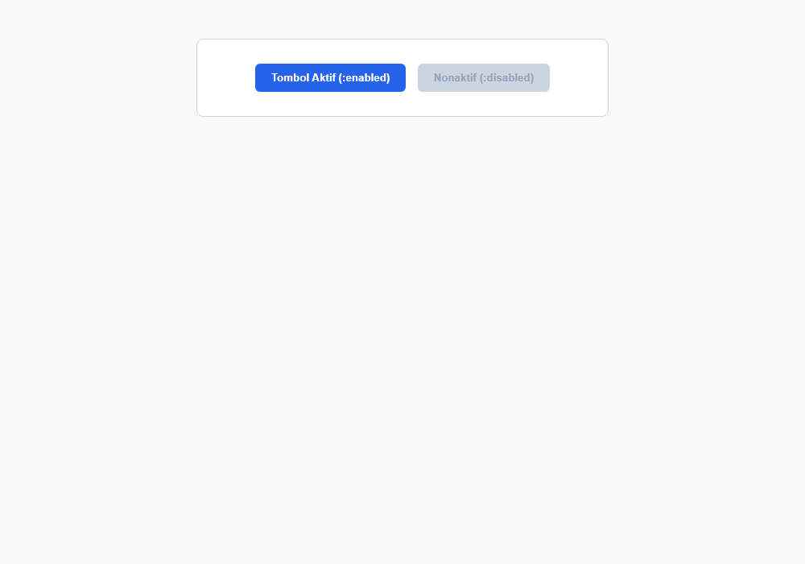

---

### 223. Pseudo-element ::before

**Tujuan:** Menyisipkan konten dekoratif virtual di awal elemen menggunakan ::before dan properti content.

**Konsep Utama:**
Pseudo-element `::before` membuat elemen anak virtual pertama tepat sebelum konten asli elemen. Wajib menyertakan properti `content: ''` agar dapat dirender oleh browser.

**Penjelasan Source Code:**
Menambahkan ikon dekoratif penanda centang hijau secara otomatis di awal baris tips.

**Source code utama:** [223_before_pseudo_element.css](223_before_pseudo_element.css)

**File pendukung preview:** [223_before_pseudo_element.html](223_before_pseudo_element.html)

**Cara Menjalankan:**
Buka file HTML pendukung di peramban web (Google Chrome, Microsoft Edge, atau Mozilla Firefox), atau gunakan Live Server / HTTP Server:

```bash
# Buka langsung file HTML di browser default
start "" "223_before_pseudo_element.html"
```

**Hasil yang Diharapkan:**
Kotak tips dengan ikon dekoratif virtual yang muncul otomatis di depan teks.

**Screenshot Hasil Eksekusi:**

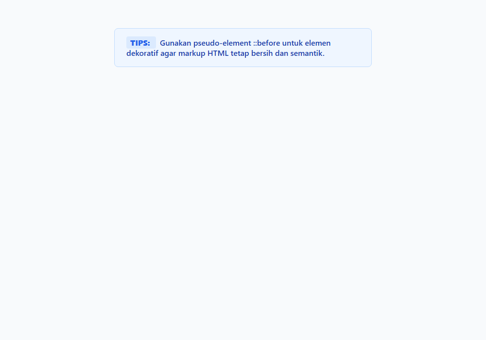

---

### 224. Pseudo-element ::after

**Tujuan:** Menyisipkan konten visual virtual di akhir elemen menggunakan ::after.

**Konsep Utama:**
Pseudo-element `::after` menyisipkan anak virtual di posisi paling akhir setelah konten asli elemen, sangat lazim untuk panah tautan, indikator eksternal, atau efek underline dinamis.

**Penjelasan Source Code:**
Menambahkan simbol panah ke kanan `&rarr;` secara otomatis setelah teks tautan.

**Source code utama:** [224_after_pseudo_element.css](224_after_pseudo_element.css)

**File pendukung preview:** [224_after_pseudo_element.html](224_after_pseudo_element.html)

**Cara Menjalankan:**
Buka file HTML pendukung di peramban web (Google Chrome, Microsoft Edge, atau Mozilla Firefox), atau gunakan Live Server / HTTP Server:

```bash
# Buka langsung file HTML di browser default
start "" "224_after_pseudo_element.html"
```

**Hasil yang Diharapkan:**
Tautan yang memiliki simbol panah otomatis di ujung akhir teks.

**Screenshot Hasil Eksekusi:**

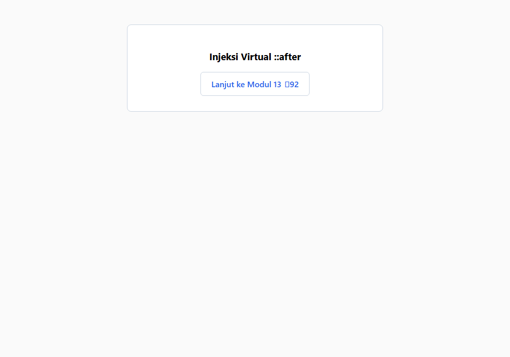

---

### 225. ::marker, ::selection, dan ::placeholder

**Tujuan:** Mengkustomisasi bullet list (::marker), sorotan seleksi teks (::selection), dan petunjuk form (::placeholder).

**Konsep Utama:**
`::marker` mengatur warna dan ukuran bullet `<li>`. `::selection` mengatur warna highlight saat teks diblok oleh kursor mouse. `::placeholder` mengatur styling teks petunjuk input formulir.

**Penjelasan Source Code:**
Menata seleksi teks dengan warna latar ungu cerah dan bullet daftar berwarna biru dongker.

**Source code utama:** [225_marker_selection_placeholder.css](225_marker_selection_placeholder.css)

**File pendukung preview:** [225_marker_selection_placeholder.html](225_marker_selection_placeholder.html)

**Cara Menjalankan:**
Buka file HTML pendukung di peramban web (Google Chrome, Microsoft Edge, atau Mozilla Firefox), atau gunakan Live Server / HTTP Server:

```bash
# Buka langsung file HTML di browser default
start "" "225_marker_selection_placeholder.html"
```

**Hasil yang Diharapkan:**
Halaman interaktif dengan bullet list custom dan seleksi teks berwarna ungu.

**Screenshot Hasil Eksekusi:**

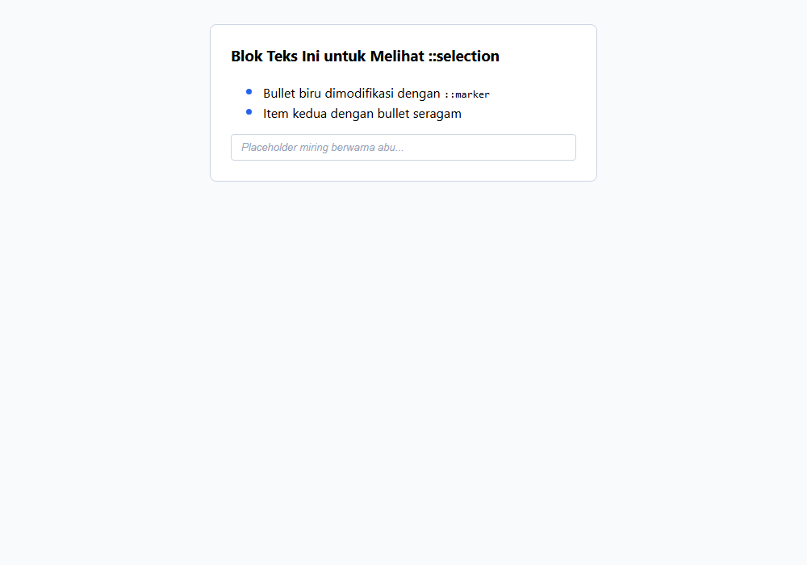

---

## Ringkasan Modul

Pseudo-class dan pseudo-element memperluas daya ekspresi CSS secara eksponensial. Dengan menguasai Modul 12, pengembang dapat menciptakan antarmuka yang sangat hidup, dinamis, dan kaya feedback visual murni berbasis CSS tanpa memerlukan manipulasi JavaScript berlebihan.

### Keterkaitan Materi
Seluruh submodul dalam modul ini dirancang secara berjenjang untuk membangun pemahaman yang kokoh dan aplikatif. Lanjutkan ke modul berikutnya setelah menguasai seluruh konsep di atas.
