# Modul 13: Transform, Transition, dan Animation

## Ringkasan Ruang Lingkup Materi

Modul ini membahas dimensi gerak dan transformasi dalam CSS secara komprehensif: transformasi geometris 2D (translate, rotate, scale, skew, dan titik tumpu transform-origin), ruang visual 3D (translate3d, rotateX/Y/Z, kedalaman perspektif perspective, transform-style: preserve-3d, dan penyembunyian sisi belakang backface-visibility untuk kartu flip 3D), transisi perubahan keadaan yang mulus (transition-property, duration, timing-function cubic-bezier/ease/linear, delay, dan shorthand transition), hingga orkestrasi animasi kompleks tanpa JavaScript menggunakan at-rule @keyframes (keyframes timeline, animation-duration, iteration-count infinite, direction alternate, fill-mode forwards, play-state running/paused, serta komposisi multi-animasi simultan).

## Tujuan Pembelajaran Modul

- Menerapkan fungsi transformasi 2D untuk manipulasi posisi, ukuran, dan orientasi elemen.
- Menciptakan ilusi kedalaman spasial tiga dimensi menggunakan perspective dan preserve-3d.
- Membangun interaksi transisi halus (smooth transitions) dengan kurva waktu yang tepat.
- Menyusun linimasa animasi multi-langkah menggunakan at-rule @keyframes.
- Mengontrol siklus hidup animasi dengan fill-mode, iteration-count, dan direction.
- Menggabungkan beberapa animasi sekaligus (komposisi) secara performan dengan akselerasi GPU.

## Daftar Submodul

- [226. Transform translate()](226_transform_translate.css) — [Halaman Preview](226_transform_translate.html)
- [227. Transform rotate()](227_transform_rotate.css) — [Halaman Preview](227_transform_rotate.html)
- [228. Transform scale()](228_transform_scale.css) — [Halaman Preview](228_transform_scale.html)
- [229. Transform skew()](229_transform_skew.css) — [Halaman Preview](229_transform_skew.html)
- [230. Properti transform-origin](230_transform_origin.css) — [Halaman Preview](230_transform_origin.html)
- [231. Transformasi 3D](231_transform_3d.css) — [Halaman Preview](231_transform_3d.html)
- [232. Properti perspective](232_perspective_property.css) — [Halaman Preview](232_perspective_property.html)
- [233. Properti transform-style](233_transform_style.css) — [Halaman Preview](233_transform_style.html)
- [234. Properti backface-visibility](234_backface_visibility.css) — [Halaman Preview](234_backface_visibility.html)
- [235. Properti transition-property](235_transition_property.css) — [Halaman Preview](235_transition_property.html)
- [236. Properti transition-duration](236_transition_duration.css) — [Halaman Preview](236_transition_duration.html)
- [237. Properti transition-timing-function](237_transition_timing_function.css) — [Halaman Preview](237_transition_timing_function.html)
- [238. Properti transition-delay](238_transition_delay.css) — [Halaman Preview](238_transition_delay.html)
- [239. Shorthand transition](239_transition_shorthand.css) — [Halaman Preview](239_transition_shorthand.html)
- [240. Animasi dengan @keyframes](240_keyframes_animation.css) — [Halaman Preview](240_keyframes_animation.html)
- [241. Properti animation-duration](241_animation_duration.css) — [Halaman Preview](241_animation_duration.html)
- [242. Properti animation-iteration-count](242_animation_iteration_count.css) — [Halaman Preview](242_animation_iteration_count.html)
- [243. Arah dan fill mode animasi](243_animation_direction_fill_mode.css) — [Halaman Preview](243_animation_direction_fill_mode.html)
- [244. Properti animation-play-state](244_animation_play_state.css) — [Halaman Preview](244_animation_play_state.html)
- [245. Komposisi dan beberapa animasi](245_animation_composition.css) — [Halaman Preview](245_animation_composition.html)

---

## Pembahasan dan Penjelasan Submodul

### 226. Transform translate()

**Tujuan:** Menggeser posisi visual elemen pada sumbu X dan Y tanpa memicu reflow tata letak dokumen.

**Konsep Utama:**
Fungsi `transform: translate(x, y)` menggeser rendering visual elemen secara hardware-accelerated melalui GPU, jauh lebih hemat performa dibanding mengubah properti top/left.

**Penjelasan Source Code:**
Menggeser kartu sejauh 20px ke kanan dan 10px ke bawah.

**Source code utama:** [226_transform_translate.css](226_transform_translate.css)

**File pendukung preview:** [226_transform_translate.html](226_transform_translate.html)

**Cara Menjalankan:**
Buka file HTML pendukung di peramban web (Google Chrome, Microsoft Edge, atau Mozilla Firefox), atau gunakan Live Server / HTTP Server:

```bash
# Buka langsung file HTML di browser default
start "" "226_transform_translate.html"
```

**Hasil yang Diharapkan:**
Kotak yang tampak bergeser halus dari bingkai aslinya.

**Screenshot Hasil Eksekusi:**

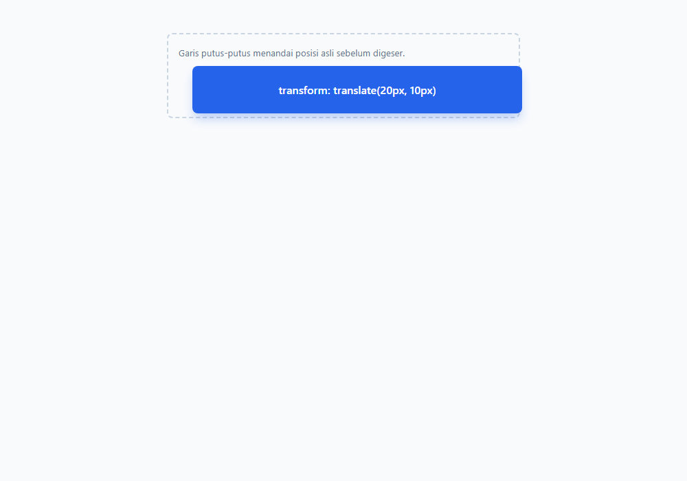

---

### 227. Transform rotate()

**Tujuan:** Memutar elemen dalam derajat sudut dua dimensi menggunakan rotate().

**Konsep Utama:**
Fungsi `transform: rotate(deg)` memutar elemen searah jarum jam (derajat positif) atau berlawanan arah jarum jam (derajat negatif).

**Penjelasan Source Code:**
Memutar lencana sudut kemiringan -5 derajat untuk menciptakan aksen stiker kasual yang menarik.

**Source code utama:** [227_transform_rotate.css](227_transform_rotate.css)

**File pendukung preview:** [227_transform_rotate.html](227_transform_rotate.html)

**Cara Menjalankan:**
Buka file HTML pendukung di peramban web (Google Chrome, Microsoft Edge, atau Mozilla Firefox), atau gunakan Live Server / HTTP Server:

```bash
# Buka langsung file HTML di browser default
start "" "227_transform_rotate.html"
```

**Hasil yang Diharapkan:**
Lencana penawaran yang tampak miring manis layaknya stiker fisik.

**Screenshot Hasil Eksekusi:**

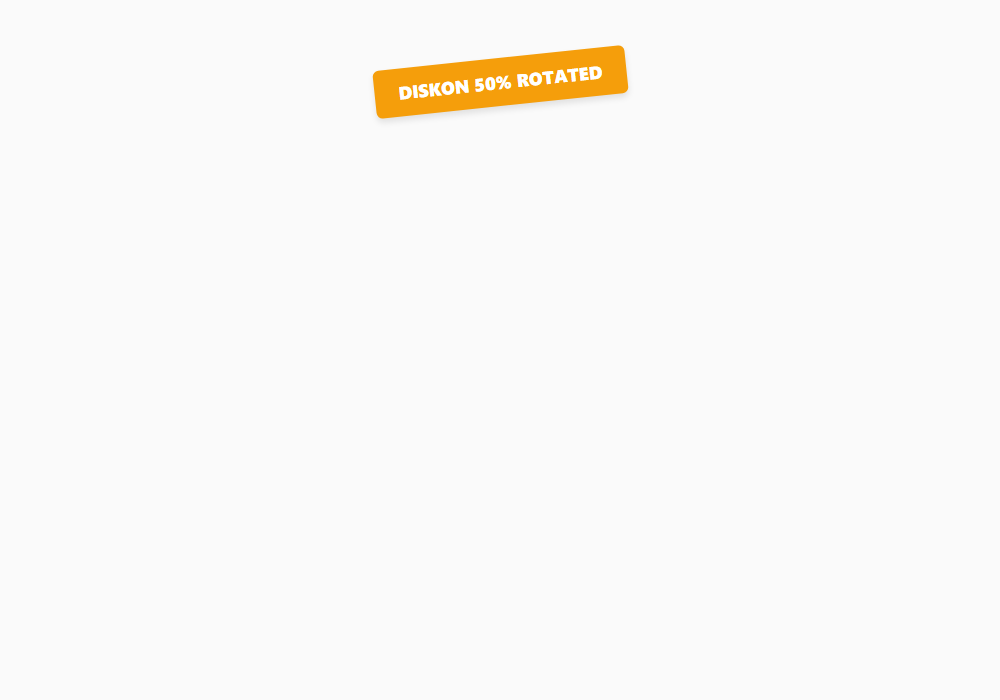

---

### 228. Transform scale()

**Tujuan:** Memperbesar atau memperkecil skala ukuran elemen menggunakan scale().

**Konsep Utama:**
Fungsi `transform: scale(faktor)` mengubah ukuran tampilan elemen: nilai `1.0` adalah ukuran normal, `1.15` memperbesar 15%, dan `0.8` mengecilkan ke 80%.

**Penjelasan Source Code:**
Membesarkan lencana fitur sebesar 1.1x lipat untuk menarik perhatian visual.

**Source code utama:** [228_transform_scale.css](228_transform_scale.css)

**File pendukung preview:** [228_transform_scale.html](228_transform_scale.html)

**Cara Menjalankan:**
Buka file HTML pendukung di peramban web (Google Chrome, Microsoft Edge, atau Mozilla Firefox), atau gunakan Live Server / HTTP Server:

```bash
# Buka langsung file HTML di browser default
start "" "228_transform_scale.html"
```

**Hasil yang Diharapkan:**
Kotak yang diskalakan lebih besar melampaui ukuran aslinya.

**Screenshot Hasil Eksekusi:**

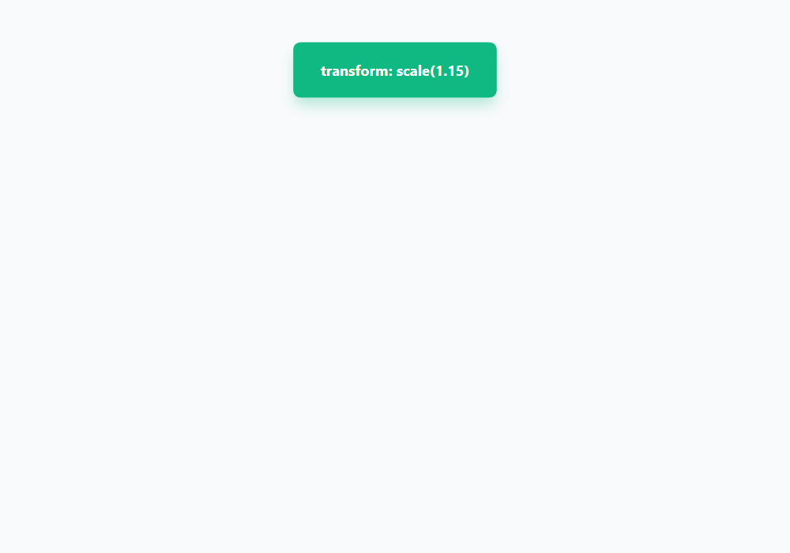

---

### 229. Transform skew()

**Tujuan:** Mencondongkan atau memiringkan sisi bidang elemen menggunakan fungsi skew().

**Konsep Utama:**
Fungsi `transform: skew(x-angle, y-angle)` mendistorsi elemen dengan memiringkan sudut-sudutnya sepanjang sumbu horizontal dan vertikal, menciptakan efek jajaran genjang.

**Penjelasan Source Code:**
Membuat tombol bergaya jajaran genjang tajam menggunakan `skewX(-15deg)`.

**Source code utama:** [229_transform_skew.css](229_transform_skew.css)

**File pendukung preview:** [229_transform_skew.html](229_transform_skew.html)

**Cara Menjalankan:**
Buka file HTML pendukung di peramban web (Google Chrome, Microsoft Edge, atau Mozilla Firefox), atau gunakan Live Server / HTTP Server:

```bash
# Buka langsung file HTML di browser default
start "" "229_transform_skew.html"
```

**Hasil yang Diharapkan:**
Tombol aksi dengan bentuk jajaran genjang miring bergaya sporty modern.

**Screenshot Hasil Eksekusi:**

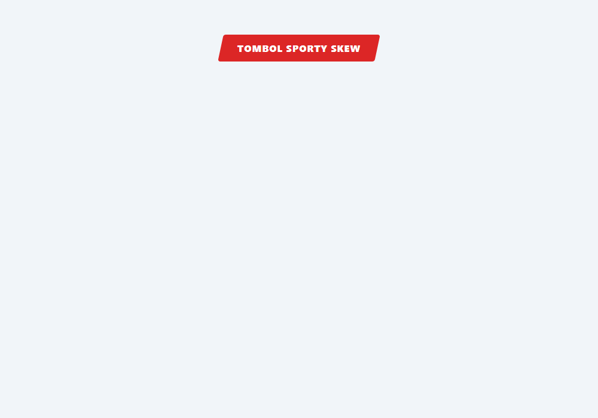

---

### 230. Properti transform-origin

**Tujuan:** Menentukan titik tumpu poros rotasi dan penskalaan transformasi elemen.

**Konsep Utama:**
Secara default `transform-origin` berada tepat di tengah elemen (`50% 50%`). Mengubah titik tumpu (misal `top left` atau `bottom right`) mengubah titik poros putaran layaknya engsel pintu.

**Penjelasan Source Code:**
Memutar elemen 15 derajat dengan titik engsel berada di pojok kiri atas (`top left`).

**Source code utama:** [230_transform_origin.css](230_transform_origin.css)

**File pendukung preview:** [230_transform_origin.html](230_transform_origin.html)

**Cara Menjalankan:**
Buka file HTML pendukung di peramban web (Google Chrome, Microsoft Edge, atau Mozilla Firefox), atau gunakan Live Server / HTTP Server:

```bash
# Buka langsung file HTML di browser default
start "" "230_transform_origin.html"
```

**Hasil yang Diharapkan:**
Kotak yang berputar berporos pada sudut kiri atasnya.

**Screenshot Hasil Eksekusi:**

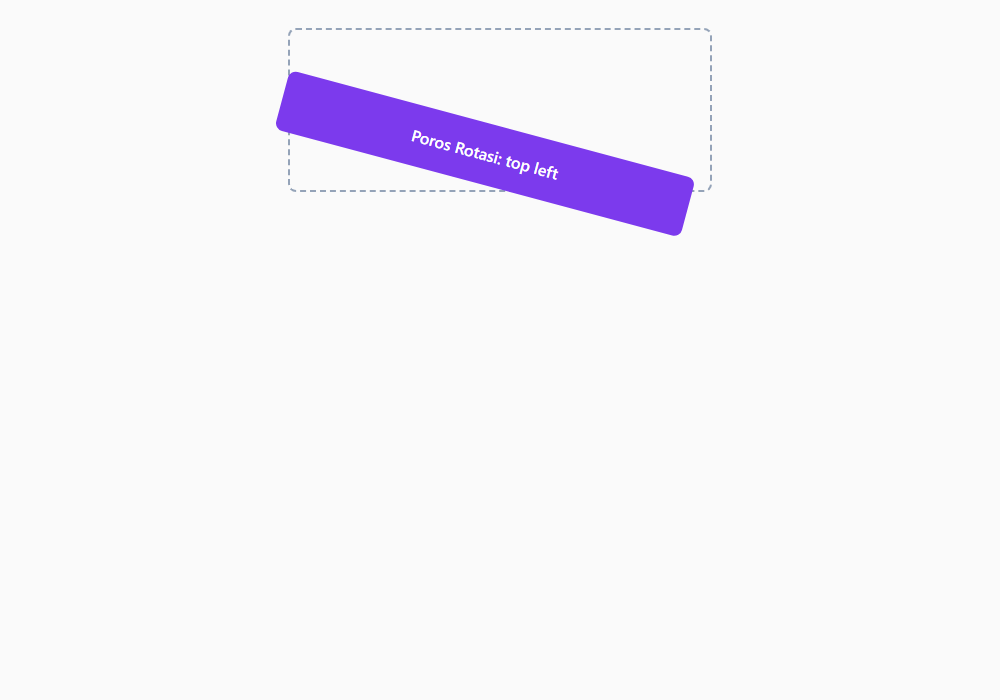

---

### 231. Transformasi 3D

**Tujuan:** Memutar dan memposisikan elemen dalam ruang tiga dimensi (rotateX, rotateY, translateZ).

**Konsep Utama:**
Transformasi 3D memungkinkan perputaran elemen mengelilingi sumbu X horizontal (`rotateX`) dan sumbu Y vertikal (`rotateY`), menciptakan efek papan miring tiga dimensi.

**Penjelasan Source Code:**
Memutar kartu pada sumbu Y sebesar 25 derajat untuk menghasilkan tampilan perspektif 3D.

**Source code utama:** [231_transform_3d.css](231_transform_3d.css)

**File pendukung preview:** [231_transform_3d.html](231_transform_3d.html)

**Cara Menjalankan:**
Buka file HTML pendukung di peramban web (Google Chrome, Microsoft Edge, atau Mozilla Firefox), atau gunakan Live Server / HTTP Server:

```bash
# Buka langsung file HTML di browser default
start "" "231_transform_3d.html"
```

**Hasil yang Diharapkan:**
Kotak kartu yang tampak miring ke dalam ruang 3D secara fotorealistik.

**Screenshot Hasil Eksekusi:**

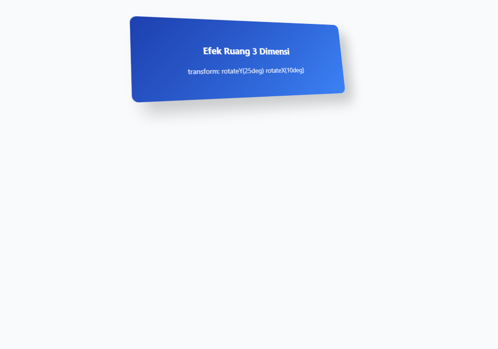

---

### 232. Properti perspective

**Tujuan:** Menentukan jarak mata pengamat ke bidang 3D untuk mengontrol intensitas distorsi perspektif.

**Konsep Utama:**
Properti `perspective` menentukan seberapa dekat mata pemirsa dengan objek: nilai piksel kecil (misal `300px`) menghasilkan efek 3D yang sangat dramatis dan ekstrim; nilai besar (misal `1000px`) menghasilkan kedalaman yang halus.

**Penjelasan Source Code:**
Mendemonstrasikan efek kedalaman perspektif 600px pada wadah elemen.

**Source code utama:** [232_perspective_property.css](232_perspective_property.css)

**File pendukung preview:** [232_perspective_property.html](232_perspective_property.html)

**Cara Menjalankan:**
Buka file HTML pendukung di peramban web (Google Chrome, Microsoft Edge, atau Mozilla Firefox), atau gunakan Live Server / HTTP Server:

```bash
# Buka langsung file HTML di browser default
start "" "232_perspective_property.html"
```

**Hasil yang Diharapkan:**
Kotak 3D dengan distorsi perspektif yang seimbang dan alami.

**Screenshot Hasil Eksekusi:**

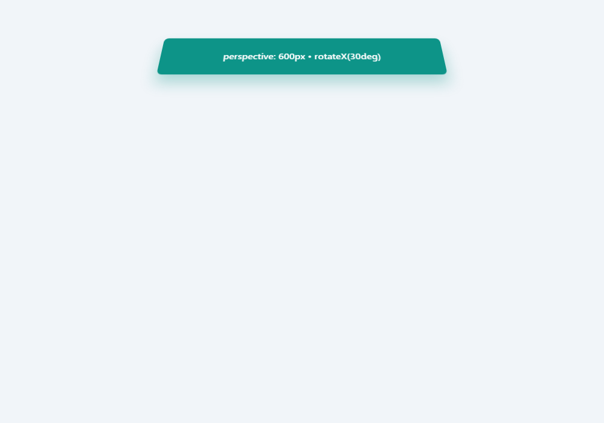

---

### 233. Properti transform-style

**Tujuan:** Mempertahankan ruang 3D pada elemen anak menggunakan transform-style: preserve-3d.

**Konsep Utama:**
Secara default elemen anak diratakan ke bidang 2D (`flat`). Dengan `transform-style: preserve-3d`, anak-anak elemen tetap hidup di ruang 3D mandiri mereka sendiri (penting untuk kubus 3D atau kartu flip).

**Penjelasan Source Code:**
Mengatur `transform-style: preserve-3d` pada pembungkus kartu rotasi.

**Source code utama:** [233_transform_style.css](233_transform_style.css)

**File pendukung preview:** [233_transform_style.html](233_transform_style.html)

**Cara Menjalankan:**
Buka file HTML pendukung di peramban web (Google Chrome, Microsoft Edge, atau Mozilla Firefox), atau gunakan Live Server / HTTP Server:

```bash
# Buka langsung file HTML di browser default
start "" "233_transform_style.html"
```

**Hasil yang Diharapkan:**
Wadah 3D yang mempertahankan koordinat spasial anak-anaknya.

**Screenshot Hasil Eksekusi:**

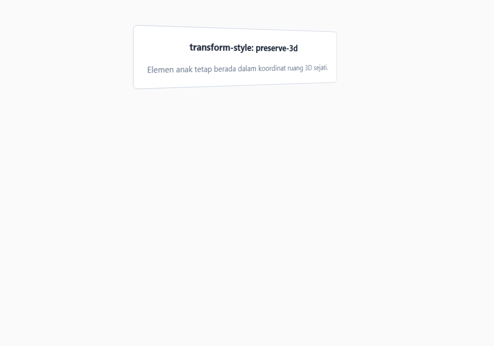

---

### 234. Properti backface-visibility

**Tujuan:** Menyembunyikan sisi belakang elemen saat diputar 180 derajat (backface-visibility: hidden).

**Konsep Utama:**
Properti `backface-visibility: hidden` menyembunyikan sisi belakang elemen saat elemen membelakangi pengamat, esensial untuk membuat efek kartu bolak-balik (card flip).

**Penjelasan Source Code:**
Mendemonstrasikan kartu sisi depan yang menyembunyikan punggungnya saat dibalik.

**Source code utama:** [234_backface_visibility.css](234_backface_visibility.css)

**File pendukung preview:** [234_backface_visibility.html](234_backface_visibility.html)

**Cara Menjalankan:**
Buka file HTML pendukung di peramban web (Google Chrome, Microsoft Edge, atau Mozilla Firefox), atau gunakan Live Server / HTTP Server:

```bash
# Buka langsung file HTML di browser default
start "" "234_backface_visibility.html"
```

**Hasil yang Diharapkan:**
Komponen kartu flip dengan sisi belakang tersembunyi secara rapi.

**Screenshot Hasil Eksekusi:**

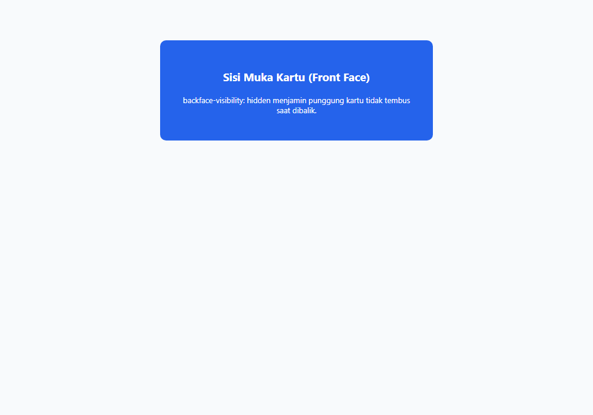

---

### 235. Properti transition-property

**Tujuan:** Menentukan properti mana yang akan dianimasikan secara halus saat terjadi perubahan state.

**Konsep Utama:**
Properti `transition-property` secara spesifik mendaftarkan properti yang berhak menerima transisi (misal `background-color, transform`), daripada menggunakan `all` yang dapat membebani performa browser.

**Penjelasan Source Code:**
Hanya mentransisikan `background-color` dan `transform` pada tombol.

**Source code utama:** [235_transition_property.css](235_transition_property.css)

**File pendukung preview:** [235_transition_property.html](235_transition_property.html)

**Cara Menjalankan:**
Buka file HTML pendukung di peramban web (Google Chrome, Microsoft Edge, atau Mozilla Firefox), atau gunakan Live Server / HTTP Server:

```bash
# Buka langsung file HTML di browser default
start "" "235_transition_property.html"
```

**Hasil yang Diharapkan:**
Tombol dengan transisi halus pada warna dan transformasi.

**Screenshot Hasil Eksekusi:**

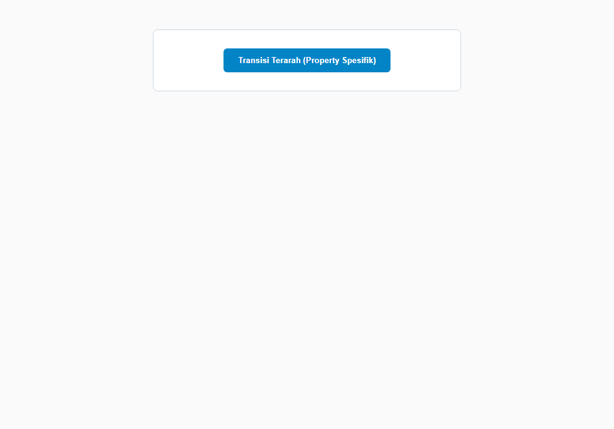

---

### 236. Properti transition-duration

**Tujuan:** Mengatur durasi lama waktu perubahan transisi menggunakan detik (s) atau milidetik (ms).

**Konsep Utama:**
Properti `transition-duration` menetapkan interval waktu animasi transisi berlangsung: durasi interaksi UI mikro yang ideal berkisar antara `200ms` hingga `400ms`.

**Penjelasan Source Code:**
Mengatur durasi transisi 350 milidetik pada kartu interaktif.

**Source code utama:** [236_transition_duration.css](236_transition_duration.css)

**File pendukung preview:** [236_transition_duration.html](236_transition_duration.html)

**Cara Menjalankan:**
Buka file HTML pendukung di peramban web (Google Chrome, Microsoft Edge, atau Mozilla Firefox), atau gunakan Live Server / HTTP Server:

```bash
# Buka langsung file HTML di browser default
start "" "236_transition_duration.html"
```

**Hasil yang Diharapkan:**
Kartu dengan waktu transisi elevasi yang nyaman dipandang.

**Screenshot Hasil Eksekusi:**

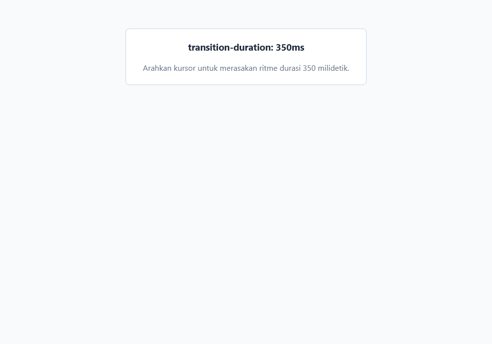

---

### 237. Properti transition-timing-function

**Tujuan:** Mengatur kurva percepatan gerak transisi (ease, ease-in, ease-out, linear, cubic-bezier).

**Konsep Utama:**
Kurva waktu (timing function) mengontrol ritme percepatan gerak: `ease-out` (mulai cepat lalu melambat anggun di akhir - ideal untuk UI masuk), `linear` (kecepatan konstan mekanis), atau kustom `cubic-bezier()`.

**Penjelasan Source Code:**
Menerapkan `ease-out` untuk animasi gerak tombol yang terasa luwes dan responsif.

**Source code utama:** [237_transition_timing_function.css](237_transition_timing_function.css)

**File pendukung preview:** [237_transition_timing_function.html](237_transition_timing_function.html)

**Cara Menjalankan:**
Buka file HTML pendukung di peramban web (Google Chrome, Microsoft Edge, atau Mozilla Firefox), atau gunakan Live Server / HTTP Server:

```bash
# Buka langsung file HTML di browser default
start "" "237_transition_timing_function.html"
```

**Hasil yang Diharapkan:**
Tombol aksi dengan kurva percepatan ease-out yang alami.

**Screenshot Hasil Eksekusi:**

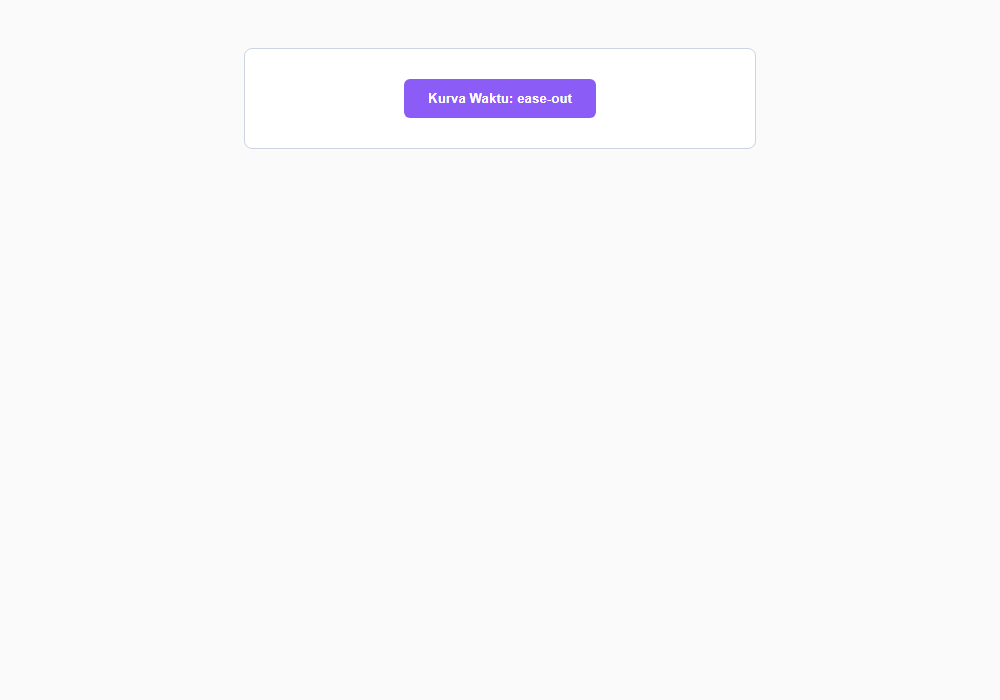

---

### 238. Properti transition-delay

**Tujuan:** Menetapkan jeda waktu tunggu sebelum animasi transisi mulai dijalankan.

**Konsep Utama:**
Properti `transition-delay` menunda dimulainya transisi selama durasi tertentu (misal `0.2s`). Sangat berguna untuk menciptakan efek kemunculan beruntun (staggered delay).

**Penjelasan Source Code:**
Memberikan delay 200ms pada tombol sehingga transisi tidak langsung aktif seketika.

**Source code utama:** [238_transition_delay.css](238_transition_delay.css)

**File pendukung preview:** [238_transition_delay.html](238_transition_delay.html)

**Cara Menjalankan:**
Buka file HTML pendukung di peramban web (Google Chrome, Microsoft Edge, atau Mozilla Firefox), atau gunakan Live Server / HTTP Server:

```bash
# Buka langsung file HTML di browser default
start "" "238_transition_delay.html"
```

**Hasil yang Diharapkan:**
Komponen yang bereaksi dengan jeda waktu sengaja sebelum bertransisi.

**Screenshot Hasil Eksekusi:**

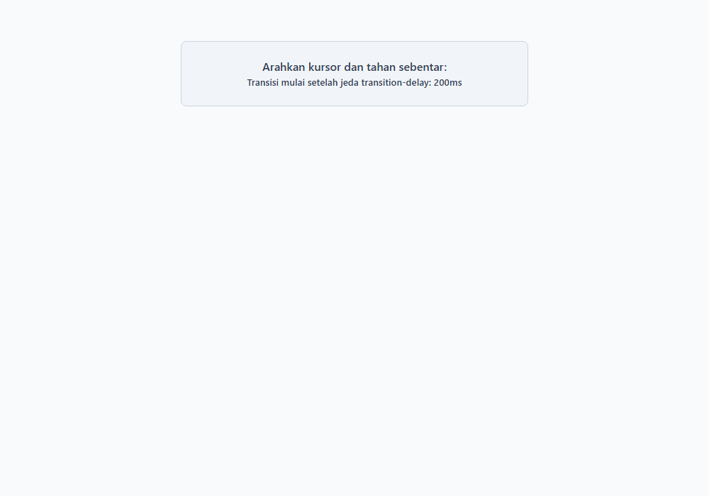

---

### 239. Shorthand transition

**Tujuan:** Menggabungkan property, duration, timing-function, dan delay dalam shorthand transition tunggal.

**Konsep Utama:**
Shorthand `transition: [property] [duration] [timing-function] [delay]`. Nilai waktu pertama dibaca sebagai `duration`, dan nilai waktu kedua (jika ada) dibaca sebagai `delay`.

**Penjelasan Source Code:**
Menerapkan `transition: all 0.25s ease-out` pada kartu interaktif.

**Source code utama:** [239_transition_shorthand.css](239_transition_shorthand.css)

**File pendukung preview:** [239_transition_shorthand.html](239_transition_shorthand.html)

**Cara Menjalankan:**
Buka file HTML pendukung di peramban web (Google Chrome, Microsoft Edge, atau Mozilla Firefox), atau gunakan Live Server / HTTP Server:

```bash
# Buka langsung file HTML di browser default
start "" "239_transition_shorthand.html"
```

**Hasil yang Diharapkan:**
Kartu modern dengan animasi transisi yang mulus dan terpadu.

**Screenshot Hasil Eksekusi:**

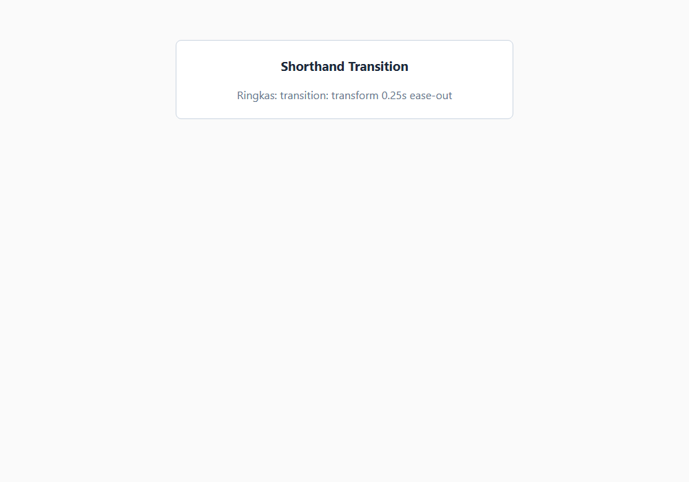

---

### 240. Animasi dengan @keyframes

**Tujuan:** Menyusun linimasa animasi multi-langkah menggunakan at-rule @keyframes.

**Konsep Utama:**
At-rule `@keyframes [nama]` mendefinisikan perubahan gaya di sepanjang linimasa animasi dari `0%` (atau `from`) hingga `100%` (atau `to`), memungkinkan pergerakan berulang mandiri tanpa pemicu hover.

**Penjelasan Source Code:**
Membuat animasi efek denyut pendaran (pulse) menggunakan `@keyframes pulse`.

**Source code utama:** [240_keyframes_animation.css](240_keyframes_animation.css)

**File pendukung preview:** [240_keyframes_animation.html](240_keyframes_animation.html)

**Cara Menjalankan:**
Buka file HTML pendukung di peramban web (Google Chrome, Microsoft Edge, atau Mozilla Firefox), atau gunakan Live Server / HTTP Server:

```bash
# Buka langsung file HTML di browser default
start "" "240_keyframes_animation.html"
```

**Hasil yang Diharapkan:**
Lencana status yang membesar dan mengecil secara berirama (pulse).

**Screenshot Hasil Eksekusi:**

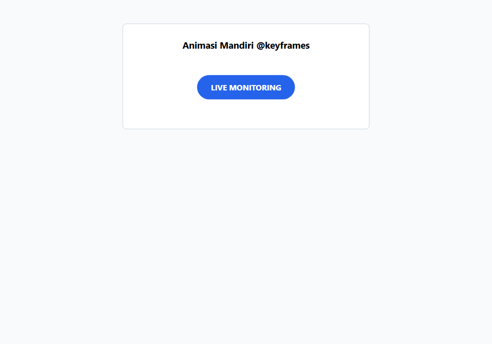

---

### 241. Properti animation-duration

**Tujuan:** Menentukan lama waktu penyelesaian satu siklus penuh animasi.

**Konsep Utama:**
Properti `animation-duration` menentukan berapa lama satu siklus linimasa `@keyframes` berjalan dari 0% hingga 100%.

**Penjelasan Source Code:**
Mengatur durasi animasi progress bergeser sepanjang 1.5 detik.

**Source code utama:** [241_animation_duration.css](241_animation_duration.css)

**File pendukung preview:** [241_animation_duration.html](241_animation_duration.html)

**Cara Menjalankan:**
Buka file HTML pendukung di peramban web (Google Chrome, Microsoft Edge, atau Mozilla Firefox), atau gunakan Live Server / HTTP Server:

```bash
# Buka langsung file HTML di browser default
start "" "241_animation_duration.html"
```

**Hasil yang Diharapkan:**
Bilah progres beranimasi yang meluncur dengan tempo teratur.

**Screenshot Hasil Eksekusi:**

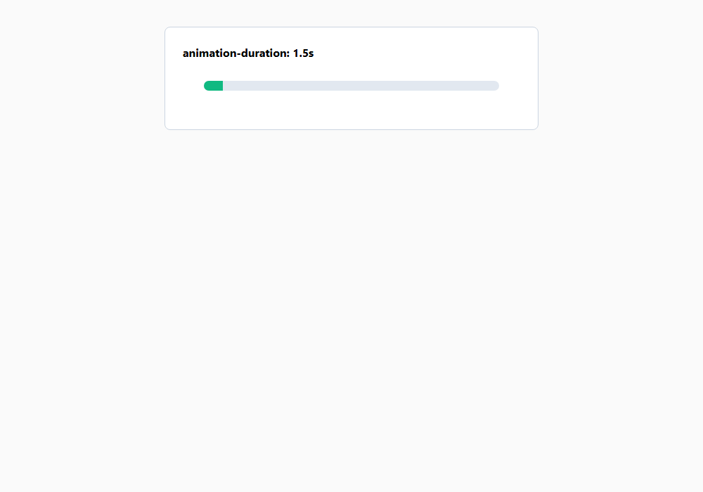

---

### 242. Properti animation-iteration-count

**Tujuan:** Mengatur pengulangan siklus animasi: jumlah putaran pasti (angka) atau berulang terus (infinite).

**Konsep Utama:**
`animation-iteration-count` menentukan berapa kali animasi dimainkan: angka bulat (misal `3` kali) atau kata kunci `infinite` untuk animasi yang terus berjalan tanpa henti.

**Penjelasan Source Code:**
Membuat ikon loading berputar tanpa henti dengan `animation-iteration-count: infinite`.

**Source code utama:** [242_animation_iteration_count.css](242_animation_iteration_count.css)

**File pendukung preview:** [242_animation_iteration_count.html](242_animation_iteration_count.html)

**Cara Menjalankan:**
Buka file HTML pendukung di peramban web (Google Chrome, Microsoft Edge, atau Mozilla Firefox), atau gunakan Live Server / HTTP Server:

```bash
# Buka langsung file HTML di browser default
start "" "242_animation_iteration_count.html"
```

**Hasil yang Diharapkan:**
Ikon lingkaran berputar terus-menerus tanpa jeda.

**Screenshot Hasil Eksekusi:**

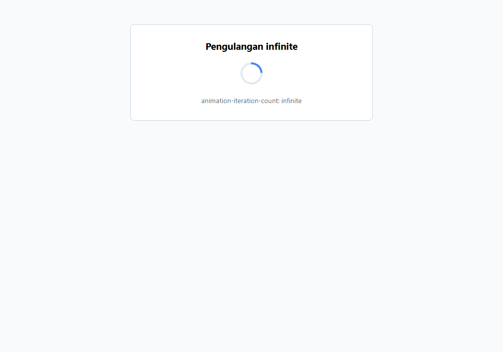

---

### 243. Arah dan fill mode animasi

**Tujuan:** Mengatur arah bolak-balik (direction: alternate) dan mempertahankan posisi akhir (fill-mode: forwards).

**Konsep Utama:**
`animation-direction: alternate` memutar animasi maju lalu mundur. `animation-fill-mode: forwards` mengunci elemen pada kondisi gaya frame terakhir (100%) setelah animasi selesai, mencegah elemen melompat kembali ke kondisi awal.

**Penjelasan Source Code:**
Mengunci posisi akhir elemen bergeser menggunakan `animation-fill-mode: forwards`.

**Source code utama:** [243_animation_direction_fill_mode.css](243_animation_direction_fill_mode.css)

**File pendukung preview:** [243_animation_direction_fill_mode.html](243_animation_direction_fill_mode.html)

**Cara Menjalankan:**
Buka file HTML pendukung di peramban web (Google Chrome, Microsoft Edge, atau Mozilla Firefox), atau gunakan Live Server / HTTP Server:

```bash
# Buka langsung file HTML di browser default
start "" "243_animation_direction_fill_mode.html"
```

**Hasil yang Diharapkan:**
Kotak yang meluncur dan tetap menetap di posisi akhirnya secara stabil.

**Screenshot Hasil Eksekusi:**

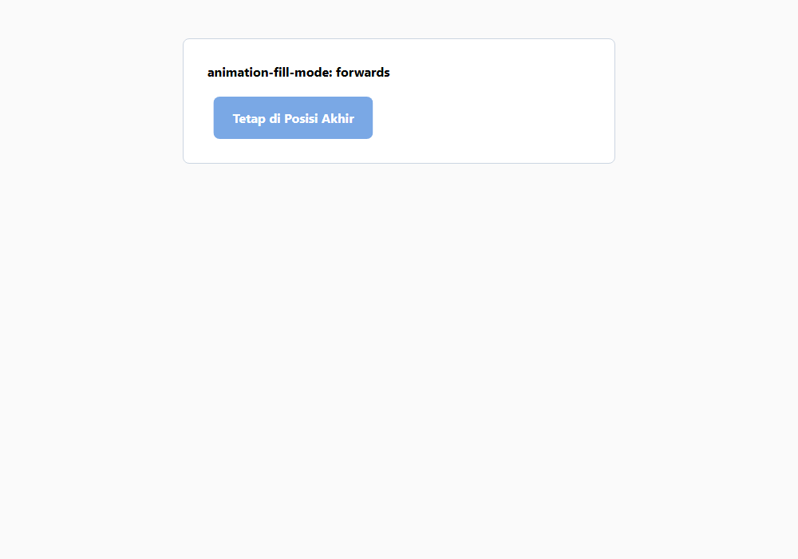

---

### 244. Properti animation-play-state

**Tujuan:** Menghentikan sementara (paused) atau melanjutkan (running) jalannya animasi.

**Konsep Utama:**
Properti `animation-play-state: paused` membekukan animasi di titik saat itu juga, dan `running` melanjutkannya kembali. Sangat populer untuk menghentikan animasi banner saat pengguna mengarahkan kursor.

**Penjelasan Source Code:**
Menghentikan animasi berputar kartu saat disentuh kursor menggunakan `:hover { animation-play-state: paused; }`.

**Source code utama:** [244_animation_play_state.css](244_animation_play_state.css)

**File pendukung preview:** [244_animation_play_state.html](244_animation_play_state.html)

**Cara Menjalankan:**
Buka file HTML pendukung di peramban web (Google Chrome, Microsoft Edge, atau Mozilla Firefox), atau gunakan Live Server / HTTP Server:

```bash
# Buka langsung file HTML di browser default
start "" "244_animation_play_state.html"
```

**Hasil yang Diharapkan:**
Elemen animasi yang berhenti sejenak saat kursor melayang di atasnya.

**Screenshot Hasil Eksekusi:**

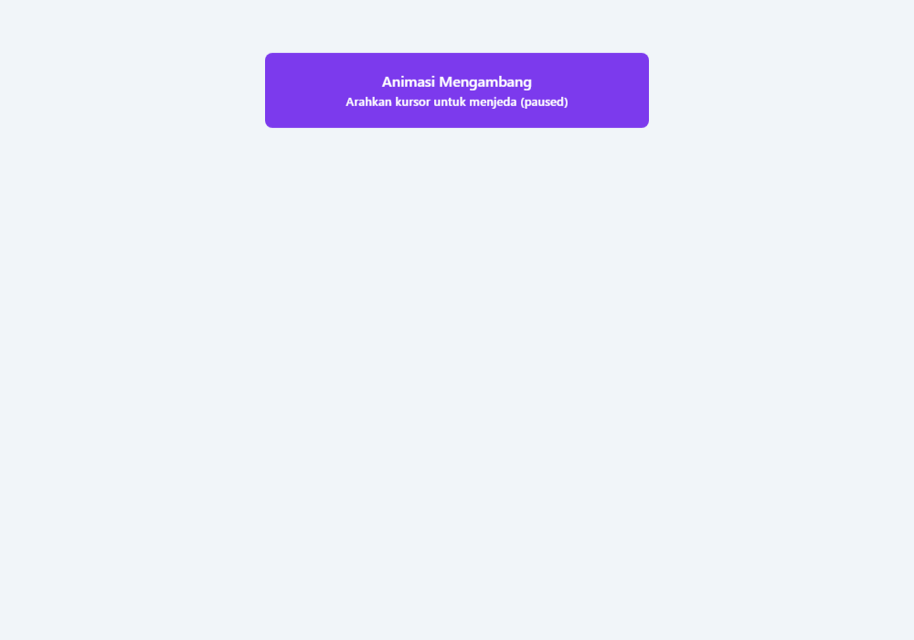

---

### 245. Komposisi dan beberapa animasi

**Tujuan:** Menjalankan beberapa animasi secara bersamaan pada satu elemen menggunakan pemisah koma.

**Konsep Utama:**
CSS mengizinkan komposisi beberapa animasi simultan dipisahkan dengan koma: misalnya animasi pergeseran horizontal dipadukan bersama animasi fade-in transparan.

**Penjelasan Source Code:**
Memadukan animasi `fadeIn` dan `slideUp` secara harmonis pada satu kartu pengumuman.

**Source code utama:** [245_animation_composition.css](245_animation_composition.css)

**File pendukung preview:** [245_animation_composition.html](245_animation_composition.html)

**Cara Menjalankan:**
Buka file HTML pendukung di peramban web (Google Chrome, Microsoft Edge, atau Mozilla Firefox), atau gunakan Live Server / HTTP Server:

```bash
# Buka langsung file HTML di browser default
start "" "245_animation_composition.html"
```

**Hasil yang Diharapkan:**
Kartu pengumuman yang muncul dengan efek memudar sekaligus meluncur ke atas.

**Screenshot Hasil Eksekusi:**

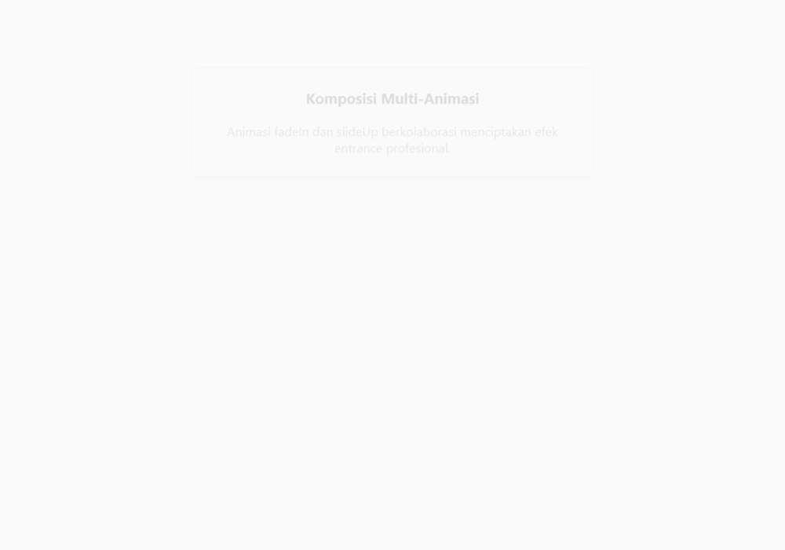

---

## Ringkasan Modul

Animasi dan transisi yang halus memandu fokus mata pengguna serta memberikan umpan balik intuitif. Modul 13 membekali pembelajar dengan penguasaan prinsip gerak web (motion design) berbasis standar modern W3C.

### Keterkaitan Materi
Seluruh submodul dalam modul ini dirancang secara berjenjang untuk membangun pemahaman yang kokoh dan aplikatif. Lanjutkan ke modul berikutnya setelah menguasai seluruh konsep di atas.
