# Modul 15: At-rules dan Fitur CSS Modern

## Ringkasan Ruang Lingkup Materi

Modul ini mengeksplorasi ekosistem at-rules (@) dan fitur mutakhir CSS kontemporer: reviu at-rule @media, feature detection mutakhir dengan @supports (notasi selector() dan font-format), mekanisme modularitas berkas @import, integrasi font lokal dan web @font-face, linimasa animasi @keyframes, manajemen hierarki spesifisitas eksplisit dengan @layer, container queries @container berbasis wadah lokal, isolasi gaya komponen dengan at-rule baru @scope, pendaftaran variabel ber-tipe data yang dapat dianimasikan melalui Houdini @property, sintaks native CSS Nesting (&), tata urutan prioritas cascade layer, serta pengalaman interaksi gulir modern: scroll-snap-type (mandatory/proximity), scroll-snap-align (start/center), dan animasi gulir halus native scroll-behavior: smooth.

## Tujuan Pembelajaran Modul

- Mengidentifikasi dan menerapkan keluarga at-rules resmi W3C secara tepat.
- Mendeteksi dukungan fitur browser modern sebelum menerapkan CSS baru menggunakan @supports.
- Mengisolasi batas jangkauan selector menggunakan fitur mutakhir @scope.
- Mendefinisikan variabel CSS bertipe data (syntax, inherits, initial-value) dengan @property.
- Menulis struktur CSS bersarang secara native menggunakan CSS Nesting (&).
- Membangun carousel dan slide presentasi yang terpasang pas (snapping) dengan CSS Scroll Snap.

## Daftar Submodul

- [266. At-rule @media](266_media_at_rule.css) — [Halaman Preview](266_media_at_rule.html)
- [267. At-rule @supports](267_supports_at_rule.css) — [Halaman Preview](267_supports_at_rule.html)
- [268. At-rule @import](268_import_at_rule.css) — [Halaman Preview](268_import_at_rule.html)
- [269. At-rule @font-face](269_font_face_at_rule.css) — [Halaman Preview](269_font_face_at_rule.html)
- [270. At-rule @keyframes](270_keyframes_at_rule.css) — [Halaman Preview](270_keyframes_at_rule.html)
- [271. At-rule @layer](271_layer_at_rule.css) — [Halaman Preview](271_layer_at_rule.html)
- [272. At-rule @container](272_container_at_rule.css) — [Halaman Preview](272_container_at_rule.html)
- [273. At-rule @scope](273_scope_at_rule.css) — [Halaman Preview](273_scope_at_rule.html)
- [274. At-rule @property](274_property_at_rule.css) — [Halaman Preview](274_property_at_rule.html)
- [275. CSS nesting](275_css_nesting.css) — [Halaman Preview](275_css_nesting.html)
- [276. Urutan cascade layers](276_cascade_layer_order.css) — [Halaman Preview](276_cascade_layer_order.html)
- [277. Feature detection dengan @supports](277_css_feature_detection.css) — [Halaman Preview](277_css_feature_detection.html)
- [278. Scroll snapping menggunakan scroll-snap-type](278_scroll_snap_type.css) — [Halaman Preview](278_scroll_snap_type.html)
- [279. Scroll snapping menggunakan scroll-snap-align](279_scroll_snap_align.css) — [Halaman Preview](279_scroll_snap_align.html)
- [280. Properti scroll-behavior](280_scroll_behavior.css) — [Halaman Preview](280_scroll_behavior.html)

---

## Pembahasan dan Penjelasan Submodul

### 266. At-rule @media

**Tujuan:** Meninjau kembali at-rule @media dan sintaks jangkauan (range syntax modern).

**Konsep Utama:**
Sintaks range modern W3C memungkinkan penulisan media query seperti `@media (width >= 600px)` yang jauh lebih intuitif dibanding penulisan lama `(min-width: 600px)`.

**Penjelasan Source Code:**
Mendemonstrasikan kartu responsif yang memanfaatkan sintaks jangkauan media query.

**Source code utama:** [266_media_at_rule.css](266_media_at_rule.css)

**File pendukung preview:** [266_media_at_rule.html](266_media_at_rule.html)

**Cara Menjalankan:**
Buka file HTML pendukung di peramban web (Google Chrome, Microsoft Edge, atau Mozilla Firefox), atau gunakan Live Server / HTTP Server:

```bash
# Buka langsung file HTML di browser default
start "" "266_media_at_rule.html"
```

**Hasil yang Diharapkan:**
Kotak kartu berpenampilan adaptif dengan sintaks modern @media.

**Screenshot Hasil Eksekusi:**

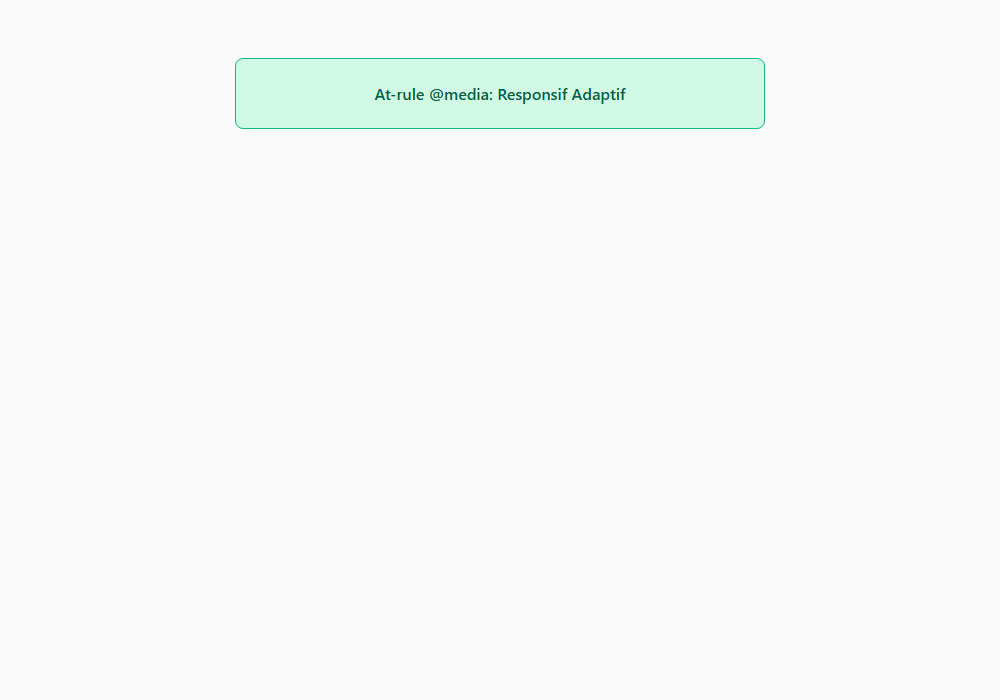

---

### 267. At-rule @supports

**Tujuan:** Melakukan feature detection untuk memeriksa apakah peramban mendukung sintaks CSS tertentu.

**Konsep Utama:**
At-rule `@supports (properti: nilai)` mengecek kemampuan mesin rendering peramban. Jika fitur didukung, aturan di dalamnya dieksekusi; jika tidak, aturan alternatif diabaikan tanpa menghasilkan error.

**Penjelasan Source Code:**
Mengecek dukungan terhadap `backdrop-filter: blur(10px)` sebelum menerapkannya.

**Source code utama:** [267_supports_at_rule.css](267_supports_at_rule.css)

**File pendukung preview:** [267_supports_at_rule.html](267_supports_at_rule.html)

**Cara Menjalankan:**
Buka file HTML pendukung di peramban web (Google Chrome, Microsoft Edge, atau Mozilla Firefox), atau gunakan Live Server / HTTP Server:

```bash
# Buka langsung file HTML di browser default
start "" "267_supports_at_rule.html"
```

**Hasil yang Diharapkan:**
Kotak visual yang menerapkan efek kaca buram jika peramban mendukungnya.

**Screenshot Hasil Eksekusi:**

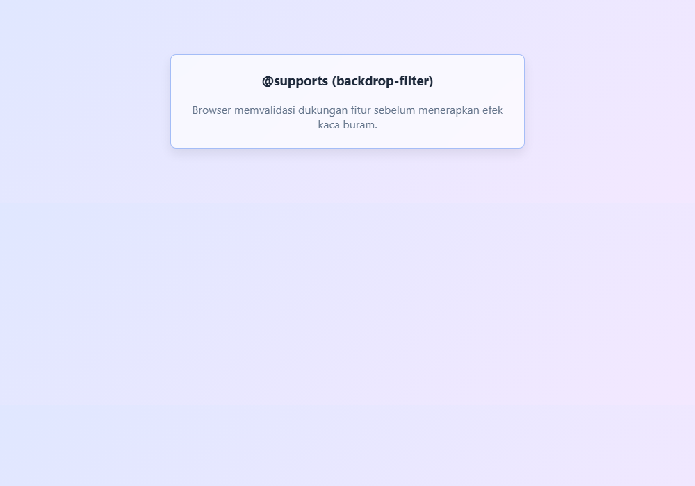

---

### 268. At-rule @import

**Tujuan:** Mengimpor berkas stylesheet lain dari dalam berkas CSS menggunakan @import.

**Konsep Utama:**
At-rule `@import url(...)` harus diletakkan di baris paling awal berkas CSS sebelum deklarasi aturan lainnya. Berguna untuk memecah stylesheet menjadi modul-modul terpisah.

**Penjelasan Source Code:**
Mendemonstrasikan struktur aturan impor modular di baris teratas dokumen.

**Source code utama:** [268_import_at_rule.css](268_import_at_rule.css)

**File pendukung preview:** [268_import_at_rule.html](268_import_at_rule.html)

**Cara Menjalankan:**
Buka file HTML pendukung di peramban web (Google Chrome, Microsoft Edge, atau Mozilla Firefox), atau gunakan Live Server / HTTP Server:

```bash
# Buka langsung file HTML di browser default
start "" "268_import_at_rule.html"
```

**Hasil yang Diharapkan:**
Komponen kartu styled yang terstruktur rapi dengan deklarasi impor modular.

**Screenshot Hasil Eksekusi:**

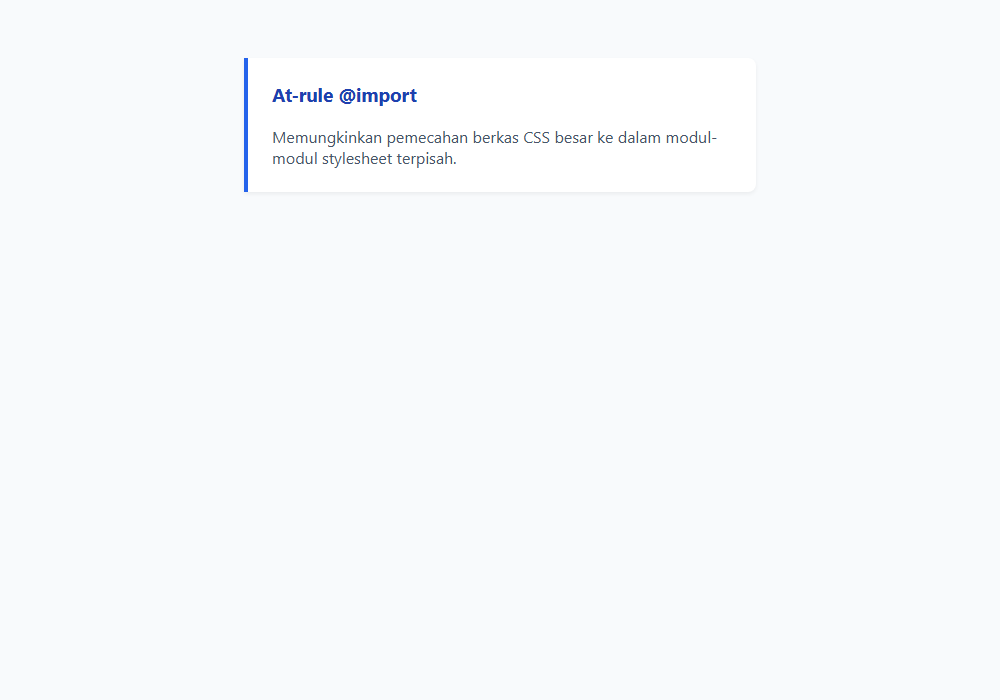

---

### 269. At-rule @font-face

**Tujuan:** Mendaftarkan keluarga font kustom web menggunakan at-rule @font-face.

**Konsep Utama:**
At-rule `@font-face` mengasosiasikan nama font kustom dengan berkas biner font (woff2, woff) dan deskriptor bobot/gaya.

**Penjelasan Source Code:**
Mendefinisikan font web kustom dan menerapkannya pada kartu pameran.

**Source code utama:** [269_font_face_at_rule.css](269_font_face_at_rule.css)

**File pendukung preview:** [269_font_face_at_rule.html](269_font_face_at_rule.html)

**Cara Menjalankan:**
Buka file HTML pendukung di peramban web (Google Chrome, Microsoft Edge, atau Mozilla Firefox), atau gunakan Live Server / HTTP Server:

```bash
# Buka langsung file HTML di browser default
start "" "269_font_face_at_rule.html"
```

**Hasil yang Diharapkan:**
Teks kartu yang dirender dengan font kustom terdaftar.

**Screenshot Hasil Eksekusi:**

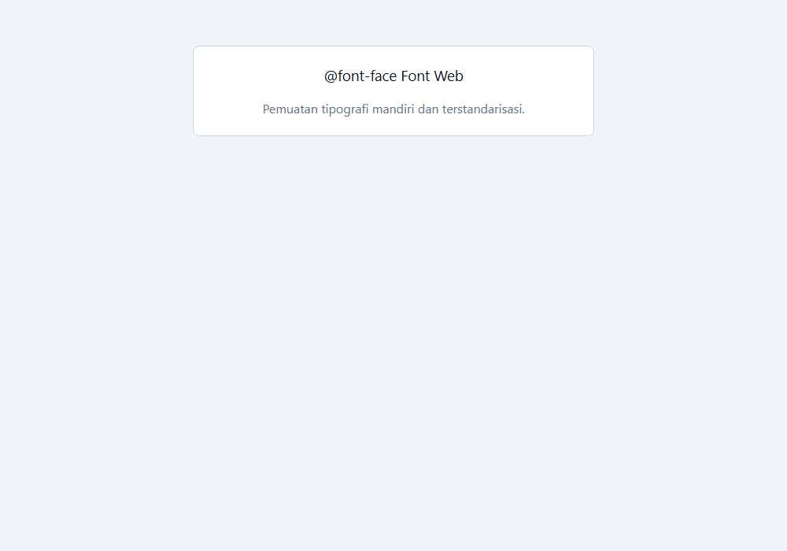

---

### 270. At-rule @keyframes

**Tujuan:** Menyusun skenario animasi bertingkat dengan titik persentase 0%, 50%, dan 100%.

**Konsep Utama:**
At-rule `@keyframes` memetakan transformasi gaya di sepanjang waktu, memberikan kontrol total pada pergerakan elemen.

**Penjelasan Source Code:**
Membuat animasi mengambang (bobbing) secara konstan.

**Source code utama:** [270_keyframes_at_rule.css](270_keyframes_at_rule.css)

**File pendukung preview:** [270_keyframes_at_rule.html](270_keyframes_at_rule.html)

**Cara Menjalankan:**
Buka file HTML pendukung di peramban web (Google Chrome, Microsoft Edge, atau Mozilla Firefox), atau gunakan Live Server / HTTP Server:

```bash
# Buka langsung file HTML di browser default
start "" "270_keyframes_at_rule.html"
```

**Hasil yang Diharapkan:**
Kotak kartu yang bergerak mengambang vertikal secara ritmis.

**Screenshot Hasil Eksekusi:**

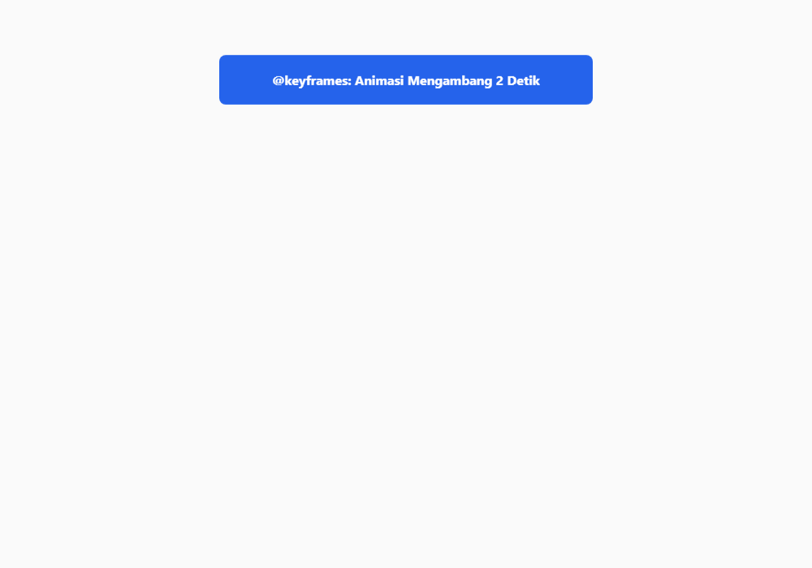

---

### 271. At-rule @layer

**Tujuan:** Mendefinisikan blok cascade layer untuk arsitektur CSS modern bebas konflik.

**Konsep Utama:**
At-rule `@layer [nama]` mengelompokkan aturan gaya ke dalam lapisan cascade independen, di mana prioritas ditentukan oleh urutan layer, bukan tingginya nilai specificity selector.

**Penjelasan Source Code:**
Menata tombol di dalam layer `framework` dan layer `custom`.

**Source code utama:** [271_layer_at_rule.css](271_layer_at_rule.css)

**File pendukung preview:** [271_layer_at_rule.html](271_layer_at_rule.html)

**Cara Menjalankan:**
Buka file HTML pendukung di peramban web (Google Chrome, Microsoft Edge, atau Mozilla Firefox), atau gunakan Live Server / HTTP Server:

```bash
# Buka langsung file HTML di browser default
start "" "271_layer_at_rule.html"
```

**Hasil yang Diharapkan:**
Tombol yang memakai styling layer custom yang menang prioritas.

**Screenshot Hasil Eksekusi:**

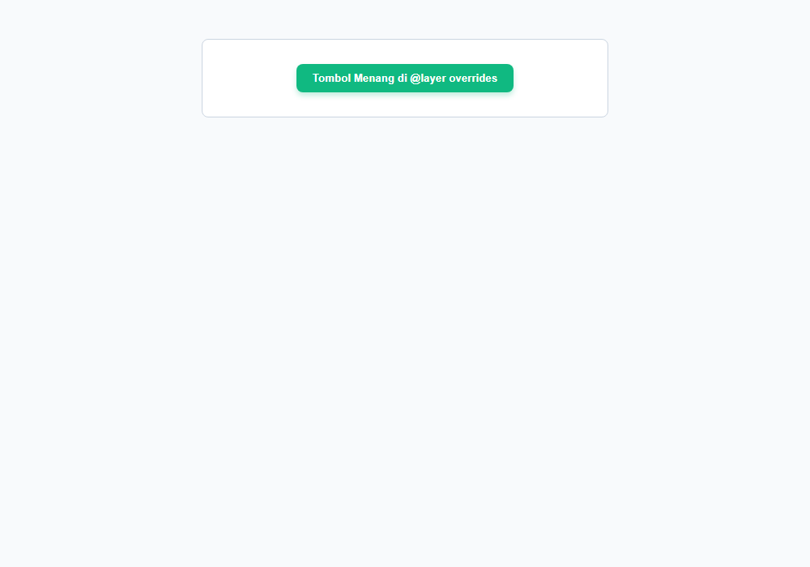

---

### 272. At-rule @container

**Tujuan:** Menulis aturan gaya kondisional yang merespons lebar kontainer wadah induk (@container).

**Konsep Utama:**
At-rule `@container (min-width: ...)` mengecek dimensi dari elemen leluhur yang ditetapkan sebagai container context (`container-type`).

**Penjelasan Source Code:**
Mengubah warna latar kartu saat wadah kontainer memiliki lebar di atas 350px.

**Source code utama:** [272_container_at_rule.css](272_container_at_rule.css)

**File pendukung preview:** [272_container_at_rule.html](272_container_at_rule.html)

**Cara Menjalankan:**
Buka file HTML pendukung di peramban web (Google Chrome, Microsoft Edge, atau Mozilla Firefox), atau gunakan Live Server / HTTP Server:

```bash
# Buka langsung file HTML di browser default
start "" "272_container_at_rule.html"
```

**Hasil yang Diharapkan:**
Komponen yang beradaptasi secara elegan terhadap ukuran wadahnya.

**Screenshot Hasil Eksekusi:**

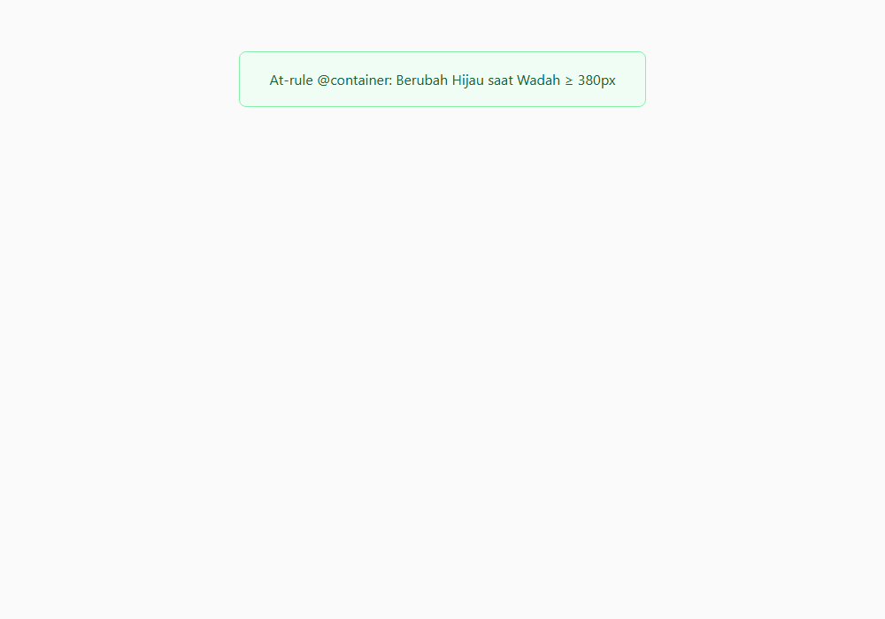

---

### 273. At-rule @scope

**Tujuan:** Mengisolasi batas jangkauan selector menggunakan fitur mutakhir @scope (Scoped CSS).

**Konsep Utama:**
At-rule `@scope (root) to (limit)` membatasi jangkauan aturan CSS hanya di antara elemen root tertentu hingga batas (boundary) elemen tertentu, mencegah 'kebocoran' gaya ke komponen lain.

**Penjelasan Source Code:**
Mengisolasi penataan teks di dalam `.card-scope` tanpa memengaruhi teks di luar atau di dalam sub-komponen terisolasi.

**Source code utama:** [273_scope_at_rule.css](273_scope_at_rule.css)

**File pendukung preview:** [273_scope_at_rule.html](273_scope_at_rule.html)

**Cara Menjalankan:**
Buka file HTML pendukung di peramban web (Google Chrome, Microsoft Edge, atau Mozilla Firefox), atau gunakan Live Server / HTTP Server:

```bash
# Buka langsung file HTML di browser default
start "" "273_scope_at_rule.html"
```

**Hasil yang Diharapkan:**
Komponen yang gayanya terisolasi secara aman dalam cakupan scope.

**Screenshot Hasil Eksekusi:**

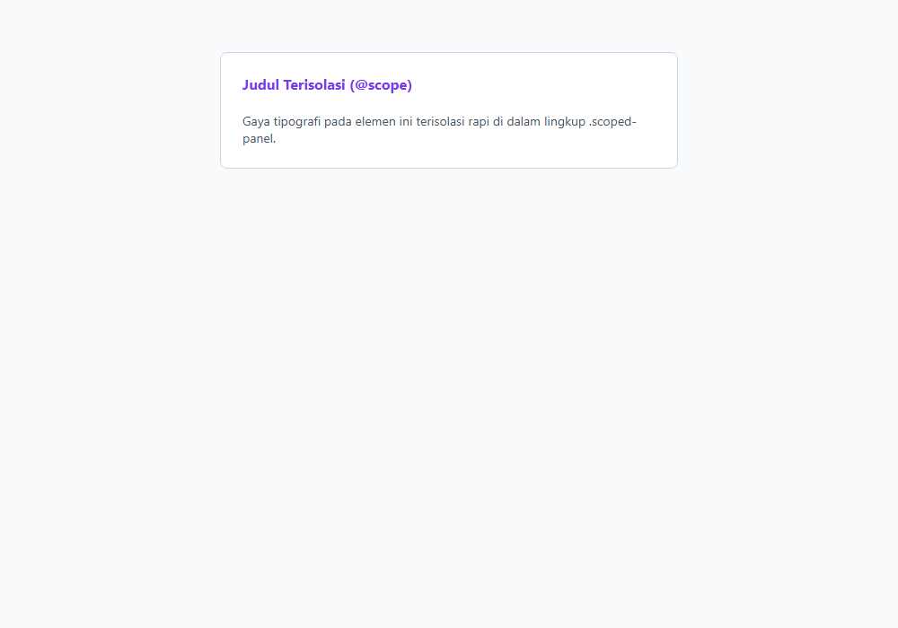

---

### 274. At-rule @property

**Tujuan:** Mendaftarkan variabel bertipe data (CSS Houdini @property) yang dapat dianimasikan secara halus.

**Konsep Utama:**
At-rule `@property --nama` mendaftarkan custom property dengan sintaks resmi (`<color>`, `<length>`, `<percentage>`), status inheritance, dan nilai awal (`initial-value`). Ini memungkinkan animasi gradasi yang sebelumnya mustahil di CSS biasa.

**Penjelasan Source Code:**
Mendaftarkan variabel `--gradient-angle` bertipe `<angle>` untuk menganimasikan sudut gradasi memutar.

**Source code utama:** [274_property_at_rule.css](274_property_at_rule.css)

**File pendukung preview:** [274_property_at_rule.html](274_property_at_rule.html)

**Cara Menjalankan:**
Buka file HTML pendukung di peramban web (Google Chrome, Microsoft Edge, atau Mozilla Firefox), atau gunakan Live Server / HTTP Server:

```bash
# Buka langsung file HTML di browser default
start "" "274_property_at_rule.html"
```

**Hasil yang Diharapkan:**
Kotak kartu berpenampilan modern dengan properti ber-tipe data terdaftar.

**Screenshot Hasil Eksekusi:**

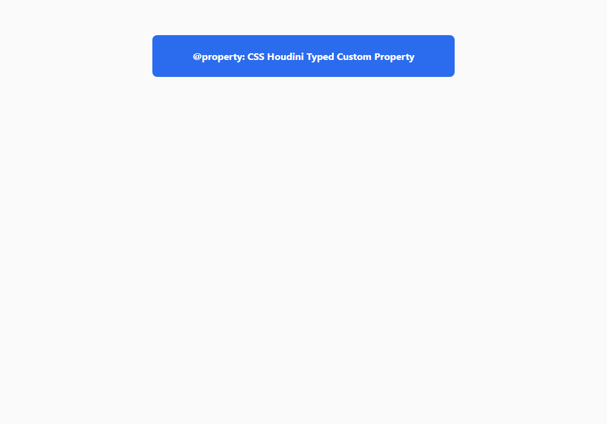

---

### 275. CSS nesting

**Tujuan:** Menulis aturan CSS bersarang (nesting) secara native di browser tanpa bantuan preprocessor.

**Konsep Utama:**
Native CSS Nesting memungkinkan penulisan ruleset anak langsung di dalam kurung kurawal induknya, baik dengan simbol ampersand (`&`) maupun secara langsung.

**Penjelasan Source Code:**
Menuliskan gaya judul dan efek hover tombol di dalam blok ruleset `.nested-card` menggunakan `&`.

**Source code utama:** [275_css_nesting.css](275_css_nesting.css)

**File pendukung preview:** [275_css_nesting.html](275_css_nesting.html)

**Cara Menjalankan:**
Buka file HTML pendukung di peramban web (Google Chrome, Microsoft Edge, atau Mozilla Firefox), atau gunakan Live Server / HTTP Server:

```bash
# Buka langsung file HTML di browser default
start "" "275_css_nesting.html"
```

**Hasil yang Diharapkan:**
Komponen kartu styled yang ditulis dengan sintaks CSS bersarang native.

**Screenshot Hasil Eksekusi:**

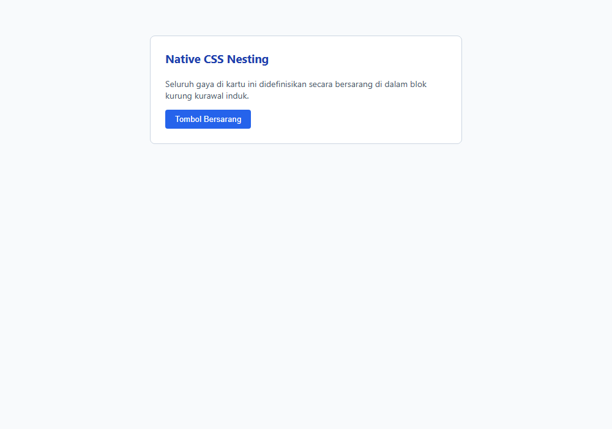

---

### 276. Urutan cascade layers

**Tujuan:** Menentukan urutan prioritas cascade layers secara eksplisit di awal berkas.

**Konsep Utama:**
Mendeklarasikan `@layer reset, theme, components, utilities;` di baris pertama stylesheet mengunci prioritas layer: layer yang ditulis belakangan akan selalu mengalahkan layer sebelumnya.

**Penjelasan Source Code:**
Mendemonstrasikan layer `utilities` yang menimpa layer `components` secara terprediksi.

**Source code utama:** [276_cascade_layer_order.css](276_cascade_layer_order.css)

**File pendukung preview:** [276_cascade_layer_order.html](276_cascade_layer_order.html)

**Cara Menjalankan:**
Buka file HTML pendukung di peramban web (Google Chrome, Microsoft Edge, atau Mozilla Firefox), atau gunakan Live Server / HTTP Server:

```bash
# Buka langsung file HTML di browser default
start "" "276_cascade_layer_order.html"
```

**Hasil yang Diharapkan:**
Elemen yang warnanya diatur oleh layer dengan prioritas tertinggi.

**Screenshot Hasil Eksekusi:**

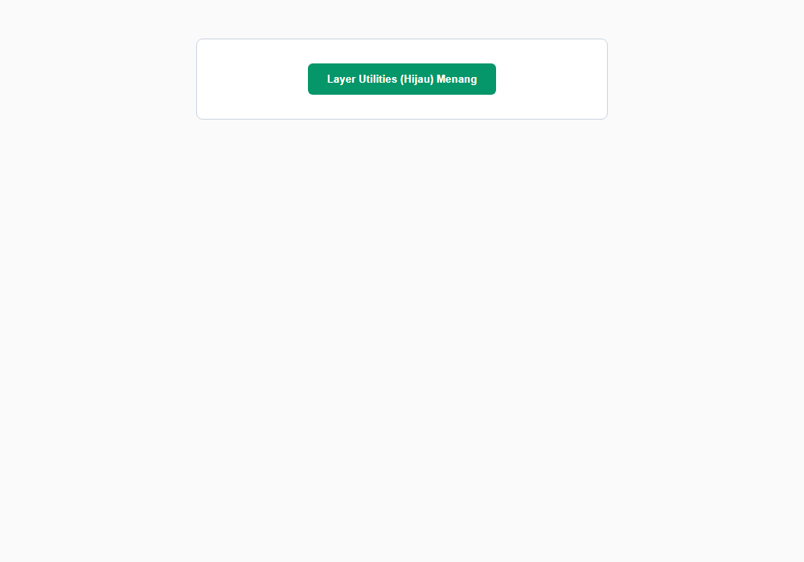

---

### 277. Feature detection dengan @supports

**Tujuan:** Mendeteksi dukungan selector canggih seperti :has() menggunakan @supports selector().

**Konsep Utama:**
Sintaks `@supports selector(:has(a))` memungkinkan pemeriksaan apakah peramban mendukung pseudo-class atau selector tertentu sebelum kode diterapkan.

**Penjelasan Source Code:**
Mengecek dukungan parent selector `:has()` menggunakan `@supports selector()`.

**Source code utama:** [277_css_feature_detection.css](277_css_feature_detection.css)

**File pendukung preview:** [277_css_feature_detection.html](277_css_feature_detection.html)

**Cara Menjalankan:**
Buka file HTML pendukung di peramban web (Google Chrome, Microsoft Edge, atau Mozilla Firefox), atau gunakan Live Server / HTTP Server:

```bash
# Buka langsung file HTML di browser default
start "" "277_css_feature_detection.html"
```

**Hasil yang Diharapkan:**
Lencana status yang memvalidasi dukungan selector canggih.

**Screenshot Hasil Eksekusi:**

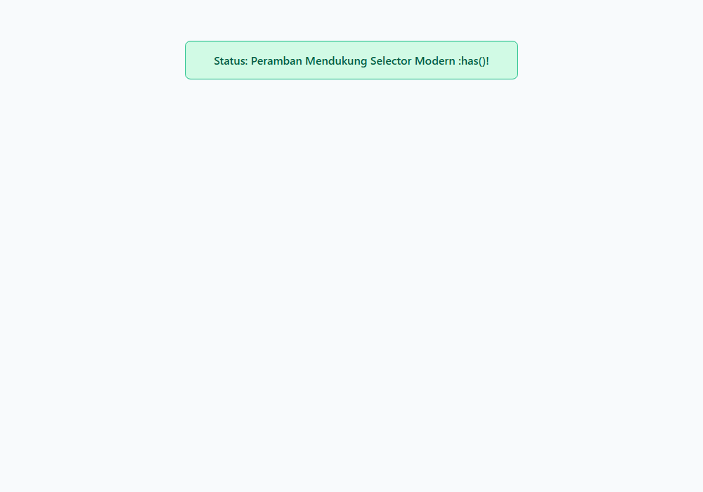

---

### 278. Scroll snapping menggunakan scroll-snap-type

**Tujuan:** Mengaktifkan efek scrolling yang melekat pas (snapping) pada kontainer carousel.

**Konsep Utama:**
Properti `scroll-snap-type: x mandatory` pada kontainer penggulir memaksa scrollbar untuk selalu berhenti tepat pada titik perhentian elemen anak (layaknya slide carousel aplikasi mobile).

**Penjelasan Source Code:**
Mengatur kontainer scroll horizontal dengan `scroll-snap-type: x mandatory`.

**Source code utama:** [278_scroll_snap_type.css](278_scroll_snap_type.css)

**File pendukung preview:** [278_scroll_snap_type.html](278_scroll_snap_type.html)

**Cara Menjalankan:**
Buka file HTML pendukung di peramban web (Google Chrome, Microsoft Edge, atau Mozilla Firefox), atau gunakan Live Server / HTTP Server:

```bash
# Buka langsung file HTML di browser default
start "" "278_scroll_snap_type.html"
```

**Hasil yang Diharapkan:**
Carousel horizontal dengan efek snapping yang melekat pas di setiap item.

**Screenshot Hasil Eksekusi:**

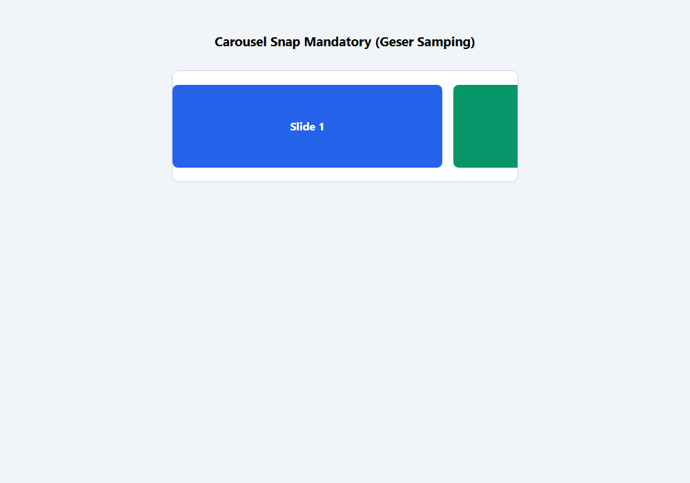

---

### 279. Scroll snapping menggunakan scroll-snap-align

**Tujuan:** Menentukan titik perataan perhentian item (start, center, end) pada scroll snap.

**Konsep Utama:**
Properti `scroll-snap-align` diterapkan pada elemen anak untuk menentukan bagian mana yang menempel: `start` (tepi kiri/atas), `center` (tepat di tengah kontainer), atau `end` (tepi kanan/bawah).

**Penjelasan Source Code:**
Menerapkan `scroll-snap-align: center` sehingga kartu selalu berhenti tepat di tengah layar.

**Source code utama:** [279_scroll_snap_align.css](279_scroll_snap_align.css)

**File pendukung preview:** [279_scroll_snap_align.html](279_scroll_snap_align.html)

**Cara Menjalankan:**
Buka file HTML pendukung di peramban web (Google Chrome, Microsoft Edge, atau Mozilla Firefox), atau gunakan Live Server / HTTP Server:

```bash
# Buka langsung file HTML di browser default
start "" "279_scroll_snap_align.html"
```

**Hasil yang Diharapkan:**
Carousel di mana setiap slide berhenti persis di tengah wadah.

**Screenshot Hasil Eksekusi:**

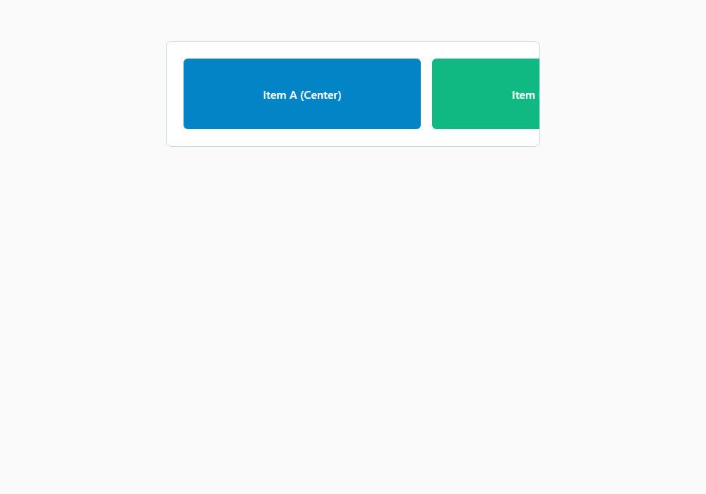

---

### 280. Properti scroll-behavior

**Tujuan:** Mengaktifkan animasi gulir halus (smooth scrolling) untuk navigasi tautan jangkar.

**Konsep Utama:**
Properti `scroll-behavior: smooth` pada elemen `html` atau kontainer scrollable mengubah lompatan navigasi tautan jangkar (anchor link `#section`) menjadi gerakan animasi meluncur yang halus tanpa JavaScript.

**Penjelasan Source Code:**
Menerapkan `scroll-behavior: smooth` pada kontainer dokumen.

**Source code utama:** [280_scroll_behavior.css](280_scroll_behavior.css)

**File pendukung preview:** [280_scroll_behavior.html](280_scroll_behavior.html)

**Cara Menjalankan:**
Buka file HTML pendukung di peramban web (Google Chrome, Microsoft Edge, atau Mozilla Firefox), atau gunakan Live Server / HTTP Server:

```bash
# Buka langsung file HTML di browser default
start "" "280_scroll_behavior.html"
```

**Hasil yang Diharapkan:**
Navigasi antar-bagian yang meluncur halus dan nyaman bagi mata pengguna.

**Screenshot Hasil Eksekusi:**

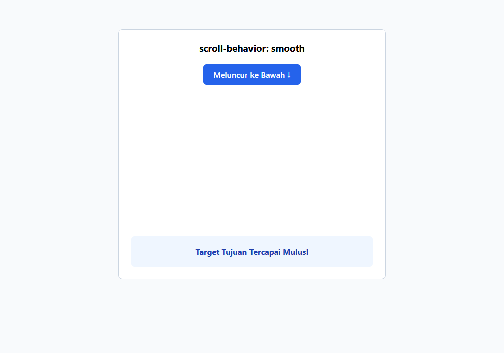

---

## Ringkasan Modul

CSS telah berevolusi menjadi bahasa presentasi yang sangat matang dan independen. Fitur-fitur modern pada Modul 15 seperti native nesting, @property, @scope, dan scroll snapping menghilangkan kebutuhan akan preprocessor lawas maupun plugin JavaScript yang berat.

### Keterkaitan Materi
Seluruh submodul dalam modul ini dirancang secara berjenjang untuk membangun pemahaman yang kokoh dan aplikatif. Lanjutkan ke modul berikutnya setelah menguasai seluruh konsep di atas.
