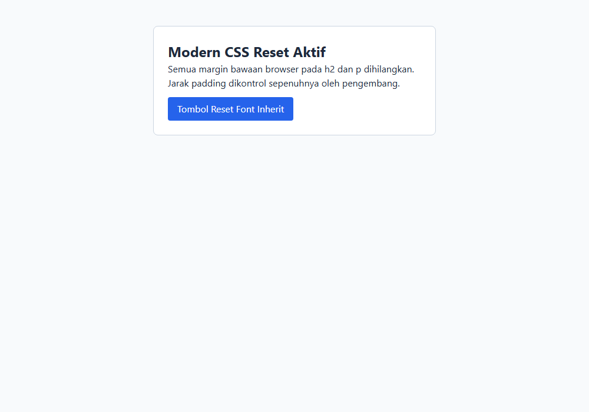
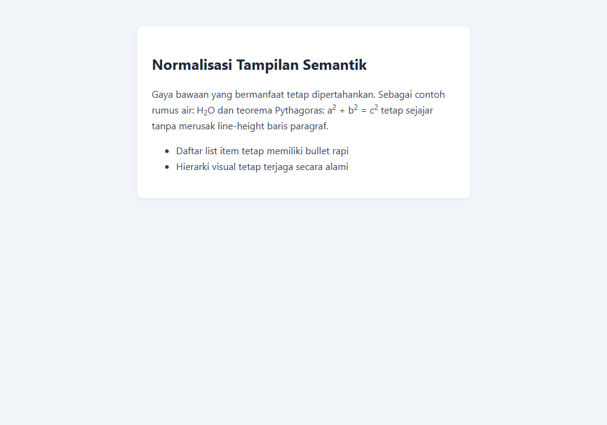
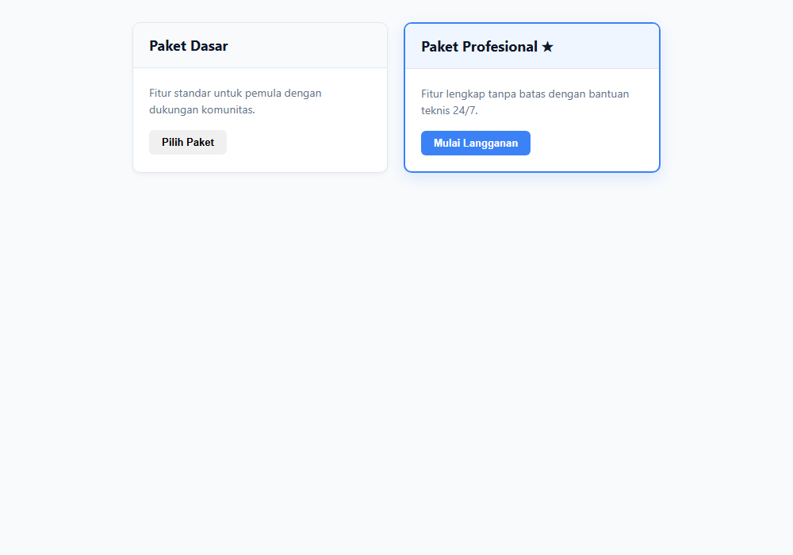
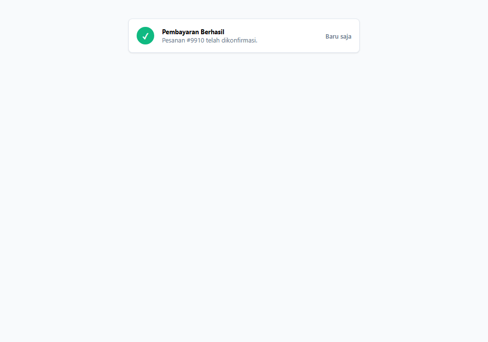
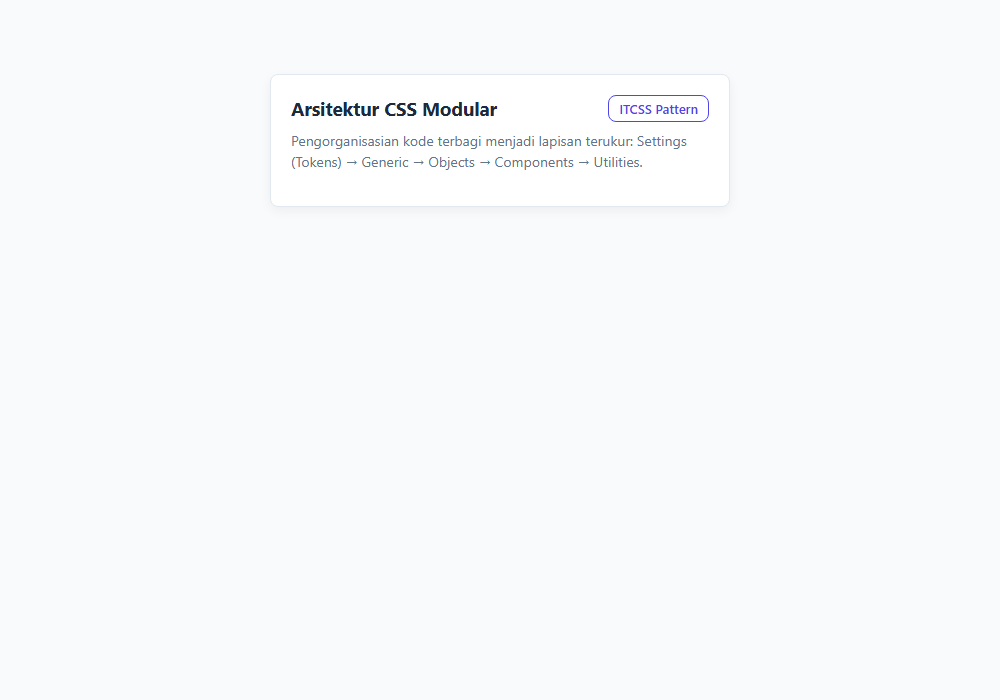

# Modul 17: Arsitektur CSS, Debugging, dan Best Practices

## Ringkasan Ruang Lingkup Materi

Modul ini membahas metodologi perancangan arsitektur, standarisasi dasar kode, dan praktik terbaik (best practices) dalam penulisan stylesheet skala besar: konsep CSS Reset untuk meratakan seluruh gaya bawaan peramban, strategi CSS Normalize untuk menyeragamkan konsistensi peramban tanpa menghapus gaya semantik bawaan, metodologi penamaan BEM (Block, Element, Modifier) untuk menghindari konflik spesifisitas, pendekatan Utility Classes (Atomic CSS) untuk penyusunan UI secara cepat dan konsisten, serta arsitektur pengorganisasian berkas CSS modular berstandar industri (seperti ITCSS dan prinsip 7-1 pattern).

## Tujuan Pembelajaran Modul

- Memahami perbedaan filosofis dan implementasi antara CSS Reset dengan CSS Normalize.
- Menerapkan fondasi reset modern yang menghilangkan kebiasaan buruk bawaan browser secara proporsional.
- Menguasai konvensi penamaan BEM (Block, Element, Modifier) untuk arsitektur CSS yang bersih dan tanpa tabrakan selektor.
- Membangun dan menerapkan kumpulan kelas utilitas (utility-first / atomic CSS) untuk efisiensi styling.
- Menata struktur organisasi berkas CSS proyek menjadi modul-modul terpisah yang mudah dirawat dan diskalakan.

## Daftar Submodul

- [291. CSS reset](291_css_reset.css) — [Halaman Preview](291_css_reset.html)
- [292. Normalisasi tampilan browser](292_css_normalize.css) — [Halaman Preview](292_css_normalize.html)
- [293. Konvensi penamaan BEM](293_bem_naming.css) — [Halaman Preview](293_bem_naming.html)
- [294. Utility classes](294_css_utility_classes.css) — [Halaman Preview](294_css_utility_classes.html)
- [295. Organisasi dan modularisasi CSS](295_css_organization.css) — [Halaman Preview](295_css_organization.html)

---

## Pembahasan dan Penjelasan Submodul

### 291. CSS reset

**Tujuan:** Menghilangkan seluruh perbedaan gaya bawaan (default user-agent stylesheet) antar berbagai peramban web.

**Konsep Utama:**
CSS Reset adalah kumpulan aturan dasar yang mengatur ulang (mereset) margin, padding, border, dan ukuran default elemen peramban ke titik nol netral. Reset modern juga menetapkan 'box-sizing: border-box' ke semua elemen dan membuat media responsif secara default.

**Penjelasan Source Code:**
Mengimplementasikan aturan modern CSS reset universal dan membandingkannya pada teks serta tombol dasar.

**Source code utama:** [291_css_reset.css](291_css_reset.css)

**File pendukung preview:** [291_css_reset.html](291_css_reset.html)

**Cara Menjalankan:**
Buka file HTML pendukung di peramban web (Google Chrome, Microsoft Edge, atau Mozilla Firefox), atau gunakan Live Server / HTTP Server:

```bash
# Buka langsung file HTML di browser default
start "" "291_css_reset.html"
```

**Hasil yang Diharapkan:**
Halaman yang terbebas dari margin/padding bawaan browser yang tidak diinginkan, dengan model kotak border-box.

**Screenshot Hasil Eksekusi:**



---

### 292. Normalisasi tampilan browser

**Tujuan:** Menyeragamkan perbedaan antar-peramban tanpa menghapus gaya semantik bawaan (prinsip Normalize.css).

**Konsep Utama:**
Berbeda dari CSS Reset yang menghapus segalanya, pendekatan 'Normalize' mempertahankan gaya semantik yang berguna (seperti hierarki font heading, bullet point daftar, teks tebal strong) sembari memperbaiki bug dan inkonsistensi rendering antar-peramban yang berbeda.

**Penjelasan Source Code:**
Mengatur normalisasi dasar: line-height konsisten, perbaikan rendering tanda superskrip/subskrip, dan konsistensi tombol form.

**Source code utama:** [292_css_normalize.css](292_css_normalize.css)

**File pendukung preview:** [292_css_normalize.html](292_css_normalize.html)

**Cara Menjalankan:**
Buka file HTML pendukung di peramban web (Google Chrome, Microsoft Edge, atau Mozilla Firefox), atau gunakan Live Server / HTTP Server:

```bash
# Buka langsung file HTML di browser default
start "" "292_css_normalize.html"
```

**Hasil yang Diharapkan:**
Elemen semantik HTML (heading, list, subscript) yang tertata rapi, proporsional, dan identik di semua peramban.

**Screenshot Hasil Eksekusi:**



---

### 293. Konvensi penamaan BEM

**Tujuan:** Menerapkan metodologi penamaan BEM (Block, Element, Modifier) untuk arsitektur CSS yang modular dan bebas konflik.

**Konsep Utama:**
BEM membagi antarmuka menjadi tiga entitas: Block (komponen independen bermakna, misal `.card`), Element (bagian internal blok yang tidak bermakna sendiri, misal `.card__title`), dan Modifier (variasi tema atau status, misal `.card--featured` atau `.card__button--primary`). BEM menjaga spesifisitas tetap datar (flat specificity = 0-1-0).

**Penjelasan Source Code:**
Membangun kartu produk dengan konvensi penamaan BEM lengkap: Block card, Element header & body, serta Modifier kartu featured.

**Source code utama:** [293_bem_naming.css](293_bem_naming.css)

**File pendukung preview:** [293_bem_naming.html](293_bem_naming.html)

**Cara Menjalankan:**
Buka file HTML pendukung di peramban web (Google Chrome, Microsoft Edge, atau Mozilla Firefox), atau gunakan Live Server / HTTP Server:

```bash
# Buka langsung file HTML di browser default
start "" "293_bem_naming.html"
```

**Hasil yang Diharapkan:**
Dua kartu komponen (standar dan featured) dengan penamaan kelas BEM yang sangat jelas, modular, dan rapi.

**Screenshot Hasil Eksekusi:**



---

### 294. Utility classes

**Tujuan:** Menyusun antarmuka menggunakan kelas pembantu atomik (utility classes / functional CSS).

**Konsep Utama:**
Kelas utilitas (Utility Classes) adalah kelas-kelas kecil bertujuan tunggal (single-purpose) yang memetakan properti CSS spesifik (seperti flexbox, margin, padding, warna, text-alignment). Pendekatan ini mempercepat proses prototyping dan memangkas ukuran berkas CSS karena kelas digunakan berulang kali.

**Penjelasan Source Code:**
Mendefinisikan rangkaian utility class umum (.d-flex, .p-4, .bg-white, .rounded, .shadow, .text-center) dan merakit komponen antarmuka.

**Source code utama:** [294_css_utility_classes.css](294_css_utility_classes.css)

**File pendukung preview:** [294_css_utility_classes.html](294_css_utility_classes.html)

**Cara Menjalankan:**
Buka file HTML pendukung di peramban web (Google Chrome, Microsoft Edge, atau Mozilla Firefox), atau gunakan Live Server / HTTP Server:

```bash
# Buka langsung file HTML di browser default
start "" "294_css_utility_classes.html"
```

**Hasil yang Diharapkan:**
Komponen antarmuka rapi yang tersusun murni melalui kombinasi utility classes pada markup HTML.

**Screenshot Hasil Eksekusi:**



---

### 295. Organisasi dan modularisasi CSS

**Tujuan:** Menstrukturkan arsitektur berkas CSS proyek skala besar dengan prinsip modularitas terkelola (ITCSS / 7-1 pattern).

**Konsep Utama:**
Proyek besar mengadopsi hierarki spesifisitas bertingkat (misal ITCSS: Inverted Triangle CSS) yang mengalir dari elemen berjangkauan luas berspesifisitas rendah (Settings & Tools) menuju elemen spesifik berjangkauan lokal (Components & Utilities), guna meminimalisasi konflik penimpaan gaya.

**Penjelasan Source Code:**
Mengorganisir stylesheet menjadi lapisan modular yang terdokumentasi: 1. Variabel Pengaturan, 2. Elemen Dasar Netral, 3. Objek Layout, 4. Komponen, 5. Utilitas Penimpa.

**Source code utama:** [295_css_organization.css](295_css_organization.css)

**File pendukung preview:** [295_css_organization.html](295_css_organization.html)

**Cara Menjalankan:**
Buka file HTML pendukung di peramban web (Google Chrome, Microsoft Edge, atau Mozilla Firefox), atau gunakan Live Server / HTTP Server:

```bash
# Buka langsung file HTML di browser default
start "" "295_css_organization.html"
```

**Hasil yang Diharapkan:**
Struktur stylesheet sistematis yang rapi, modular, dan terdokumentasi dengan baik.

**Screenshot Hasil Eksekusi:**



---

## Ringkasan Modul

Menulis CSS yang bekerja adalah langkah pertama, namun menulis CSS yang terstruktur, mudah dirawat (maintainable), dan dapat diskalakan (scalable) adalah ciri dari software engineer profesional. Modul 17 memberikan fondasi arsitektural kokoh agar basis kode CSS proyek web Anda tetap bersih dan berdaya guna tinggi.

### Keterkaitan Materi
Seluruh submodul dalam modul ini dirancang secara berjenjang untuk membangun pemahaman yang kokoh dan aplikatif. Lanjutkan ke modul berikutnya setelah menguasai seluruh konsep di atas.
