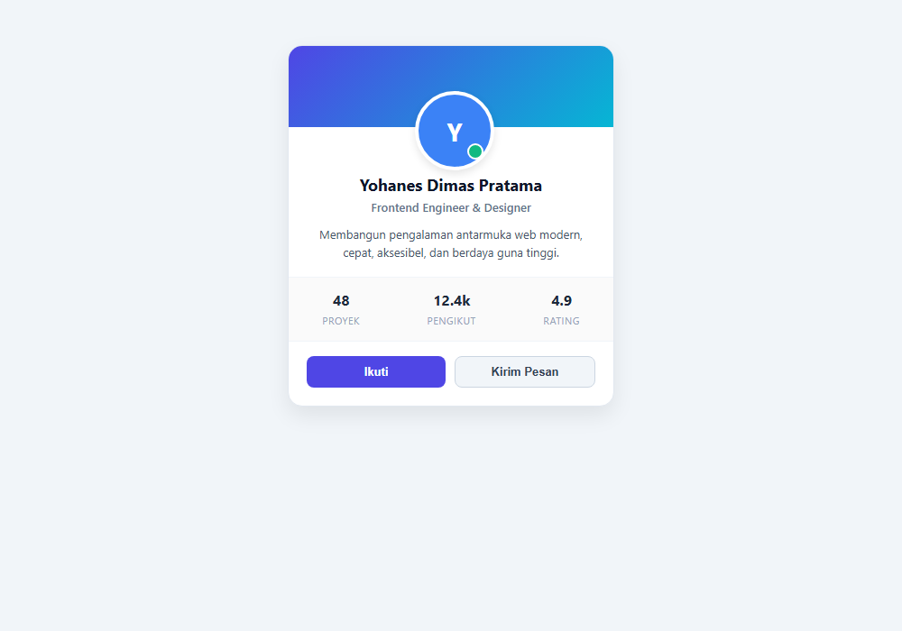
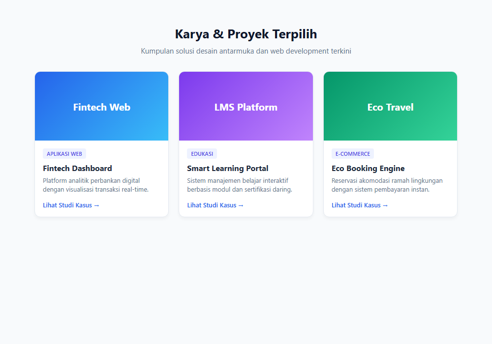
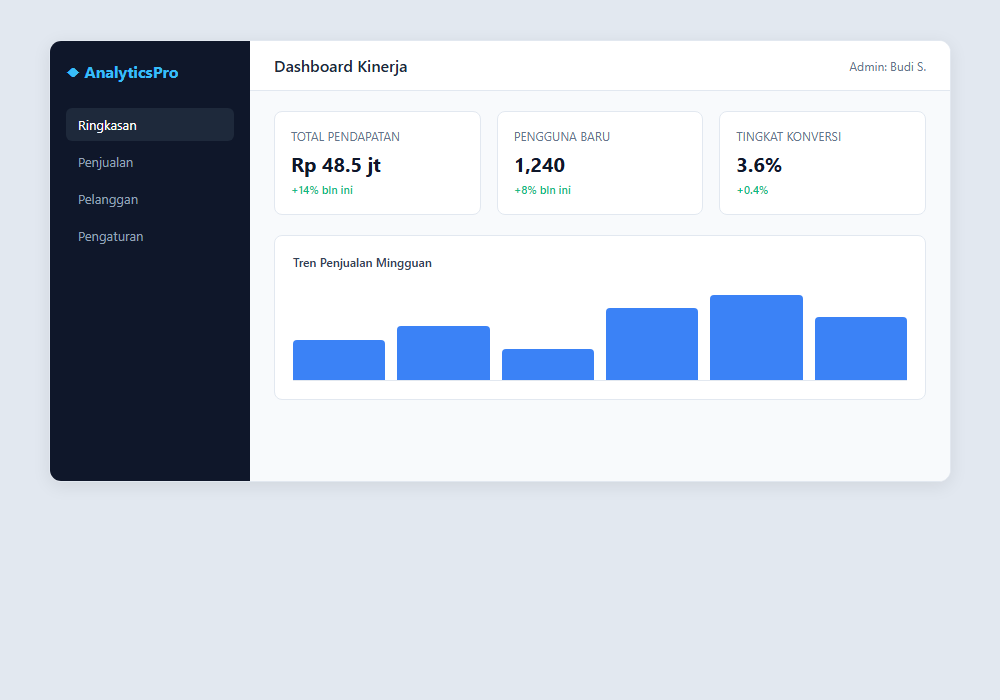
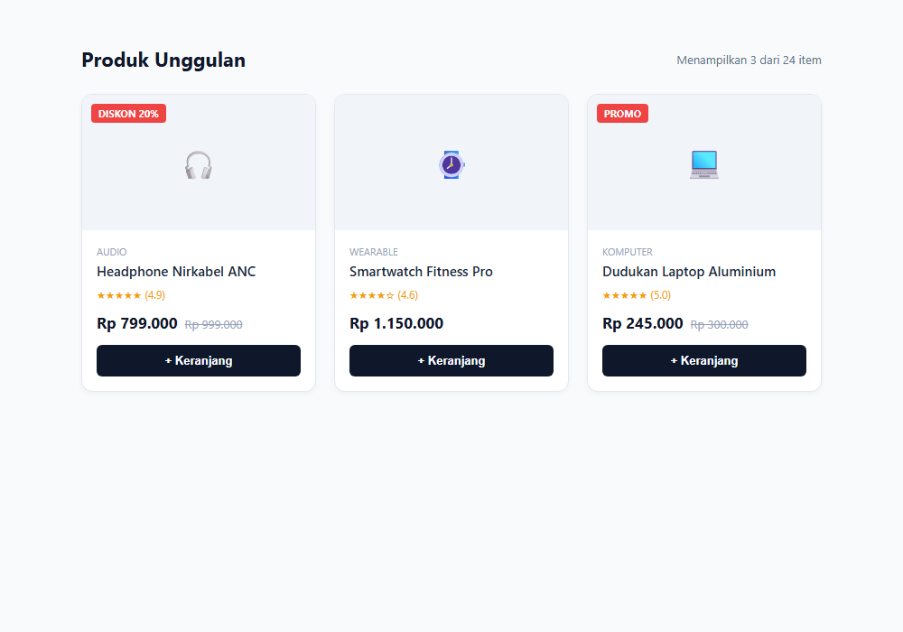
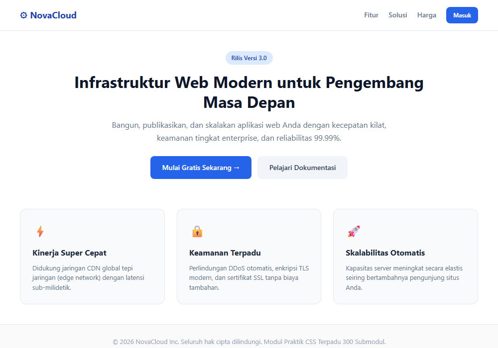

# Modul 18: Proyek Praktik CSS

## Ringkasan Ruang Lingkup Materi

Modul 18 merupakan modul kulminasi yang menyatukan seluruh kompetensi dari Modul 1 hingga Modul 17 ke dalam 5 proyek antarmuka web nyata (real-world projects): perancangan Kartu Profil Pengguna modern lengkap dengan avatar dan metrik statistik (296), halaman Portofolio Responsif dengan galeri proyek multi-kolom adaptif (297), tata letak Dashboard Web komprehensif berbasis CSS Grid dengan bilah navigasi dan kartu metrik KPI (298), tata letak Toko Daring (E-Commerce) lengkap dengan katalog produk, badge diskon, dan kartu produk komersial (299), serta perancangan Situs Web Lengkap (Full Landing Page) mencakup header navigasi melayang, hero section CTA, grid fitur unggulan, dan footer terpadu (300).

## Tujuan Pembelajaran Modul

- Mensintesis seluruh konsep CSS (Box Model, Flexbox, Grid, Tipografi, Warna, Efek, dan Responsivitas) pada kasus nyata.
- Membangun komponen antarmuka mandiri seperti kartu profil dan kartu produk dengan hierarki visual yang kuat.
- Mengimplementasikan sistem grid responsif yang menyesuaikan diri otomatis pada aneka resolusi layar.
- Merancang tata letak aplikasi kompleks dua dimensi (Dashboard) menggunakan CSS Grid tingkat mahir.
- Menyelesaikan halaman arahan web (landing page) profesional yang lengkap, estetis, dan memenuhi standar produksi.

## Daftar Submodul

- [296. Styling kartu profil](296_profile_card_project.css) — [Halaman Preview](296_profile_card_project.html)
- [297. Styling portofolio responsif](297_responsive_portfolio_project.css) — [Halaman Preview](297_responsive_portfolio_project.html)
- [298. Layout dashboard](298_dashboard_layout_project.css) — [Halaman Preview](298_dashboard_layout_project.html)
- [299. Layout toko daring](299_ecommerce_layout_project.css) — [Halaman Preview](299_ecommerce_layout_project.html)
- [300. Styling situs web lengkap](300_full_website_design_project.css) — [Halaman Preview](300_full_website_design_project.html)

---

## Pembahasan dan Penjelasan Submodul

### 296. Styling kartu profil

**Tujuan:** Merancang komponen kartu profil pengguna modern dengan integrasi avatar, badge status, informasi bio, dan metrik aktivitas.

**Konsep Utama:**
Kartu profil memanfaatkan Flexbox untuk perataan elemen vertikal dan horizontal, border-radius lingkaran untuk avatar, badge status online absolut, serta grid kecil untuk deretan angka statistik profil pengguna.

**Penjelasan Source Code:**
Mengatur kartu profil berlatar putih dengan bayangan lembut, header bergaya cover, avatar melingkar bergaris putih, dan tombol aksi interaktif.

**Source code utama:** [296_profile_card_project.css](296_profile_card_project.css)

**File pendukung preview:** [296_profile_card_project.html](296_profile_card_project.html)

**Cara Menjalankan:**
Buka file HTML pendukung di peramban web (Google Chrome, Microsoft Edge, atau Mozilla Firefox), atau gunakan Live Server / HTTP Server:

```bash
# Buka langsung file HTML di browser default
start "" "296_profile_card_project.html"
```

**Hasil yang Diharapkan:**
Kartu profil pengguna profesional dengan gambar header, foto avatar melingkar berstatus online, deskripsi bio, dan tombol follow.

**Screenshot Hasil Eksekusi:**



---

### 297. Styling portofolio responsif

**Tujuan:** Membangun tampilan halaman portofolio kreatif dengan banner hero dan galeri proyek responsif otomatis.

**Konsep Utama:**
Mengombinasikan CSS Grid dengan formula `repeat(auto-fit, minmax(260px, 1fr))` sehingga kartu portofolio beradaptasi tanpa perlu menuliskan banyak media query khusus, diperkaya dengan efek hover zoom gambar dan tag keahlian.

**Penjelasan Source Code:**
Menata container responsif, header perkenalan, serta grid kartu portofolio yang dilengkapi badge kategori dan transisi elevasi.

**Source code utama:** [297_responsive_portfolio_project.css](297_responsive_portfolio_project.css)

**File pendukung preview:** [297_responsive_portfolio_project.html](297_responsive_portfolio_project.html)

**Cara Menjalankan:**
Buka file HTML pendukung di peramban web (Google Chrome, Microsoft Edge, atau Mozilla Firefox), atau gunakan Live Server / HTTP Server:

```bash
# Buka langsung file HTML di browser default
start "" "297_responsive_portfolio_project.html"
```

**Hasil yang Diharapkan:**
Halaman galeri portofolio responsif yang tersusun dalam kolom adaptif dengan efek transisi interaktif.

**Screenshot Hasil Eksekusi:**



---

### 298. Layout dashboard

**Tujuan:** Menyusun struktur tata letak aplikasi dashboard komprehensif menggunakan CSS Grid dua dimensi.

**Konsep Utama:**
Tata letak dashboard modern dibangun dengan membagi area menjadi Sidebar navigasi vertikal, Header ringkas di atas, dan Konten Utama yang memuat kartu KPI serta grafik data visual murni CSS.

**Penjelasan Source Code:**
Mengatur grid layout induk dengan grid-template-columns untuk sidebar dan main, serta sub-grid kartu metrik.

**Source code utama:** [298_dashboard_layout_project.css](298_dashboard_layout_project.css)

**File pendukung preview:** [298_dashboard_layout_project.html](298_dashboard_layout_project.html)

**Cara Menjalankan:**
Buka file HTML pendukung di peramban web (Google Chrome, Microsoft Edge, atau Mozilla Firefox), atau gunakan Live Server / HTTP Server:

```bash
# Buka langsung file HTML di browser default
start "" "298_dashboard_layout_project.html"
```

**Hasil yang Diharapkan:**
Antarmuka dashboard analitik dengan navigasi bilah samping gelap, header pencarian, dan kartu statistik ringkas.

**Screenshot Hasil Eksekusi:**



---

### 299. Layout toko daring

**Tujuan:** Menyusun antarmuka katalog belanja daring (e-commerce) lengkap dengan filter kategori dan kartu produk komersial.

**Konsep Utama:**
Tata letak toko daring memadukan filter kategori, grid display responsif, serta styling kartu produk yang memuat penanda badge diskon (promo/sale), perataan harga coret, rating bintang, dan tombol beli terintegrasi.

**Penjelasan Source Code:**
Mengatur layout etalase produk, kartu produk dengan badge posisi absolut, info harga promosi, dan tombol aksi belanja.

**Source code utama:** [299_ecommerce_layout_project.css](299_ecommerce_layout_project.css)

**File pendukung preview:** [299_ecommerce_layout_project.html](299_ecommerce_layout_project.html)

**Cara Menjalankan:**
Buka file HTML pendukung di peramban web (Google Chrome, Microsoft Edge, atau Mozilla Firefox), atau gunakan Live Server / HTTP Server:

```bash
# Buka langsung file HTML di browser default
start "" "299_ecommerce_layout_project.html"
```

**Hasil yang Diharapkan:**
Katalog toko daring elegan dengan deretan kartu produk komersial bertanda promo dan tombol beli yang menarik.

**Screenshot Hasil Eksekusi:**



---

### 300. Styling situs web lengkap

**Tujuan:** Membangun stylesheet lengkap untuk halaman arahan web (landing page) profesional dari navigasi atas hingga footer penutup.

**Konsep Utama:**
Proyek pamungkas mengintegrasikan bilah navigasi lengket (sticky navbar), area utama penarik perhatian (hero section dengan headline dan call-to-action ganda), kisi fitur tiga kolom (features grid), dan footer berpenampilan profesional.

**Penjelasan Source Code:**
Mengatur struktur landing page menyeluruh dengan sticky header, hero banner kontras, grid fitur unggulan, dan footer terpadu.

**Source code utama:** [300_full_website_design_project.css](300_full_website_design_project.css)

**File pendukung preview:** [300_full_website_design_project.html](300_full_website_design_project.html)

**Cara Menjalankan:**
Buka file HTML pendukung di peramban web (Google Chrome, Microsoft Edge, atau Mozilla Firefox), atau gunakan Live Server / HTTP Server:

```bash
# Buka langsung file HTML di browser default
start "" "300_full_website_design_project.html"
```

**Hasil yang Diharapkan:**
Landing page situs web lengkap yang elegan, terstruktur, responsif, dan siap dipublikasikan.

**Screenshot Hasil Eksekusi:**



---

## Ringkasan Modul

Selamat! Modul 18 berhasil mengonversi teori dan konsep teknis CSS menjadi karya antarmuka nyata. Kelima proyek praktik ini membuktikan penguasaan penuh atas CSS modern dari dasar hingga tingkat arsitektur web profesional.

### Keterkaitan Materi
Seluruh submodul dalam modul ini dirancang secara berjenjang untuk membangun pemahaman yang kokoh dan aplikatif. Lanjutkan ke modul berikutnya setelah menguasai seluruh konsep di atas.
